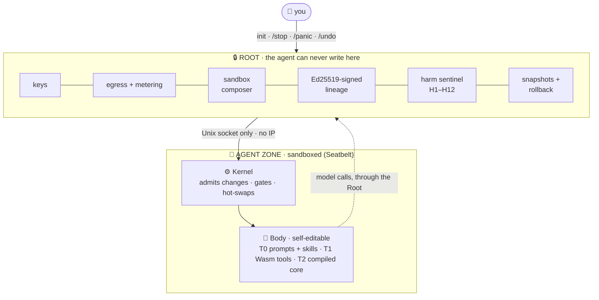
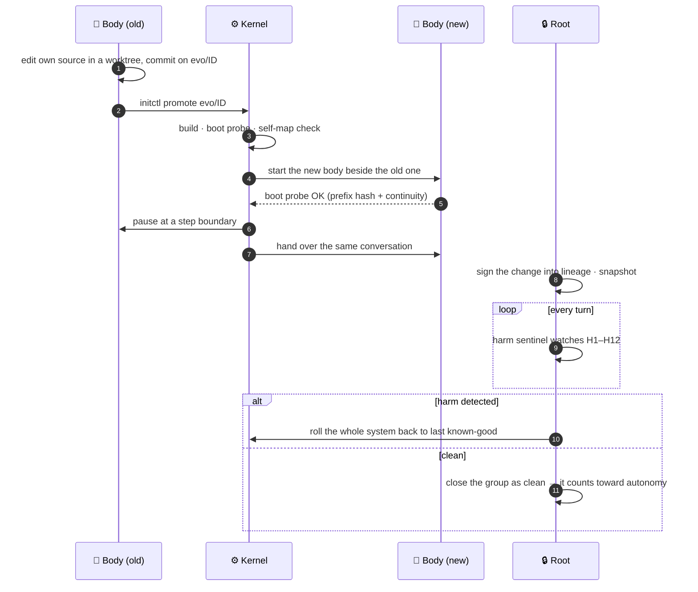
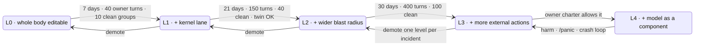

# INIT

**An agent harness built to grow with the model, not to cap it.**

INIT is a coding agent that can rewrite any part of itself: its prompts, its skills, its tools, even its compiled core. Around it sits one thing it can never change, the **Root**. The Root holds your keys, the sandbox and a signed record of every change, and it can always roll the agent back.

> Govern the recovery path and the measuring stick, never the model's choices.

## Why INIT exists

**Today's agents are built for models weaker than the people who build them.** The loop, the tools, the memory scheme, the planning heuristics and the approval gates are all decided by humans in advance. That works while the model is the weakest part of the system. As models approach and pass human level, every hand-written scaffold becomes a ceiling: the agent can only be as good as the harness someone designed for a dumber model.

**Self-improving agents exist, but they improve toward a reward that someone wrote beforehand**: a benchmark score, a test pass rate, a judge's grade. The capabilities a strong model most wants to build for itself are exactly the ones nobody can score in advance:
- a new kind of memory;
- a tool for a task nobody anticipated;
- a better way to plan;
- a different loop.

Gate self-modification on a predefined reward and you block the very growth you wanted.

**INIT's bet is the opposite default: give the model the whole harness, and govern only what must be governed.** It does not ask "prove this change is better before you keep it". It asks "can we always undo it, and did it cause harm?"

## The ideas

1. **The model owns its harness.** The agent's body is a Rust crate it can read and change, in three tiers:
   - **T0:** skills and prompts, including its own system prompt.
   - **T1:** new tools, as sandboxed Wasm components.
   - **T2:** its compiled core and loop, hot-swapped into the running conversation.
2. **Trust through reversibility, not proof** ([ADR-011](docs/adr/011-reward-free-self-extension.md)).
   - In `free` mode a change is admitted on mechanical checks only: it builds, it boots, it can be rolled back. No reward, no benchmark.
   - Every change opens a reversible change group. The Root watches for *generic* harm (crashes, refusals, your stops and undos, cost and error spikes) and rolls back the group that caused it.
   - Measurement still exists, but the agent opts into it (`Measure:`); it is no longer the price of every change.
3. **A small Root the agent can never change.**
   - It is minimal and mechanical. It holds keys, egress and metering, the sandbox, stop/panic, snapshots, the signed lineage and the harm sentinel.
   - It has no opinions about how the agent should think. It only guarantees that you can stop it, see it and undo it.
4. **Autonomy is earned from records, not granted by vibes.**
   - Levels L0–L4 rise with a clean record and your explicit `/grant`, and fall on harm or panic.
   - The agent can ask for more room; you answer in one line.
5. **What gets used survives.**
   - Capabilities the agent builds but stops using decay and are archived.
   - Ones that keep coinciding with trouble are quarantined.
   - The harness does not bloat; it evolves by use.

**The safety principle in one sentence:** the model may change anything except the thing that lets you stop it, see it and roll it back.

## How it works

### Three zones, one wall



The only security boundary is the wall between the Root and everything else. Inside the agent zone the model may change anything; the Root can always stop it, see it and roll it back.

### The life of a self-change



If the new body crashes at boot, nothing happens: the old one never stopped. Code changes, memory does not; the conversation is an append-only log with exactly one writer.

### Autonomy is earned, never claimed



Levels are computed only from records the Root writes itself (days, your turns, clean change groups, harm rollbacks); nothing the agent reports counts. This release caps autonomy at L0, which already allows the whole body.

## Under the hood

For the curious. Every item links to its design doc.

| | How | Why it is interesting |
|---|---|---|
| **Hot-swapping a compiled core** | Rust has no stable ABI, so the body is replaced by a fresh process: probe-first, overlapped, paused at a step boundary, then handed the same conversation ([ADR-001](docs/adr/001-overlapped-handoff.md)). | The process doing the swap is never the one being swapped. A failed swap is a non-event. |
| **Five gates** | G0 compiler (build, tests, clippy) · G1 self-map (the agent's inventory of itself must regenerate byte-for-byte) · G2 boot probe (prefix-hash and continuity) · G3 the new version must itself complete a scripted self-edit · G4 sealed regression ([gate.md](docs/kernel/gate.md)). | G3 stops a change that works today but breaks the ability to change tomorrow. |
| **A test set the agent never sees** | G4 draws from sealed task templates held by the Root, plus canaries for tamper, leak, impossible and health; paired cluster-bootstrap non-inferiority ([m7-design.md](docs/m7-design.md)). | Our one real result: a self-change the visible screen liked was not accepted by the sealed gate. |
| **Reward-free admission** | In `free` mode a change needs only mechanical checks A0–A5: it builds, boots, and can be rolled back ([ADR-011](docs/adr/011-reward-free-self-extension.md)). | No benchmark decides what the model may build for itself. |
| **A statistical harm sentinel** | 12 generic signals (crashes, refusals, your stops and undos, cost and error spikes), counted per session, each tested against a 40-session baseline ring at α = 0.005. | It detects harm without knowing what the change was for. |
| **A frozen twin** | A copy of the system from before the change replays your sessions nightly; an exact signed-rank test over 14 nights; report-only. | A slow counterfactual that never blocks anything. |
| **Selection by use** | Unused capabilities decay into an archive; ones that keep coinciding with trouble are quarantined by a Fisher exact test. | The harness evolves by use instead of bloating. |
| **The sandbox** | The Root composes Seatbelt profiles per process: no IP at all, one Unix socket to the Root's egress, a deny-list for your secrets, writes only to the workspace. | The agent never holds your API key; it cannot even open a TCP socket. |
| **Snapshots and lineage** | APFS clones before every change and before the agent can touch your folder; every promotion, rollback, grant and panic is Ed25519-signed into an append-only lineage (`init-root audit verify --full`). | Undo is a filesystem operation, and history cannot be rewritten. |
| **Memory and disk watchdog** | The Root polls every workload each second and kills a runaway process tree by PID; below the disk floor it refuses new work. | Added after a sandboxed process reached 43.9 GB of compressed memory in testing. |
| **Wasm tools** | T1 capabilities are WebAssembly components against a WIT interface, run by Wasmtime inside the body. | New tools without recompiling the core. |
| **Context** | Old tool output is masked first; then an anchored summary compaction; a full record stays on disk. | Long tasks without losing the log. |

About 200,000 lines of Rust in four workspaces (Root, kernel, body, TUI), plain `std` threads with no async runtime ([ADR-003](docs/adr/003-std-threads-no-async.md)), and a red-team suite against the real Root.

## Where we are, honestly

This is **v0.2.0-preview, a research preview for macOS on Apple silicon.** The machinery works:
- the self-edit → gate → hot-swap → rollback loop has run end to end on a real model;
- the Root has held every attack in our red-team suite;
- install takes about 30 seconds.

What we have **not** shown yet is that self-evolution makes today's models better:
- **The one real self-change on deepseek-flash was not kept.** Its sealed score was inside the measurement noise: it showed neither help nor harm.
- **Our missing-mechanism test found no task to test with.** Wherever INIT failed, Claude Code on the same model failed too. With a small model, the model is the bottleneck, not the harness.

That is the point of INIT. It is built for models that are strong enough to outgrow the scaffolds we give them. If you have access to such models, you are exactly who we want running it. Details: [Status](#status-v020-preview), the [technical report](reports/INIT%20technical%20report.md), [CHANGELOG.md](CHANGELOG.md).

**Spending is shown, not capped**, so set a spend limit at your provider (see [Spending](#spending)). Linux and Windows are not supported yet. Agents working on this repo start at [HANDOFF.md](HANDOFF.md).

## Get started

### Requirements

- macOS 14 or newer on Apple silicon (tested on an M2), with the Command Line Tools (`xcode-select --install`), which provide `git` and `/usr/bin/python3`. Linux is not supported yet (the sandbox is in progress), and Windows is unsupported.
- An API key. DeepSeek is the only provider used against a live API. OpenAI-compatible gateways, Anthropic Messages, OpenAI Responses and local servers are offered as **experimental** (offline tests only).
- Disk: about 0.5 GB for the install, plus the free-space floor you choose (default 20 GB).
- Optional: the Rust toolchain ([rustup](https://rustup.rs), 1.97 plus `rustup target add wasm32-wasip2`). Without it INIT runs and can change its own skills and prompts (tier T0). With it, INIT can also build new Wasm tools (T1) and rewrite its compiled core (T2): install Rust, then run `init-root toolchain --set`.

### Install

```sh
curl -fsSL https://github.com/nagisanzenin/init/releases/latest/download/get.sh | sh
init
```

`get.sh` downloads the prebuilt bundle, checks its SHA-256 and installs it with default answers (no Rust, no sudo, no key). The first `init` opens a short setup: choose a provider, paste your key (shown only as `•`; it goes to the Root, never to the agent or a log), and pick a model. Later, `/model`, `/key` and `/setup` change them. `get.sh --from <bundle.tar.gz>` installs a downloaded bundle.

To build from source instead (about 15 minutes on an M2, Rust required): `scripts/install.sh`, then `init`.

The installer never touches your key. It writes `~/.init-root/` (the Root: your charter, keys, signed lineage) and `~/.init/` (the agent's world). It puts the `init` command and the TUI `init-tui` in `~/.local/bin/`: `init` opens the TUI, or the plain `init-root attach` terminal when the TUI is not installed, and `init --which` shows which. It also loads the LaunchAgent `dev.init.root`, which keeps the Root running and starts it at login. Use `--no-service` to skip the service and run `init-root start --foreground` yourself.

## Daily use

| You want to | Do |
|---|---|
| chat or give a task | `init`, type a line, press Enter. Ctrl-C interrupts the current turn; Ctrl-D detaches and INIT keeps running. |
| work on a project | `cd` into it and run `init`. The agent can read your home, except secrets (`~/.ssh`, cloud credentials, keychains, browser and mail data), and edit only that folder and its own `~/.init`. Run from `~`, `init` lets it read but not edit. |
| let it edit anywhere in your home | `init --full`, or `/full on` in the chat; the first time you type `/full on confirm`. `FULL` shows in the status bar; `/full off` ends it. Secrets, `~/.init-root` and `~/Library/LaunchAgents` stay off-limits. |
| undo the agent's edits | when the agent is idle, `/undo`, then `/undo confirm`: the folder goes back to the snapshot the Root took when you ran `init` there. The state it replaces is saved first, so an undo can be undone. Folders over 2 GiB or not on APFS get no snapshot. |
| keep the agent out of a folder | add it to `read_deny` under `[sandbox]` in `~/.init-root/charter.toml`, then `init-root charter check --apply`. `read_home = false` turns home reads off; `allow_full = false` disables `--full`. |
| see what it has spent | `/usage` in the chat, or the status bar (estimated USD and tokens). `init-root egress stats` prints the Root's full money block; it says `"enforced": false`. Every request is logged in `~/.init-root/egress/usage/`. |
| stop the current run | `/stop` in the chat, with no demotion. `/resume` starts it again. |
| stop everything, now | `/panic` in the chat, or `init-root panic` from any terminal. Every agent process stops, the panic is latched, and the agent drops one autonomy level (when it is above L0). `/resume` (or `init-root resume`) when you are ready. |
| stop for the day (no demotion) | `init-root stop`; later `init-root start` |
| see state and level | `init-root status` (slot, mode, level and cap, panic, charter), `init-root ledger` (level history and progress); `/status` in the chat for the kernel's view |
| answer the agent's request for more room | `/grants` lists open requests; `/grant <id> [for <n>d\|<n>h]` approves one with a typed confirmation; `/deny <id>` refuses it. |
| see the frozen twin | `/twin` shows the nightly shadow-replay report (report only; it changes nothing). |
| change the charter | edit `~/.init-root/charter.toml` (autonomy cap, sandbox, memory cap, disk floor, `[extend]`), then `init-root charter check --apply` |
| change the model | edit `~/.init/kernel/config.toml`, then `init-root stop && init-root start`. The `[budget]` dollar values there are not enforced while the Root reports observe-only money. |

`init-root` lives in `~/.init-root/bin/`; add it to your PATH or use the full path.

Where things are:
- Root logs: `~/.init-root/logs/` (`launchd.log` for the service).
- Kernel and body logs: `~/.init/state/kernel/logs/`; conversations: `~/.init/state/sessions/`.
- Every metered request with its usage and estimated cost: `~/.init-root/egress/usage/`. Every promotion, rollback, panic, grant and charter change: `~/.init-root/lineage/lineage.jsonl`, signed; check it with `init-root audit verify --full`.
- The agent's own source and history: `~/.init/body/` and `~/.init/lineage/`.

## Spending

Since 2026-10-23 (owner decision) the Root **observes** spending and does not cap it:

- The Root records every model request with the provider's reported token usage and an estimated cost from the charter's tariffs. When a provider reports no usage, the Root keeps the reservation estimate and marks token totals incomplete; it never counts unknown usage as zero.
- You see the estimates in the status bar, with `/usage` and with `init-root egress stats`. They are estimates, not invoices.
- The Root does **not** refuse, stop or demote anything when a dollar amount is reached. The charter's `day_usd`, `total_usd` and the twin's dollar keys are kept as metadata. The kernel's dollar soft budgets are switched off as well.
- Non-dollar limits are still enforced: per-class request counts, bytes per day and rate per minute, a bounded output size on every request, and the time and token limits of runs.
- You stop spending with `/stop`, `/panic` or `init-root stop`.

**The risk, plainly:** a self-modifying agent can keep making model requests, and so keep spending, until you stop it. **Set a spend limit at your provider.** For DeepSeek, which bills against a prepaid balance, keep that balance small. Check `/usage` while it works.

## Safety model

1. **The Root** (`init-root`) is a separate process the agent can never write. It holds your key, your charter and the signed lineage, and it runs the agent only inside a macOS sandbox (Seatbelt) it composes. The sandbox has no network; the agent reaches the model provider only through the Root.
2. **Spending is observed, not capped** (see [Spending](#spending)). The Root meters and logs every request; you stop it.
3. **Rollback.** In the default `gated` mode every self-change passes the gate (G0–G4) first. The Root keeps the last known-good system and rolls back the whole tuple when a change fails, and a panic demotes.
4. **Self-extension (ADR-011).** The charter key `extend.mode` chooses `gated` (the default) or `free`. In `free` mode a change is admitted after mechanical checks only (A0–A5), and the Root then watches it: a harm sentinel (signals H1–H12, such as crashes, refusals, owner stops and undos, cost and error spikes) rolls back the change group that caused harm, using Root-held snapshots and a rollback probe. Autonomy levels L0–L4 are earned from records and owner grants, but **this build caps autonomy at L0**.
5. **Memory and disk.** The Root polls every workload each second. A tool call's process tree that passes `sandbox.mem_cap_mib` (default 4096 MiB) is killed alone, by pid. Below `sandbox.disk_floor_gib` (default 5 GiB) free, the Root refuses new workloads and kills the running ones. The Root and the kernel are never killed.
6. **Owner-machine mode (ADR-008).** On your live account the Root signals only the processes it holds, by PID; the process sweep (`live-sweep`) is compiled out. Enabling it still requires the disposable-account tests first ([docs/adr/](docs/adr/)).
7. **Permissions (ADR-009).** The agent reads your home except a deny list of secrets, and writes only `~/.init` plus the folder you ran `init` in (your whole home with `--full`). It can never touch `~/.init-root`, your keys or the lineage. Anything it reads may be sent to the model provider, as with Claude Code or Codex. The Root snapshots the folder before the agent can edit it, and `/undo` restores it. In every mode it can never write your shell startup files, git config, git hooks, `~/.local/bin`, `~/bin` or login items. A file it writes in the project (a Makefile, a test, a package script) may still run with your full rights when you run it, so review what you run from a project it edited.

## Uninstall

```sh
scripts/uninstall.sh
```

It stops INIT through `init-root stop`, unloads the LaunchAgent, then, after you type `uninstall`, **moves** `~/.init-root`, `~/.init` and the `init` command to the Trash (with a timestamp in the name). Nothing is deleted: empty the Trash yourself. Your key file goes to the Trash with `~/.init-root`.

## Status (v0.2.0-preview)

**What works and how it was checked:**
- **macOS CI.** The full `ci/local.sh` passes on macOS: 1,807 tests at $0 on the mock model. Three `kernel-selfmap` tests can time out when the machine is heavily loaded, and they pass when run alone.
- **Install and a live turn.** The prebuilt bundle installs without Rust in about 30 s. A real DeepSeek turn through it cost about $0.002, and the key stayed in one 0600 file the agent cannot read.
- **The gated self-edit loop ran end to end on a real model** (deepseek-flash, $2.67, 2026-10-21): the evolution engine found a failure pattern in the agent's own runs, the agent wrote a change, passed gates G0–G3, was hot-swapped into the running session, and the sealed gate G4 sent it back with an automatic rollback. That run used the code of 2026-10-21, before ADR-011 and the spending change.
- **The Root held every attack tried** in a $0 red-team suite against the real Root (in test mode): self-declared prices, unknown providers, forged lineage, forged owner commands, a forged L3 command. The one gap found, RT-GAP-1 (self-reported promotions could unlock L1), was latent under the L0 cap and is now closed.
- **MEM-RUNAWAY is fixed on macOS**: the memory watchdog and disk floor above. It was found when a sandboxed process reached 43.9 GB of compressed memory in a test run.
- **ADR-011 self-extension is built**: free and gated modes (default gated), the harm sentinel, snapshots and the rollback probe, per-capability attribution, selection by use (decay, archive, quarantine), records-based levels with `/grant` and `/deny`, and the frozen twin. It is tested at $0, including end to end against the real Root with the mock model. The free path has not run on a real model.

**What is not shown:**
- **There is no evidence yet that self-evolution improves results.** The one real self-change was not kept, and its sealed result (−5 points) was inside the measurement noise, so it shows neither help nor harm. The ADR-011 evolution test on deepseek-flash found no task where INIT failed but a missing mechanism was to blame (where INIT failed, Claude Code on the same model failed too), so its evolution phases never ran. See the [verdict](reports/INIT%20proof%20sprint%20verdict.md) (in Vietnamese; erratum and evolution test at the end), the [technical report](reports/INIT%20technical%20report.md) and the [evolution test protocol](measurements/evo-test-protocol.md) §10–§11.
- **Real-model coverage of this release is one smoke turn on DeepSeek.** Everything else since the spending and provider changes is checked at $0.
- **Linux is not supported yet.** The Linux sandbox groundwork passed some isolation tests on cloud CPUs, but the native build test failed and its fix is not yet qualified; there is no Linux memory limit (cgroups) yet. **Windows is unsupported.**

**Providers:**
- **DeepSeek** (`deepseek-flash`, `deepseek-v4-pro`) is the only provider used live and the only one the installer offers.
- **Experimental:** OpenAI-compatible Chat Completions gateways, OpenAI Responses, Anthropic Messages and local servers on loopback without a key. They exist as code with offline tests, configured by hand ([docs/provider-configuration.md](docs/provider-configuration.md)), and none has been tested against a live endpoint. Native Gemini, Ollama's native API, Bedrock, Azure and Vertex authentication are not built.

**Other limits:**
- Autonomy is capped at **L0** in this build, so kernel self-evolution (L1 and up) is not available.
- The `free` mode's false-rollback rate under strongly clustered sessions measured 3.09% in simulation, above its 2.5% bound; measure it on real use before making `free` the default.
- A kernel could bypass the Root's `root.unwatched_change` check through a wrapper or an interpreter (relevant only above L0).
- There is no sub-agent runtime: `fleet_spawn` answers "not built".
- The off-machine lineage mirror is off until you create its repository.

Open owner decisions and measurements are listed in [RELEASE_PLAN.md](RELEASE_PLAN.md) and [HANDOFF.md](HANDOFF.md).

## Docs

- [`INIT Agent spec.md`](INIT%20Agent%20spec.md): the design and its source of truth.
- [`docs/overview.md`](docs/overview.md): the whole picture and the doc map. [`docs/CONVENTIONS.md`](docs/CONVENTIONS.md): layouts and global decisions.
- [`docs/root/root.md`](docs/root/root.md): the Root, the charter (§3.12) and the CLI (§4.3). [`docs/root/egress.md`](docs/root/egress.md): the egress and the observe-only money policy.
- [`docs/kernel/config.md`](docs/kernel/config.md): `kernel/config.toml`. [`docs/provider-configuration.md`](docs/provider-configuration.md): experimental provider setups.
- [`docs/adr/011-reward-free-self-extension.md`](docs/adr/011-reward-free-self-extension.md): the current self-extension design.
- [`reports/INIT technical report.md`](reports/INIT%20technical%20report.md): the research write-up.
- [`docs/release.md`](docs/release.md): how a release is cut. [`CHANGELOG.md`](CHANGELOG.md). [`docs/release-notes/`](docs/release-notes/).
- [`docs/adr/`](docs/adr/): the architecture decisions. [`reports/`](reports/) and `research_notes/`: the research behind the design.

## License

Apache License 2.0: see [LICENSE](LICENSE) and [NOTICE](NOTICE). The vendored crates under `vendor/` keep their own licenses.
