<p align="center"></p>

INIT is a coding agent that rewrites its own harness while it works. The harness is everything around the model: prompts, tools, the loop, how context is kept. People write it by hand for the models they have, and Sutton's bitter lesson says hand-built structure loses to learning and scale. Once a model outgrows its designers, each scaffold is a ceiling. So INIT lets the model change its own harness, compiled Rust core included, mid-task. One part stays fixed: the Root, a separate process the agent cannot modify, which checks each change, records it in a signed log and can undo it.

```sh
curl -fsSL https://github.com/nagisanzenin/INIT-Agent/releases/latest/download/get.sh | sh
```

Then open a new terminal and run `init-agent`. The first run asks you to pick a provider, paste your key and pick a model.

macOS 14+ on Apple silicon; Linux x86_64 is experimental. Upgrades, Linux setup and removal: [Install, upgrade, uninstall](docs/guide.md#install-upgrade-uninstall).

To uninstall (everything goes to the Trash): `/bin/bash -p -c 'f="$(/usr/bin/mktemp)" && /usr/bin/curl -q -fsSL https://raw.githubusercontent.com/nagisanzenin/INIT-Agent/main/scripts/uninstall.sh -o "$f" && /bin/bash -p "$f"'` (installed with a custom `INIT_ROOT_HOME`: put `INIT_ROOT_HOME=<that directory>` in front)

## How it works

```text
  you:  init-agent · /stop · /panic · /undo · /rollback
   │
   ▼
╔═ ROOT · init-root, a separate process the agent cannot write ════════════╗
║                                                                          ║
║  holds   your API keys · your charter · its signing key                  ║
║          the signed lineage · the spend ledger · snapshots               ║
║  does    starts every agent process in a sandbox it composes             ║
║          adds your key to each model call and meters it                  ║
║          harm signals · stop and panic · memory and disk watchdog        ║
║          rolls the whole system back to a known-good version             ║
║                                                                          ║
╚═════════════╤═══════════════════════════════════════════▲════════════════╝
              │ starts, sandboxes,                        │ every model call
              │ rolls back                                │ (no key on this side)
              ▼                                           │
┌─ AGENT ZONE · sandboxed, holds no API key ──────────────┴────────────────┐
│                                                                          │
│  kernel  gates each change and hot-swaps the body      editable from L1  │
│  body    T0  prompts and skills                        editable now (L0) │
│          T1  tools, as Wasm components                                   │
│          T2  the compiled Rust core and its loop                         │
│                                                                          │
└──────────────────────────────────────────────────────────────────────────┘
```

A change to the compiled core takes five steps. Prompts, skills and Wasm tools skip the process swap and reload in place.

1. **Edit a copy.** The agent edits its source on a branch beside the running body.
2. **Gates.** G0 builds it and runs the tests and clippy. G1 regenerates the self-map (`self.json`, its inventory of itself) byte for byte. G2 boots the new binary beside the live one and probes it. G3 has the new version complete a self-edit, so a change cannot break the ability to change. If a gate fails, nothing happened: the live body never stopped.
3. **Hot-swap.** At a turn boundary the new process takes over the same conversation log. Rust has no stable ABI, so a new core always runs as a new process ([ADR-001](docs/adr/001-overlapped-handoff.md)).
4. **Watch.** In the default `gated` mode, a sealed test (G4) on tasks the agent never sees decides whether the change stays; a fresh install has no such tasks, so G0–G3 decide. In `free` mode the Root watches each change for 2 to 72 hours with twelve harm signals, such as crashes, your `/rollback`, and spikes in cost or errors measured against your own recent turns ([ADR-011](docs/adr/011-reward-free-self-extension.md)).
5. **Roll back.** A failed G4, a crash, a harm signal, `/rollback` or `/panic` returns the system to a known-good version, with a signed record.

No step asks a change to prove it is better, because nobody can write the score for a capability nobody foresaw. The Root checks what it can check for any change: can it be undone, and did it cause harm?

**The Root is the fixed part.** `init-root` is its own service (a LaunchAgent on macOS, a systemd user unit on Linux) with its own directory, `~/.init-root`, which holds your keys, your charter (the settings), its Ed25519 signing key, the signed lineage, the spend ledger and the snapshots. It starts every agent process in a sandbox it composes (Seatbelt on macOS, bubblewrap on Linux), adds your key to each model request and meters it, and signs a record of every promotion, rollback, grant and panic. That sandbox, in every access mode, denies the agent the Root's files, its service file, INIT's launchers and signals to the Root. The Root is 26,354 lines of Rust in v0.5.4, without tests: `init-root` 22,967 and its sandbox profiles 3,387 ([REL-054](build/status/REL-054.md)). [root.md §4.8](docs/root/root.md) gives the command, and counts separately the part that the two guarantees in [foundations.md](docs/foundations.md) rest on, its trusted computing base: 8,318 to 12,562 of those lines.

**Why a compiled core and not plugins?** A plugin API fixes in advance where the model may extend the agent. What a stronger model is likely to want to change sits elsewhere: how context is compacted, how the loop retries, how requests are laid out so the prompt cache keeps hitting. That code is the core, so the core is editable (T1 Wasm tools are the plugin path). The cost is time. A no-op core change on a fresh v0.5.0 install, built cold, took 788 s (13.1 min) from G0 to the hot-swap (M2, mock model, load not recorded, [receipt](build/status/bundle-e2e-t2.json)). The v0.5.2 release check took 1,831 s for the same path, with CI running beside it ([receipt](build/status/bundle-e2e-t2-v0.5.2-macos.json)). With a warm dependency cache, a small change's build and G0 took 126 s (M2, load 10–23, measured before v0.5; [MERGE-T2CACHE](build/status/MERGE-T2CACHE.md)), and the later gates were not timed. The guide lists every measurement with its load ([Time](docs/guide.md#install-upgrade-uninstall)).

## What it has done

- **It wrote itself a sub-agent tool** (v0.2.0-preview, a small model, 2026-10-24). Asked for sub-agents, INIT wrote a `delegate` tool on its own branch: a nested loop with a fresh context and the same prompt head (so the cache still hits), at most 8 turns and 24 tool calls, no recursion, only a summary returned. It never promoted itself (stale tests, then a 900 s build limit we later raised); v0.3's built-in `delegate` is built on it ([tools.md §3.7](docs/body/tools.md), [REL-G0](build/status/REL-G0.md)).
- **It swapped its compiled core mid-conversation and kept the cache** (v0.1, deepseek-flash, 2026-10-20). A comment-only core change from the test harness passed G0–G3 and was handed to the running session. The first request after the swap read 5,888 of 6,696 prompt tokens from DeepSeek's cache, 87.9% ([real-v0.1.md](measurements/real-v0.1.md), E2E-3).
- **A sealed test refused its own change, and the rollback is signed** (pre-v0.2 code, deepseek-flash, gated mode, 2026-10-21). From its own failed runs the agent wrote a change to its `bash` tool, which passed G0–G3 and went live. G4 scored it 5 points worse (d = −50‰, 29 tasks × 3 runs, inside the noise), and the gate rolled it back ([m7-results.md](measurements/m7-results.md), [technical report](reports/INIT%20technical%20report.md)).
- **A guardrail rolled back a bad change in 3.8 s** (v0.4.0-preview, deepseek-flash, free mode). In a `/goal` test run, a deliberately bad change raised cost per turn by 137%; the Root rolled it back to its parent and kept the good change before it ([v0.4.0 notes](docs/release-notes/v0.4.0-preview.md)).

**Not shown yet:** that self-changes make a model better. The one change the sealed test measured was not kept, and a test built to find tasks INIT fails for lack of a mechanism found none on deepseek-flash: where INIT failed, Claude Code on the same model and budget failed too ([evo-test protocol §11.8](measurements/evo-test-protocol.md)). If you run frontier models, we would like your results.

## Safety model

- **Full access by default.** The agent reads and writes anything you can and uses the network, including files your own tools run later (shell startup files, `PATH` directories, git hooks), so trust it as you trust your shell. The Root protects INIT, not your files; `/undo` restores only the folder you started in ([ADR-012](docs/adr/012-full-access-by-default.md)).
- **Workspace mode** (`init-agent --workspace` or `/full off`). The agent reads your home except secrets (`~/.ssh`, cloud credentials, keychains, browser and mail data), writes only the start folder and `~/.init`, and reaches only the model provider. From 0.5.1 on macOS it also cannot redirect git's config or hooks there, or `git init`. On Linux it stays in its own home.
- **Spend is metered, not capped.** The Root records each request's estimated cost; no dollar amount stops INIT. Set a limit at your provider ([Spending](docs/guide.md#spending)).
- **Keys never reach the agent.** The key you paste goes to the Root, which adds it to each request on the way out.

## Status and limits

INIT 0.5 is a research preview.

- **Tested:** DeepSeek (deepseek-flash, deepseek-v4-pro) on the live API, and OpenAI's gpt-6.1-sol, qualified live on v0.5.2 (2026-10-29: streaming, a tool round trip, pause and resume, the cache, and the Root's token counts and bill equal to the provider's usage at list price; [receipt](build/status/qualify/openai-gpt-6.1-sol-v0.5.2.json)); v0.5.3 changed how a cut request is booked and has not been re-qualified yet. At $0 on a mock model, the v0.5.3 bundles on macOS and on Linux x86_64 (a hosted Ubuntu 24.04 VM): install, a core change through the gates and the hot-swap on both; on macOS, upgrades from every public release since 0.3.1 (or the uninstall they need) and an upgrade that kept an evolved body. The core change and the evolved-body upgrade on macOS ran on the candidate's bundle, before its one later change (`/undo` waits for the next heartbeat); the shipped bundle ran install, pause and the upgrades from each release. 2,273 Rust tests passed in CI on macOS (the v0.5.3 candidate); one TUI end-to-end test failed, was fixed before the tag and passed ([REL-053](build/status/REL-053.md)). Releases from v0.5.3 are signed: release key 1, `SHA256:IS7wIWkppZkHSUwdnsJR+K4fBPkmPa/IJwfNi9sIoMs` ([how to check](docs/release-signing.md)).
- **Not tested or not built:** Anthropic, OpenAI's gpt-6-astra and API gateways on a live API (offline tests only); a Linux aarch64 bundle for 0.5.x; autonomy above L0 (L0 already covers the whole body; the kernel opens at L1); Windows.

## Docs

[User guide](docs/guide.md) · [technical report](reports/INIT%20technical%20report.md) · [design decisions (ADRs)](docs/adr/) · [release notes](docs/release-notes/) · [changelog](CHANGELOG.md) · [release protocol](docs/release-protocol.md)

Apache-2.0. See [LICENSE](LICENSE) and [NOTICE](NOTICE).
