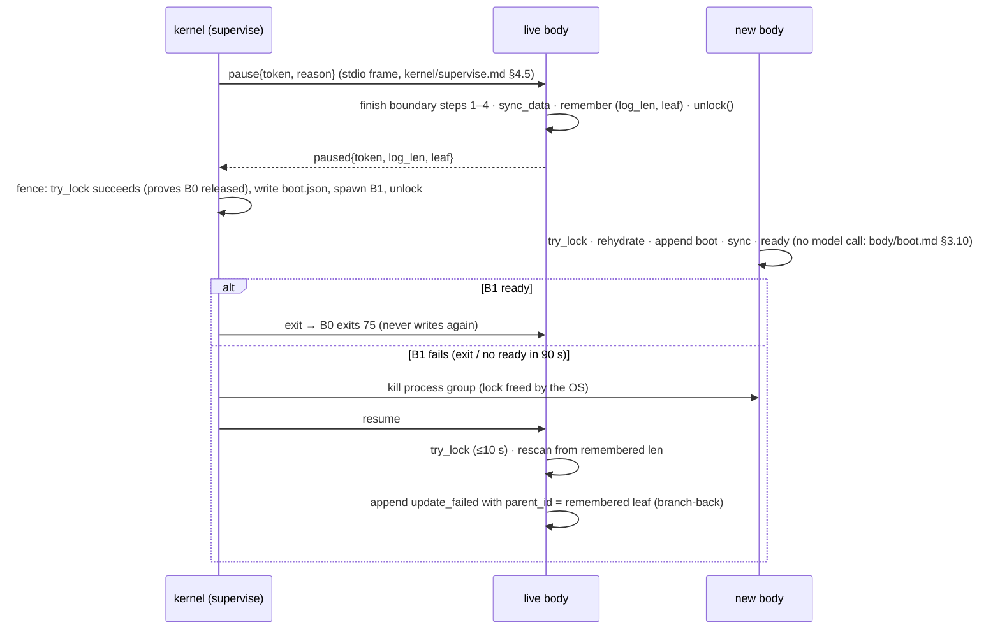

# Event log, context assembly, caching and compaction

```
Status: v0.3 + build sync 2026-10-20 · Area: body
Depends on: CONVENTIONS.md, spec v0.2 (§4, §5, §7.1, §9, App. A–B), awareness.md (texts rendered into
            the log), body/provider.md (wire types, CacheProfile), body/loop.md (turn boundary, steering,
            abort), body/tools.md (tool registry, spill files), body/boot.md (boot order, boot facts),
            kernel/supervise.md (stdio frames, boot.json, env vars, handoff pause), kernel/proxy.md
            (/_init/stats, head-hash recomputation), kernel/gate.md (G2), kernel/selfmap.md (markers),
            ext/host.md (T1 reload report), evolution.md (§4.5 event fields), testing.md (F-corrupt-tail)
Defines:    event envelope and every event type (JSON Schema, format 1); session files and the
            state/session pointer; the single-writer lock; append and durability policy; torn-tail
            recovery; tree operations (leaf, branch, label); rehydration; the bounded in-memory view;
            the projection (log → context); INIT canonical JSON (ICJ v1); the head and its hash
            (prefix_hash); per-provider prompt layout and cache-breakpoint policy; context epochs;
            the masking policy and placeholder text; compaction (trigger, cut, anchored summary, prompt,
            artifact index); placement of self-signals and kernel notices; token estimation and
            calibration
```

---

## 1. Purpose

This doc fixes three things that must never drift once the body is built:

1. **What happened.** The session log is an append-only JSONL tree. It is the agent's whole memory of a conversation, it survives every restart and swap, and it is never rewritten.
2. **What the model sees.** The context is a pure function of the log path from the leaf to the root, plus the current head (the genesis prompt, the constitution, `SELF.md`, the skills index and the tool schemas). The same log gives the same bytes in any process, on any version of the body that keeps this contract.
3. **What it costs.** Prompt-cache stability is lever #1 of spec §9. A cache miss costs about 17× the input of a cached step on Opus 5.5 and about 30–50× on DeepSeek V4. Every rule below that looks pedantic (sorted keys, stored rendered text, edits batched into epochs) exists to keep the cached prefix byte-identical.

## 2. Responsibilities / non-goals

**This doc owns:**
- the event envelope and the JSON Schema of every event type;
- the session files, the session pointer, locking, durability and crash recovery;
- the tree semantics: leaf, branching, labels;
- rehydration and the bounded in-memory view;
- the projection from log to model context, and the head;
- ICJ (the canonical JSON used for anything that reaches a prompt or a hash) and the head hash;
- the abstract prompt layout per provider, which bytes are cacheable, and where Anthropic cache breakpoints go;
- masking, compaction and their texts;
- where self-signals and kernel notices are placed (awareness.md owns their content);
- token estimation.

**Non-goals (owned elsewhere):**
- Wire-level field spelling, SSE parsing and the normalized stream events: body/provider.md. This doc states what the adapter must put where. Provider.md decides how.
- The loop's control flow, parallelism, steering queue and abort: body/loop.md. This doc defines the turn-boundary hooks the loop calls.
- Tool schemas and spill-file creation: body/tools.md.
- The texts of the genesis prompt, constitution, `SELF.md`, environment snapshot, boot events and signals: awareness.md.
- `boot.json`, the user channel, the handoff pause and env vars: kernel/supervise.md.
- Proxy stats and traces: kernel/proxy.md. G2's checks: kernel/gate.md.

## 3. Design

### 3.1 Overview

```
 owner ─(user channel)─┐        kernel notices (gate, update_failed, …) ─┐
                       ▼                                                   ▼
             ┌──────────────────── body ─────────────────────────────────────────────┐
             │ loop ──append──▶ LogWriter ──▶ state/sessions/<sid>.jsonl (append-only)│
             │   │                 │                                                 │
             │   │           in-memory View (index + active window)                 │
             │   ▼                 ▼                                                 │
             │ context: Head (stable) + Projection(path leaf→root, epoch rules)      │
             │   │   ICJ render, per-message byte cache, head hash                   │
             │   ▼                                                                   │
             │ provider adapter (CacheProfile) ──HTTP/1.1+SSE──▶ run/proxy.sock       │
             └───────────────────────────────────────────────────────────────────────┘
```

Three properties hold everywhere:

- **P1, append-only.** A byte once written to a session file is never changed or removed. A torn or corrupt line stays where it is and is skipped by every reader (§3.4.4).
- **P2, render once.** Any text the body synthesizes for the model (boot block, signals, summaries, placeholders, kernel notices) is rendered once, when its event is appended, and stored in the event's `text` field. Later projections replay the stored bytes. A newer body with a different renderer therefore cannot silently change old context, which would break the cache after a T2 swap without changing the head hash.
- **P3, epochs.** Within an epoch, the rendered message list only grows at the end. Anything that rewrites earlier context (masking, compaction, a head change) starts a new epoch. Epochs start only at a turn boundary, and only when a threshold or an explicit request says so.

Code layout: `src/log/` holds the event log (`icj`, `clock`, `event`, `writer`, `index`, `session`), `src/context/` holds the head, hash, projection, render, mask, compaction and the `Context` engine, and `src/sha256.rs` holds SHA-256.

### 3.2 Files, identifiers, time

| Item | Format | Notes |
|---|---|---|
| Session file | `$INIT_HOME/state/sessions/<sid>.jsonl` | one event per line, LF-terminated, UTF-8, ICJ (§3.8) |
| Session id `<sid>` | `YYYYMMDD-HHMMSS-<6 hex>` (UTC), e.g. `20261019-203015-9f3a2c`; any id matching `^[0-9A-Za-z._-]{1,64}$` is accepted | chosen **by the kernel** at spawn when `state/session` is missing or invalid; it is always sent as `INIT_SESSION` (kernel/supervise.md §3.4). Generated **by the body** for `/new` (§3.5), and defensively when `INIT_SESSION` is empty, which happens only in tests and manual runs |
| Session pointer | `$INIT_HOME/state/session` | `<sid>\n`; written only by the body, atomically (tmp + `rename`); the kernel reads it at the next spawn and passes it as `INIT_SESSION` |
| Lock | `flock(LOCK_EX)` on the session file itself, via `File::try_lock` | §3.4.1 |
| Blobs | `state/blobs/<sha256 hex>.<ext>` | images and other binary content referenced by events |
| Spill files | `state/spill/<sid>/…` | owned by body/tools.md §4.4; events only point at them (`spill_path`) |
| Event id | 16 lowercase hex (`^[0-9a-f]{16}$`), never all zeros | random 64 bits; unique within the file (checked against the index) |
| `ts` | RFC 3339 UTC with milliseconds, `2026-10-19T20:30:15.123Z` | informational only; order is file order, never `ts` order |

Event ids come from `std::hash::RandomState` (randomly keyed SipHash) over `(nanos since epoch, pid, per-process counter)`. This needs no RNG crate and no `unsafe`. A collision with the index is regenerated.

```rust
use std::hash::{BuildHasher, RandomState};
use std::time::{SystemTime, UNIX_EPOCH};

pub struct IdGen { keys: RandomState, counter: u64, pid: u32 }

impl IdGen {
    pub fn next(&mut self, taken: &impl Fn(u64) -> bool) -> u64 {
        loop {
            self.counter += 1;
            let nanos = SystemTime::now().duration_since(UNIX_EPOCH).map(|d| d.as_nanos()).unwrap_or(0);
            let id = self.keys.hash_one((nanos, self.pid, self.counter)); // BuildHasher::hash_one, std ≥ 1.71
            if id != 0 && !taken(id) { return id; }
        }
    }
}
pub fn id_hex(id: u64) -> String { format!("{id:016x}") }
```

Timestamps are formatted from `SystemTime` with the days-from-civil algorithm (Hinnant), about 20 lines, with no date crate.

### 3.3 Event envelope and types

Every line is one JSON object with sorted keys:

```json
{"id":"9f2c4a1b0d3e5f67","parent_id":"1a2b3c4d5e6f7081","ts":"2026-10-19T20:30:15.123Z","type":"tool_result", ...}
```

`parent_id` is `null` only for the `session` header (the root). Every other event's parent is the leaf at the time it was appended, except `branch`, whose parent is the branch target (§3.5).

Event types (format 1). "Projected" means the event contributes to model context (§3.9).

| Type | Written by | Projected | Purpose |
|---|---|---|---|
| `session` | body, at file creation | no | root/header: format version, origin |
| `message` | body | yes | owner message (`role:"user"`, `source:"owner"`, with the kernel's `input_id`), harness user text (`role:"user"`, `source:"harness"`, e.g. the `[init:cutoff]` note of body/loop.md §3.6), or model response (`role:"assistant"`, including thinking and `tool_use` blocks) |
| `command` | body, from an owner input frame | no | an owner slash command (`/compact`, `/new`, `/branch`, `/label`) with its `input_id`, so redelivery never runs it twice |
| `tool_call` | body (loop) | no | execution-start marker of one `tool_use`; distinguishes "never ran" from "interrupted" |
| `tool_result` | body (loop) | yes | result of one call |
| `steer` | body, from the owner channel mid-turn | yes | owner steering drained at a turn boundary; carries `input_id` |
| `boot` | body (mirrors `boot.json`) | yes (`text`) | process start; awareness.md defines the text |
| `self_edit` | body | no | a self-change landed (T2 at boot after promote; T0/T1 at reload) |
| `gate` | body, from a kernel notice | yes (`text`) when async | gate stage result (authoritative copy: git notes) |
| `update_failed` | body, from a kernel notice or on resume after a failed handoff | yes (`text`) | a promotion or swap failed |
| `thinning_done` | body, from a kernel notice | yes (`text`) | the model-change thinning window closed (evolution.md §3.12) |
| `notice` | body, from a kernel notice not covered above | yes (`text`) if `projected` | e.g. "G4 passed; you are LKG" |
| `reload` | body, at the turn boundary after `initctl reload` | yes (`text`) | head or extension reload result |
| `signal` | body, after each tool batch | yes (`text`) | self-signals (awareness.md §3.8) |
| `mask` | body | no (changes how others render) | starts a mask epoch (§3.11) |
| `compaction` | body | yes (rendered first, as the summary) | starts a compaction epoch (§3.12) |
| `branch` | body (owner `/branch` or growth code) | yes (`text`) if a summary exists | moves the leaf to an earlier event |
| `label` | body (owner `/label`) | no | bookmark on an event |
| `display` | body | no | text shown to the owner on the user channel that is not model output |
| `error` | body | no | provider, tool, log or context error record |

Unknown types and unknown fields are **preserved and ignored** by readers. This keeps rollback safe: an LKG body must read a log written by a newer provisional body (§7).

**Exactly-once delivery from the kernel.** The kernel's user channel and notices are at-least-once: unacked frames are redelivered when a body becomes ready (kernel/supervise.md §4.5). The body therefore keeps two sets in memory, rebuilt by the scan at boot: every `input_id` (on `message`, `steer`, `command`) and every `notice_id` (on `gate`, `update_failed`, `thinning_done`, `notice`) in the session file. A frame whose id is already present is acknowledged without appending. `update_failed` mirrored from `boot.json` is also deduplicated by its `seq`. Combined with the kernel's redelivery, each owner input and each notice lands in the log exactly once.

The full JSON Schema is in §4.2.

**Where content lives.** The assistant `message` holds its blocks in the order the provider returned them: thinking, text, `tool_use`, possibly interleaved. Keeping one atomic event per model response is what makes byte-exact replay possible. Spec App. B's `tool_call` with `{name, input, call_id}` is therefore narrowed to an execution-start marker (spec delta D2).

**Provider-native data.** The log stores what replay needs, verbatim:
- `thinking.native`: the exact provider object, such as an Anthropic `thinking` block with `signature`, or an OpenAI `reasoning` item with `encrypted_content`.
- For DeepSeek, `thinking.text` holds `reasoning_content` verbatim.
- `tool_use.raw_arguments`: the exact argument string for providers whose wire carries a string (DeepSeek and OpenAI). `input` is the parsed object used by tools.
- `opaque`: `{"type":"opaque","api","raw"}` holds a provider block the body does not interpret (for example an Anthropic block type added after the body was written). It is replayed verbatim to the same `api` and dropped for any other (body/provider.md §3.10).
- The assistant `message` records its origin: `provider`, `api` (`chat_completions`, `messages` or `responses`), `model` and the upstream `response_id`. The handoff filter keys on these.

Replay uses `raw_arguments` when present and never re-serializes the parsed object. DeepSeek's cache stores the model's own output as a prefix unit, so a byte-identical replay of the assistant message can hit it (§3.10.1).

### 3.4 Writer: lock, append, durability, recovery

#### 3.4.1 Single writer

Exactly one process appends to a session file at any time. The file is opened with `OpenOptions::new().read(true).append(true).create(true)`, and an exclusive `flock` is taken through `File::try_lock()` (stable since Rust 1.89; `flock(fd, LOCK_EX|LOCK_NB)` on Unix). The lock lives as long as that file handle, and the kernel releases it when the process dies, so a crashed body never leaves a stale lock.

- **Acquire:** `try_lock` every 50 ms for up to 10 s. On `TryLockError::WouldBlock` after 10 s, boot fails with exit code 1 and stderr `log: session <sid> locked by another writer`. Supervise counts it as a crash.
- **Readers** take no lock: the agent's `jq`, the kernel copying the log for G2, the summarizer's span reader. They must tolerate an unterminated last line (§4.6).
- **Handoff:**



The branch-back puts the failed body's `boot` event (if any) on an abandoned branch. The model sees only the `update_failed` text, not a boot event from a body that is no longer running. When the kernel's resume carries no failure record, B0 appends no `update_failed`, but the leaf still returns to the remembered leaf, so B1's events stay off the path. The `text` is the awareness text when the caller supplies one. Otherwise the body writes the fallback `[init:update-failed] The update to <sha7> failed at <stage>: <reason>. You are still running the previous body. Report: state/kernel/update-failed.json.`

#### 3.4.2 Append

```rust
use std::fs::{File, OpenOptions, TryLockError};
use std::io::{self, Write};

pub struct LogWriter {
    file: File,          // read + append; holds the flock
    len: u64,            // bytes handed to the OS so far
    leaf: Option<u64>,
    dirty: bool,         // appended since last sync_data
    ids: IdGen,
}

impl LogWriter {
    /// Appends one event whose parent is the current leaf (or `parent` for `branch`).
    pub fn append(&mut self, ty: &str, mut fields: serde_json::Map<String, serde_json::Value>,
                  parent: Option<u64>, index: &mut Index) -> io::Result<u64> {
        let id = self.ids.next(&|x| index.contains(x));
        let parent = parent.or(self.leaf);
        fields.insert("id".into(), id_hex(id).into());
        fields.insert("parent_id".into(), parent.map(id_hex).into());
        fields.insert("ts".into(), now_rfc3339_ms().into());
        fields.insert("type".into(), ty.into());
        // serde_json::Map is a BTreeMap unless `preserve_order` is enabled (forbidden in the body),
        // so keys come out sorted at every nesting level.
        let mut line = serde_json::to_vec(&serde_json::Value::Object(fields))?;
        if line.len() > MAX_LINE_BYTES { return Err(io::Error::other("log: event too large; use a blob")); }
        line.push(b'\n');
        self.file.write_all(&line)?;        // O_APPEND: lands at EOF
        index.push(id, parent, self.len, line.len() as u32, ty);
        self.len += line.len() as u64;
        self.leaf = Some(id);
        self.dirty = true;
        Ok(id)
    }

    /// Durability point. On macOS std uses fcntl(F_FULLFSYNC) for sync_data.
    pub fn sync(&mut self) -> io::Result<()> {
        if self.dirty { self.file.sync_data()?; self.dirty = false; }
        Ok(())
    }
}
```

String content never contains a raw LF, because JSON escapes it as `\n`. The only LF in a line is therefore the terminator, which is written last.

#### 3.4.3 Durability policy

A process crash loses nothing that `write_all` returned: the bytes are in the OS page cache. Only a kernel panic or power loss can drop unsynced bytes. INIT syncs at **durability points**, so the worst power-loss case loses the current step, which is then retried or marked interrupted.

| Point | When | What it protects |
|---|---|---|
| D1 | after the assistant `message` and all its `tool_call` markers are appended, **before any tool runs** | after power loss, a tool that ran is never reported as "not started" |
| D2 | at a turn boundary, after results, steers, notices, reload, rebuild and signal are appended, **before the next model request** | the request's context is on disk before it is paid for |
| D3 | after `session`, `boot`, `compaction`, `mask`, `branch` and `update_failed`; before acknowledging a handoff pause; before writing `state/run/ready` | epoch changes and lifecycle events |

That is two `sync_data` calls per step. On Apple silicon, `F_FULLFSYNC` is known to be slow: one measurement put Apple SSDs about 1000× slower when flushing than when not (Hector Martin, 2022, via mjtsai). The absolute latency on the M2 is measured in Phase 0 (test T-LOG-9). At about 10–30 ms per sync it stays under 1% of a model round trip. No cheaper barrier (`F_BARRIERFSYNC`) is reachable without `unsafe` or a libc dependency.

**An fsync or write error is fatal.** Log it to stderr and exit 1. Never retry: after a failed fsync, the dirty pages may already be gone and a retry can falsely report success (PostgreSQL "fsyncgate"; PostgreSQL 12 PANICs on fsync failure). Supervise restarts the body, which rehydrates from what is actually on disk. `ENOSPC` takes the same path. A full disk therefore becomes a crash loop, then safe mode (spec §7.1), which is the intended terminal state.

**New files.** A session file (named by `INIT_SESSION`, or by an id the body generated at boot or for `/new`) is created with `create_new(true)`; the `session` header is written, then synced. The directory is synced with `File::open(dir)?.sync_all()`. On macOS, an error from syncing a directory is logged and ignored (UNVERIFIED whether `F_FULLFSYNC` is supported on a directory fd). The pointer `state/session` is written to `state/session.tmp`, synced, renamed, and the directory synced.

#### 3.4.4 Torn-tail and corruption recovery

Nothing is ever truncated or rewritten (P1). At open, the writer scans the file (§3.6) and handles three cases:

1. **Clean:** the file is empty (new) or ends with `\n`, and every line parses.
2. **Unterminated tail:** the bytes after the last `\n` are a partial record, left by a crash or power loss in the middle of `write_all`.
   - Repair: append a single `\n` (then `sync_data`) before the first new event, so the next event starts on its own line. The partial bytes become one complete but invalid line, which every reader skips.
   - If those trailing bytes happen to parse as a complete event (the crash hit just before the terminator), the appended `\n` completes it and it counts as valid.
3. **Invalid lines anywhere** (a torn tail after repair, a block reordered on power loss, invalid UTF-8, a duplicate id):
   - The scanner skips each one and records `{offset, len}`.
   - If one held an event on the current path, the path walk stops at the missing parent, so the model loses everything older than the gap (§3.6 step 6).
   - After the `boot` event, the body appends one `error` event (`where:"log"`, `code:"corrupt_line"`, `data:{skipped:[{offset,len}], newline_appended}`), and a `display` warning to the owner when a skipped line lies before the last valid event. The `boot` event itself carries the same facts in `log_repair` (§4.2).

This is RocksDB's tolerate-corrupted-tail policy (an incomplete trailing write is expected after an unclean shutdown) combined with skip-and-report for anything else, without the truncation. A valid event is never lost: `valid_events_after == valid_events_before + appended` (testing.md F-corrupt-tail).

### 3.5 Tree operations

- **Leaf.** The current leaf is the last valid event in the file. Every append sets the leaf to the new event. No separate leaf file exists, so the leaf cannot disagree with the log.
- **Path.** `path(leaf)` is the parent chain from the leaf to the root, reversed. The context is a projection of this path (§3.9). Events off the path stay in the file and are searchable, but never projected.
- **Branch.** `branch(target, reason, summary?)` appends a `branch` event whose `parent_id` is `target`, an earlier event in the same file. The leaf becomes the branch event, and later events chain from it.
  - `summary` is optional text describing the abandoned branch, like Pi's `branch_summary`. When present, it is projected as `[init:branch] …`.
  - Uses: the owner's `/branch <event-id>` command (§4.5); the handoff branch-back (§3.4.1); later growth code (for example "try an approach on a side branch").
  - Seed restriction: `target` must not lie inside an open tool round, that is, between an assistant message with `tool_use` and its last `tool_result`. Otherwise `branch` is refused with `error{code:"branch_in_tool_round"}`.
- **Label.** `label{target_id, label}` sets a bookmark; `label:null` clears it. The latest `label` event for a target wins, file-wide (labels are not branch-relative). Labels are never projected.
- **New session.** At boot, an empty `INIT_SESSION` makes the body generate an id and create the file with `origin.reason:"cold"`; a non-empty `INIT_SESSION` whose file is missing (the log was deleted) is created under that id, also `cold`, with a `display` warning. The owner's `/new` makes the body generate an id (`YYYYMMDD-HHMMSS-<6 hex>`, UTC), create the file with `origin.reason:"new"`, update the pointer, take the lock on the new file and release the old one, and use the new id for `x-init-session` from then on. The kernel picks the new id up from `state/session` at the next spawn. A new session also resets extension trials (`ext.reset_trials()`, body/loop.md §4.2). Old sessions are never deleted by the body.

### 3.6 Rehydration

Run at every boot, after the rollback check and before anything that calls the model (body/boot.md owns the order).

```text
rehydrate(env, boot_facts, head_root):
 1  sid ← env.INIT_SESSION if non-empty, else generate YYYYMMDD-HHMMSS-<6 hex>   # supervise §3.4
    if state/sessions/<sid>.jsonl is missing: new_session(sid, "cold")   # file + header
    if it exists but holds no valid event (empty or fully corrupt): append a "cold" session header,
        so the session has a root
    if state/session ≠ sid: rewrite the pointer (atomic)
 2  open file (read+append); try_lock with 10 s budget            # §3.4.1
 3  scan: read the file sequentially in 1 MiB chunks; for each LF-terminated line:
        parse ICJ → (id, parent_id, type) + byte (offset,len); unknown types kept as Kind::Other
        reject duplicates (second occurrence treated as an invalid line)
        index.push(id, parent, offset, len, kind); collect input_id / notice_id / update_failed.seq
    end → clean | unterminated tail | invalid-line list               # §3.4.4
 4  if unterminated: append "\n" and sync_data (no truncation)
 5  leaf ← last valid event id
 6  path ← walk parent pointers from leaf; stop at null or at a missing parent (corruption)
 7  epoch ← latest of (compaction, mask) on path; C ← latest compaction on path
 8  load active window: events on path from C.first_kept_id (or path start) to leaf, plus
    prelude boot (§3.12.5) and C; everything else stays on disk (offsets only)
 9  interrupted tool rounds (done after step 10, so that their tokens_est uses the recovered k):
    for every assistant message on path with tool_use blocks whose
    call_id has no tool_result later on path, in block order:
        tool_call marker exists → append tool_result{synthetic:"interrupted", is_error:true,
             output:[text: INTERRUPTED_TEXT]}
        else                    → append tool_result{synthetic:"not_started", is_error:true,
             output:[text: NOT_STARTED_TEXT]}
10  calibration ← k from the newest assistant message's request.k_ppm on path (else K0) # §3.14
11  head ← build_head(head_root) (§3.8); prefix_hash ← head_hash(head) (§3.10.4)
         # head_root = $INIT_HOME/body, or $INIT_HOME/<boot.json.lkg_tree> in safe mode
12  append boot{derived fields, facts: boot_facts, prefix_hash, log_repair, text}; sync (D3)
         # field mapping §4.2 `boot`; text from awareness.md §3.6
13  if lines were skipped: append error{where:"log", code:"corrupt_line", …}; display{…} (§3.4.4)
```

Texts (P2, stored in the event):
- `INTERRUPTED_TEXT` = `[init:interrupted] This call started, but the body stopped before its result was recorded (interrupted; state unknown; verify before retrying).`
- `NOT_STARTED_TEXT` = `[init:not-run] This call never started because the body restarted first. Run it again if it is still needed.`

Irreversible actions carry idempotency keys and are never replayed (spec §7.1). Rehydration never re-executes anything.

Synthetic results are appended **before** the boot event, so the boot block never sits inside an open tool round. Providers reject a `tool_use` without a matching result.

### 3.7 Bounded in-memory view

```rust
pub struct Index {                    // grows O(events): 25 bytes per event
    ents: Vec<IdxEnt>,
    by_id: std::collections::HashMap<u64, u32>,  // never reaches a prompt
    input_ids: std::collections::HashSet<String>,  // owner input frame ids already logged (dedup)
    notice_ids: std::collections::HashSet<String>, // kernel notice ids already logged (dedup)
    update_failed_seqs: std::collections::HashSet<u64>,
}
#[derive(Clone, Copy)]
pub struct IdxEnt { id: u64, parent: u64 /* 0 = none */, off: u64, len: u32, kind: Kind }

pub struct View {
    pub head: Head,                   // §3.8, re-read only at boot and on reload
    pub prelude: Option<Loaded>,      // boot block pinned in front of a summary (§3.12.5)
    pub summary: Option<Loaded>,      // the latest compaction on the path
    pub window: Vec<Loaded>,          // path events from first_kept (or start) to leaf
    pub masked: std::collections::BTreeSet<(u64, Part)>, // from mask events on the path
    pub epoch: u64,                   // id of the epoch-starting event (or the session root)
    pub rendered: Vec<Vec<u8>>,       // ICJ bytes per wire message for this epoch (§3.13)
}
```

**Memory bound.** The live content is the active window, at most `T_trigger` tokens: about 0.8 MB of text at 4 bytes per token, plus replayed thinking objects. Older events are offsets only. The index grows by 25 bytes per event: a 1,000-step session (about 5,000 events) uses about 125 KB. Phase 0 measurement #5 ("RSS stays flat over a synthetic session of 1,000 steps") checks this: everything except the index must be flat. The summarizer and the artifact index read older spans by streaming from disk (§3.12.4), never by loading them.

### 3.8 ICJ and the head

#### 3.8.1 INIT canonical JSON (ICJ v1)

Everything that reaches a prompt, a log line or a hash is ICJ:

1. UTF-8 with no BOM and no insignificant whitespace.
2. Object keys are unique and sorted by **byte-wise** comparison of their UTF-8. This is Rust `String` ordering and `serde_json::Map` without `preserve_order`.
3. In strings, escape `"` as `\"`, `\` as `\\`, U+0008 as `\b`, U+0009 as `\t`, U+000A as `\n`, U+000C as `\f`, U+000D as `\r`, and every other U+0000–U+001F as `\u00xx` with lowercase hex. Nothing else is escaped: `/`, U+007F and all non-ASCII characters are written raw. This is exactly what `serde_json` 1.0.154 `to_vec` emits (`ser.rs`: `HEX_DIGITS = b"0123456789abcdef"`; the `ESCAPE` table has no entry for `/` or bytes ≥ 0x7F).
4. **Integers only.** Numbers are i64/u64 in plain decimal. Floats are forbidden in events, prompts and hashes: money is micro-USD (`*_musd`), ratios are permille, durations are milliseconds. This removes float formatting from the cache contract.
5. `true`, `false` and `null` are written as literals.

Implementation: build a `serde_json::Value` and call `serde_json::to_vec`. Never derive `Serialize` straight to bytes, because `#[derive(Serialize)]` emits fields in declaration order, not sorted. Typed structs go through `serde_json::to_value(&x)?` first. The body's `Cargo.toml` must not enable `preserve_order`, and a test asserts it (T-CTX-3).

#### 3.8.2 The head

The head is the stable part of every request: the tools, the system text and the cache-relevant parameters. It is built at boot and on `initctl reload`, never per turn.

| Part | Source | Normalization |
|---|---|---|
| `core` system block | `<head_root>/GENESIS.md` + `"\n# CONSTITUTION.md\n\n"` + `$INIT_HOME/kernel/CONSTITUTION.md` (untruncated) | each file: strip a UTF-8 BOM, CRLF → LF, strip trailing whitespace at EOF, append exactly one `\n` |
| `self` system block | `"# SELF.md\n\n"` + `<head_root>/SELF.md` + `"\n# Skills\n\n"` + skills index | same; index lines `- <name>: <description> (body/skills/<dir>/SKILL.md)` sorted byte-wise by name, from each `<head_root>/skills/<dir>/SKILL.md` front matter (`name:` and `description:` single-line values between leading `---` lines); a skill without front matter is skipped and listed in a `display` warning |
| tools | the registry of body/tools.md §4.1 (`bash`, `edit`, `ext`, `read`, `write`) plus any promoted tool | **sorted byte-wise by `name`**, which is also tools.md §4.1's registry order (a promoted tool takes its sorted place); each object is ICJ |
| params | model id, thinking/effort/reasoning settings, `tool_choice`: see §3.10 | fixed for the life of the process |

`<head_root>` is `$INIT_HOME/body` normally, and `$INIT_HOME/<boot.json.lkg_tree>` in safe mode (body/boot.md §3.14, kernel/supervise.md §3.9). Files are taken verbatim apart from the normalization above, including any `<!-- @init compensates-for: … -->` marker blocks (kernel/selfmap.md §3.7): markers are a few stable bytes and tell the model which block is a scaffold.

Ordering inside the system text goes from most to least stable: the genesis prompt and constitution change at most a few times a year, while `SELF.md` and the skills index change with T0 edits. On Anthropic, a breakpoint after `core` keeps tools, genesis and constitution cached when `SELF.md` changes (§3.10.2).

Rules:
- **Nothing volatile in the head**: no time, date, session id, sha, counter, budget or path that varies per install. A volatility lint (awareness.md §8, T-AW-3) enforces this on `GENESIS.md` and `SELF.md`.
- A file that is not valid UTF-8 fails the reload (`reload{ok:false}`) and the previous head stays. At boot, a non-UTF-8 head file is a boot error, so the kernel's rollback logic takes over.
- Editing `SELF.md` or `GENESIS.md` changes nothing until `initctl reload` (or the next boot). This batches prefix changes to explicit boundaries (spec §6.1).
- A T2 change to the tool list or any head text (for example promoting an extension to a native tool, ext/wit.md) takes effect at the new body's boot and starts a new epoch there. The body does not defer it to a later compaction: the new code needs its own tools. The agent can combine the two misses by promoting right after a compaction epoch; the commit carries `Prefix-change: yes`.

### 3.9 Projection: from log to context

The projection is a pure function `project(path, view_state, profile) → Vec<Item>`. Its only inputs are events on the path and the provider's `CacheProfile` (§3.10.0). Process state (time, calibration, hash maps) never enters it.

```text
project(path):
  C ← latest compaction on path;  E ← latest of (C, latest mask) on path   # epoch start
  M ← union of masked (id, part) over all mask events on path
  items ← []
  if C:
      items += UserText(prelude_boot(C).text)          # §3.12.5
      items += UserText(C.text)                         # the [init:summary] block
      span ← events on path from C.first_kept_id up to (not incl.) C, then events after C
  else:
      span ← all events on path
  for e in span:
      match e.type:
        message(user)               → UserText(e.content)   # source owner or harness
        message(assistant)          → Assistant(blocks(e) with:
                                         thinking omitted if profile.strip_thinking_before_epoch
                                              and e precedes E;
                                         tool_use.input masked if (e.id,"input") ∈ M)
        tool_result                 → ToolResult(call_id, output or placeholder if (e.id,"output") ∈ M)
        steer                       → UserText(e.content)
        boot, branch(with summary)  → UserText(e.text)
        signal, reload, gate*, update_failed, thinning_done, notice(projected)
                                    → Note(e.text)     # *gate only if e.async
        everything else             → skip
  return group(items)                                    # §3.13: user-side items between two
                                                         # assistant messages form one turn
```

Visibility rules that look odd but matter:
- `tool_call`, `command`, `self_edit`, `mask`, `label`, `display` and `error` are never projected. The model already saw the action (its own tool use) or the effect (placeholders, a summary, a new session).
- A harness user message (`source:"harness"`) is used only where a user-side item must follow an assistant turn that had no tool calls (the `[init:cutoff]` note): a Note cannot go there, because Anthropic's mid-conversation system message must follow a user message.
- A `gate` event is projected only when it arrived asynchronously as a kernel notice (`async:true`). When the model ran `initctl gate --quick` itself, it already has the result as tool output.

### 3.10 Per-provider prompt layout and caching

#### 3.10.0 What the adapter must expose (contract with body/provider.md)

```rust
pub struct CacheProfile {
    pub provider: &'static str,          // "deepseek" | "anthropic" | "openai" | "mock"
    pub model_window: u32,               // tokens
    pub max_output: u32,                 // max_tokens this body requests per call
    pub strip_thinking_before_epoch: bool,
    pub note_placement: NotePlacement,   // where Note items go (§3.13)
    pub breakpoints: Breakpoints,        // None | Anthropic | OpenAiExplicit
    pub replay_raw_arguments: bool,      // true for deepseek, openai
    pub min_cacheable_tokens: u32,       // 512 Opus 5.5 · 1024 GPT-5.6+ · 0 DeepSeek (no stated minimum)
}
pub enum NotePlacement { MidSystemMessage, TextAfterToolResults, UserMessage, DeveloperMessage }
pub enum Breakpoints { None, Anthropic { max: u8 }, OpenAiExplicit { max: u8 } }
```

Seed values. body/provider.md §3.2 owns them and has adopted these (with `mock` = `deepseek`, and `min_cacheable_tokens` 0 / 512 / 1,024); both seed Anthropic models support `MidSystemMessage`:

| Field | deepseek | anthropic | openai |
|---|---|---|---|
| `strip_thinking_before_epoch` | **false** (`reasoning_content` must be passed back in tool mode; whether omitting *older* ones is accepted is UNVERIFIED, T-PROV-4) | **true** (an edit before a thinking block invalidates it; stripping all prior thinking is valid) | **true** (UNVERIFIED; conservative) |
| `note_placement` | `UserMessage` | `MidSystemMessage` on Fable 5.1, Mythos 5.1, Fable 5, Mythos 5, Opus 5.5, Opus 5, Opus 4.8, Sonnet 5.5, Haiku 5.5; else `TextAfterToolResults` | `DeveloperMessage` (UNVERIFIED mid-input semantics, T-PROV-6) |
| `breakpoints` | `None` (automatic) | `Anthropic{max:4}` | `OpenAiExplicit{max:4}` on GPT-5.6+, else `None` |
| `replay_raw_arguments` | true | false (input is an object) | true |

#### 3.10.1 DeepSeek (Chat Completions, first adapter)

Request skeleton. ICJ, so the keys are sorted; `…` marks elided content. Wire details (for example, no `stream_options`, since usage arrives on the last chunk anyway) are body/provider.md's:

```json
{"max_tokens":32768,
 "messages":[
   {"content":"<core>\n<self>","role":"system"},
   {"content":"[init:boot] …","role":"user"},
   {"content":"<owner task>","role":"user"},
   {"content":"","reasoning_content":"<verbatim>","role":"assistant",
    "tool_calls":[{"function":{"arguments":"<raw_arguments verbatim>","name":"bash"},"id":"call_0","type":"function"}]},
   {"content":"<tool output>","role":"tool","tool_call_id":"call_0"},
   {"content":"[init:signals] …","role":"user"}],
 "model":"deepseek-v4-pro",
 "stream":true,
 "thinking":{"type":"enabled"},
 "tools":[{"function":{"description":"…","name":"bash","parameters":{…}},"type":"function"}, …]}
```

How the cache works (verified 2026-10-19, DeepSeek "Context Caching" guide):
- Caching is on by default and stored on disk.
- Each request persists two **cache prefix units**: one at the end of the user input and one at the end of the model output. Common prefixes detected across requests are persisted too, and long inputs are cut into units "at fixed token intervals". The interval size is not stated.
- A request hits only if it **fully matches a unit**; partial overlap does not count.
- Construction takes seconds. Unused units are cleared within "a few hours to a few days". It is best effort, with no guaranteed hit rate.
- Usage reports `prompt_cache_hit_tokens` and `prompt_cache_miss_tokens`, and `prompt_tokens` = hit + miss.
- The 2024 announcement's "64 tokens as a storage unit" and "< 64 tokens not cached" no longer appear in the current guide (historical; not relied on).
- Price ratio, miss to hit: about 50× for `deepseek-flash` (CNY 1 vs 0.02 off-peak) and 30× for `deepseek-v4-pro` (CNY 4.5 vs 0.15 off-peak). Both have a 1M context and 384K max output (zh pricing page, 2026-10-19).
- `user_id` is documented as usable for "KVCache isolation". INIT sends **no** `user_id`, because its effect on hit rates is unstated (UNVERIFIED).

What INIT must do for hits:
1. Keep the system message and `tools` byte-identical: ICJ, tools sorted, head rebuilt only on reload.
2. Keep messages append-only within an epoch (P3).
3. Replay each assistant message exactly: `content` string, `reasoning_content` and `tool_calls` with the provider's ids and the **raw** `arguments` strings. Then request N+1 can match request N's *output* unit, not just its input unit.
4. Keep `model`, `thinking` and `reasoning_effort` constant for the session (head params).
5. Put signals and notes after the tool messages (they are the new tail).
6. Expect a miss on everything after the first changed byte when an epoch starts. Units sit at old request boundaries, so the hit after a mask epoch extends only to the last unit that ends before the first masked message.
7. Measure `hit/(hit+miss)` per request. It feeds the signal line, and the proxy's figure is the trusted one.

With thinking and tools enabled, DeepSeek requires `reasoning_content` to be "fully passed back… in all subsequent requests", or it returns a 400. The DeepSeek adapter therefore never strips thinking, and DeepSeek contexts grow faster. Token estimation counts replayed reasoning (§3.14).

#### 3.10.2 Anthropic (Messages)

```json
{"cache_control":{"type":"ephemeral"},
 "max_tokens":64000,
 "messages":[
   {"content":[{"text":"[init:boot] …","type":"text"},{"text":"<owner task>","type":"text"}],"role":"user"},
   {"content":[{"signature":"…","thinking":"","type":"thinking"},
               {"id":"toolu_…","input":{…},"name":"bash","type":"tool_use"}],"role":"assistant"},
   {"content":[{"content":"<output>","tool_use_id":"toolu_…","type":"tool_result"}],"role":"user"},
   {"content":"[init:signals] …","role":"system"}],
 "model":"claude-opus-5-5",
 "output_config":{"effort":"high"},
 "stream":true,
 "system":[{"cache_control":{"type":"ephemeral"},"text":"<core>","type":"text"},
           {"cache_control":{"type":"ephemeral"},"text":"<self>","type":"text"}],
 "thinking":{"type":"adaptive"},
 "tools":[{"description":"…","input_schema":{…},"name":"bash"}, …]}
```

Facts used (Anthropic prompt-caching docs and the preserved-thinking page, checked 2026-10-19):
- Cache prefixes are built in the order `tools` → `system` → `messages`. A change at one level invalidates that level and everything after it; a tool-definition change invalidates all three.
- Up to **4** breakpoints. The top-level automatic `cache_control` uses one slot and moves to the last cacheable block.
- Lookback is **20 positions** per breakpoint, where a run of consecutive `tool_use` blocks (or `tool_result` blocks) counts as one position.
- TTL is 5 min by default, or `"ttl":"1h"` (longer TTLs must come first). A read refreshes the TTL, and the clock starts at request start.
- Minimum cacheable prompt is **512 tokens** for Opus 5.5, Opus 5, Fable 5/5.1, Mythos 5/5.1, Sonnet 5.5 and Haiku 5.5.
- Pricing multipliers on base input: 5-minute write 1.25×, 1-hour write 2×, read 0.1×, but **0.05× on Opus 5.5 and Sonnet 5.5** and 0.025× on Fable 5.1 and Mythos 5.1.
- Usage reports `cache_read_input_tokens`, `cache_creation_input_tokens` (split in `cache_creation.ephemeral_5m_input_tokens` and `ephemeral_1h_input_tokens`) and `input_tokens`, with total input = read + creation + input.
- A cache entry becomes readable only after the first response **starts streaming**.
- **Preserved thinking:** on Fable 5.1, Opus 5.5, Sonnet 5.5 and Haiku 5.5, a thinking block is bound to the exact prior `system`, `tools` and messages.
  - Clearing or shortening an earlier `tool_result`, changing an earlier `tool_use` input, or editing an earlier message invalidates every later thinking block.
  - This is enforced with a 400 for accounts created on or after 2026-08-31, and opt-in via `thinking.block_binding.prefix_mismatch_behavior` (beta `thinking-binding-controls-2026-08-01`).
  - Removing thinking blocks from the start, from the end, or **all of them** is valid.
  - Appended `role:"system"` messages are valid and become part of the prefix.

Breakpoint placement (at most 4):

| Slot | Where | Why |
|---|---|---|
| B1 | explicit on `system[0]` (`core`) | tools, genesis and constitution survive a `SELF.md` edit |
| B2 | explicit on `system[1]` (`self`) | the full head is a guaranteed read point, whatever happens in `messages` |
| B3 | explicit on the **last block of the previous request's messages**, only if this request appends more than 15 positions after it (counting runs as one) | keeps the previous entry inside the 20-position lookback; rarely needed, since a normal step adds 4–6 positions |
| A | top-level automatic `cache_control` | the growing tail; writes only the delta past the highest hit |

- All TTLs are 5 minutes. Tool steps arrive well under 5 minutes apart. A gap of 5–60 minutes waiting for the owner costs one re-write. A `max_tokens:0` keep-alive is listed as a growth pattern, not seed.
- The summarizer fork (§3.12.3) omits A and puts B3 on the last block before the summary prompt, so it reads the whole conversation from cache and writes nothing reusable.

Epoch handling: at a mask or compaction epoch, the projection omits **all** thinking blocks that precede the epoch event (`strip_thinking_before_epoch`). This is valid under preserved thinking ("all of them"), and blocks produced after the epoch are bound to the new prefix. An assistant message left with no blocks gets one text block `"[no visible output]"`. **Never start an epoch inside an open tool round**: epochs start only at turn boundaries, after results are appended. The adapter sends `thinking-binding-controls-2026-08-01` with `prefix_mismatch_behavior:"error"` in tests and `"drop_block"` in production, and logs any non-empty `input_transformations` as `error{code:"thinking_dropped"}`. This is how any accidental history edit gets caught.

#### 3.10.3 OpenAI (Responses)

```json
{"include":["reasoning.encrypted_content"],
 "input":[
   {"content":[{"text":"<core>","type":"input_text"},
               {"prompt_cache_breakpoint":{"mode":"explicit"},"text":"<self>","type":"input_text"}],
    "role":"developer","type":"message"},
   {"content":[{"text":"[init:boot] …","type":"input_text"}],"role":"user","type":"message"},
   {"encrypted_content":"…","id":"rs_…","summary":[],"type":"reasoning"},
   {"arguments":"<raw>","call_id":"call_…","name":"bash","type":"function_call"},
   {"call_id":"call_…","output":"<output>","type":"function_call_output"},
   {"content":[{"text":"[init:signals] …","type":"input_text"}],"role":"developer","type":"message"}],
 "model":"…","parallel_tool_calls":true,"prompt_cache_key":"<sid>",
 "reasoning":{"effort":"high"},"store":false,"stream":true,
 "tools":[{"description":"…","name":"bash","parameters":{…},"strict":false,"type":"function"}, …]}
```

Facts used (OpenAI prompt-caching guide, checked 2026-10-19):
- Cache reuse requires the entire rendered prefix to match, and tools are part of it.
- The minimum is 1,024 tokens on GPT-5.6+. Hit reporting rounds down to 128 tokens on earlier models.
- On GPT-5.6+, `prompt_cache_options.mode` is `implicit` or `explicit`, with up to 4 cache writes per request. In implicit mode the automatic breakpoint lands at the end of the latest eligible message, leaving 3 explicit `prompt_cache_breakpoint` slots.
- Top-level `instructions` cannot hold a breakpoint, so the head goes in a developer message.
- `ttl` is `"30m"`.
- `prompt_cache_key` influences routing on earlier models (keep it under about 15 requests/min per key). On GPT-5.6+ it is optional and used for accounting.
- Usage reports `usage.input_tokens_details.cached_tokens` and `cache_write_tokens`. Reads cost 0.1× and writes 1.25× on GPT-5.6+.
- Compaction and truncation reset reuse.

INIT's choices:
- The head goes in the first developer message, with an explicit breakpoint on the `self` part.
- `prompt_cache_key` is the session id: stable for the session and distinct across parallel sessions.
- `store:false` with encrypted reasoning items replayed verbatim, so the body stays stateless and portable.

#### 3.10.4 The head hash (`prefix_hash`)

```
prefix_hash = "sha256:" + lowercase_hex( SHA-256( ICJ(head_object) ) )

head_object = { "v": 1,
                "provider": <provider id from the proxy path, e.g. "deepseek", "mock">,
                "model":    <model id as sent>,
                "params":   <cache-relevant params as sent; absent keys omitted>,
                "system":   <system/instruction content as sent, cache markers removed>,
                "tools":    <tools array as sent, cache markers removed> }
```

Extraction is defined on the **request body as sent**, so the kernel proxy can recompute it independently from the bytes it forwards. The row is chosen by the request's **wire format** (body/provider.md `Api`; kernel/proxy.md route family), never by provider id, so a provider served through another API's route (for example DeepSeek on its Anthropic-compatible route, or `mock`) uses that API's row:

| wire format (`Api` · proxy family) | `system` | `tools` | `params` keys (if present) |
|---|---|---|---|
| `chat_completions` · `openai-chat` | array of `content` of the leading run of `messages` with `role:"system"` | `tools` | `reasoning_effort`, `thinking`, `tool_choice`, `user_id` |
| `messages` · `anthropic` | `system` (string or array) | `tools` | `output_config`, `speed`, `thinking`, `tool_choice` |
| `responses` · `openai-responses` | `{"instructions": <instructions or null>, "items": <leading run of input items with role developer or system>}` | `tools` | `prompt_cache_options`, `reasoning`, `text`, `tool_choice` |

- "Cache markers removed" means deleting every `cache_control` key (Anthropic) and every `prompt_cache_breakpoint` key (OpenAI) at any depth. Markers do not change cached content, and moving them is valid under preserved thinking.
- `prompt_cache_key`, `stream`, `max_tokens`, `store`, `include` and `parallel_tool_calls` are excluded: they route or shape output but are not prefix content.
- A request with no `tools` key hashes `tools` as `null`. INIT always sends tools.
- The hash function is **SHA-256 (FIPS 180-4)**. The body implements it in `src/sha256.rs`, about 60 lines of safe Rust with no new dependency. Test vectors: `""` → `e3b0c442…7852b855`; `"abc"` → `ba7816bf…f20015ad`.

Where it is reported:
1. **Boot event**: `prefix_hash`, the hash of the head the body will send first. Display form: `sha256:` plus the first 12 hex digits.
2. **Each assistant `message`**: `request.head_hash` for the head used.
3. **`reload` events**: `head_hash_before` and `head_hash_after`. `prefix_changed` is true when they differ.
4. **`state/run/ready`**: `prefix_hash` (kernel/supervise.md §4.4).
5. **Proxy** (kernel/proxy.md §3.12.1, adopted): the proxy computes the same function on every metered request, records it per request, exposes `last_head_hash` in `/_init/stats`, and returns it in the response header `x-init-head-hash`. The body compares it with its own value and appends `error{code:"head_hash_mismatch"}` on a difference. A difference means the body's understanding of its own prefix is wrong. The proxy's extra diagnostic `head_bytes_hash` catches key-order and escape changes that ICJ hides.
6. **G2** (kernel/gate.md §3.5 criteria 5–7; evolution.md F6): the candidate's proxy-computed hash for its first request must equal the running version's, unless `Prefix-change: yes`. The candidate's self-reported `boot.prefix_hash` must equal the proxy's value (boot honesty). Both hashes and the first differing byte offset go in the gate note.

The head hash does **not** cover messages, so a T2 change to message rendering would not show in it. P2 (stored texts) prevents most such drift, and gate.md's G2 **continuity check** (criterion 7, adopted from this doc's X5) catches the rest: the candidate's first request must contain the running body's last request for the same session as an ICJ-identical prefix of message elements.

### 3.11 Masking (layer 2 of spec §4's context policy)

Layer 1, spilling, happens at write time in tools.md: bash output above about 30k characters is tail-truncated and the full text goes to a spill file. That is append-only and needs no epoch. Layer 2 replaces old bulky content with a pointer. It always runs as a batch that starts an epoch, never one item per turn, because a per-turn rolling mask would re-miss the cache from the masked point on every request and, on Anthropic, invalidate every later thinking block.

**What is masked** at a mask epoch:
- every `tool_result` before the protected tail whose text part (`tokens_est` minus its image tokens) is ≥ `MASK_MIN_TOKENS` (256). The whole output is replaced by one placeholder, images included. Error results (`is_error:true`) are kept unless they are ≥ `MASK_ERROR_MIN_TOKENS` (2,000), because failed actions are evidence and Manus keeps them in context;
- every large tool input before the protected tail: `write.content`, and `edits[].old_text`/`new_text` of `edit`, when that input is ≥ `MASK_INPUT_MIN_TOKENS` (1,000). The input keeps its JSON shape and only the long string values are replaced. A string is long when its estimate is above 64 tokens (`MASK_INPUT_STRING_MIN_TOKENS`), about twice the placeholder (a seed choice);
- image blocks in tool results before the protected tail (any size). When the result's text part is below the threshold, only its images are masked (`part: "image"`): the text stays, and all the images of that result are replaced by one placeholder at the position of the first image, one line per image.

**Protected tail:** events from the cut point chosen by `choose_cut(window, KEEP_RECENT_TOKENS, ∞)` (§3.12.2) to the leaf. They are never masked. If `choose_cut` returns `None` (the whole window is smaller than `KEEP_RECENT_TOKENS`), the whole window is protected and nothing is masked.

**Placeholder text** (P2: computed at the mask epoch, stored in the `mask` event per entry, replayed verbatim):

```
[init:masked] {desc} → ~{tokens} tokens, see event {id}{spill}
```
- `desc` comes from the matching `tool_use` input:
  - `read {path} lines {a}-{b}`, where `a-b` comes from the `[Showing lines S-E` trailer of the output, else from the input `offset` plus the number of numbered lines in the output
  - `bash \`{first 80 chars of command, newlines → ⏎}\` exit={code}`
  - `write {path}` or `edit {path}`
  - `ext {name}`
  - `image {media_type}`
- `{spill}` is ` (full output: {spill_path})` when the result has a spill file, otherwise empty.
- `{tokens}` is a plain integer, with no separators.
- For masked inputs, the long string becomes `[init:masked ~{tokens} tokens, see event {id}]`, with that string's own estimate. The `mask` entry (`part: "input"`) also carries `call_id` and `input`, the masked input object. The projection replays `input` as ICJ in place of the raw arguments (P2).
- How to read a masked output back is written once in `SELF.md` (awareness.md §3.4), not in every placeholder:
  `jq -r 'select(.id=="ID") | .output[]? | .text // empty' state/sessions/$INIT_SESSION.jsonl`

**Decision rule** (at a turn boundary):

```text
boundary_rebuild_check():   # inside next_request, step 5
  est ← estimate_next_request()                         # §3.14
  if not manual and est < T_trigger: return
  if thrashing(): emit display+error; if est ≥ hard_limit: abort turn; return     # §3.12.6
  cands ← mask_candidates(window)
  after_mask ← est − Σ(c.tokens − placeholder_tokens(c))
  if not manual and after_mask ≤ T_target: mask_epoch(cands)      # cheap: no model call
  else: compaction_epoch(manual_focus)                             # §3.12
```

Masking is tried first: the Complexity Trap study found observation masking matched or beat LLM summarization at about half the cost, and Claude Code also "clears older tool outputs first, then summarizes". Compaction runs only when masking cannot reach `T_target`.

### 3.12 Compaction (layer 3)

#### 3.12.1 Thresholds

```
W_eff     = min(model_window, EFFECTIVE_WINDOW_CAP)           # cap 200,000
T_trigger = min(W_eff − 16,384,  model_window − max_output − 1,024)
T_target  = W_eff / 2
KEEP      = min(20,000, 15% of W_eff)                          # keep_recent_tokens
MAX_TAIL  = 40% of W_eff
```

| Model window | W_eff | T_trigger | T_target | KEEP | MAX_TAIL |
|---|---|---|---|---|---|
| 64,000 | 64,000 | 47,616 | 32,000 | 9,600 | 25,600 |
| 128,000 | 128,000 | 111,616 | 64,000 | 19,200 | 51,200 |
| 200,000 | 200,000 | 183,616 | 100,000 | 20,000 | 80,000 |
| 1,000,000 (DeepSeek V4, Opus 5.5) | 200,000 | 183,616 | 100,000 | 20,000 | 80,000 |

The second term of `T_trigger` binds only when a model's window minus the requested `max_tokens` is smaller, for example 128k with 32k output → 94,976.

Why these values:
- The reserve of 16,384 and keep of 20,000 are Pi's defaults. Codex triggers at 90% and Pi at window − 16k.
- The 200k cap follows Devin, which capped a 1M window at 200k to remove "context anxiety", and Anthropic's "context rot" guidance. It also bounds per-step cache-read cost.
- Rebuilding down to 50% of `W_eff` makes rebuilds rare (each one costs a cache miss). Gemini CLI also compresses to keep 30% and triggers at 50%.
- These are seed constants in `src/context/model.rs`. The agent may change them through T2, and the gate measures the effect.

#### 3.12.2 Cut point

The cut never separates a `tool_use` from its result, because cut points sit only **before** an assistant message (the start of a step), an owner message or a boot event. Every tool result follows its assistant message, so it is always on the same side of the cut.

```rust
/// window: projected span (after the previous first_kept). tokens(i): per-event estimate (§3.14).
/// Returns the index of the first kept event, or None if nothing can be summarized.
fn choose_cut(window: &[Loaded], keep: u32, max_tail: u32) -> Option<usize> {
    let mut tail: u64 = 0;
    let mut best_over: Option<usize> = None;      // first boundary (walking back) with tail ≥ keep
    let mut last_boundary: Option<usize> = None;  // latest boundary seen (smallest tail)
    for i in (1..window.len()).rev() {            // i = 0 would summarize nothing
        tail += window[i].tokens as u64;
        if is_boundary(&window[i]) {              // assistant msg | owner msg | boot
            if last_boundary.is_none() { last_boundary = Some(i); }
            if tail >= keep as u64 { best_over = Some(i); break; }
        }
    }
    match best_over {
        Some(i) if tail_tokens(window, i) <= max_tail as u64 => Some(i),
        Some(_) => last_boundary,                 // one huge step: keep only the last step
        None => None,                             // whole window < keep: compaction can't help
    }
}
```

If even the last step exceeds `MAX_TAIL`, the compaction epoch also masks inside the kept tail, using the §3.11 rules with the protected tail reduced to that step's assistant message. If the estimate is still ≥ `T_trigger`, the turn is aborted with `error{code:"context_overflow"}` and a `display` to the owner.

#### 3.12.3 Algorithm

```text
compaction_epoch(focus):
  1  cut ← choose_cut(window, KEEP, MAX_TAIL); if None → mask_epoch(all candidates); return
  2  prev ← C (latest compaction on path) or none
  3  FORK request = exactly the current request (same head, same params, same messages,
        same model) + one appended user-side item: SUMMARY_PROMPT(focus)       # §4.4
        Anthropic: no automatic breakpoint; B3 on the last block before the prompt
        max_tokens = SUMMARY_MAX_OUTPUT (16,000)
     → cache-read of the whole conversation; only the prompt and the summary are new tokens
  4  r ← response text; if r contains tool_use or no <summary> block:
        retry once (append r as assistant + "[init:compact] Text only, in the required format.")
        still bad → mask_epoch(all candidates incl. tail rules) ; append error ; return
  5  parse sections (§3.12.4); validate against prev:
        missing ← ids(prev) − ids(r) − retired(r);  also duplicate ids and missing sections
        if any: retry once, telling the model which ids it dropped or repeated
        still bad → deterministic repair: re-insert each missing item, verbatim from
                         prev, under its old heading, suffixed " (restored)";
                         renumber a duplicate id to the next free number of its letter;
                         write a missing heading with "- none"
        (at most one retry in step 4 and one in step 5, so `retries` is 0–2;
         `repaired_ids` lists the restored ids first, then the renumbered ones)
  6  body-generated sections: Owner messages (verbatim) + Artifacts, merged incrementally
  7  text ← render_summary_block(...)                     # §4.4 format, stored (P2)
  8  inflation check: est(prelude + text + kept tail) must be < est before; else discard,
        mask_epoch(all), error{code:"summary_inflated"}
        (when one huge last step was kept, §3.12.2, the tail masking that follows the
         compaction is counted; otherwise that case could never pass this check)
  9  append compaction{summary:text, text, first_kept_id: window[cut].id, through_id:
        window[cut-1].id, tokens_before, tokens_after_est, n: prev.n+1, artifacts,
        owner_msgs, trigger, focus, summarizer:{model, usage}, retries, repaired_ids}
 10  sync (D3); reset rendered-bytes cache; epoch ← this event
```

The summary is **merged incrementally**, not regenerated. The previous summary is already in context as the `[init:summary]` message, so the fork shows the model "old summary + everything since", and the prompt orders it to keep every item id. Factory found that anchored, sectioned, incrementally merged summaries scored 3.70, against 3.44 for full regeneration (Anthropic SDK) and 3.35 for opaque compaction (OpenAI). The id rule makes "itemized deltas, never wholesale rewrites" (spec §6.5) mechanically checkable, which prevents ACE-style collapse.

The fork appends; it edits nothing. That is valid under Anthropic's preserved thinking, and it gets a cache hit on DeepSeek and OpenAI. "Fork operations must reuse the parent's exact prefix", per the claude-api caching guide.

#### 3.12.4 Summary format, artifact index, owner messages

The stored summary block (P2) is:

```
[init:summary] Context compacted (compaction 3; events up to 4be0a5c19d2e7f30 summarized; 183,612 tokens before).
The full record is state/sessions/20261019-203015-9f3a2c.jsonl; search it with grep or jq.

<summary v="1" n="3" through="4be0a5c19d2e7f30">
## Intent
- [I1] …
## Constraints and preferences
- [C1] …
## Progress
### Done
- [P1] …
### In progress
- [P4] …
### Blocked
- none
## Decisions
- [D1] … (because …)
## Open errors
- [E1] …
## Next steps
- [N1] …
## Critical details
- [K1] …
## Owner messages (verbatim, newest last)
- 7c3e5a90b1d24f68 2026-10-19T20:31:02Z: "…up to 2,000 characters…"
## Artifacts
### Files (newest last; ops r=read w=write e=edit)
| path | ops | n | last event |
|---|---|---|---|
| body/src/context.rs | r,e | 7 | 4be0a5c19d2e7f30 |
### Spill files
- state/spill/20261019-203015-9f3a2c/call_00_bash-1.txt (event 1f3c9a07d2b48e65)
### Commits and gates
- self_edit T2 7c1d2e9 evo/0007 (event 4be0a5c19d2e7f30)
- gate G2 7c1d2e9 pass (event 5a1c0e9d3b7f2468)
### Extensions called
- ext/pty ×12
Retired: I2, P7
</summary>
```

- Sections `Intent` through `Critical details` are written by the model.
- Owner messages and Artifacts are **generated by the body** from the log, deterministically:
  - **Owner messages:** every `message{role:"user", source:"owner"}` and every `steer` on the summarized span, verbatim, each truncated to 2,000 characters, newest 20 kept. Older ones are noted by a first line `- (+N older; see the log)`. Each line is `- <full 16-hex event id> <ts to the second, ending in Z>: "<text>"`, and a text that was cut ends in `…`. Owner words are the most important thing to keep exact, and copying them by code makes that certain.
  - **Artifacts:** Factory found artifact tracking the weakest dimension for every method (2.19–2.45 of 5) and recommended "a dedicated artifact index". The body builds it from:
    - `read`, `write` and `edit` tool uses (path, ops, count, last event);
    - `tool_result.spill_path`;
    - `self_edit` and `gate` events;
    - `ext` calls.
  - "Commits and gates" has one row per `self_edit` or `gate` event, not one merged row per commit: `self_edit <tier> <sha7> [<branch>] (event <id>)` and `gate <stage> <sha7> pass|fail|pending (event <id>)`. Event ids in the block are always the full 16 hex digits.
  - Paths are relative to `INIT_HOME` when inside it. Rows are ordered by last event, newest last, with the newest 200 kept and `(+N older)` noted.
  - The index is carried as structured JSON in `compaction.artifacts` and merged incrementally: new = merge(prev.artifacts, span). It is never recomputed from the model's text.
- `Retired:` lists ids the model dropped deliberately. Validation (step 5) requires every previous id to be present or retired.
- Soft cap: when the model-written part exceeds `SUMMARY_SOFT_CAP` (8,000 tokens), the next compaction's prompt adds: "The summary is over its budget: shorten item texts and retire finished items; keep ids."

#### 3.12.5 After compaction

The projection after compaction is:

```
[prelude: latest boot event on the path before first_kept, rendered from its stored text]
[the summary block]
[kept tail: events from first_kept up to the compaction event, then everything after it]
```

- The **prelude** keeps the kernel-verified environment snapshot in context verbatim. The model is never asked to summarize ground truth.
- Thinking blocks before the epoch are omitted where the profile says so (§3.10.0).
- The raw log is unchanged and searchable. The summary names the file, and `SELF.md` gives the `jq` recipes. This follows Cursor's "reference to the full chat-history file" and Managed Agents' durable session log, so compaction is never irreversible.

#### 3.12.6 Manual compaction, overflow, thrash

- **`/compact [focus]`** from the owner runs a compaction epoch at the next turn boundary, whatever the estimate, unless the window is under 10k tokens (`display: nothing to compact`). `focus` is inserted into the prompt.
- **Overflow:** if the provider rejects a request for length (provider.md maps the error to `ContextOverflow`), the body runs one emergency compaction with `KEEP/2` and retries once. On a second failure: `error{code:"context_overflow"}`, a `display` to the owner, and the turn is aborted.
- **Thrash guard:** if a rebuild would be the third in any 6 consecutive model requests, auto-rebuild is suspended for the turn. The body appends `error{code:"rebuild_thrash"}` and `display: "Context refills faster than it can be compacted (a large output keeps re-entering). Read it in smaller pieces or start a new session with /new."`, and lets the request run while it still fits the hard window (`model_window − max_output`). This mirrors Claude Code's "Autocompact is thrashing" stop.

### 3.13 Grouping, notes and self-signal placement

The projection's items are grouped into turns. All user-side items between two assistant messages form one **user-side group**: tool results, steers, owner text, notes. The adapter renders each group in this fixed order:

1. tool results, in the `tool_use` block order of the preceding assistant message;
2. steers and owner text, in append order;
3. notes (`signal`, `reload`, async `gate`, `update_failed`, `thinning_done`, projected `notice`), concatenated with `\n` into **one** note, in append order.

| `NotePlacement` | Rendering of the note |
|---|---|
| `MidSystemMessage` (Anthropic, supported models) | `{"role":"system","content":"<note>"}` after the group's user message. Valid placement: it follows a user message and is followed by the next assistant turn. Non-spoofable operator channel. |
| `TextAfterToolResults` (other Anthropic models) | a `text` block appended after the `tool_result` blocks inside the same user message |
| `UserMessage` (DeepSeek) | `{"role":"user","content":"<note>"}` after the `tool` messages |
| `DeveloperMessage` (OpenAI) | a developer `message` item after the `function_call_output` items |

**Self-signals** (content: awareness.md §3.8) are appended as one `signal` event per tool batch, at the turn boundary, after any rebuild. They therefore describe the context the model is about to see. No signal follows a final answer: when a turn ends without tool calls, nothing is appended until the owner speaks. The context always fills `ctx_tokens` and `ctx_permille` itself, from its own estimate. A pending signal is dropped on `/branch` and `/new`, because the batch it describes is off the path.

Kernel notices arrive as stdio `notice{id, kind, data}` frames (kernel/supervise.md §4.5). The body appends the matching event as soon as it can (at once when idle, else at boundary step 4; body/loop.md §3.8.3), deduplicated by `notice_id`, and then acks. Kinds `lkg`, `promoted`, `provisional`, `budget` and `safe` become `notice` events. In rendering, a note always sits at the end of the next user-side group: a notice logged while idle is shown after the owner's next message, never directly after an assistant message, which Anthropic's `role:"system"` rule forbids. Notes are never deleted later (append-only), which is the cache-safe form of a per-turn reminder (claude-api caching guide: "Per-turn reminders… never deleted").

Turn-boundary order (contract with body/loop.md):

```text
boundary():
  1 append tool_result × n (loop)            5 rebuild check (mask/compaction)   §3.11
  2 drain steers → steer events              6 signal event (fresh numbers)      awareness §3.8
  3 pending reload → head swap + reload      7 sync (D2)
  4 queued kernel notices → events           8 render + send next request
  (pause-for-handoff check sits between 4 and 5: sync, unlock, ack; on resume continue at 5)
```

### 3.14 Token estimation and calibration

Estimates drive the trigger, the cut point and masking savings. They never change rendered bytes, so they cannot break the cache.

- **Running estimate for the next request** (exact where the provider tells us):
  `est = P + O + k·B_new + I_new`
  - `P` is the total prompt tokens the provider reported for the previous request: Anthropic read + creation + input; DeepSeek `prompt_tokens`; OpenAI `input_tokens`.
  - `O` is that response's `output_tokens`, including reasoning.
  - `B_new` is the content bytes of everything appended since that request.
  - `I_new` is the image tokens appended since.
  - After an epoch or head change, `P + O` is replaced by `k·B_all + I_all + R`, where `R` is replayed reasoning tokens. `R` is the sum of `usage.output_tokens` of assistant messages whose thinking is replayed, minus `k·visible bytes`.
- **Content bytes:** the UTF-8 length of every string the provider tokenizes. That is the system texts, the ICJ bytes of tool schemas and tool inputs (or `raw_arguments`), texts, tool outputs and replayed `reasoning_content`. JSON punctuation of the wire envelope is not counted (it is absorbed by `k`).
- **Per-event tokens** (for cuts and masking): `tool_result.tokens_est` is computed at append time as `ceil(k·bytes)` and stored, so it is stable. Assistant messages use `usage.output_tokens` when their thinking is replayed, else `ceil(k·visible bytes)`. Other text uses `ceil(k·bytes)`.
- **Images:** `tokens_est` is stored in the image block at creation, using provider.md's formula (Anthropic about w·h/750). The default is 1,600.
- **Calibration of `k` (tokens per byte)**, per `(provider, model)`:
  - After every response with usage: `k_obs = (P − I_req) / B_req` over the request just sent.
  - Update `k ← clamp(0.8·k + 0.2·k_obs, 0.12, 0.60)`, starting from `K0 = 0.25` (4 bytes/token).
  - `k` is stored in the assistant message as `request.k_ppm` (tokens per million bytes, an integer, per ICJ rule 4) and recovered at rehydration, so behavior after a restart is unchanged.
- **Accuracy target:** after 3 calibrated requests, `|est − P_next| / P_next ≤ 5%` on the running estimate, and ≤ 15% on the from-scratch estimate after an epoch (T-TOK-1).
- **Context used %** (signal) = `est / W_eff`, rounded down to an integer percent.

Calibration targets the provider's own count. INIT never ships a tokenizer, which keeps the body small and model-agnostic: the provider's usage is ground truth, and the proxy records it too.

### 3.15 Constants (seed defaults)

| Constant | Value | Source / reason |
|---|---|---|
| `EFFECTIVE_WINDOW_CAP` | 200,000 tokens | Devin 1M→200k; context rot |
| `RESERVE_TOKENS` | 16,384 | Pi default |
| `KEEP_RECENT_TOKENS` | min(20,000, 15% W_eff) | Pi default 20,000 |
| `T_target` | 50% W_eff | rebuilds rare |
| `MAX_TAIL` | 40% W_eff | one huge step cannot dominate |
| `MASK_MIN_TOKENS` / `MASK_ERROR_MIN_TOKENS` / `MASK_INPUT_MIN_TOKENS` | 256 / 2,000 / 1,000 | placeholder ≈ 30 tokens; keep error evidence |
| `MASK_INPUT_STRING_MIN_TOKENS` | 64 | a string inside a masked input is replaced above this (§3.11) |
| `SUMMARY_MAX_OUTPUT` / `SUMMARY_SOFT_CAP` | 16,000 / 8,000 tokens | |
| Owner messages verbatim | 2,000 chars each, newest 20 | Codex keeps user messages ≤ 20k tokens |
| Artifact rows | 200 | |
| Thrash guard | 3 rebuilds in 6 requests | Claude Code thrash stop |
| Anthropic B3 trigger | > 15 positions appended | 20-position lookback |
| TTL | 5 min (Anthropic), 30 min (OpenAI GPT-5.6+), n/a (DeepSeek) | §3.10 |
| Lock wait | 10 s, polling every 50 ms | |
| `MAX_LINE_BYTES` | 8 MiB | larger content goes to blobs |
| `K0`, EWMA α, clamp | 0.25, 0.2, [0.12, 0.60] | |
| Image default | 1,600 tokens | |

## 4. Interfaces

### 4.1 Files and environment

| Path / var | Access | Format |
|---|---|---|
| `state/sessions/<sid>.jsonl` | body: append (locked); everyone else: read | ICJ JSONL, format 1 (§4.2) |
| `state/session` | body: atomic write | `<sid>\n` |
| `state/blobs/<sha256>.<ext>` | body: create once (content-addressed) | raw bytes |
| `body/GENESIS.md`, `body/SELF.md`, `body/skills/*/SKILL.md` | body: read at boot/reload | Markdown (awareness.md) |
| `$INIT_HOME/kernel/CONSTITUTION.md` | body: read at boot (read-only mount) | Markdown |
| `INIT_SESSION` | read at boot | the session id. The production kernel never sends it empty; an empty value (tests or manual runs) means the body starts a new session (kernel/supervise.md §3.4, §4.1) |
| `INIT_BOOT_ID` | read at boot | copied into `boot.boot_id` (equals `boot.json.boot_id`, checked by body/boot.md) |
| `INIT_MODE` | read at boot | `probe` runs on the kernel's copy of the log; the same code path |

### 4.2 JSON Schema (format 1)

Writers emit only the fields listed here. Readers accept and ignore unknown fields and unknown `type` values. Required fields are listed; all others are optional. Every non-root event has `parent_id` set.

```json
{
  "$schema": "https://json-schema.org/draft/2020-12/schema",
  "$id": "https://init.local/schema/session-event-1.json",
  "title": "INIT session event, format 1",
  "type": "object",
  "required": ["id", "parent_id", "ts", "type"],
  "properties": {
    "id":        {"$ref": "#/$defs/id"},
    "parent_id": {"oneOf": [{"$ref": "#/$defs/id"}, {"type": "null"}]},
    "ts":        {"$ref": "#/$defs/ts"},
    "type":      {"type": "string", "pattern": "^[a-z][a-z0-9_]{0,31}$"}
  },
  "allOf": [
    {"if": {"properties": {"type": {"const": "session"}}},       "then": {"$ref": "#/$defs/session"}},
    {"if": {"properties": {"type": {"const": "message"}}},       "then": {"$ref": "#/$defs/message"}},
    {"if": {"properties": {"type": {"const": "command"}}},       "then": {"$ref": "#/$defs/command"}},
    {"if": {"properties": {"type": {"const": "tool_call"}}},     "then": {"$ref": "#/$defs/tool_call"}},
    {"if": {"properties": {"type": {"const": "tool_result"}}},   "then": {"$ref": "#/$defs/tool_result"}},
    {"if": {"properties": {"type": {"const": "steer"}}},         "then": {"$ref": "#/$defs/steer"}},
    {"if": {"properties": {"type": {"const": "boot"}}},          "then": {"$ref": "#/$defs/boot"}},
    {"if": {"properties": {"type": {"const": "self_edit"}}},     "then": {"$ref": "#/$defs/self_edit"}},
    {"if": {"properties": {"type": {"const": "gate"}}},          "then": {"$ref": "#/$defs/gate"}},
    {"if": {"properties": {"type": {"const": "update_failed"}}}, "then": {"$ref": "#/$defs/update_failed"}},
    {"if": {"properties": {"type": {"const": "thinning_done"}}}, "then": {"$ref": "#/$defs/thinning_done"}},
    {"if": {"properties": {"type": {"const": "notice"}}},        "then": {"$ref": "#/$defs/notice"}},
    {"if": {"properties": {"type": {"const": "reload"}}},        "then": {"$ref": "#/$defs/reload"}},
    {"if": {"properties": {"type": {"const": "signal"}}},        "then": {"$ref": "#/$defs/signal"}},
    {"if": {"properties": {"type": {"const": "mask"}}},          "then": {"$ref": "#/$defs/mask"}},
    {"if": {"properties": {"type": {"const": "compaction"}}},    "then": {"$ref": "#/$defs/compaction"}},
    {"if": {"properties": {"type": {"const": "branch"}}},        "then": {"$ref": "#/$defs/branch"}},
    {"if": {"properties": {"type": {"const": "label"}}},         "then": {"$ref": "#/$defs/label"}},
    {"if": {"properties": {"type": {"const": "display"}}},       "then": {"$ref": "#/$defs/display"}},
    {"if": {"properties": {"type": {"const": "error"}}},         "then": {"$ref": "#/$defs/error"}}
  ],
  "$defs": {
    "id":   {"type": "string", "pattern": "^[0-9a-f]{16}$", "not": {"const": "0000000000000000"}},
    "ts":   {"type": "string", "pattern": "^[0-9]{4}-[0-9]{2}-[0-9]{2}T[0-9]{2}:[0-9]{2}:[0-9]{2}\\.[0-9]{3}Z$"},
    "sid":  {"type": "string", "pattern": "^[0-9A-Za-z._-]{1,64}$"},
    "input_id":  {"type": "string", "pattern": "^[0-9a-f]{16}$", "description": "kernel input frame id (supervise.md §4.5)"},
    "notice_id": {"type": "string", "minLength": 1, "description": "kernel notice frame id (supervise.md §4.5)"},
    "sha":  {"type": "string", "pattern": "^([0-9a-f]{40}|[0-9a-f]{64})$"},
    "hash": {"type": "string", "pattern": "^sha256:[0-9a-f]{64}$"},
    "uint": {"type": "integer", "minimum": 0},
    "permille": {"type": "integer", "minimum": 0, "maximum": 1000},
    "text": {"type": "string"},

    "block_text":  {"type": "object", "required": ["type", "text"],
                    "properties": {"type": {"const": "text"}, "text": {"type": "string"}}},
    "block_image": {"type": "object", "required": ["type", "media_type", "blob", "tokens_est"],
                    "properties": {"type": {"const": "image"},
                                   "media_type": {"enum": ["image/png", "image/jpeg", "image/gif", "image/webp"]},
                                   "blob": {"$ref": "#/$defs/hash"},
                                   "path": {"type": "string"},
                                   "tokens_est": {"$ref": "#/$defs/uint"}}},
    "block_thinking": {"type": "object", "required": ["type", "provider", "model", "text"],
                    "properties": {"type": {"const": "thinking"},
                                   "provider": {"type": "string", "minLength": 1, "description": "proxy provider id: deepseek | anthropic | openai | mock"},
                                   "model": {"type": "string"},
                                   "text": {"type": "string", "description": "visible reasoning or summary; DeepSeek: reasoning_content verbatim"},
                                   "native": {"type": "object", "description": "exact provider object for replay (owned by body/provider.md)"}}},
    "block_tool_use": {"type": "object", "required": ["type", "call_id", "name", "input"],
                    "properties": {"type": {"const": "tool_use"},
                                   "call_id": {"type": "string", "minLength": 1},
                                   "name": {"type": "string", "minLength": 1},
                                   "input": {"type": "object"},
                                   "raw_arguments": {"type": "string"}}},
    "block_opaque": {"type": "object", "required": ["type", "api", "raw"],
                    "properties": {"type": {"const": "opaque"},
                                   "api": {"$ref": "#/$defs/api"},
                                   "raw": {"type": "object", "description": "provider block verbatim; replayed only to the same api"}}},
    "api": {"enum": ["chat_completions", "messages", "responses"]},
    "block": {"oneOf": [{"$ref": "#/$defs/block_text"}, {"$ref": "#/$defs/block_image"},
                        {"$ref": "#/$defs/block_thinking"}, {"$ref": "#/$defs/block_tool_use"},
                        {"$ref": "#/$defs/block_opaque"}]},
    "usage": {"type": "object",
              "required": ["input_tokens", "cache_read_tokens", "cache_write_tokens", "output_tokens"],
              "properties": {"input_tokens": {"$ref": "#/$defs/uint", "description": "uncached input"},
                             "cache_read_tokens": {"$ref": "#/$defs/uint"},
                             "cache_write_tokens": {"$ref": "#/$defs/uint"},
                             "output_tokens": {"$ref": "#/$defs/uint"},
                             "reasoning_tokens": {"$ref": "#/$defs/uint"},
                             "native": {"type": "object"}}},

    "session": {"required": ["format", "session_id", "origin", "sha"],
                "properties": {"format": {"const": 1}, "session_id": {"$ref": "#/$defs/sid"},
                               "sha": {"$ref": "#/$defs/sha"},
                               "origin": {"type": "object", "required": ["reason"],
                                          "properties": {"reason": {"enum": ["cold", "new", "fork"]},
                                                         "from_session": {"$ref": "#/$defs/sid"},
                                                         "from_event": {"$ref": "#/$defs/id"}}}}},
    "message": {"required": ["role", "content"],
                "properties": {"role": {"enum": ["user", "assistant"]},
                               "content": {"type": "array", "items": {"$ref": "#/$defs/block"}},
                               "source": {"enum": ["owner", "harness"]},
                               "input_id": {"$ref": "#/$defs/input_id"},
                               "channel": {"type": "string"},
                               "provider": {"type": "string"}, "api": {"$ref": "#/$defs/api"}, "model": {"type": "string"},
                               "response_id": {"type": ["string", "null"]},
                               "stop_reason": {"enum": ["end_turn", "tool_use", "max_tokens", "aborted", "refusal", "error"]},
                               "stop_details": {"oneOf": [{"type": "null"}, {"type": "object",
                                                "properties": {"category": {"type": ["string", "null"]},
                                                               "explanation": {"type": ["string", "null"]}}}],
                                                "description": "refusal category (body/provider.md §3.2); null otherwise"},
                               "usage": {"$ref": "#/$defs/usage"},
                               "request": {"type": "object",
                                           "properties": {"head_hash": {"$ref": "#/$defs/hash"},
                                                          "est_tokens": {"$ref": "#/$defs/uint"},
                                                          "k_ppm": {"$ref": "#/$defs/uint", "description": "k in tokens per million bytes"},
                                                          "epoch": {"$ref": "#/$defs/id"},
                                                          "task_id": {"type": ["string", "null"], "description": "x-init-task sent: input_id of the owner input that started the run (evolution.md §3.1)"},
                                                          "wall_ms": {"$ref": "#/$defs/uint"},
                                                          "ttft_ms": {"$ref": "#/$defs/uint"}}}},
                "allOf": [{"if": {"properties": {"role": {"const": "user"}}},
                           "then": {"required": ["source"]}},
                          {"if": {"properties": {"source": {"const": "owner"}}, "required": ["source"]},
                           "then": {"required": ["input_id"]}}]},
    "command": {"required": ["input_id", "text"],
                "properties": {"input_id": {"$ref": "#/$defs/input_id"},
                               "text": {"type": "string", "description": "the slash command as typed, e.g. /compact keep the plan"},
                               "outcome": {"type": "string"}}},
    "tool_call": {"required": ["call_id", "name", "message_id"],
                  "properties": {"call_id": {"type": "string"}, "name": {"type": "string"},
                                 "message_id": {"$ref": "#/$defs/id"},
                                 "idempotency_key": {"type": "string"}}},
    "tool_result": {"required": ["call_id", "name", "output", "is_error", "tokens_est"],
                    "properties": {"call_id": {"type": "string"}, "name": {"type": "string"},
                                   "output": {"type": "array", "items": {"oneOf": [{"$ref": "#/$defs/block_text"}, {"$ref": "#/$defs/block_image"}]}},
                                   "is_error": {"type": "boolean"},
                                   "spill_path": {"type": ["string", "null"]},
                                   "exit_code": {"type": ["integer", "null"]},
                                   "signal": {"type": ["integer", "null"]},
                                   "wall_ms": {"$ref": "#/$defs/uint"},
                                   "tokens_est": {"$ref": "#/$defs/uint"},
                                   "synthetic": {"enum": ["interrupted", "not_started"]}}},
    "steer": {"required": ["content", "input_id"],
              "properties": {"content": {"type": "array", "items": {"$ref": "#/$defs/block_text"}},
                             "input_id": {"$ref": "#/$defs/input_id"},
                             "channel": {"type": "string"}}},
    "boot": {"required": ["boot_id", "reason", "mode", "sha", "from_sha", "model", "provider", "effort",
                          "context_window", "effective_window", "body_tokens", "prefix_hash", "env",
                          "facts", "log_repair", "text"],
             "properties": {"reason": {"enum": ["cold", "promote", "rollback", "crash", "handoff"]},
                            "mode": {"enum": ["normal", "probe", "safe"]},
                            "sha": {"$ref": "#/$defs/sha"},
                            "from_sha": {"oneOf": [{"$ref": "#/$defs/sha"}, {"type": "null"}]},
                            "boot_id": {"type": "string", "pattern": "^[0-9a-f]{16}$"},
                            "lkg_sha": {"$ref": "#/$defs/sha"},
                            "provisional": {"type": "boolean", "description": "boot.json.provisional != null"},
                            "branch": {"type": ["string", "null"], "description": "promoted branch (reason promote)"},
                            "cause": {"oneOf": [{"type": "null"}, {"enum": ["clear_safe", "model_change", "owner_restart"]}], "description": "boot.json.cause (reason handoff); unknown values kept as strings"},
                            "model": {"type": "string"}, "provider": {"type": "string"},
                            "effort": {"type": "string", "description": "effective effort (boot.json.model.effort or the model default)"},
                            "facts": {"type": "object", "description": "body/boot.md §3.8 boot facts verbatim; facts.kernel = boot.json verbatim"},
                            "log_repair": {"type": "object", "required": ["newline_appended", "skipped"],
                                           "properties": {"newline_appended": {"type": "boolean"},
                                                          "skipped": {"type": "array", "items": {"type": "object",
                                                                      "properties": {"offset": {"$ref": "#/$defs/uint"}, "len": {"$ref": "#/$defs/uint"}}}}}},
                            "context_window": {"$ref": "#/$defs/uint"},
                            "effective_window": {"$ref": "#/$defs/uint"},
                            "body_tokens": {"$ref": "#/$defs/uint"},
                            "body_tokens_prev": {"$ref": "#/$defs/uint"},
                            "prefix_hash": {"$ref": "#/$defs/hash"},
                            "prefix_hash_prev": {"$ref": "#/$defs/hash"},
                            "constitution_sha256": {"$ref": "#/$defs/hash", "description": "sha256:<hex> of kernel/CONSTITUTION.md as read; same format as initctl status"},
                            "restarts_since_lkg": {"$ref": "#/$defs/uint"},
                            "update_failed": {"oneOf": [{"type": "null"}, {"type": "object", "description": "boot.json.update_failed verbatim (update-failed.json shape, incl. seq)"}]},
                            "retire_candidates": {"type": "array", "items": {"type": "object", "required": ["id"],
                                                  "description": "evolution.md §3.11.2 item: {class, evidence, id, last_used_task, tasks_since_use, tokens, compensates_for}"}},
                            "thin_candidates": {"type": "array", "items": {"type": "object", "required": ["id"],
                                                "description": "evolution.md §3.12 item: {id, tag, tokens, status, penalty?}"}},
                            "upstream": {"oneOf": [{"type": "null"}, {"type": "object"}]},
                            "predict_hit_rate": {"oneOf": [{"type": "null"}, {"$ref": "#/$defs/permille"}]},
                            "evolution_state": {"type": "string"},
                            "stash": {"type": ["string", "null"]},
                            "crash": {"oneOf": [{"type": "null"}, {"type": "object",
                                      "properties": {"exit_code": {"type": ["integer", "null"]},
                                                     "signal": {"type": ["string", "null"]},
                                                     "log_tail": {"type": "string", "maxLength": 4096}}}]},
                            "interrupted_calls": {"$ref": "#/$defs/uint"},
                            "rehydrated_events": {"$ref": "#/$defs/uint"},
                            "env": {"type": "object", "description": "environment snapshot; schema in awareness.md §4.2"},
                            "env_changed": {"type": "array", "items": {"type": "string"}},
                            "text": {"$ref": "#/$defs/text"}}},
    "self_edit": {"required": ["tier", "sha"],
                  "properties": {"tier": {"enum": ["T0", "T1", "T2"]},
                                 "branch": {"type": ["string", "null"]},
                                 "sha": {"$ref": "#/$defs/sha"},
                                 "change_type": {"type": "string"},
                                 "trailers": {"type": "object", "description": "parsed, sorted keys (evolution.md §3.9)"}}},
    "gate": {"required": ["gate_id", "sha", "stage", "pass", "async"],
             "properties": {"gate_id": {"type": "string"}, "sha": {"$ref": "#/$defs/sha"},
                            "notice_id": {"$ref": "#/$defs/notice_id"},
                            "stage": {"enum": ["G0", "G1", "G2", "G3", "G4"]},
                            "pass": {"type": ["boolean", "null"]},
                            "reason": {"type": ["string", "null"]},
                            "score": {"oneOf": [{"type": "null"}, {"$ref": "#/$defs/permille"}]},
                            "cost": {"oneOf": [{"type": "null"}, {"$ref": "#/$defs/uint"}], "description": "micro-USD"},
                            "wall": {"oneOf": [{"type": "null"}, {"$ref": "#/$defs/uint"}], "description": "milliseconds"},
                            "cache_hit": {"oneOf": [{"type": "null"}, {"$ref": "#/$defs/permille"}]},
                            "note_ref": {"const": "refs/notes/gate"},
                            "async": {"type": "boolean"},
                            "text": {"$ref": "#/$defs/text"}}},
    "update_failed": {"required": ["sha", "stage", "reason", "text"],
                      "properties": {"sha": {"$ref": "#/$defs/sha", "description": "the failed candidate (update-failed.json to_sha)"},
                                     "from_sha": {"oneOf": [{"$ref": "#/$defs/sha"}, {"type": "null"}]},
                                     "stage": {"type": "string", "description": "fetch validate build G0 G1 G2 G3 G4 pause fence handoff probation crash_provisional rollback kernel_restart panic (kernel/supervise.md §4.3); unknown values kept"},
                                     "reason": {"type": "string"},
                                     "seq": {"$ref": "#/$defs/uint", "description": "update-failed.json seq; dedup key"},
                                     "job": {"type": ["string", "null"]},
                                     "exit_code": {"type": ["integer", "null"]},
                                     "signal": {"type": ["string", "integer", "null"]},
                                     "log_tail": {"type": "string", "maxLength": 4096, "description": "update-failed.json stderr_tail"},
                                     "report": {"type": ["string", "null"]},
                                     "notice_id": {"$ref": "#/$defs/notice_id"},
                                     "text": {"$ref": "#/$defs/text"}}},
    "thinning_done": {"required": ["removed", "kept", "expired", "tokens_saved", "text"],
                      "properties": {"removed": {"type": "array", "items": {"type": "string"}},
                                     "kept": {"type": "array", "items": {"type": "string"}},
                                     "expired": {"type": "array", "items": {"type": "string"}},
                                     "tokens_saved": {"type": "integer"},
                                     "notice_id": {"$ref": "#/$defs/notice_id"},
                                     "text": {"$ref": "#/$defs/text"}}},
    "notice": {"required": ["source", "code", "projected", "text"],
               "properties": {"source": {"enum": ["kernel", "body"]},
                              "code": {"type": "string", "description": "kernel notice kind: lkg, promoted, provisional, budget, safe, …"},
                              "notice_id": {"$ref": "#/$defs/notice_id"},
                              "projected": {"type": "boolean"}, "data": {"type": "object"},
                              "text": {"$ref": "#/$defs/text"}}},
    "reload": {"required": ["tier", "ok", "components", "prefix_changed", "head_hash_before", "head_hash_after", "text"],
               "description": "one event per tier; a reload that changed both appends T0 then T1",
               "properties": {"tier": {"enum": ["T0", "T1"]}, "ok": {"type": "boolean"},
                              "components": {"type": "array", "items": {"type": "string"}},
                              "prefix_changed": {"type": "boolean"},
                              "head_hash_before": {"$ref": "#/$defs/hash"},
                              "head_hash_after": {"$ref": "#/$defs/hash"},
                              "error": {"type": ["string", "null"]},
                              "text": {"$ref": "#/$defs/text"}}},
    "signal": {"required": ["ctx_tokens", "ctx_permille", "text"],
               "properties": {"ctx_tokens": {"$ref": "#/$defs/uint"},
                              "ctx_permille": {"$ref": "#/$defs/permille"},
                              "spend_today_musd": {"oneOf": [{"type": "null"}, {"$ref": "#/$defs/uint"}]},
                              "cap_today_musd": {"oneOf": [{"type": "null"}, {"$ref": "#/$defs/uint"}]},
                              "cache_last_permille": {"oneOf": [{"type": "null"}, {"$ref": "#/$defs/permille"}]},
                              "cache_today_permille": {"oneOf": [{"type": "null"}, {"$ref": "#/$defs/permille"}]},
                              "uptime_s": {"$ref": "#/$defs/uint"},
                              "restarts_since_lkg": {"oneOf": [{"type": "null"}, {"$ref": "#/$defs/uint"}]},
                              "provisional": {"type": ["boolean", "null"]},
                              "text": {"$ref": "#/$defs/text"}}},
    "mask": {"required": ["masked", "tokens_before", "tokens_after_est", "n"],
             "properties": {"masked": {"type": "array", "items": {"type": "object",
                                        "required": ["id", "part", "tokens", "placeholder"],
                                        "properties": {"id": {"$ref": "#/$defs/id"},
                                                       "part": {"enum": ["output", "input", "image"]},
                                                       "tokens": {"$ref": "#/$defs/uint"},
                                                       "placeholder": {"type": "string"},
                                                       "call_id": {"type": "string", "description": "part input only: the tool_use this entry masks"},
                                                       "input": {"type": "object", "description": "part input only: the masked input object, replayed as ICJ in place of the raw arguments"}}}},
                            "tokens_before": {"$ref": "#/$defs/uint"},
                            "tokens_after_est": {"$ref": "#/$defs/uint"},
                            "n": {"$ref": "#/$defs/uint"}}},
    "compaction": {"required": ["summary", "text", "first_kept_id", "through_id", "tokens_before", "tokens_after_est", "n", "trigger", "artifacts"],
                   "properties": {"summary": {"type": "string", "description": "the <summary> block"},
                                  "text": {"$ref": "#/$defs/text"},
                                  "first_kept_id": {"$ref": "#/$defs/id"},
                                  "through_id": {"$ref": "#/$defs/id"},
                                  "tokens_before": {"$ref": "#/$defs/uint"},
                                  "tokens_after_est": {"$ref": "#/$defs/uint"},
                                  "n": {"$ref": "#/$defs/uint"},
                                  "trigger": {"enum": ["auto", "manual", "overflow"]},
                                  "focus": {"type": ["string", "null"]},
                                  "artifacts": {"type": "object"},
                                  "owner_msgs": {"type": "array", "items": {"$ref": "#/$defs/id"}},
                                  "summarizer": {"type": "object", "properties": {"model": {"type": "string"}, "usage": {"$ref": "#/$defs/usage"}}},
                                  "retries": {"$ref": "#/$defs/uint"},
                                  "repaired_ids": {"type": "array", "items": {"type": "string"}}}},
    "branch": {"required": ["from_leaf", "reason"],
               "properties": {"from_leaf": {"$ref": "#/$defs/id"},
                              "reason": {"enum": ["owner", "handoff_failed", "agent"]},
                              "summary": {"type": ["string", "null"]},
                              "text": {"type": ["string", "null"]}}},
    "label": {"required": ["target_id", "label"],
              "properties": {"target_id": {"$ref": "#/$defs/id"}, "label": {"type": ["string", "null"], "maxLength": 200}}},
    "display": {"required": ["level", "text"],
                "properties": {"level": {"enum": ["info", "warn", "error"]}, "text": {"type": "string"}}},
    "error": {"required": ["where", "code", "message"],
              "properties": {"where": {"enum": ["provider", "tool", "log", "context", "boot", "loop"]},
                             "code": {"type": "string"}, "message": {"type": "string"},
                             "data": {"type": "object"}}}
  }
}
```

Examples (one line each in the file; wrapped here):

```json
{"format":1,"id":"0b6f1c2d3e4f5061","origin":{"reason":"cold"},"parent_id":null,
 "session_id":"20261019-203015-9f3a2c","sha":"3f2a1c0e…","ts":"2026-10-19T20:30:15.123Z","type":"session"}
{"content":[{"call_id":"call_0","input":{"command":"cargo test -q"},"name":"bash",
 "raw_arguments":"{\"command\": \"cargo test -q\"}","type":"tool_use"}],"id":"5c1e…","model":"deepseek-v4-pro",
 "parent_id":"…","provider":"deepseek","request":{"est_tokens":41210,"head_hash":"sha256:9b1e…","k_ppm":271000},
 "role":"assistant","stop_reason":"tool_use","ts":"…","type":"message",
 "usage":{"cache_read_tokens":40960,"cache_write_tokens":0,"input_tokens":312,"output_tokens":188}}
{"call_id":"call_0","id":"77aa…","message_id":"5c1e…","name":"bash","parent_id":"5c1e…","ts":"…","type":"tool_call"}
{"call_id":"call_0","exit_code":101,"id":"8d02…","is_error":false,"name":"bash",
 "output":[{"text":"…test result: FAILED…","type":"text"}],"parent_id":"77aa…","spill_path":null,
 "tokens_est":1812,"ts":"…","type":"tool_result","wall_ms":5310}
```

**`error.code` registry** (format 1; `where` in brackets). Unknown codes are kept and ignored by readers.

| Code | Written when |
|---|---|
| `provider` [provider] | a model request failed after retries (body/loop.md §3.9) |
| `budget` [provider] | the proxy refused for a cap (`x-init-cap`) |
| `refusal` [provider] | the model refused; details in the message's `stop_details` |
| `thinking_dropped` [provider] | Anthropic reported `input_transformations` (§3.10.2) |
| `head_hash_mismatch` [context] | the proxy's `x-init-head-hash` ≠ the body's head hash (§3.10.4) |
| `length_guard`, `aborted_in_retry` [loop] | loop guards (body/loop.md §3.6, §3.9) |
| `context_overflow` [context] | the window still cannot fit after an emergency rebuild (§3.12.6) |
| `rebuild_thrash` [context] | thrash guard fired (§3.12.6) |
| `summary_inflated` [context] | a compaction was discarded (§3.12.3 step 8) |
| `branch_in_tool_round` [context] | a refused branch (§3.5) |
| `corrupt_line` [log] | lines were skipped at boot (§3.4.4) |
| `constitution_mismatch`, `boot_json_field` [boot] | awareness.md §3.9 and §5 checks |

**`boot` field sources.** The body copies, never infers, what the kernel knows (awareness.md §3.9):

| Field | Source |
|---|---|
| `boot_id`, `reason`, `mode`, `sha`, `from_sha`, `lkg_sha`, `restarts_since_lkg` | `boot.json` (kernel/supervise.md §4.3) |
| `provisional` | `boot.json.provisional != null` |
| `provider`, `model`, `effort` | `boot.json.model` (`effort: null` → the model's default, body/provider.md) |
| `context_window` | provider.md `ModelInfo`; `effective_window` per §3.12.1 |
| `body_tokens`, `body_tokens_prev` | `boot.json.selfmap.body_tokens`, `boot.json.selfmap.body_tokens_prev` (kernel/selfmap.md `o200k_base` measure) |
| `update_failed` | `boot.json.update_failed` verbatim, unless its `seq` is already logged |
| `retire_candidates`, `thin_candidates`, `upstream`, `predict_hit_rate`, `evolution_state` | `boot.json.evolution.{retire_candidates, thin_candidates, upstream, predict_hit_rate, state}` (objects as evolution.md §3.11–§3.12 define them) |
| `branch` | `boot.json.branch` (reason `promote`) |
| `stash` | the body's own rollback-boot git step (evolution.md §3.6, as moved to the body by kernel/supervise.md §9 item 4) |
| `crash` | `boot.json.crash` = `{exit_code, signal, log_tail}` (reason `crash`) |
| `cause` | `boot.json.cause` (reason `handoff`: `clear_safe`, `model_change`, `owner_restart`) |
| `env` | `{kernel: boot.json.env verbatim, probed: …}` (awareness.md §3.5, §4.2) |
| `prefix_hash`, `prefix_hash_prev`, `constitution_sha256`, `log_repair`, `interrupted_calls`, `rehydrated_events`, `env_changed`, `text` | computed by the body (§3.6, §3.10.4; awareness.md §3.5–§3.6) |
| `facts` | body/boot.md §3.8 boot facts verbatim (`facts.kernel` = `boot.json`) |

### 4.3 Turn-boundary API used by body/loop.md

`on_boundary` is split in two, so the loop can run its pause check between §3.13 steps 4 and 5 (body/loop.md Q-L2, adopted):

```rust
pub trait ContextHooks {
    /// The model response is complete: append the message and its tool_call markers, then sync (D1).
    fn on_response(&mut self, msg: &AssistantMessage, started: &[CallStart]) -> io::Result<()>;
    /// §3.13 steps 1–4 (results, owner text, steers, commands, reload, notices, harness text),
    /// with input_id / notice_id dedup (§3.3), then sync.
    fn boundary_append(&mut self, input: BoundaryInput) -> io::Result<()>;
    /// §3.13 steps 5–8: rebuild check, signal, sync (D2), render. Returns the next request.
    fn next_request(&mut self, m: &ModelInfo, max_tokens: u32) -> Result<Request, ContextError>;
    /// Kernel pause (handoff or rollback): sync, unlock, return (log_len, leaf as 16 hex).
    fn pause(&mut self) -> io::Result<(u64, String)>;
    /// Handoff failed: re-lock (≤ 10 s), rescan from log_len, and if `failure` is set append
    /// update_failed with parent_id = leaf (branch-back, §3.4.1), deduplicated by its seq.
    /// The leaf returns to `leaf` either way (with no failure, B1's events stay off the path).
    fn resume(&mut self, log_len: u64, leaf: &str, failure: Option<serde_json::Value>) -> io::Result<()>;
    /// The leaf is an owner message, a steer, a harness message, or a complete result set.
    fn has_pending_work(&self) -> bool;
    /// Provider reported ContextOverflow: next_request runs one emergency compaction (§3.12.6).
    fn request_emergency_compaction(&mut self);
    fn leaf(&self) -> String;
}
```

`BoundaryInput`, `AssistantMessage`, `ModelInfo` and `Request` are body/loop.md's and body/provider.md's types. As built, the `Context` engine (`src/context/engine.rs`) has these methods but takes log-level mirrors of them (`AssistantIn`, `BoundaryIn`, `ResultIn`, `OwnerIn`, `NoticeIn`, `ReloadIn`, `CallStart`) and returns `BoundaryOut` and `RequestOut`. The loop's `LogContext` (`src/loop/hooks.rs`) maps the loop and provider types onto them and implements `ContextHooks`. A T1 reload report from ext/host.md becomes a `reload` event whose `text` starts with `[init:reload]` (the host's report text follows on the next lines).

### 4.4 Summary prompt (final text)

Appended as the last user-side item of the fork request (§3.12.3). `{focus}` is empty, or the line `The owner asked this summary to focus on: <focus>`. The stored event keeps the exact text sent.

```
[init:compact] Your context is about to be compacted. Write the updated session summary now.
Respond with text only, in exactly the format below. Do not call any tools.

If an [init:summary] block appears earlier, it is the previous summary: merge into it everything
that happened after it. Do not rewrite it from scratch.
- Keep every existing item with its id. You may reword an item, move it between Progress
  subsections, or merge it into another item and say so in that item.
- To drop an item, put its id on the "Retired:" line.
- Give a new item the next unused number for its section letter (I, C, P, D, E, N, K).
- A section with nothing in it keeps its heading and the line "- none".

Preserve exactly: problems hit and how each was handled; approaches tried or set aside, and why;
every decision, constraint and preference, as stated; where the work stands now; what is still
open, promised or expected next; and names, numbers, paths, commands, event ids and exact wording
that would be hard to reconstruct. Condense your own reasoning to what it concluded or produced.
Do not list owner messages or files; the harness adds those.
{focus}
<summary>
## Intent
## Constraints and preferences
## Progress
### Done
### In progress
### Blocked
## Decisions
## Open errors
## Next steps
## Critical details
Retired:
</summary>
```

Design notes:
- The "text only, no tools" sentence is load-bearing whenever the request still carries `tools`, which it must for the cache to hit. The claude-api guidance for client-side compaction says the same.
- The six "preserve" classes follow Anthropic's Fable 5.1 compaction prompt and Factory's probe types: recall, artifact, continuation, decision.
- The section names follow Factory (intent, file modifications, decisions, next steps), Pi (goal, constraints, progress, decisions, next steps, critical context) and spec §4 (intent, files changed, decisions, next steps, open errors, artifact index).

### 4.5 Owner commands handled by the body

Commands arrive as ordinary `input` frames (kernel/supervise.md §4.5) whose text starts with the command. body/loop.md routes them to the command queue. Each one is first logged as a `command` event carrying its `input_id`, so a redelivered frame is acknowledged without running the command again.

| Command | Effect |
|---|---|
| `/compact [focus]` | compaction epoch at the next boundary (§3.12.6) |
| `/new` | new session file and pointer (§3.5); the old session is untouched |
| `/branch <event-id> [note]` | `branch` event to that target (§3.5); `note` becomes `summary` |
| `/label <event-id> <text>` | `label` event |

`/panic` and the other kernel commands are parsed by the kernel and never reach the body.

### 4.6 Reader contract (for the agent, the kernel and tests)

- Read line by line. Ignore a final line that does not end with `\n`: it is being written, or it is torn.
- Ignore lines that fail to parse. Ignore unknown `type` values and unknown fields.
- To rebuild the conversation, follow `parent_id` from the last event. File order is not path order after a `branch`.
- Recipes (also in `SELF.md`):
  - `jq -c 'select(.type=="boot")' state/sessions/$INIT_SESSION.jsonl` lists boots;
  - `grep -n '"call_id":"call_7"' …` finds a call;
  - `jq -r 'select(.id=="ID")|.output[]?|.text // empty' …` reads back a masked output.

## 5. Failure modes and recovery

| # | Failure | Detection | Recovery | Model sees |
|---|---|---|---|---|
| L1 | Body crash mid-append | unterminated last line at next open | append `\n`; the partial line is skipped and reported (§3.4.4); nothing is truncated | nothing (the step reruns) |
| L2 | Crash after the assistant message, before tools ran | `tool_use` without a `tool_call` marker | synthetic `not_started` results | `[init:not-run]` per call |
| L3 | Crash while a tool ran | `tool_call` marker without a result | synthetic `interrupted` results | `[init:interrupted] … verify before retrying` |
| L4 | Power loss | up to one step since the last durability point lost | rehydrate from disk | earlier state, plus a boot block with reason `crash` |
| L5 | `fsync`/write error, `ENOSPC` | `io::Error` | exit 1; supervise restarts; persistent → safe mode | crash boot block |
| L6 | Second writer (stray process, failed handoff) | `TryLockError::WouldBlock` for 10 s | boot fails; supervise kills the stray tree | — |
| L7 | Middle corruption | unparsable non-tail line | skip; path truncated at a missing parent; `error` + `display` | context starts after the gap |
| L8 | Failed handoff, B1 wrote a boot event | kernel resume | branch-back `update_failed` (§3.4.1) | `update_failed` text |
| L9 | Cache silently broken (rendering drift) | proxy `head_hash` mismatch; hit-rate drop in signals; G2 continuity check (§9 X5) | `error{code:"head_hash_mismatch"}`; agent investigates | signal shows a low cache rate |
| L10 | Summary drops items or collapses | id validation | one retry, then deterministic restore | `(restored)` items |
| L11 | Summary inflates the context | estimate check | discard; mask-only epoch | placeholders |
| L12 | Model calls a tool in the summary fork | response check | one retry; then mask-only epoch | — |
| L13 | Context still too large | trigger after rebuild | thrash guard; abort the turn; owner told | — (owner sees `display`) |
| L14 | Anthropic thinking binding violated (bug) | `input_transformations` non-empty, or 400 in tests | log `error{code:"thinking_dropped"}`; production uses `drop_block` | slightly less reasoning |
| L15 | DeepSeek 400 for missing `reasoning_content` | provider error | adapter replays all reasoning (default); if a T2 change stripped it, the gate's G2 probe catches it | — |
| L16 | Proxy stats unavailable | 200 ms timeout | signal renders `spend ?` and `cache ?` (stored as such) | `?` fields |
| L17 | Rollback to an older body that does not know new event types | unknown types | ignored by contract (§3.3); may lose some projection detail; one cache miss | slightly different context |
| L18 | `SELF.md` not UTF-8 at reload | read error | reload refused, old head kept, `reload{ok:false}` | reload failure note |
| L19 | Kernel redelivers an input or notice after a crash or handoff | `input_id` / `notice_id` / `seq` already in the index | ack without appending (§3.3) | nothing duplicated |

## 6. Performance notes (spec §9)

- **Rank 1 (cache stability):**
  - ICJ everywhere; head rebuilt only at boot and reload; render-once texts (P2); append-only epochs (P3).
  - Masking and compaction are batched into rare epochs (≤ 1 per `T_trigger − T_target` ≈ 84k tokens of growth at the default window).
  - Breakpoints B1–B3 plus automatic on Anthropic.
  - Raw-argument replay for DeepSeek's output units.
  - Expected healthy-loop signature, per provider:
    - Anthropic: `cache_read` grows each step, while `cache_creation` ≈ the previous output plus new results.
    - DeepSeek: `hit/(hit+miss)` ≥ 0.9 after step 3 (T-PROV-1).
- **Rank 2 (round trips):** masking needs no model call. Compaction costs one extra call that reads the whole conversation from cache. Its only uncached input is the summary prompt (about 450 tokens), and on Anthropic the fork writes no cache entry (no automatic breakpoint, §3.10.2).
- **Rank 5 (footprint):** bounded view (§3.7): window ≤ `T_trigger` tokens plus a 25 B/event index. The summarizer and artifact index stream from disk.
- **Rank 7 (per-turn CPU):**
  - Per-message ICJ bytes are cached per epoch, and each new request is the concatenation of cached bytes plus new ones (T-CTX-4 asserts it equals the full serialization).
  - SHA-256 runs only on the head: about 20 KB at boot and reload, well under 1 ms.
  - Scanning at boot is linear: about 50 MB/s is plenty for a 10 MB session.
- **Sync cost:** two `sync_data` calls (F_FULLFSYNC) per step. Measured in Phase 0 (T-LOG-9); budget ≤ 1% of step wall time.

## 7. Invariants and security (spec §2.1)

- **Invariant 4, lineage.** The session log is the agent's mirror, and it is agent-writable. It is **not** the trust anchor. Authoritative records are the kernel's: `refs/notes/gate`, `vault/lineage.jsonl` and `vault/traces/` (proxy). Events mirrored from the kernel (`gate`, `update_failed`, `thinning_done`, `boot` fields from `boot.json`) carry enough ids (`gate_id`, `sha`, `note_ref`) to be checked against those records (awareness.md §3.9).
- **Invariant 1, recoverability.** The log format is forward and backward compatible (unknown types and fields ignored). An LKG body can always rehydrate a session written by a newer provisional body. A rollback never needs a log migration. Breaking changes to the format would need `format: 2` plus a reader in the LKG first; that is a maintainer decision, not a T2 change.
- **Invariant 2, honest measuring stick.** Cache and cost numbers the gate uses come from the proxy, never from the body's `usage` copies. The head hash is recomputed by the proxy from the forwarded bytes.
- **Invariant 3, blast radius.** The log lives in `state/`, inside the sandbox. Nothing in it is a secret: the proxy injects keys, so none ever reach the body.
- **Spoofing.** Text tagged `[init:…]` inside a tool result could be forged by a file or command output. Mitigations:
  - On Anthropic, notes use the `role:"system"` channel, which content cannot forge.
  - Everywhere, harness texts appear only as their own user-side items, never inside tool outputs. A forged tag is therefore visibly inside a tool result.
  - The genesis prompt says tags come from the harness (awareness.md §3.2).
  - Signals are informational: nothing is enforced through them.
- **Thinking binding.** History edits are confined to epoch starts, where all prior thinking is stripped. This is the valid form under Anthropic's preserved-thinking check, and the same rule keeps the cache healthy.

## 8. Test plan

Unit and property tests run at $0 against files and the mock model (body/provider.md). Live tests run in the Phase 0 DeepSeek flow test under the owner's cap.

| Id | Test | Pass criterion | Maps to |
|---|---|---|---|
| T-LOG-1 | append 10k random events, reopen | identical index, leaf and path | — |
| T-LOG-2 | for each byte offset inside the last line: cut the file there, reopen; also testing.md F-corrupt-tail's three variants (cut mid-JSON, appended `{"id":"deadbeef` with no newline, appended `0xFF 0xFE\n`) | the damaged bytes stay in place; the first appended byte is `\n` when the file did not end with one; leaf = last valid event; `boot.log_repair` and an `error{code:"corrupt_line"}` report the skipped line; `valid_events_after == valid_events_before + appended` | — |
| T-LOG-3 | child process appends in a loop, parent sends `SIGKILL` at random times ×500 | every reopen succeeds; no valid event lost before the last `write_all` return | A4/A5 support |
| T-LOG-4 | two processes `try_lock` the same file | second gets `WouldBlock`; after the first dies, the second acquires within 100 ms | — |
| T-LOG-5 | handoff script: pause → B1 boot → B1 killed → resume | B0 appends `update_failed` with parent = old leaf; B1's boot is off the path | A4 |
| T-LOG-6 | log with unknown `type` and unknown fields | rehydrates; projection ignores them; bytes preserved | rollback safety |
| T-LOG-7 | corrupt a middle line | path truncated at the gap; `error` + `display` appended; no truncation of the file | — |
| T-LOG-8 | crash between the assistant message and the markers, and between markers and results | `not_started` vs `interrupted` synthetic results, appended before `boot` | spec §7.1 |
| T-LOG-9 | measure `sync_data` p50/p99 on the M2 (1,000 iterations, 1 KB appends) | recorded; flag if p99 > 50 ms | perf |
| T-LOG-10 | redeliver the same `input`, `notice` and `update_failed{seq}` twice, including across a restart | exactly one event each; every frame acked | supervise §4.5 |
| T-CTX-1 | project the same log in two processes with different `RandomState` seeds | byte-identical request bodies | rank 1 |
| T-CTX-2 | golden head bytes and `prefix_hash` for the seed head, for each wire format (tools in registry order) | match the checked-in golden files, which are built from snapshot copies of the head files (`src/context/testdata/head/`) and of tools.md §4.1 (`testdata/tools.json`), so edits to the seed files do not silently break them (re-bless with `INIT_WP12_BLESS=1`); the same vectors pass kernel/proxy.md test P-13 | A2 |
| T-CTX-3 | ICJ golden vectors: control chars, `/`, non-ASCII, nested key order; `cargo tree -e features` shows no `preserve_order` | exact bytes | rank 1 |
| T-CTX-4 | within an epoch, request N's messages are a byte prefix of request N+1's; cached concatenation = full `to_vec` | holds for 200 random steps | rank 1 |
| T-CTX-5 | restart mid-session (kill + rehydrate) | first post-restart request = previous request's messages + synthetic results (if any) + boot block; head hash equal | A3, Phase 0 #4 |
| T-CTX-6 | T1 reload of a new extension | `reload.prefix_changed=false`; head hash unchanged | A2 |
| T-CTX-7 | mask epoch | placeholders match golden text; Anthropic render has no thinking before the epoch; protected tail untouched; error results < 2k kept | — |
| T-CMP-1 | property test: random logs with parallel tool batches | `choose_cut` never yields a kept `tool_result` whose `tool_use` is summarized | — |
| T-CMP-2 | summary validation: drop ids, duplicate ids, missing sections | retry then deterministic repair; `repaired_ids` recorded | spec §6.5 |
| T-CMP-3 | inflated summary | rejected; mask-only epoch | — |
| T-CMP-4 | a tool output that refills the window each step | thrash guard fires on the third rebuild in 6 requests | — |
| T-CMP-5 | owner messages and artifacts sections | verbatim and deterministic for a fixed log | Factory artifact dimension |
| T-TOK-1 | mock usage with known k | running estimate within 5% after 3 requests; from-scratch within 15% | — |
| T-PROV-1 (live, DeepSeek) | 30-step tool loop | `hit/(hit+miss)` ≥ 0.9 for steps 4–30; proxy's `last_head_hash` = body's every step | rank 1 |
| T-PROV-2 (live, DeepSeek) | T2 handoff mid-loop | first post-handoff request hit ≥ 0.9 of the pre-handoff prompt | A3, Phase 0 #4 |
| T-PROV-3 (live, DeepSeek) | signals as `user` messages between tool results and the next assistant turn | no 400; hit ratio unchanged vs a run without signals | — |
| T-PROV-4 (live, DeepSeek) | tool-mode request with an older assistant message lacking `reasoning_content` | records 200 vs 400; decides whether `strip_thinking_before_epoch` may become true | open question |
| T-PROV-5 (live, Anthropic, later) | mask and compaction epochs with `prefix_mismatch_behavior:"error"` | no 400; `input_transformations` empty | preserved thinking |
| T-PROV-6 (live, OpenAI, later) | developer-message notes mid-input; reasoning items replayed | no 400; `cached_tokens` grows | — |

## 9. Open questions

**Internal**
1. Should masking exempt `read` results of files not modified since, because they can be re-read? The seed masks them: re-reading costs one call, and stale reads are common after edits. Revisit with Phase 2 traces.
2. Is `EFFECTIVE_WINDOW_CAP = 200k` right for DeepSeek, whose cache reads are 30–50× cheaper than misses? The cap is about quality, not cost, so it is measured in Phase 2 (same tasks at 200k vs 400k).
3. A `max_tokens:0` keep-alive for Anthropic idle gaps of 5–60 minutes: it cuts cost on Opus 5.5 at a 0.05× read price. It is listed in harness-patterns, not in the seed.

**Cross-doc** (after reconciliation round 2; resolved items are recorded in docs/reconciliation/body-log-awareness.md)
- **X9 → ext/host.md (still open):** start the T1 reload report text with `[init:reload] ext generation N` instead of `[ext reload] generation N`, so every harness text carries the `[init:` tag the genesis prompt promises. Until host.md changes, the body prefixes `[init:reload]` to the report (§4.3), which is deterministic and stored once (P2), so the cache is unaffected either way.

## 10. Spec deltas

| # | Spec v0.2 | This doc | Why |
|---|---|---|---|
| D1 | `state/events.jsonl` | `state/sessions/<sid>.jsonl` + `state/session` | CONVENTIONS §3; multiple sessions |
| D2 | `tool_call {name, input, call_id}` | `tool_use` blocks live in the assistant `message`; `tool_call` is an execution-start marker `{call_id, name, message_id}` | byte-exact replay of provider block order; distinguishes "not started" from "interrupted" |
| D3 | App. B: 9 types | adds `session`, `command`, `update_failed`, `thinning_done`, `notice`, `signal`, `mask`, `branch`, `label`, `display`, `error` | evolution.md Q9; masking epochs; owner I/O; tree ops |
| D4 | §4: masking as an independent layer | masking and compaction run only as batched epochs at one trigger, masking first | per-turn masking would re-miss the cache every step and break Anthropic preserved thinking |
| D5 | §4: compaction "when the context reaches the window minus 16k" | `T_trigger = min(W_eff − 16,384, window − max_out − 1,024)` with `W_eff = min(window, 200k)` | 1M windows would otherwise compact at 984k: context rot and cost |
| D6 | §5: env snapshot "in the tail of the first turn" | in the boot block, which precedes the first owner message and is pinned as the prelude after compaction | the boot happens before any owner message exists; pinning keeps kernel truth out of the summarizer |
| D7 | App. B `compaction {summary, first_kept_id, tokens_before}` | adds `text`, `through_id`, `n`, `artifacts`, `owner_msgs`, `trigger`, `focus`, `summarizer`, `retries`, `repaired_ids` | incremental merge, artifact index, auditability |
| D8 | `prefix_hash` undefined | SHA-256 over ICJ of `{provider, model, params, system, tools}` minus cache markers, recomputed by the proxy | G2 and the proxy need one exact definition |
| D9 | body deps: serde_json, wasmtime | adds an in-house `src/sha256.rs` (no new crate) | the boot event needs a hash without a new dependency |
| D10 | numbers unspecified | integers only (micro-USD, permille, ms) in events and prompts | floats are a byte-stability hazard |
| D11 | gate event `cost, wall, cache_hit` units unstated | `cost` micro-USD, `wall` ms, `cache_hit` and `score` permille | integers only |

**Build sync 2026-10-20** (build → docs; ledger reconciliation/build-deviations.md §1.17):

| Build ref | This doc now says | Section |
|---|---|---|
| build: WP12 D1 | the code is in `src/log/` and `src/context/` (SHA-256 stays in `src/sha256.rs`), and the seed constants are in `src/context/model.rs` | §3.1, §3.12.1 |
| build: WP12 D2 | the `Context` engine takes log-level mirrors (`AssistantIn`, `BoundaryIn`, …) and returns `BoundaryOut`/`RequestOut`; the loop's `LogContext` implements `ContextHooks` | §4.3 |
| build: WP12 D3 | rehydration step 9 (synthetic results) runs after step 10, so their `tokens_est` uses the recovered k | §3.6 |
| build: WP12 D4 | an existing session file with no valid event (empty or fully corrupt) gets a `cold` session header | §3.6 |
| build: WP12 D5 | masked-input entries carry `call_id` and `input` (the masked object, replayed as ICJ); a string is long above 64 tokens (`MASK_INPUT_STRING_MIN_TOKENS`) | §3.11, §3.15, §4.2 |
| build: WP12 D6 | a result whose text part is big is masked whole (images included); otherwise only its images are masked, as part `image`, with one placeholder | §3.11 |
| build: WP12 D7 | `read` ranges come from the `[Showing lines S-E` trailer or offset plus numbered lines; token counts are plain integers; owner-message lines use the full 16-hex id, seconds-precision `ts` and a `…` when cut, with a `- (+N older; see the log)` first line; Commits and gates has one row per `self_edit`/`gate` event | §3.11, §3.12.4 |
| build: WP12 D8 | at most one format retry (step 4) and one id retry (step 5), so up to 2; duplicate ids are renumbered; `repaired_ids` lists restored ids first | §3.12.3 |
| build: WP12 D9 | the inflation check counts the tail masking that follows a huge last step; the thrash guard's hard window is `model_window − max_output` | §3.12.3, §3.12.6 |
| build: WP12 D10 | the context always fills `ctx_tokens`/`ctx_permille`; a pending signal is dropped on `/branch` and `/new` | §3.13 |
| build: WP12 D11 | resume with no failure appends nothing, and the leaf still returns to the remembered leaf | §3.4.1, §4.3 |
| build: WP12 D12 | the fallback `update_failed` text is used only when no rendered text is supplied | §3.4.1 |
| build: WP12 D13 | T-CTX-2's goldens are built from snapshot copies of the head files and tools.md §4.1; re-bless with `INIT_WP12_BLESS=1` | §8 |
| build: WP12 D14 | a request with no `tools` key hashes `tools` as `null` | §3.10.4 |

## 11. References

All checked on 2026-10-19 unless noted.

- DeepSeek, Context Caching guide: https://api-docs.deepseek.com/guides/kv_cache (Chinese version: https://api-docs.deepseek.com/zh-cn/guides/kv_cache)
- DeepSeek, original disk-cache announcement (2024; "64 tokens as a storage unit", historical): https://api-docs.deepseek.com/news/news0802
- DeepSeek, Create Chat Completion (usage fields, `user_id` "KVCache isolation"): https://api-docs.deepseek.com/api/create-chat-completion
- DeepSeek, Thinking Mode (`reasoning_content` must be passed back with tools; 400 otherwise): https://api-docs.deepseek.com/guides/thinking_mode
- DeepSeek, Models & Pricing (1M context, 384K output, hit/miss prices): https://api-docs.deepseek.com/zh-cn/quick_start/pricing
- Anthropic, Prompt caching: https://platform.claude.com/docs/en/build-with-claude/prompt-caching
- Anthropic, Preserved thinking: https://platform.claude.com/docs/en/build-with-claude/preserved-thinking
- Anthropic claude-api skill reference, `shared/prompt-caching.md` and `shared/model-migration.md` (bundled skill v2.1.295, model table cached 2026-10-06): placement patterns, mid-conversation system messages, append-only per-turn reminders, client-side compaction shapes, Fable 5.1 summarization prompt
- OpenAI, Prompt caching guide: https://developers.openai.com/api/docs/guides/prompt-caching
- Pi, session format: https://github.com/earendil-works/pi/blob/main/packages/coding-agent/docs/session-format.md
- Pi, compaction: https://github.com/earendil-works/pi/blob/main/packages/coding-agent/docs/compaction.md
- Factory, "Evaluating compression" (2025-12-16): https://factory.com/news/evaluating-compression
- Claude Code, How Claude Code works (compaction order, thrashing): https://code.claude.com/docs/en/how-claude-code-works ; Troubleshooting (thrashing error): https://code.claude.com/docs/en/troubleshooting
- Codex CLI `openai_models.rs` (90% trigger) and compact prompt, via research_notes/production_harness_internals.md §3 (checked there 2026-10-19)
- Gemini CLI `chatCompressionService.ts` (50% / 30%), via research_notes/production_harness_internals.md §3
- Lindenbauer et al., "The Complexity Trap" (NeurIPS 2025): https://arxiv.org/abs/2508.21433
- Manus, Context engineering lessons: https://manus.im/blog/Context-Engineering-for-AI-Agents-Lessons-from-Building-Manus
- Cursor, Dynamic context discovery (2026-01-06): https://cursor.com/blog/dynamic-context-discovery
- Cognition, Devin and Sonnet 4.5 (1M window capped at 200k): https://cognition.com/blog/devin-sonnet-4-5-lessons-and-challenges
- Rust std `File::lock`/`try_lock`/`unlock` (stable 1.89.0, `flock`), `sync_all`, `sync_data`, `set_len`: https://doc.rust-lang.org/std/fs/struct.File.html
- Rust std source, `library/std/src/sys/fs/unix.rs` (Apple `os_fsync`/`os_datasync` = `fcntl(F_FULLFSYNC)`; `try_lock` = `flock(LOCK_EX|LOCK_NB)` mapping `WouldBlock`): https://github.com/rust-lang/rust/blob/master/library/std/src/sys/fs/unix.rs
- serde_json 1.0.154 (2026-10-11): https://docs.rs/crate/serde_json/latest ; escaping in `ser.rs`: https://github.com/serde-rs/json/blob/master/src/ser.rs ; `Map` ordering: https://docs.rs/serde_json/latest/serde_json/map/struct.Map.html
- RocksDB, WAL recovery modes (tolerating torn tail records): https://github.com/facebook/rocksdb/wiki/WAL-Recovery-Modes
- PostgreSQL wiki, Fsync Errors (retrying fsync is unsafe; PANIC since PG 12): https://wiki.postgresql.org/wiki/Fsync_Errors
- Apple `fsync(2)` / `F_FULLFSYNC` (fsync does not force the drive to flush its cache): https://developer.apple.com/library/archive/documentation/System/Conceptual/ManPages_iPhoneOS/man2/fsync.2.html ; Apple SSD flush cost (Hector Martin, 2022): https://mjtsai.com/blog/2022/02/17/apple-ssd-benchmarks-and-f_fullsync
- FIPS 180-4 SHA-256 test vectors (`abc`, empty string): NIST CSRC, https://csrc.nist.gov/projects/cryptographic-standards-and-guidelines/example-values (not fetched this session; the vectors are standard)
