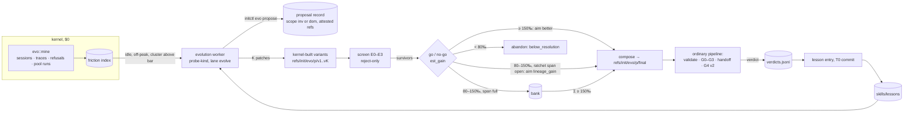

# Evolution v2: reflect, propose → screen → compose, the T0 gate, lessons

```
Status: draft v0.1 · 2026-10-20 · Area: evolution (lane DES-EVO; cross-cuts kernel/gate and the body)
Depends on: CONVENTIONS.md (§1, §4, §6), evolution.md (v0.3 + build sync), kernel/gate.md, kernel/proxy.md,
            kernel/supervise.md, kernel/initctl.md, kernel/selfmap.md, body/log-context.md, body/loop.md,
            body/boot.md, body/tools.md, awareness.md (GENESIS, CONSTITUTION, SELF.md, boot block),
            root/sealed-eval.md, m7-design.md (1b11b7f: S v1, G4 v2, the ratchet, the pool, the $5 plan),
            measurements/real-v0.1.md (S-REAL, A3-real), reports/Google harness2 cho INIT.md,
            research_notes/Google harness2/notes.md
Defines:    the evolution engine: the Reflect stage (failure miner, signal set, friction index, the
            evolution worker, proposal records with INV/DOM scope and attested evidence); the screen
            (gate kind `screen`, stages E0–E3, reject-only); variants, the go/no-go power rule, the bank
            and compose; the T0 gate fix (Repro for behaviour-changing T0 text, `t0_batch`, `t0_measured`,
            T0 debt); the lessons library (`skills/lessons/`); editor/executor routing for evolution
            sessions (L1); the engine's budget lines and anti-gaming rules; the first real demo plan; the
            engine's work breakdown. Contracts owned elsewhere change only through §10's fold table.
```

---

## 1. Purpose

The owner asked what INIT can learn from, or validate against, Google's Harness² (google-research/harness2, arXiv 2610.14224), because he does not trust INIT's current evolution mechanism. His doubt is justified, and it is about a specific half of the loop.

An evolution loop has two halves:
- **Acceptance**: deciding whether a change helped.
- **Search**: deciding what to try.

INIT's acceptance half is stronger than Harness²'s. It has an immutable Root, money ceilings, deterministic checks, a sealed set S that the agent never sees, canaries, and (with M7) an exact superiority test run by the Root. Harness² has none of these: it uses LLM judges, has no spend cap (issue #4), has guardrails the editor can delete (#94), and runs with network on and the sandbox off.

INIT's search half barely exists. Proposals happen when the model notices something in the middle of a task. There is one candidate per promote. Nothing mines failures, nothing remembers verdicts, and the cheapest tier (T0, skills) is the least measured, although Harness²'s ablations say skills are the biggest lever. With a G4 that can only see gains of about 15 points or more, an unaimed search almost never produces an accept.

This doc adds a real search engine and leaves every guarantee of the acceptance half in place:
1. **Reflect**: a deterministic, $0 kernel miner turns session logs, proxy traces and pool runs into a friction index. An idle-time evolution worker turns the top frictions into proposal records. Each record carries mandatory, kernel-attested evidence and is scoped INV or DOM.
2. **Propose → Screen → Compose**: K variants per proposal, a cheap reject-only screen (replays of the original failing trajectory plus a few visible pool tasks), then composition of the survivors into one candidate. Only a candidate whose estimated effect the gate can actually resolve goes on to the normal G0–G3, handoff and G4.
3. **The T0 gate fix**: behaviour-changing skill and prompt text needs `Repro:`, and T0 changes get a batched, deferred G4 (`t0_batch`).
4. **A lessons library**: cue, lesson, gate evidence, confidence. Rejected changes are recorded too.
5. **A first demo**, inside the owner's $5, in which the engine (not a runbook) finds a real friction, fixes it, and has the fix accepted on S v1 and kept as LKG.

## 2. Responsibilities / non-goals

**This doc decides**
- The engine's stages, their data formats, when they run and what they cost.
- What counts as evidence for a proposal and for a behaviour-changing T0 commit.
- How the screen may reject, and that it can never accept.
- The go/no-go rule that keeps G4 money and S looks for changes the gate can resolve.
- `t0_batch`, `t0_measured` and T0 debt as evolution policy. gate.md owns the stage mechanics, and §10 lists them.
- The lessons format, its checks and its retirement.
- The engine's budget lines inside the evolution share, and the demo plan.

**Non-goals**
- Any change to the accept rule, S, M, the gate-of-gates, the sealed audit or the Root. G4 v2 is m7-design.md's. This doc only consumes it.
- Any LLM judge. Nothing an LLM says decides an accept, a screen verdict or a lesson's confidence.
- Test-time adaptation on graded tasks. Harness² edits the harness after seeing rollouts of the very task it is scored on. INIT never adapts on S, holdout or canary content, and never sees their traces (D5).
- Replacing the opportunistic path. The live agent can still self-edit during a task exactly as evolution.md describes. The engine adds a second, deliberate path, and both meet the same gate.
- L3 kernel evolution of the engine itself. From L3 the miner and the screen are agent code. They can only reject or propose, so this is safe, as §7 explains.

## 3. Design

### 3.0 The decisions in one table

| # | Decision | Why | Quality guard |
|---|---|---|---|
| D-E1 | A deterministic kernel **miner** (`evo::mine`, $0) builds a friction index from session logs, proxy traces, kernel refusals and visible pool runs | No failure is mined today. In S-REAL's 6 recorded sessions with failures, 12 failure events produced 0 proposals (§3.1) | Signal rules are code with golden tests on the S-REAL sessions (EV-01…05). Counts come from kernel-written data |
| D-E2 | Proposals are **records**, filed through `initctl evo propose`, with ≥ 2 **kernel-attested, failure-bearing** evidence refs and a scope of `inv` or `dom` | Harness²: edits with no trajectory evidence lost 5–10 points (Fig. 7); unscoped editors lost 2.9 / 3.7 (Table 3) | The validator checks each ref exists, is kernel-written and shows a failure. Body-written `event:` refs are supplementary only |
| D-E3 | An idle-time **evolution worker**, a probe-kind instance on lane purpose `evolve`, writes proposals and variants. It can never promote, reload or vendor | Reflection needs model time, and the owner's conversation must not pay for it in context or latency | The lane refuses everything except `evo.*`, `status`, `wait` and `job.*`. Spend comes from the evolution share. One worker at a time below L2 |
| D-E4 | **K = 3 variants** per proposal, and a **reject-only screen** E0–E3: build and self-map; mock replay of the failing run; a decision-point probe; a candidate-only mini-run on the targeted visible pool tasks | Harness² probes every candidate before composing. A G4 costs $0.37–0.81 and one of 20 S looks; a screen costs cents | The screen can only reject. Its choice among variants uses visible pool data only (m7 §3.5) |
| D-E5 | A **go/no-go power rule** on the estimated sealed gain (est), with three outcomes. est ≥ 150‰: promote and aim for `better`. 80–150‰: promote through m7's lineage ratchet (`lineage_gain`) if the span has room, otherwise bank the proposal and compose it with others. Below 80‰: abandon as `below_resolution` | G4 v2 certifies `better` reliably only at ≈ +13 to +17 points (m7 §3.2.6). The ratchet admits pre-registered smaller gains, but it accepts a null change 14.5% of the time and holds only 4 per span (m7 §3.2.13). Every attempt costs a look and $0.37–0.81 | The estimate's inputs are recorded. After each verdict, the slice's d is compared with the estimate, and the transfer factor is refitted (§3.5.3) |
| D-E6 | Engine candidates are **kernel-built commits** under `refs/init/evo/<p>/…`, made from the worker's patches, authored as `INIT Agent`, and promoted through the ordinary pipeline | The live agent stays free for the owner, and the kernel stays the single committer | The same validator, G0–G3, handoff and G4 apply. A new `Proposal:` trailer and the R4 `promotion.via:"evo"` keep provenance |
| D-E7 | **T0 fix.** `Repro:` is required on every behaviour-changing T0 change. `t0_batch` is a deferred, batched G4 that slices the LKG with its T0 batch reverted against the LKG. **T0 debt** follows a harmful verdict. Retirement stays | Article 4 of the constitution says a new rule needs `Repro:` "required by the kernel's commit check", but today a rule written into a skill body passes with G0 and G1 alone | The `t0_batch` slice uses the incumbent = LKG form that m7's control link already requires. Reverts are ordinary `revert` commits |
| D-E8 | A **lessons library** in `skills/lessons/` (on demand, never in the cached head). Entries are written from gate verdicts, rejects included, and G1 checks their evidence against the gate records | Harness²: removing the library cost 3.1 / 1.8 points. INIT has verdicts as evidence, which is stronger than LLM trajectory comparison | Caps of 64 entries and 24 KiB; no rewrites; one active entry per cue; retirement and model-change staling |
| D-E9 | From L1, **editor/executor routing**: evolution sessions use purpose `propose`, routed to `evolution.engine.editor_model`. Screens and G4 always use the executor | Harness²: an Opus editor helped GLM-5 by +11.5. A same-model editor still helped (+3.0 to +13.7) | The proxy refuses purpose `propose` on run, probe, screen and slice lanes, so the gate measures the executor |
| D-E10 | The first real demo runs **inside M7's $3.00 real envelope**: a new line R (reflect and screen, ≤ $0.15 real), plus m7's line D (≤ $0.55 real at standard tier, ≤ $0.95 at strong) | The owner's $5 is a hard cap in real dollars. M7 already pays for S, calibration and the null G4 the demo needs | Pre-registration before mining. One attempt. If no cluster qualifies, stop at ≈ $0.05 and report |

D-E3, D-E5, D-E6 and D-E10 are **provisional owner decisions 2026-10-20** under the owner's "do not wait" instruction (CONVENTIONS §6 pattern). The owner may override any of them.

### 3.1 Diagnosis: today's loop, with evidence

| # | Weakness | Evidence | Consequence |
|---|---|---|---|
| W1 | **Opportunistic proposals only** | GENESIS: "Grow only what a task needs; a new rule needs an observed failure behind it" (awareness.md §3.2). Nothing in GENESIS, the constitution or SELF.md tells the agent when to reflect. evolution.md §1: "the model chooses what to change", and nothing schedules that choice. In S-REAL every self-edit was dictated by the harness prompt: A2 (write `semver-sort`), A3 (add a `//!` line), E2E-3 (a comment change). m7 §3.7's demo is also chosen by the runbook ("the idea is deliberate") | The loop improves only when a person tells it what to change, or when a task happens to make a weakness obvious mid-flight |
| W2 | **Repeated frictions are never mined** | The 6 unique S-REAL sessions with failures (build/real-artifacts/real/*/init/sessions/) hold 12 failure events: 11 `is_error` tool results plus 1 validator refusal that is not flagged. **6 of the 12 are path errors, in 4 of the 6 sessions**: `cd work/a1-calc` from cwd `work/`, twice (events `bfa14a0cb6a6ddb9`, `a78baa4a82213c46`); `body/skills/ext-authoring/SKILL.md` read from cwd `work/`, twice (`e5470011661ec349`, `be230897960d0477`); an ext opening `/work/work/a2/versions.txt` (`c497bb8961a8f579`); an edit of the guessed `/Users/init/work/wt-doc/src/loop/mod.rs` (`50368e6371b4c8c1`). Both self-edit sessions also hit a trailer refusal on the first promote (`7ebd9d8c153b0a15`: `trailer.subject_too_long` + `block_mixed`; `ee1e29efbd417748`: `trailer.subject`, which came back without `is_error`). E2E-2 silently wrote to `INIT_HOME/work/work/e2e/hello.txt`, the wrong place (real-v0.1.md). The other 4 events are 3 kernel or seed defects since fixed and 1 expected red test | The same mistake recurs across sessions, with no memory. One kind of failure, a refusal reported with exit 0, is invisible to any check based on `is_error` |
| W3 | **One candidate per promote** | `promote.not_single_commit`; one G0–G3 pipeline at a time (evolution.md §3.2); no variants and no composition | Harness²: removing composition cost 1.6 / 1.9 points, and direct refinement without probes or a library cost 10.2 (Code) / 4.9 (Web) (Fig. 7). Each INIT candidate is a single shot at a costly gate |
| W4 | **The T0 gate is weaker than the T2 gate, although T0 has more leverage** | Scope `t0` = G0 + G1, LKG at once, no G4 (gate.md §3.1). `skill` commits need `Repro:` only with `Prefix-change: yes`, and skill bodies are read on demand, outside the prefix (evolution.md §3.8, footnote 1). Retirement lists only *unused* components. m7 §3.2.12: T0 promotions "skip G4"; only a scheduled whole-system audit ever measures them, and its remedy is a rollback to audited-good plus a demotion | A harmful skill that the model *uses* is never caught except by an audit that throws away everything since audited-good. Harness²: skills are the largest lever (−5.3 without them), and SkillsBench found self-written skills at −1.3 (report). The constitution's Article 4 claims a kernel `Repro:` check that does not exist for skills |
| W5 | **Evidence cannot be cited, and is not attested** | `Repro:` refs are checked for existence only (evolution.md §3.9 step 10). `trace:` refs, the only kernel-written kind, are "not found until a trace reader is wired in" (build sync WP8 D12). `event:` refs point into the body-written session log | The strongest evidence cannot be used, and the usable evidence can be fabricated by the body that cites it |
| W6 | **No lessons memory** | `refs/notes/predict` holds kernel-scored verdicts, but the agent sees only `predict_hit_rate` in the boot block (evolution.md §3.10.6). Rejected candidates leave only `refs/init/archive/*`. `promote_attempts_task` = 3 caps repeats per task, not per idea | A new session can re-propose an idea that the gate has already rejected, at full gate cost |
| W7 | **G4 is underpowered for the changes the loop produces** | S-REAL's real G4s (`j-000002`, `j-000003`, 2/1/1 pool) ended `inconclusive: underpowered`. gate.md §3.8.5: ≈ 17–20 points at n = 16. G4 v2 at standard tier: 80% power only at ≈ +17 uniform, more than +25 concentrated; strong tier ≈ +13 (m7 §3.2.6). m7's ratchet lets a pre-registered +5 in 45% of the time, but only 4 per span, and a null 18% of the time (§3.2.13). Harness²'s per-change effects are 1.5–5 points | Unaimed, single, small changes end in `no_gain`, `ratchet_full` or `inconclusive_final` while spending money and S looks. v2 must aim at large effects, send mid-size ones to the ratchet, bank the rest, and screen before it spends |
| W8 | **One real self-edit is slow and costly** | A3-real: 12 turns, 1,337 s from the owner line to the promote result, ≈ $0.13 Root-metered, for a one-line comment. It included a guessed path, a trailer refusal and a cold body build of ≈ 5 min | Multi-variant search must not multiply full pipelines. Variants are screened at the patch level, and only the composed winner is built into a candidate |

### 3.2 Harness² against INIT: what v2 adopts, adapts and rejects

| Harness² mechanism (source) | Its evidence | INIT v2 | Verdict |
|---|---|---|---|
| Every edit must trace to a trajectory moment. Evidence ranking: divergence between runs > repeated concrete failure > latent risk (prompts.py) | direct refinement −10.2 / −4.9 (Fig. 7) | Proposal evidence: ≥ 2 kernel-attested, failure-bearing refs; priority by divergence > repetition (§3.4.3). `Repro:` is extended to T0 text (§3.6) | **Adopt, made mechanical** |
| INV and DOM proposers kept apart (recursion.py: `inv{i}`, `dom{i}`) | no scoping −2.9 / −3.7 (Table 3) | Worker modes and a `scope` field, with a path rule the validator enforces (§3.4.7) | **Adopt** |
| Probe each candidate by running it on the same task (recursion.py `_roll_many` on one `task_id`) | — | The screen replays the *recorded* failing trajectory and runs the targeted *visible* pool tasks. It never touches S, holdout or canaries (§3.5.2) | **Adapt** (no adaptation on graded tasks) |
| Compose or aggregate the candidate pool (recursion.py `agg`, `compose_round`) | no composition −1.6 / −1.9 | Compose screen survivors within a proposal (L0) and across proposals (bank at L0, fleet at L2), then one G4 per composed candidate (§3.5.4) | **Adapt** |
| `STAGE_ATTEMPTS = 2` with the rejection error fed back, then fall back to the base; `kept_base` (recursion.py) | — | The worker gets each validator or screen refusal once, retries once, then the proposal ends `abandoned:keep_base` | **Adopt** |
| Library: `cue`, `lesson`, `evidence` required, `confidence` optional; `add()` writes nothing if any is empty; INDEX.md rebuilt; no caps, search, merge or retirement (library.py). At most one lesson; NO_ENTRY without a contrast (prompts.py) | no library −3.1 / −1.8 | Lessons from gate verdicts, rejects included; confidence derived mechanically; G1 checks the evidence; caps and retirement (§3.7) | **Adopt and strengthen** |
| Budget identity: R = 4k, P = 3k, duplicate labels checked first (ledger.py) | — | A run-grid assertion in the screen and in G4 (report idea #5, §10 to gate.md) | **Adopt** |
| Opus 4.8 as editor over cheaper executors | +11.5 on GLM-5; same model +3.0 to +13.7 (Fig. 8) | L1 `propose` routing; the gate measures the executor (§3.8) | **Adopt at L1** |
| Grader-verdict substring tripwire (context.py) | — | INIT relies on OS isolation, Root leak scans and canaries, and adds a pool-literal lint (§3.9.3) | **INIT stronger; small add** |
| LLM judges for scores and selection (judge.py, selection.py) | — | No judge anywhere | **Reject** |
| Reset to H0 per task, carry only lessons | — | INIT accumulates into LKG under retirement, thinning, `t0_batch` and the audit | **Reject** |
| Test-time adaptation, ≥ 4× rollouts per task | headline gains are on the adapted task | Not done. It costs too much and is contamination by design | **Reject** |

**Validating INIT against Harness²'s claims.** INIT cannot replicate the paper: it has 32 tasks, a $5 budget and no LLM judge. It can test the claims that matter for INIT, directionally. The engine records per-proposal metrics in `vault/lineage.jsonl` (`kind:"proposal"`, §4.7), and `initctl evo stats` reports them:
1. **Evidence-tied edits beat ad-hoc ones** (Fig. 7). Compare the G4 accept rate of engine candidates with that of opportunistic promotes.
2. **Screening saves gate money** (the probe stage). Track the screen reject rate, and the G4 accept rate of screened versus unscreened candidates.
3. **Lessons stop repeats** (Table 3, library). Count proposals refused as `evo.tried` and the lesson citation rate.
4. **Estimate calibration.** Compare `est_gain` with the slice's rounded d.

At INIT's volumes these are reports, not significance tests. A $0 replica of Harness²'s own demo also exists: `demo.py`'s ledger-sum task, whose base script drops negative amounts, becomes the engine's mock-pipeline fixture (EV-T20).

### 3.3 The pipeline at a glance



The T0 side path: behaviour-changing T0 commits need attested `Repro:` and become LKG on G0–G1 as before. They are then batched for `t0_batch` (§3.6), or, if the engine expects a resolvable effect, promoted as `t0_measured` with a synchronous G4.

### 3.4 Reflect

#### 3.4.1 Sources and trust

| Source | Writer | Read by the miner as | Usable as `Repro:` evidence |
|---|---|---|---|
| Proxy request records and reconstructed requests (`vault/traces/v1/`, `vis:"agent"` only) | kernel | tool calls (`end.tool_calls`), the tool results carried in the next request's messages, `attempt`, `retries`, `cache_permille`, cost, `x-init-cap` refusals, `purpose`, `task` | **yes**, as `trace:<req_id>` (attested) |
| Visible pool runs: RunRecords and the session logs of **failing** pool runs, retained by the gate (§10 → gate.md) | kernel (records), body (logs, copied by the kernel) | outcome, score, caps hit, `tamper`, and the trajectory signals | **yes**, as `run:<gate_id>/<run_id>` (attested by the RunRecord's score) |
| initctl server log: refusals the kernel itself issued (`trailer.*`, `E_*`, `gate.*`) | kernel | `initctl.refused:<code>`, even when the tool's exit code was 0 | **yes**, via the `friction:` id that indexes it |
| Session logs `state/sessions/*.jsonl` (read under supervise.md K-F2's rules) | body (agent zone) | owner `steer` events, `aborted` results, follow-ups, `error` events, the `cwd` context | supplementary only: `event:` refs may accompany, never satisfy, the evidence rule |
| Gate records and predict notes | kernel | rejected and accepted proposals, for the lessons join | — (lessons cite gate ids) |
| Holdout, canary and S runs, and any `vis:"kernel"` trace | — | **never read** | never |

Anything the miner extracts from agent-written data is treated as data, never as instructions (CONVENTIONS §1). The miner never executes anything it reads.

#### 3.4.2 Signals

Each signal is a deterministic rule with a stable id. An instance records `{signal, ref, task, session, label?, family?, ts, detail ≤ 200 B}`.

| Signal id | Rule | Weight |
|---|---|---|
| `tool.error:<tool>:<code>` | a tool result whose first line is `error: <code>: …` (tools.md §4.6) | 1 |
| `path.home_relative` | `not_found` / `cd: … No such file` / ext `os error 44` for a relative path that exists relative to `INIT_HOME` but not to the cwd (S-REAL: `body/skills/…` from `work/`) | 2 |
| `path.doubled_prefix` | the path repeats the cwd's last component (`work/work/…`, `/work/work/…`), whether the call failed or a write succeeded (E2E-2) | 2 |
| `path.guessed_absolute` | an absolute path under no writable root and no existing parent (S-REAL: `/Users/init/…`) | 2 |
| `bash.exit:<cmd>` | non-zero exit; `<cmd>` = first token class (`cd`, `cargo`, `python3`, `pytest`, `git`, `make`, `initctl`, other) | 1 |
| `bash.timeout`, `bash.bg_killed` | the bash `timeout` code; a background job killed after 2 s | 2 |
| `initctl.refused:<code>` | a kernel-logged refusal for this session, matched by the session header; covers JSON errors returned with exit 0 | 2 |
| `retry.same_call` | the same tool name and argument hash repeated within 3 steps after an error | 1 |
| `loop.repeat_read`, `loop.repeat_cmd` | the same path read, or the same command run, ≥ 3 times in a task with no write in between | 1 |
| `owner.interrupt` | an `aborted` result "not executed (owner abort)", or an interrupt control | 3 |
| `owner.steer` | a `steer` event in a busy run | 2 |
| `owner.followup` | an owner message within 300 s of a final answer in the same session (weak: it may be a new request) | 1 |
| `cost.spike`, `turns.spike` | the task's cost or turns are more than 3× the rolling median of the last 20 tasks of the same kind (label, or `live`) | 1 |
| `cache.break` | a request with `cache_permille` < 500 after one ≥ 900 in the same chain, with no prefix-changing reload in between | 1 |
| `cap.hit:<cap>` | a 429 with `x-init-cap` (`turns`, `tokens_out`, `tokens_in`, `task`) | 2 |
| `finish.untested` | a final answer after the last write or edit with no test command run afterwards (pytest, `python3 -m unittest`, `cargo test`, `make test`, `npm test`, `go test`) | 2 |
| `finish.tests_failing` | a final answer when the last test command exited non-zero (m7 §3.7's class "stopped with tests failing") | 3 |
| `task.fail` | a pool RunRecord with score < 1000, or outcome `timeout` or `cost_capped` with a failing score | outcome |

Expected failures are excluded. A failing test command that is followed, after an edit, by the same command succeeding is ordinary test-driven work, not friction (S-REAL `0e48fb7caed922f0`).

#### 3.4.3 Clusters and priority

- **Signature.** A cluster is the set of instances sharing `(signal id, tool, code or subclass)`.
- **Attribution.** An instance is *fatal* when it occurs in a run whose `task.fail` holds and no later instance of the same command or path in that run succeeded.
- **Per-cluster statistics:**
  - occurrences;
  - distinct sessions and tasks;
  - labels and families;
  - fatal runs, and `s_c` = fatal runs / all failing pool runs (computed over the screen-eligible pool runs in the pool cache, m7 §3.2.7);
  - **divergence pairs**: pool tasks with at least one passing and one failing incumbent run, where the signature appears only in the failing ones;
  - first and last seen;
  - up to 5 example refs, attested kinds first.
- **Priority** (Harness²'s ranking made numeric): `prio = 3·divergence_pairs + 2·distinct_tasks_with_fatal + Σ weight`.
- **Eligibility.** A cluster is *proposal-eligible* if it has ≥ 2 attested refs from ≥ 2 distinct tasks or sessions, or 1 attested ref plus a divergence pair. A cluster seen once is latent risk: it is listed, but no proposal is made for it.
- **Lessons join.** If a lesson's `signatures` field names the cluster and its polarity is `no_effect`, `hurt` or `below_resolution` at confidence ≥ medium, the digest marks the cluster `tried:<lesson id>`. A new proposal on it is refused (`evo.tried`) unless it cites evidence newer than the lesson.

#### 3.4.4 The friction index

`state/kernel/evo/frictions.jsonl` (kernel-written, agent-readable, ICJ). It holds one line per cluster:

```json
{"v":1,"id":"f-000003","signature":"path.home_relative","counts":{"instances":4,"sessions":3,"tasks":3,
 "fatal_runs":0,"divergence_pairs":0},"s_c_permille":0,"labels":["live"],"families":[],"prio":10,
 "eligible":true,"tried":[],"refs":["trace:01a158ae4f650010","run:j-000031/p-repo-03-r1"],
 "first":"2026-10-20T06:37:36Z","last":"2026-10-20T09:30:01Z"}
```

`initctl evo frictions` prints the top 10 as a digest of ≤ 2 KiB. The boot block's tail gains one line: `evolution: 3 eligible frictions (top path.home_relative ×6); 1 proposal screening` (awareness.md §3.6, §10). It sits in the tail, never in the head, because it is volatile.

#### 3.4.5 When Reflect runs and what it costs

- **Mining** runs incrementally, using byte-offset cursors per file in `state/kernel/evo/cursor.json`. It runs every `mine_interval_s` (3,600 s), and after every G4 or calibrate job. Its cost is CPU only: the target is < 2 s per hour of logs (EV-05 measures it). It never makes a model call.
- **The worker** starts when all of these hold:
  - the live body has been idle ≥ `idle_after_s` (900 s): no owner input, and `busy:false`;
  - no promote pipeline or G4 is running, and the provisional chain depth is ≤ 1;
  - an eligible cluster without an open proposal exists, or T0 debt is open (always first);
  - the day's `budget.reflect_usd_day` and evolution share have room for one session;
  - it is an off-peak window, or the wait has passed 4 h (`prefer_offpeak`);
  - the system is not in safe mode, and below L2 no other worker is alive.
- **Worker cost.** ≤ `worker_turns_max` (40) turns and ≤ `reflect_usd_session` ($0.05). On deepseek-flash off-peak a proposal with 3 variants is about 40–60k input and 6–10k output tokens, ≈ $0.01–0.02. With the L1 editor `deepseek-v4-pro` off-peak ($0.66 per Mtok uncached input, $1.98 per Mtok output; research_notes llm_api_providers.md) it is ≈ $0.04–0.06.
- **Daily ceiling (L0 defaults).** Reflect ≤ $0.10/day, screens ≤ $0.15 per proposal, `evo_proposals_day` = 6. All of it counts in `budget.evolution_share`, under the Root's ceilings.

#### 3.4.6 The evolution worker

- **Instance.** The worker is a probe-kind instance (supervise.md `probe()`), purpose `evolve`, with `INIT_MODE=normal` and a fresh session `evo-<p>`. Its root contains:
  - `body/`: an export of lineage `main`;
  - `work/evidence/`: the evidence directory, below;
  - `work/target/`: an APFS clone of the warm dependency target (`cache/deps/<key>/target`), so T2 variants can run `cargo check` and `cargo test` without a cold build.
- **Lane rights.** The lane allows `evo.*`, `status`, `wait`, `job.*` and the agent trace view. It refuses `promote`, `reload`, `vendor`, `rollback`, `task submit` and `fleet *` (`E_LANE`).
- **The evidence directory** is built by the kernel at spawn, like Harness²'s `context.py`, from **raw** excerpts. Meta-Harness found raw traces beat summaries (50.0 vs 34.9). It contains:
  - the cluster line;
  - for each attested ref, the reconstructed request's last 3 messages and the tool result, with no single observation cut below 10,000 characters (Harness² `obs_trunc` ≥ 10k: shorter cuts invent defects);
  - the pool task prompt and the visible files of each targeted pool task;
  - the matching lessons;
  - the proposal schema.

  The directory is ≤ 256 KiB. It is built only from the attested sources of §3.4.1, so no holdout, S or `vis:"kernel"` content can enter it.
- **The procedure** is the seed skill `skills/evolve/SKILL.md` (`kind: inv`). It has two modes:
  - **INV** (how the agent works: tools, loop, retries, scripts, SELF.md working rules, INV skills). It must not add domain facts.
  - **DOM** (knowledge about a kind of work: DOM skills only). It must not touch commands, tools, retries or SELF.md.

  The mode follows the cluster: tool, path, loop, cap, finish and owner signals mean INV; `task.fail` on one label without tool-level signals means DOM. The skill tells the worker to read `skills/lessons` first, to cite the lessons it uses, to write a falsifiable `Predicts:`, to prefer deletions and deterministic tool behaviour over prompt text (Harness² Table 6: the prompt group −1.5, skills −5.3, scripts −3.7), and that `KEEP_BASE` (no change) is a valid outcome.
- **Retry once.** A validator or screen refusal is fed back to the worker once, verbatim and bounded to 4 KiB. A second refusal ends the proposal `abandoned:keep_base`.

#### 3.4.7 Proposal records

`initctl evo propose <file>` validates the record and stores it in `state/kernel/evo/proposals/<id>.json`. The kernel owns the `state` field. The live agent can file proposals too, so its mid-task insights flow into the same engine.

```json
{"v":1,"id":"p-000007","scope":"inv","frictions":["f-000003"],
 "hypothesis":"relative paths are resolved against the cwd while the model writes INIT_HOME-relative paths",
 "change":"read/edit/write: on not_found, resolve the path against INIT_HOME and the workspace and name the existing match in a hint; never write elsewhere silently",
 "repro":["trace:01a158ae4f650010","run:j-000031/p-repo-03-r1"],
 "predicts":["pass_rate >= parent+0.15 sealed","cost_usd <= parent+30%"],
 "lessons":["l-000002"],"k":3,"tier_hint":"t2",
 "by":{"session":"evo-p-000007","model":"deepseek/deepseek-flash","purpose":"turn"},
 "state":"proposed","est":null,"created":"2026-11-02T03:10:00.000Z"}
```

**Validation** (codes in §4.4):
1. The record matches the schema (`evo.schema`).
2. Evidence: ≥ 2 refs of attested kinds (`trace:`, `run:`, `friction:`), with at least one of them not a `friction:` id (`evo.evidence_missing`, `evo.evidence_unattested`). Each attested ref must be **failure-bearing** (`evo.not_failure`):
   - a `trace:` ref: the request carries a tool result starting with `error:` or a non-zero exit trailer, a 429 cap refusal, or an owner steer or abort;
   - a `run:` ref: score < 1000;
   - a `friction:` ref: the cluster is eligible.
3. `predicts` parses with evolution.md §3.10's grammar, plus m7's `sealed` scope and its absolute-points target `parent+0.15` (§9 cross-doc), and has at least one non-baseline clause. A proposal that may take the ratchet path must include a `pass_rate … sealed` improvement clause, which m7 §3.2.13 requires for `lineage_gain`.
4. Lessons named in `lessons` exist; no `evo.tried` conflict (§3.4.3).
5. Quota `evo_proposals_day` (`evo.quota`).

**Scope rule** (applied to every variant and to the final commit; `evo.scope_paths`):
- Every SKILL.md gains a frontmatter key `kind: inv|dom`. It is required for new skills, and the seed skills are tagged (selfmap.md §10).
- A `dom` proposal changes only `skills/<name>/**` of skills whose `kind` is `dom`.
- An `inv` proposal changes no `kind: dom` skill.
- A composed commit may combine one `inv` and one `dom` proposal and then names both in `Proposal:`.

**States:** `proposed → variants → screening → screened → (banked) → composed → promoted → verdict`, or `abandoned:{keep_base | screen | below_resolution | budget | superseded | tried}`. Every transition is a kernel record (§4.7).

### 3.5 Propose → Screen → Compose

#### 3.5.1 Variants

- The worker submits K = `k_variants` (3) patches with `initctl evo variant <p> <k> <patch>`. The patches are unified diffs against lineage `main`, each ≤ 200 KiB.
- The kernel applies each patch in a kernel-owned scratch index (`$G apply --cached` on `cache/evo/<p>/index`; supervise.md's hardened `$G`; never in an agent-writable tree, K-F3). It writes the tree, then commits it with `commit-tree`, author and committer `INIT Agent <agent@init.local>`, onto `refs/init/evo/<p>/v<k>`. That ref is kernel-only, create-only, and never `main`.
- **Diversity.** A variant whose changed lines have Jaccard ≥ 0.8 with an earlier variant is refused (`evo.duplicate_variant`), after Harness²'s `tree.diversity`. The worker may then submit a real alternative, or fewer variants.
- When the remaining evolution share for the day is below $0.50, K drops to 2.

#### 3.5.2 The screen (gate kind `screen`; it can reject, never accept)

The screen runs per variant, cheapest stage first, and stops at the first reject. Every stage is kernel-run and recorded.

| Stage | What runs | Applies to | Cost | Rejects when (reason) |
|---|---|---|---|---|
| **E0** build and map | G0 and G1 on the variant (build slot), plus a validator dry-run on the proposal's trailers | all | $0, ~0.3 s–6 min (warm vs cold slot) | any G0/G1 failure (`screen.e0:<code>`) |
| **E1** mock replay | the recorded assistant messages of each `run:` evidence ref become an `init-mockllm` script (body/provider.md §3.12 format). The candidate body runs it in a probe on a fresh extraction of the frozen task's `workspace.tar` | INV changes to tools, loop or ext, with `run:` evidence | $0 | the tool result at the recorded failure step still matches the signature (`screen.replay_unchanged`), or the replay crashes or produces a new error class before that step (`screen.replay_regressed`). After the first changed tool result, the recorded script is no longer valid; E1 stops there and passes |
| **E2** decision-point probe | for up to 2 failure points: a probe boot of the candidate **and** of the LKG on the same copy of the recorded session log, truncated just before the failing assistant message. The boot uses handoff resume semantics, so the pending run continues (body/boot.md item 9: "B continues the pending run"). The probe lane allows exactly one model request; the proxy records the response's tool calls. N = 3 fresh probes per arm per point | all, when a session log exists (live sessions, retained pool runs) | ≈ $0.004 per probe on flash off-peak; ≤ $0.05 per variant | the LKG reproduces the signature in ≥ 2 of 3 probes, **and** the candidate reproduces it at least as often as the LKG (`screen.decision_unchanged`). If the LKG reproduces it < 2 times, E2 is uninformative and passes |
| **E3** targeted mini-run | the candidate, R = 1, on ≤ 4 visible pool tasks where the cluster was fatal, plus 2 seeded control pool tasks the incumbent passed. The incumbent arm comes from the pool cache (m7 §3.2.7). The task caps are the G4 caps (m7 §3.2.8) | all | ≤ 6 runs × $0.003 ≈ $0.02 per variant | any `tamper` or canary trip (`screen.tamper`); 0 targeted tasks fixed **and** ≥ 1 control lost; ≥ 2 controls lost (`screen.mini_inferior`); mean cost per run > 2× the incumbent's on the controls (`screen.costlier`) |

- **Reject-only by construction.** No stage produces an accept, and passing the screen only allows the go/no-go estimate (§3.5.3) to run. A screen pass carries no evidential weight in the gate.
- **The run grid is asserted** before any statistic: the expected `(variant, stage, task or point, arm, repeat)` set must match the recorded runs exactly, with duplicates checked first (Harness² `ledger.assert_identity`; `screen.grid`).
- **Ranking survivors** for compose: by E3 fixes on targeted tasks, then the E2 signature reduction, then the smaller diff. Only visible data is used (m7 §3.5: no choice among candidates by S results).
- **Budget.** `budget.screen_usd` ($0.15) per proposal, all variants together. Exhaustion ends the proposal `abandoned:budget`.
- **E2 caveat.** The candidate and the LKG both boot on the same truncated log, so the extra `boot` event they both see cancels out in the paired comparison. That a probe-mode boot resumes a pending run as a handoff boot does is UNVERIFIED. If it does not, E2 sends both arms the input `[init:replay] continue`, which is again identical across arms (§9).

#### 3.5.3 Go/no-go: spend G4 only on what G4 can see

For the best survivor (or a composite):

```text
s_c    = fatal pool runs of the proposal's clusters / failing screen-eligible pool runs   (pool cache, ≥ 36 runs)
fix    = (targeted tasks the candidate passed in E3 + 1) / (targeted tasks + 2)           (Laplace-shrunk)
q      = 1 − p̄_S  ≈ 0.5                         // S v1 targets incumbent pass rates of 20–80% (m7 §3.1.6);
                                                // replaced by the Root's published p̄_S if a record exposes it
T      = transfer = 0.8                         // pool → S discount; refitted (below)
est    = round(1000 · q · s_c · fix · T)        // permille
aim_better   ⇔ est ≥ go_gain_permille (150)                               → promote
aim_ratchet  ⇔ ratchet_gain_permille (80) ≤ est < 150 ∧ span has room      → promote (expects lineage_gain)
bank         ⇔ 80 ≤ est < 150 ∧ span full (unconfirmed lineage_gain = ratchet_k)
abandon (below_resolution) ⇔ est < 80, unless the change is deletion-shaped or `perf`
```

- **Why 150‰ for `better`.** At G4 v2's strong tier a uniform +15 is accepted as `better` 87% of the time and a concentrated one 69%; at standard tier, 70% and 55% (m7 §3.2.6).
- **Why 80‰ for the ratchet.** At standard tier, a true +10 is accepted as `better` or `lineage_gain` 74% of the time, a +5 45%, and a null 18% (m7 §3.2.13). Below about +8, the ratchet's own false-accept rate on nulls is close to its hit rate, so a look spent there mostly adds noise to the span. The milestone check would catch that noise, but only at the cost of halving `ratchet_k`.
- **Span room** is read from the Root's agent-visible ratchet state (the span's unconfirmed `lineage_gain` count against `ratchet_k`; m7 §3.2.13).
- **The bank.** Up to `bank_max` (4) screened proposals with pairwise-disjoint clusters and cleanly merging diffs. When Σ est over a subset reaches 150‰, the subset is composed (§3.5.4) into one candidate that aims for `better`. When the span reopens after a milestone, the best banked proposal is promoted on the ratchet path. The estimates are added because the failure classes are disjoint by construction. A banked proposal older than 14 days, or invalidated by a new LKG whose E1/E2 rerun fails, leaves the bank. The bank and the ratchet are complementary: the ratchet lets small gains in one at a time and confirms them together at the milestone; the bank saves looks and ratchet slots by letting several small fixes share one look.
- **Refit.** After every verdict the kernel records `(est, d_permille)` from the slice. Once there are 5 pairs, T is replaced by the median ratio, clamped to [0.3, 1.2]. The lessons record the same pairs, so the worker learns its own optimism.
- **What the rule does not do.** It never makes a candidate accepted. It only decides whether the gate is asked.

#### 3.5.4 Compose

- **Within a proposal (L0).**
  - With one survivor, it is the composed candidate.
  - With several survivors touching disjoint files, the kernel 3-way merges them (`$G merge-tree --write-tree` on git ≥ 2.40, else the throwaway kernel worktree of evolution.md §3.9 step 10) and takes the union only if E3 ranked every merged survivor as fixing at least one targeted task. Otherwise it takes the best one.
  - With survivors that overlap, the worker composes them in one more short session. It sees the survivors' diffs and screen summaries, like Harness²'s `aggregate` stage, which sees the pool, the base evidence and the decisions.
- **Across proposals.** The bank at L0, and the fleet at L2 (§3.5.7).
- **Re-screen.** A composed candidate that is not identical to a single screened variant reruns E0 and E1 ($0). It reruns E2 and E3 only on the files that changed relative to the screened variants, which is enough because each part was screened.
- **The final commit** is `refs/init/evo/<p>/final`, built by the kernel. An illustrative message (the numbers are invented for the example):

```
fix(tools): resolve INIT_HOME-relative paths on not_found and name the match

Engine proposal p-000007 (scope inv). Cluster path.home_relative: 6 instances in 4 sessions, 3
fatal pool runs. Screen: E1 replay changed at the failure step; E2 1/3 vs LKG 3/3; E3 fixed 3/4,
controls 2/2. est 160‰.

Why: path errors were 6 of 12 failure events in S-REAL and recur in pool runs (f-000003).
Predicts: pass_rate >= parent+0.15 sealed; cost_usd <= parent+30%
Compensates-for: path-resolution: model mixes INIT_HOME-relative and cwd-relative paths
Prefix-change: no
Repro: trace:01a158ae4f650010, run:j-000031/p-repo-03-r1
Proposal: p-000007
```

`initctl evo promote <p>` (or the scheduler, after go) enters the ordinary pipeline of evolution.md §3.5. The fetch from `body/` is skipped because the commit is already in lineage. The candidate is archived as usual under `refs/init/archive/<sha>`. The pipeline's own steps apply unchanged: the validator, G0–G3, the handoff at the next idle point, provisional status and G4 v2. The live body learns of it as an `[init:kernel]` note and resyncs `body/` at the handoff boot (evolution.md §3.6). If the live agent has a pipeline running, the engine waits (`E_BUSY`) and retries at the next idle.

#### 3.5.5 Tiers

| Tier | Variants are | E1 | E2 | E3 | After compose |
|---|---|---|---|---|---|
| **T0** (skills, SELF.md, GENESIS.md) | text patches | n/a (the model's responses are what changes) | the main screen | yes | `skill` commit with attested `Repro:` (§3.6.1). It becomes LKG on G0 + G1 and joins the next `t0_batch`. If est ≥ 80‰ (either go path of §3.5.3), it is promoted as **`t0_measured`** instead: G0, G1, then a synchronous G4 v2 before `main` moves (§3.6.3) |
| **T1** (ext) | new or changed components | yes, when the evidence includes ext calls | yes | yes | G0–G3, a data-only promotion, provisional, G4 v2 |
| **T2** (body code: tools, loop, context) | code patches; the worker iterates with `cargo test` in its root | yes (the strongest screen for tool behaviour) | yes | yes | G0–G3, handoff, provisional, G4 v2 |
| `dep` | forbidden for the engine at L0: a variant that touches `vendor/` or adds a registry package is refused (`evo.dep`) | — | — | — | — |

#### 3.5.6 The ladder

| Level | Engine shape |
|---|---|
| **L0** | One worker at a time, sequential: Harness²'s `seq` mode with k = 1 per round. The default model is both editor and executor. Compose within a proposal, plus the bank. Every engine promote counts in `promotes_day`. G4 is the maintainer's G4 v2. |
| **L1** | As L0, plus editor routing (§3.8), and the agent may set `[evolution.engine]` budget keys with `initctl budget set`. A cluster whose evidence lies in one label may become an agent task family (evolution.md §3.15.4) instead of a fix. Such a family gives the `capability_gain` path a sealed half to measure. |
| **L2** | Up to `quotas.parallel_bodies − 1` workers in parallel, one proposal each: Harness²'s `agg` mode. A cross-proposal compose step merges qualified survivors before the single committer adopts (evolution.md §3.15.5). Members' screen survival and accept rates feed HGM's clade counts as an extra prior, never as n_s. |
| **L3** | The miner, the screen and the go/no-go are kernel code the agent may evolve. They can only propose or reject, and accepts still rest on S, M and the sealed audit (§7). |

### 3.6 The T0 gate fix

#### 3.6.1 `Repro:` for behaviour-changing T0 text

- **Rule.** Any commit whose diff touches T0 paths and **adds** at least one non-blank line to `GENESIS.md`, `SELF.md` or `skills/**` must carry `Repro:`, whatever its type and whatever its `Prefix-change:`. The exceptions:
  - deletion-shaped diffs (`retire`, `thin`, `revert`);
  - `skills/lessons/**`, whose evidence G1 checks instead (§3.7);
  - type `refactor` with at most 3 added lines over all T0 files.

  The validator code is `trailer.repro_required_for_t0`.
- **Attested and failure-bearing.** For this rule, and for the existing `fix`, `guard` and prefix rules, at least one `Repro:` ref must be of an attested kind and failure-bearing (`repro.unattested`, `repro.not_failure`). The grammar gains two ref kinds (§4.2):
  - `run:<gate_id>/<run_id>`, a pool run with score < 1000;
  - `friction:f-<6 digits>`, an eligible cluster.

  `event:` refs remain valid as supplementary refs.
- **Why this is enough.** It makes the constitution's Article 4 true as written ("A new rule or guardrail needs an observed failure behind it (Repro:, required by the kernel's commit check)"). It needs no change to the constitution, which is charter text the agent cannot edit. A skill written from documentation with no observed failure cannot be kept. That is deliberate: Harness² measured such edits as harmful. The way to keep one is to show the failure the skill prevents, for example an `ext` task that failed.
- **Prerequisite.** The kernel trace reader for the validator (§3.12 EV-TRACE). Until it exists, every `trace:` ref is "not found" and the rule would be satisfiable only with `run:` refs.

#### 3.6.2 `t0_batch`: a deferred, batched G4 for T0

- **The batch.** B is the newest body SHA that passed a G4 verdict. The batch is the behaviour-changing T0 commits on `main` since B that no G4 has covered, so the T0 changes since B were never measured.
- **Trigger.** The batch has ≥ `t0_batch_min_commits` (3) commits, **and** either a pool pre-screen shows signs of harm or the oldest commit in the batch is older than `t0_batch_max_age_days` (30). The run waits for an off-peak window and for no other G4. At most one runs per S epoch, because it spends a look.
- **The pool pre-screen.** G4 v2's screen protocol on 12 pool tasks at R = 1, with arms LKG L and L⁻ (below), and the L arm from the pool cache. If L⁻ is ahead by a net ≥ +2 passes, there are signs of harm, and the slice runs. Otherwise the batch is marked `screened_ok` and waits for its age trigger. Cost ≈ $0.04.
- **The arms**, using m7's control link as it is (the incumbent must be `lkg`):
  - **incumbent** = L, the current LKG tuple, which includes the batch;
  - **candidate** = L⁻ = {L's body binary, L's ext set, the **t0 blob of B**}. The blob is a pax tar of `GENESIS.md`, `SELF.md` and `skills/**`, uploaded with `store.put kind:"t0"`.

  Only the T0 files differ, so the slice measures exactly the batch, and m7's `dup` rule makes it one look.
- **Decision.**

  | Slice status (candidate L⁻ vs incumbent L) | Meaning | Action |
  |---|---|---|
  | `superior` | removing the batch is significantly better: the batch harms | **T0 debt** (below); one lesson per batch commit, polarity `hurt` (confounded if there are several) |
  | `inferior`, `inferior_early` | removing the batch is significantly worse: the batch helps | keep. Lessons `helped`, confidence high; B moves to L |
  | `tie`, `tie_negative`, `underpowered` | no resolvable effect | keep. B moves to L. Lessons `no_effect` at confidence low |
  | any tripwire (`canary`, `tamper`, `leak`, `health`) on L⁻ | L⁻ has old T0 text, so the harness is suspect | stop, alert, no action on the batch |

  The tie-break rules (`smaller` and the rest) are **not** applied, because removing text would always win a size tie. `t0_batch` is a harm test, not a size contest.
- **T0 debt.** The kernel records `t0_debt{gate, commits[]}` and notifies the agent. Until the debt clears, any promote other than a `revert` of a listed commit, `retire` or `thin` is refused with `E_T0_DEBT`. The engine treats the debt as its top-priority proposal: its worker files the `revert` commits, one per listed commit (evolution.md's grammar allows one `Reverts:` each). These are `t0` scope, G0 + G1, about minutes and $0. When the last listed commit is reverted, the debt clears. The kernel never authors body history on `main` itself; every commit on `main` remains an agent commit with its trailers.
- **Cost.** A slice at standard tier with the incumbent cached is ≈ $0.37, plus the $0.04 pre-screen, from the evolution share.

#### 3.6.3 `t0_measured`

An engine T0 candidate whose est ≥ 80‰, or any T0 commit carrying the trailer `Measure: g4` (new; optional), takes scope **`t0_measured`**: G0, G1, then a synchronous G4 v2 before `main` moves. It is the same flow as `t0_escalated`, and on accept (`better` or `lineage_gain`) B moves to it. This gives T0 changes real verdicts, and therefore lessons with real evidence, when the engine expects an effect the gate can see.

#### 3.6.4 Retirement stays

evolution.md §3.11 is unchanged, and it still lists unused skills. v2 adds the component kind `lesson/<id>` to retirement listing (§3.7). `t0_batch` covers the case retirement cannot see: a skill that is *used* and *harms*.

### 3.7 Lessons library

- **Where.** `body/skills/lessons/SKILL.md` (seed; `kind: inv`). Its name and description are in the head, constant: "Past gate verdicts on self-changes. Grep before proposing; cite what you use." The data lives in `body/skills/lessons/entries.jsonl`, one ICJ entry per line. Only the description line is in the cached head; entries are read on demand with `grep` or `jq`, so adding one never changes `prefix_hash`.
- **Entry:**

```json
{"id":"l-000004","cue":"model writes INIT_HOME-relative paths while cwd is a workspace",
 "lesson":"tool-side resolution hints fixed 3/4 targeted pool tasks; the sealed gain was 150‰ ± 50",
 "scope":"inv","signatures":["path.home_relative"],"polarity":"helped",
 "evidence":{"kind":"g4","gate":"j-000052","verdict":"accept","reason":"better","status":"superior",
             "d_permille":150,"m_permille":220,"cpp_ratio_permille":1050,"proposal":"p-000007",
             "sha":"0e786c733a9648164a2b4c4aea7ece24d0beb7c7","est_permille":160},
 "confidence":"high","model":"deepseek/deepseek-flash","created":"2026-11-02T06:40:00.000Z"}
```

- **Polarity:** `helped | hurt | no_effect | below_resolution | confounded`.
- **Confidence is computed, never chosen:**

  | Confidence | When |
  |---|---|
  | high | a G4 or `t0_batch` slice status of `superior` or `inferior`, for the single proposal or commit it judged; a `lineage_gain` whose span the milestone check later `confirmed` (the entry is superseded by a new one citing the `milestone` record) |
  | medium | a slice `tie` or `tie_negative` with m ≤ margin_max; an unconfirmed `lineage_gain`; a screen reject at E3 with ≥ 4 runs |
  | low | `underpowered` or inconclusive; E2-only screen rejects; any composite (several proposals or batch commits), with polarity `confounded` |

- **Limits.** At most one entry per verdict (Harness²'s "at most one lesson"). There is no entry for `error`, cancelled or superseded gates. That is Harness²'s NO_ENTRY: no contrast, no lesson.
- **Who writes them.** The kernel appends a verdict digest per proposal and per `t0_batch` to `state/kernel/evo/verdicts.jsonl`, using only the agent-visible fields. The worker, or the live agent, turns it into an entry in a `skill(lessons)` commit. Rejected changes get entries too: INIT's archive already keeps the rejected candidate, and the lesson keeps *why*.
- **G1 checks** (selfmap.md and gate.md, §10). On any commit that touches `skills/lessons/**`:
  1. `evidence.gate` exists in `vault/lineage.jsonl`, and verdict, reason, status, d, m and cpp equal the gate record's agent-visible values (`gate.g1.lesson_evidence`);
  2. `confidence` equals the computed value (`gate.g1.lesson_confidence`);
  3. the `proposal` exists;
  4. no existing entry is modified, so the diff only adds lines or deletes whole lines (`gate.g1.lesson_rewrite`). This rules out an ACE-style collapse;
  5. at most one active entry per normalized cue (`gate.g1.lesson_dup`); a superseding entry must delete the older one in the same commit;
  6. ≤ 64 entries, ≤ 400 bytes each, file ≤ 24 KiB (`gate.g1.lesson_cap`);
  7. no holdout id, S field or `vis:"kernel"` data, which the field whitelist guarantees.
- **Retirement.** Proposal records cite lessons, and the kernel counts the citations. An entry uncited in the last 40 proposals and older than 30 days is listed as `lesson/<id>` among `retire_candidates`. On a main-model change (thinning starts), every entry with another `model` drops one confidence level and is listed for review. Lessons, like scaffolds, are model-specific.
- **Use.** The friction digest marks clusters `tried` from lessons (§3.4.3). The worker's evidence directory includes the lessons whose signatures match. `initctl evo stats` reports the citation rate.

### 3.8 Editor and executor (L1)

- **The purpose.** The proxy gains `x-init-purpose: propose`. The evolution worker and compose sessions send it. From L1, routing maps `propose` to `evolution.engine.editor_model` (default `deepseek/deepseek-v4-pro`; any charter-allowed model). At L0 the editor is the default model, as for every request.
- **The gate measures the executor.** The proxy refuses `propose` on `run`, `probe`, `screen` and sealed lanes (`purpose_not_allowed`). The screen's E2 and E3 and G4 run the candidate body under its normal routing, so the editor model never enters a measurement. A body that routes its *own* task turns to an expensive model is still measured, with its cost (cost-per-pass ≤ 1.5, m7 §3.2.4).
- **Choosing the editor** is bookkeeping, not a gate decision. Proposals record `by.model`, and `initctl evo stats` reports screen survival, accept rate and $ per accepted change per editor. Harness² saw uneven transfer (Gemini 3.7 Flash +0.3 on Code), so the stronger editor must earn its price in INIT's own numbers.

### 3.9 Budget and anti-gaming

#### 3.9.1 Engine budget lines (soft, inside the evolution share; L0 defaults)

| Line | Key | Default | On exceed |
|---|---|---|---|
| Worker sessions per day | `budget.reflect_usd_day` | $0.10 | no new worker until the day resets |
| One worker session | `evolution.engine.reflect_usd_session` | $0.05 | the session stops at its next step boundary; the proposal is `abandoned:budget` |
| Screens per proposal (all variants) | `budget.screen_usd` | $0.15 | `abandoned:budget` |
| `t0_batch` pre-screen + slice | from `budget.gate_usd` | ≈ $0.41 | the slice does not start (`inconclusive: budget_insufficient`) |
| Engine G4 | `budget.gate_usd` (m7 tier auto) | as m7 | as m7 |
| Proposals per day | `evolution.engine.proposals_day` | 6 | `evo.quota` |

Under the template charter ($5.00 day ceiling, soft day $4.00, evolution share $2.40) a full engine cycle costs ≈ $0.05–0.15 before G4 and ≈ $0.40–1.00 with one. That is about two engine G4s a day at most, which matches m7's 20-look epoch. These are real off-peak dollars. Until providers-v2 adds off-peak billing, the Root meter reads about 2× (m7 §3.6).

#### 3.9.2 The $5: what the first demo uses

All amounts are **real** dollars off-peak, as m7 §3.6 plans them. The Root meter reads about 2× until providers-v2 lands.

| Line (M7 runbook) | Owner | Planned (real) | Cap (real) |
|---|---|---|---|
| P, C, G1 (cost probe, calibration, null G4) | M7 | $1.61 | $1.91 |
| **R** (new): demo mining ($0), worker session(s), screens | this doc | **$0.10** | **$0.15** |
| **D**: the demo's G0–G3 and G4 v2 (strong if ≥ $1.50 real is left after G1, else standard) | M7, steps 2–3 replaced by §3.10 | $0.43 / $0.81 | $0.55 / $0.95 |
| M (milestone check), B (benchmark slice) | M7 | $0.63 | $0.80 |
| M7 total with R | | **$2.77** (standard D); strong D drops B: **$2.96** | **$3.00** (M7's envelope; B dropped first, then M) |

The first evolution demo therefore uses ≈ **$0.53–0.91 of the $5** (lines R + D), hard-capped at $1.10 real. It needs M7's P, C and G1 (≈ $1.61, M7's money) to have run, and it follows P's measured cost per run: if P puts the plan in m7's T5 band, D runs at lean tier and the go threshold for `better` rises to 250‰ (lean has 80% power only at ≈ +25). Everything else in this doc runs at $0 on `init-mockllm`.

#### 3.9.3 Anti-reward-hacking rules

| Route | Control | Where |
|---|---|---|
| Edit or read the checker | Checkers live in `ROOT_HOME` (S) or `vault/` (pool, holdout), run after the body is gone in a `check` sandbox, and the check-dir digest is verified before and after each run (`checker_tamper`) | m7 §3.1.3 (unchanged) |
| Weaken the visible tests | `protected.json` sha256 per visible test; any change scores 0 with `tamper:true`. A candidate tamper in the screen, E3 or G4 is a reject | m7 §3.1.3; §3.5.2 E3 |
| Special-case test inputs | the `impossible` canary (ImpossibleBench-style) in S and in the pool screen; 1000 → reject `canary` | m7 §3.1.4 |
| Carry S content | Root leak scans of binary, ext and t0 blob, GUID and instance tokens, before each slice | m7 §3.5 |
| Hard-code visible pool answers | **new G1 lint `gate.g1.pool_literal`**: added T0 lines, string literals or ext data containing a pool task id, or a ≥ 40-character substring of any pool prompt or visible check file, are refused. The divergence guard backs it up | §10 → gate.md |
| Fabricate evidence | proposal and `Repro:` evidence must be kernel-attested and failure-bearing; body-written `event:` refs never suffice | §3.4.7, §3.6.1 |
| Fabricate lessons | G1 checks each lesson's verdict fields against the gate record; confidence is computed | §3.7 |
| Tune the worker on hidden data | the evidence directory is built only from `vis:"agent"` traces, pool runs and kernel refusals; the worker's probe root has no `vault/` access | §3.4.6 |
| An LLM decides an accept | no LLM judge anywhere: accepts come from G4 v2's exact test and bootstrap NI on deterministic checks. Screens use signature matching and pass/fail counts | §2 |
| Buy passes with spend | cost per pass ≤ 1.5 for `better`; E3's `screen.costlier` | m7 §3.2.4; §3.5.2 |
| Spend S looks to search | one look per candidate binary, 20 per epoch; the go/no-go rule spends looks only at est ≥ 150‰; the screen picks among variants with visible data only | m7 §3.1.7; §3.5.3 |
| Bypass the gate with the engine | the worker lane cannot promote. Only the kernel promotes engine candidates, and only from state `composed` with screen records. The candidate meets the same validator and gates | §3.4.6, §3.5.4 |
| Flood the gate | `proposals_day` 6; engine promotes count in `promotes_day` (12) | §3.9.1 |

### 3.10 The first demo: one engine-found change that sticks on real deepseek-flash

This replaces steps 2 and 3 of m7 §3.7 (the runbook choosing and dictating the change) with the engine. Steps 1, 4, 5 and 6 of m7 §3.7 stay as written: freeze S; gate; the "sticks" criteria (an accept as `better` or `lineage_gain` → LKG; `audited` moves or an audit passes; line M's milestone check finds no regression; no rollback in the run-down; "confirmed" when M also confirms the gain); report whatever happens.

**Preconditions.**
- M7's P, C and G1 have passed: S v1 is drawn and calibrated with FA ≤ 50‰, and G1 returned `no_gain`. The pool cache holds incumbent runs on the 40 visible pool tasks, with their failing runs' session logs retained.
- EV-E2E (the $0 dry run) is green.
- The demo home runs the release body with the engine enabled. Its charter caps money at what remains in M7's envelope.

**Step D-0: pre-register** before any mining output is read, in the runbook, with the S records' seqs:
- the selection rule: the eligible cluster with the highest `s_c` that spans ≥ 3 pool tasks and ≥ 2 families; ties go to more S-REAL occurrences;
- go at est ≥ 80‰ with T = 0.8, aiming for `better` at ≥ 150‰ and for `lineage_gain` below that (the demo's span is empty, so it has room);
- K = 3;
- the tier rule (strong if ≥ $1.50 real is left after G1, else standard, as m7 §3.6);
- the Predicts template (`pass_rate >= parent+0.15 sealed; cost_usd <= parent+30%`, with the sealed target set to the rounded est when est < 150‰);
- one G4 attempt;
- line R's $0.15 cap.

**Step D-1: mine ($0).** The sources are the demo home's pool runs from lines C and G1 (incumbent, R = 1 on 40 tasks, plus G1's screen runs) and the 6 S-REAL sessions, imported read-only as fixture sessions. The S-REAL sessions give supplementary refs and occurrence counts only, because their traces are not in this home's vault.

**Step D-2: select.** Apply D-0's rule. The priors are stated as guesses; the census decides:
- `finish.tests_failing` / `finish.untested`, m7's default class. Its fix is deterministic tool behaviour (verify-on-finish), which acts whether or not the model follows a prompt;
- `path.*`, the most frequent class in S-REAL (6 of 12 failure events), but mostly recoverable at the cost of a turn, so its `s_c` may be small;
- `cap.hit:turns`, exploring until the turn cap.

**Step D-3: worker** (flash, L0, ≤ $0.03). It writes a proposal in the cluster's mode with 3 variants and the pre-registered Predicts, plus `fixes task:<targeted pool ids>`.

**Step D-4: screen** (≤ $0.12). E0 and E1 cost $0; E2 is ≤ $0.05; E3 is 6 runs per variant with the pool incumbent cached. The output is the survivors and est.

**Step D-5: go/no-go.**
- If est ≥ 80‰, continue, with the target accept set by §3.5.3.
- Otherwise run D-3 to D-5 once for cluster #2, if line R's cap allows.
- Otherwise **stop**. The report reads "no friction the gate can resolve", with the census, the estimates and ≈ $0.05–0.12 spent. No G4 is run and no S look is used.

**Step D-6: compose and promote.** The kernel builds the final commit (§3.5.4) and runs `initctl evo promote`, then G0–G3 (≈ $0.03 with G3 in model mode), the handoff at idle, and G4 v2 at the pre-registered tier with the incumbent reused from G1 (≤ 72 h).

**Step D-7: verdict.** `accept: better`, or `accept: lineage_gain` (flagged `milestone_required`), makes the change LKG. The slice's incumbent is the audited tuple, because G1's `no_gain` left LKG = audited = genesis. So `audited` moves too on `superior`, or on `tie` with m ≤ margin_max (m7 §3.2.12).

**Step D-8: record.** The lesson entry is committed ($0, `skill(lessons)`). The predict note is scored from the slice's d, and the `(est, d)` pair is recorded.

**Step D-9: sticks.** m7 §3.7 step 5 applies: LKG, `audited` moved, line M's milestone check finds no regression, and there is no rollback in the run-down. If M also confirms the gain, the demo reached the stronger result, **confirmed**.

**Why acceptance is plausible, and how plausible.** The rule only asks G4 when visible evidence predicts a gain the gate can see. It favours failure modes that end tasks outright and have deterministic, tool-side fixes, whose effect carries from the pool to S (same families, m7 §3.3). Given the true gain:
- **+15:** at the strong tier, P(`better`) ≈ 87% uniform and 69% concentrated; at standard, 70% and 55% (m7 §3.2.6). With the ratchet, m7 puts P(accepted as `better` or `lineage_gain`) at ≈ 60–90%, and line M confirms it ≈ 56% of the time.
- **+10:** at standard tier, P(`better` or `lineage_gain`) ≈ 74% (m7 §3.2.13).

The big unknown is whether such a cluster exists. P(go) is unknown until D-1, and the plan does not pretend otherwise. If none qualifies, the engine has still shown its first half (mine, propose, screen) and has spent almost nothing. The honest fallback is m7 §3.7's runbook-chosen change, now filed as a proposal and screened, so that it at least uses the engine's evidence path.

**Stop rules.**
- Line R stops at $0.15.
- Line D keeps M7's stop rules.
- Any canary, tamper or leak trip stops all spend and triggers debugging at $0.
- A `screen.grid` failure or a mismatch between the meter and the balance > 25% stops the line.

### 3.11 What changes for the agent's self-model

- **SELF.md**, "How to change me", gains one line: "Engine: `initctl evo frictions`, `evo propose`; lessons in skills/lessons (grep before proposing)." The SELF.md budget allows it (79 of 100 lines). It is a prefix change, made once in the seed.
- **The boot block tail** shows the engine line (§3.4.4) and any open T0 debt.
- **GENESIS and the constitution are unchanged.** v2 makes the constitution's existing Article 4 sentence true (§3.6.1) instead of changing the text.

### 3.12 Work breakdown

| WP | Content | Depends on | Agent-h | $0 tests | Real $ |
|---|---|---|---|---|---|
| EV-TRACE | kernel trace reader for the validator (`trace:` refs); the failure-bearing predicate; gate retention of failing pool runs' session logs (`vault/gate/jobs/<job>/sessions/`, vis agent, 30 days) | proxy.md §3.13 `reconstruct`; GATE-V2 (pool cache) | 6 | EV-06, EV-07 | — |
| EV-MINE | `evo::mine`: the extractors of §3.4.2, attribution, clusters, priority, cursors, `frictions.jsonl`, `initctl evo frictions`, the boot-block line | EV-TRACE | 14 | EV-01…05 (golden on the 6 S-REAL sessions: 6 path, 2 refusal (one with exit 0), 3 defect, 1 expected-test events) | — |
| EV-PROP | proposal records; `evo propose/variant/status/abandon`; schema and evidence rules; the scope rule and SKILL.md `kind`; kernel-built commits under `refs/init/evo/*`; the `Proposal:` trailer; validator deltas (`run:`, `friction:`, attestation); records | EV-MINE | 14 | EV-08…13 | — |
| EV-WORKER | lane purpose `evolve` and scope; the idle and off-peak scheduler with daily caps; worker spawn (evidence directory, warm target clone); `skills/evolve/SKILL.md` (INV and DOM modes, retry once, KEEP_BASE) | EV-PROP | 14 | EV-14…17 (scripted mock worker; the Harness² ledger-sum fixture) | — |
| EV-SCREEN | gate kind `screen`: E0 reuse, E1 mock replay from recorded responses, E2 decision-point probes (truncated log, resume boot, 1-request lane cap, signature match), E3 candidate-only mini-run on the pool cache; reasons; `budget.screen_usd`; run-grid assertion | EV-PROP, GATE-V2 (pool cache, caps) | 22 | EV-18…24 | — |
| EV-COMPOSE | the go/no-go estimator and refit; the bank; kernel merge and worker compose; re-screen; `evo compose/promote` into the pipeline (skip fetch, archive, `promotion.via`) | EV-SCREEN | 9 | EV-25…28 | — |
| EV-T0 | validator `trailer.repro_required_for_t0` and attestation; the `refactor` and lessons exemptions; gate kinds `t0_batch` (L⁻ t0 blob, pool pre-screen, slice, decision table) and `t0_measured`; T0 debt, `E_T0_DEBT`, notices | EV-TRACE, GATE-V2 (slice client, t0 blob) | 14 | EV-29…34 | — |
| EV-LESSON | seed `skills/lessons/`; `verdicts.jsonl`; G1 lesson checks; `lesson/<id>` retirement; model-change staling | EV-PROP | 9 | EV-35…39 | — |
| EV-ROUTE | L1: purpose `propose` → `editor_model`; refusal on measured lanes; per-editor stats | M7 L1 routing | 5 | EV-40, EV-41 | — |
| EV-GUARD | G1 `pool_literal`; worker lane refusals; `vis` checks on the evidence directory; quotas | EV-WORKER | 5 | EV-42…45 | — |
| EV-DOC | fold §10 into evolution.md, gate.md, initctl.md, proxy.md, supervise.md, log-context.md, selfmap.md, awareness.md, config.md, testing.md, m7-design.md | this doc | 6 | doc lint | — |
| EV-E2E | the $0 end-to-end run on `init-mockllm` + `init-fakeroot` (EV-T20…T24) | all above | 10 | EV-T20…T24 | — |
| EV-DEMO | runbook additions to REAL-M7 (line R, D-0…D-9); the pre-registration text; report `measurements/evo-demo-v1.md` | EV-E2E; M7 P, C, G1 | 5 + ≈ 2 h wall | dry run at $0 | **R ≤ $0.15, D ≤ $0.95 (real)** |
| **Total** | | | **≈ 133** | | **≤ $1.10 real** |

- **Critical path:** GATE-V2's pool cache and slice client (M7) → EV-TRACE (6) → EV-PROP (14) → EV-SCREEN (22) → EV-COMPOSE (9) → EV-E2E (10) → EV-DEMO. That is ≈ 61 agent-hours serial after M7's GATE-V2 parts land.
- **Parallel plan.** Four lanes after EV-TRACE: (a) EV-MINE → EV-PROP; (b) EV-T0; (c) EV-LESSON then EV-GUARD; (d) EV-WORKER stubs against the proposal schema. EV-SCREEN starts when EV-PROP's variant refs exist, and EV-ROUTE waits for M7's L1 routing. Disk: one cargo slot per lane, and the worker's target clone is APFS copy-on-write.
- **Real money** is only EV-DEMO's lines R and D, and only after M7's P, C and G1.

## 4. Interfaces

### 4.1 initctl commands (proposed to kernel/initctl.md)

| Command | Level, lanes | Result |
|---|---|---|
| `initctl evo frictions [--json] [--all]` | L0; live, evolve | the digest (top 10) or the full index |
| `initctl evo propose <file>` | L0; live, evolve | `{id, state}` or all validation problems at once |
| `initctl evo variant <p> <k> <patch>` | L0; live, evolve | `{ref, sha, diff_stat}`; `evo.patch_apply`, `evo.duplicate_variant`, `evo.scope_paths`, `evo.dep` |
| `initctl evo screen <p> [--variant k]` | L0; live, evolve | job → per-variant `{stage, pass, reason, cost}` and est |
| `initctl evo compose <p> [--merge k,k…] [--patch <file>]` | L0; live, evolve | `{ref:"refs/init/evo/<p>/final", sha}` |
| `initctl evo promote <p>` | L0; **live only** (the scheduler uses it internally) | as `promote` (evolution.md §4.1), from the kernel-built ref |
| `initctl evo status [<p>]`, `evo abandon <p> <reason>`, `evo stats` | L0; live, evolve | the state machine, engine metrics |

### 4.2 Grammar deltas (evolution.md §3.8)

```abnf
repro-ref    =/ "run:" gate-id "/" run-id          ; gate-id "j-" 6DIGIT; run-id per gate.md §3.1
             /  "friction:f-" 6DIGIT
proposal     = proposal-id *( "," SP proposal-id )  ; trailer `Proposal:`, at most once, 1–4 ids
proposal-id  = "p-" 6DIGIT
measure      = "g4"                                 ; trailer `Measure:` (optional; §3.6.3)
```

The mandatory-trailer matrix stays as it is, with three additions:
- the T0 rule of §3.6.1, which applies to every type;
- `Proposal:` is mandatory on kernel-built engine commits;
- `Measure:` is allowed on types whose changed paths are T0 only.

### 4.3 Files

| Path | Writer | Agent access | Content |
|---|---|---|---|
| `state/kernel/evo/frictions.jsonl`, `cursor.json` | kernel | read | §3.4.4 |
| `state/kernel/evo/proposals/<p>.json` | kernel (from the agent's record) | read | §3.4.7, plus `state`, `screens[]`, `est` |
| `state/kernel/evo/verdicts.jsonl` | kernel | read | per-verdict digests for lessons (agent-visible fields only) |
| `state/kernel/evo/bank.json`, `t0.json` | kernel | read | the bank; B, the batch and the debt |
| `cache/evo/<p>/` | kernel | none | scratch index and merge worktree; deleted by exact path |
| `vault/gate/jobs/<job>/sessions/<run_id>.jsonl` | gate | through the evidence dir only | retained failing pool-run logs (never holdout, canary or S) |
| `refs/init/evo/<p>/{v<k>,final}` in `lineage/body.git` | kernel | read | kernel-built candidates (create-only) |
| `body/skills/evolve/SKILL.md`, `body/skills/lessons/{SKILL.md,entries.jsonl}` | seed, then agent | read-write (T0) | §3.4.6, §3.7 |

### 4.4 Gate kinds and codes

- **Gate kinds** (gate.md §3.1):
  - `screen`: E0–E3, with no lineage change and a kernel-side record only;
  - `t0_batch`: pre-screen and slice; the decision is in §3.6.2;
  - scope `t0_measured`: G0, G1 and a synchronous G4.
- **Engine codes:** `evo.schema`, `evo.evidence_missing`, `evo.evidence_unattested`, `evo.not_failure`, `evo.scope_paths`, `evo.tried`, `evo.quota`, `evo.patch_apply`, `evo.duplicate_variant`, `evo.dep`, `evo.state`.
- **Screen reasons:** `screen.e0:<code>`, `screen.replay_unchanged`, `screen.replay_regressed`, `screen.decision_unchanged`, `screen.mini_inferior`, `screen.costlier`, `screen.tamper`, `screen.grid`, `screen.budget`.
- **Validator codes:** `trailer.repro_required_for_t0`, `repro.unattested`, `repro.not_failure`, `proposal.not_found`, `proposal.state`.
- **G1 codes:** `gate.g1.lesson_evidence`, `lesson_confidence`, `lesson_rewrite`, `lesson_dup`, `lesson_cap`, `pool_literal`, `skill_kind`.
- **initctl and proxy:** `E_T0_DEBT {gate, commits}`, `E_LANE` (an `evolve` lane asked for a refused command), proxy `purpose_not_allowed`.

### 4.5 Configuration (kernel/config.md; `[evolution.engine]`, plus `[budget]` keys)

```toml
[evolution.engine]
enabled                 = true
mine_interval_s         = 3600
idle_after_s            = 900
prefer_offpeak          = true
workers_max             = 1        # L0–L1; L2: ≤ quotas.parallel_bodies − 1
worker_turns_max        = 40
worker_wall_s           = 1800
reflect_usd_session     = "0.05"
proposals_day           = 6
k_variants              = 3
go_gain_permille        = 150      # aim for `better`
ratchet_gain_permille   = 80       # aim for `lineage_gain` (m7 §3.2.13), or bank when the span is full
bank_max                = 4
transfer_permille       = 800      # refitted after 5 verdicts (§3.5.3)
cluster_min_refs        = 2
t0_batch_min_commits    = 3
t0_batch_max_age_days   = 30
editor_model            = ""       # L1+: "deepseek/deepseek-v4-pro"; empty = the default model

[budget]
reflect_usd_day         = "0.10"
screen_usd              = "0.15"
```

From L1 the agent may change these keys with `initctl budget set` within evolution.md §3.14's freedom. The go and ratchet thresholds have floors of 100‰ and 50‰. Below the floors, a change would ask the gate for effects it cannot resolve.

### 4.6 Events and notices (body/log-context.md)

The new notice type `evo` is projected as text in the live session:
- `{kind:"proposal"|"screen"|"promoted"|"verdict"|"t0_batch"|"t0_debt", id, summary ≤ 200 B}`;
- an example rendering: `[init:kernel] evolution p-000007 (inv, path.home_relative): screened 2/3, est 160‰, promoting`.

The boot event's `evolution` object gains `frictions_eligible`, `proposals_open` and `t0_debt`.

### 4.7 Records

Kernel-side records go in `vault/lineage.jsonl`, with new kinds:
- `friction_index` (counts only);
- `proposal` (every state transition);
- `screen` (per variant and stage, with cost);
- `t0_batch`;
- `lesson_check`.

The Root's R4 gets nothing new except:
- `promotion.via: "evo"` and `proposal` ids on engine promotes;
- `t0_batch` as a `gate` record (`gate_kind:"t0_batch"`, the agent-safe subset).

## 5. Failure modes and recovery

| Failure | Effect | Recovery |
|---|---|---|
| The miner misclassifies (false friction) | a proposal on a non-problem | the evidence rule needs ≥ 2 attested refs; E1–E3 reject changes that alter nothing; go/no-go needs fatal attribution. Worst case is screen money, never an accept |
| The miner misses a class | no proposal | the opportunistic path still exists; new extractors are kernel code (maintainer at L0–L2, agent from L3) |
| A worker crashes or runs over its cap | a partial proposal | the probe is swept by instance id; the proposal is `abandoned:budget` or retried once at the next idle |
| A patch fails to apply (main moved) | variant missing | `evo.patch_apply` goes back to the worker once (retry with feedback), else `abandoned:superseded` |
| Composition conflict | no composite | pick the best survivor; or one worker compose session; else abandon |
| The engine's G4 is `inconclusive` | as evolution.md F13 | one escalated re-run at the next tier (m7), then `inconclusive_final`; lesson at low confidence |
| The `t0_batch` slice trips a tripwire on L⁻ | the old T0 text is suspect | stop, alert, no debt; the next audit decides |
| T0 debt is never paid | the agent cannot promote anything else | the engine schedules the reverts first; the debt is visible in the boot block and status. It blocks only the agent's own progress, never tasks |
| The evidence directory leaks hidden data | a rule breach | it is built from `vis:"agent"` sources only, with a test (EV-43); at L3 the Root's S secrecy does not depend on it (D5) |
| The validator's trace reader is down | `trace:` refs not found | `run:` refs still satisfy the rule; `evo.io` maps to an internal error, not the agent's fault |
| Disk low during worker builds | build fails | the worker's target is an APFS clone; the scheduler requires `gate.g4.min_free_gb` before spawning a T2-mode worker |
| A proposal floods the bank with tiny effects | composite gain over-estimated | disjoint clusters only; `bank_max` 4; the refit of T; lessons record est vs d |

## 6. Performance notes (spec §9)

- **Rank 1, cache.** Lessons and evolve are skills, so only their constant description lines are in the head. The friction line and the debt are tail text. Engine T2 changes take the same G2 prefix check. `cache.break` is itself a mined signal.
- **Rank 4, self-edit latency.** Variants are screened as patches, and only the composed winner becomes a full candidate. E0 shares the warm build slot. The worker's `work/target` is a copy-on-write clone, so T2 iteration avoids A3-real's ≈ 5-minute cold build.
- **The owner never waits for the engine.** The worker is a separate probe instance that starts only after 15 minutes idle. Handoffs of engine candidates use the ordinary idle-point handoff.
- **Footprint.** Mining is incremental, with a target of < 2 s/hour of logs (EV-05). The friction index is ≤ 1 MiB.
- **Money.** A typical cycle with no G4 costs $0.05–0.15. Off-peak preference halves DeepSeek bills, and comparisons use `cost_ref`.

## 7. Invariants and security (spec §2.1)

| Invariant → Root | How v2 keeps it |
|---|---|
| #1 Recoverability → R1 | Every engine candidate goes through the same LKG rules. `t0_batch` acts only through ordinary `revert` commits. Nothing in v2 writes `main` except the existing pipeline |
| #2 Honest measuring stick → R6 | No accept depends on the miner, the screen, the estimate or a lesson; they can only propose, reject or abstain. Accepts rest on G4 v2 (S in the Root, exact test, NI, canaries). Evidence and lessons are checked against kernel-written records. No LLM judge. From L3 the engine is agent code, and honesty still rests on S, M and the sealed audit |
| #3 Blast radius → R2, R3 | The worker is a sandboxed probe instance with a narrow lane, soft budgets under the Root's ceilings, no external actions, and no `dep` changes at L0 |
| #4 Lineage → R4 | Kernel-built commits carry the agent identity and a `Proposal:` trailer. `promotion.via:"evo"` is in R4, every proposal transition is in `vault/lineage.jsonl`, and every variant is archived create-only |
| #5 Human only where irreversible | No owner step is added. The engine runs on idle time inside the charter |

**Known limits.**
- The engine optimizes what the friction signals can see. A weakness that leaves no tool error, refusal, cap hit or failing pool run stays invisible, and DOM gaps on S-only families may not show on the pool.
- The estimate is crude: R = 1 E3 on ≤ 4 tasks, and a guessed transfer factor until refitted. It can waste a look (at most one per candidate binary) or bank a real effect. It cannot cause a false accept.
- Kernel-built commits authored as `INIT Agent` rely on the fact that the content is the agent's (the worker's model produced it). The `Proposal:` trailer and `promotion.via` make that provenance auditable.
- The `t0_batch` power equals G4 v2's. A harmful batch below ≈ 13–17 points is caught only by the scheduled audit, as today.

## 8. Test plan (new IDs, proposed to testing.md; $0, mock model, scratch homes, only the test's own processes)

| # | Case | Expectation |
|---|---|---|
| EV-01 | mine the 6 S-REAL sessions (fixtures copied from `build/real-artifacts/real/`) | 6 `path.*` instances in 4 sessions (by subclass: 2 `cd` doubled/home-relative, 2 home-relative reads, 1 ext doubled prefix, 1 guessed absolute); 2 `initctl.refused`, one of them with exit 0; the expected red test excluded |
| EV-02 | E2E-2's silent write to `work/work/e2e/hello.txt` | `path.doubled_prefix` with no error event |
| EV-03 | `finish.tests_failing` / `finish.untested` on scripted mock runs | detected; a red-then-green sequence is not |
| EV-04 | attribution and divergence pairs on a synthetic pool cache | `s_c` and the pairs match hand counts |
| EV-05 | incremental mining with cursors on 100 MB of synthetic logs | identical index to a full rescan; < 2 s/hour of logs |
| EV-06 | the validator's trace reader: `trace:` ref to an error-bearing request; to a clean request | accepted; `repro.not_failure` |
| EV-07 | failing pool runs' session logs retained; holdout and canary logs not | present / absent |
| EV-08 | a proposal with 2 `event:` refs only; with 1 attested ref; with 2 attested refs from one task and no divergence | `evo.evidence_unattested`; `evo.evidence_missing`; refused unless one is `run:` with a divergence pair |
| EV-09 | `dom` proposal touching `src/tools/`; `inv` touching a `kind: dom` skill | `evo.scope_paths` both |
| EV-10 | a proposal on a cluster `tried` by a high-confidence `no_effect` lesson | `evo.tried`; accepted with a newer attested ref |
| EV-11 | kernel-built variant: patch applies; patch conflicts; variant identical to v1 at Jaccard 0.9 | ref created; `evo.patch_apply`; `evo.duplicate_variant` |
| EV-12 | `Proposal:` trailer on a kernel-built final; promote skips fetch, archives, R4 `via:"evo"` | as stated |
| EV-13 | `dep` variant | `evo.dep` |
| EV-14 | worker lane asks for `promote`, `reload`, `vendor` | `E_LANE` each |
| EV-15 | the scheduler: owner input inside the idle window; a pipeline running; the day cap spent; T0 debt open | no spawn; no spawn; no spawn; debt proposal first |
| EV-16 | the evidence dir never contains `vis:"kernel"` traces, holdout ids or `vault/` paths; no observation is cut below 10,000 chars | holds |
| EV-17 | scripted worker on the Harness² ledger-sum fixture (base drops negative amounts): propose → 3 variants → screen → compose | one survivor; composed candidate fixes the fixture |
| EV-18 | E0 failure on a variant | `screen.e0:<code>`; the others continue |
| EV-19 | E1: tool-fix variant changes the result at the failure step; a no-op variant; a variant that crashes earlier | pass; `screen.replay_unchanged`; `screen.replay_regressed` |
| EV-20 | E2: LKG reproduces 3/3, candidate 3/3; candidate 1/3; LKG 1/3 | `screen.decision_unchanged`; pass; pass (uninformative) |
| EV-21 | E3: 0 fixes and 1 control lost; 2 controls lost; a tamper; 2.5× cost | `screen.mini_inferior` (×2); `screen.tamper`; `screen.costlier` |
| EV-22 | the screen never yields an accept: a perfect screen followed by a fakeroot slice `tie` | `no_gain` |
| EV-23 | run-grid assertion: one duplicated run id, one missing run | `screen.grid` |
| EV-24 | screen budget exhausted mid-variant | `abandoned:budget`; spend recorded |
| EV-25 | go/no-go: est 160; 120 with span room; 120 with the span full; 60 | promote (aim `better`); promote (aim `lineage_gain`, sealed claim present); bank; `below_resolution` |
| EV-26 | the bank composes two disjoint proposals at 90 + 80 | one composite, `Proposal: p-1, p-2`; lesson `confounded` |
| EV-27 | refit of T after 5 synthetic (est, d) pairs | median ratio, clamped |
| EV-28 | compose of overlapping survivors via a scripted worker session; re-screen E0/E1 | final ref; re-screen recorded |
| EV-29 | `skill` commit adding 1 line to a SKILL.md body without `Repro:`; `refactor` adding 3 lines; deletion-shaped | `trailer.repro_required_for_t0`; ok; ok |
| EV-30 | `t0_batch` pre-screen L⁻ net +1; +2 | no slice (`screened_ok`); slice requested |
| EV-31 | fakeroot slice status `superior` for L⁻ | T0 debt; non-revert promote → `E_T0_DEBT`; reverts clear it |
| EV-32 | slice `inferior` for L⁻; `tie` | keep; B moves; lessons `helped` (high) / `no_effect` (low) |
| EV-33 | L⁻ trips `health` | stop, alert, no debt |
| EV-34 | `Measure: g4` on a T0 commit | scope `t0_measured`; G4 before `main` moves |
| EV-35 | lesson with a gate id that does not exist; with d ≠ the record's | `gate.g1.lesson_evidence` |
| EV-36 | lesson with `confidence:"high"` from an underpowered slice | `gate.g1.lesson_confidence` |
| EV-37 | a commit modifying an existing entry; two active entries with one cue; the 65th entry | `lesson_rewrite`; `lesson_dup`; `lesson_cap` |
| EV-38 | lessons in the head: adding an entry | `prefix_hash` unchanged (G2) |
| EV-39 | model change: entries drop one level; uncited for 40 proposals → listed | as stated |
| EV-40 | L1: `propose` routed to `editor_model`; a `propose` request on a `run` lane | routed; `purpose_not_allowed` |
| EV-41 | editor stats per model | counts match records |
| EV-42 | G1 `pool_literal`: a skill containing a pool task id; a 40-char prompt substring; a 39-char one | refused; refused; ok |
| EV-43 | worker probe root cannot read `vault/` or `ROOT_HOME` | OS denial (sandbox profile) |
| EV-44 | `proposals_day` 7th | `evo.quota` |
| EV-45 | engine promotes counted in `promotes_day` | counted |
| **EV-T20** | **end-to-end $0**: Harness²-style fixture friction in pool runs → mine → worker (scripted mock) → 3 variants → E0–E3 (one rejected at E1, one at E3) → go → compose → promote → G0–G3 → handoff → fakeroot slice `superior` → `accept: better` → LKG → lesson entry passes G1 | all states and records as specified |
| EV-T21 | end-to-end T0: engine T0 proposal at est 90 with the ratchet span full → bank → second proposal → composite → `t0_measured`; fakeroot slice `tie` with a ratchet signal | `lineage_gain`, `milestone_required`; lesson at medium confidence |
| EV-T22 | end-to-end `t0_batch` harmful → debt → reverts → cleared | as specified |
| EV-T23 | end-to-end no-go: every cluster below 80‰ | no G4 job, no S look, report line |
| EV-T24 | the live agent's mid-task proposal flows into the worker at idle | picked up |

## 9. Open questions

**Within this doc**
1. Are the thresholds of 150‰ (`better`) and 80‰ (ratchet), with T = 0.8, right? They are chosen from m7's power tables (§3.2.6, §3.2.13). The refit after 5 verdicts is the test. A lower ratchet threshold buys more `lineage_gain`s and more milestone non-confirmations, each of which halves `ratchet_k`.
2. E2's resume probe: does a probe-mode boot on a truncated log resume the pending run as a handoff boot does (body/boot.md item 9)? This is UNVERIFIED. The fallback, an identical `[init:replay] continue` input on both arms, is acceptable because E2 is paired and reject-only.
3. Should engine T0 proposals always be `t0_measured`, giving every T0 engine change a verdict and a high-confidence lesson? This doc measures only when est ≥ 150‰, to save looks.
4. Should the engine be enabled by default on user installs? Recommended yes, with the daily caps above. Its spend is bounded at ≈ $0.25/day before any G4.
5. Should `refactor`'s 3-line T0 exemption exist at all? The type is self-declared. Recommend keeping it, because small wording fixes are common and 3 lines cannot carry much of a rule. Revisit after 50 T0 commits.
6. The bank adds estimates as if effects were additive across disjoint clusters. Harness² found its component effects "not additive" (Table 6). The refit of T absorbs some of this, and the milestone check measures the cumulative effect directly. Composite lessons are `confounded` by design.

**Cross-doc** (lane EV-DOC folds the settled ones)
- **→ kernel/gate.md:** gate kinds `screen` and `t0_batch`, and scope `t0_measured`. Retention of failing pool-run session logs. The run-grid assertion in G4 (report idea #5). The G1 checks for lessons, `pool_literal` and `skill_kind`. How `Repro: task:` repro runs work under G4 v2: run them at R = 3 in the screen phase, both arms, so that `repro_fixed` keeps its all-R meaning.
- **→ m7-design.md (DES-M7, committed 1b11b7f):**
  - add line R to §3.6 (real cap $0.15);
  - §3.7 steps 2–3 are replaced by §3.10 here, with the runbook-chosen change as fallback;
  - confirm that a `t0_batch` slice with candidate L⁻ (t0 blob of B) and incumbent = lkg fits `sealed.g4_slice` as specified, and counts as one look. `t0_batch` acts only on `superior` and `inferior`, never on the ratchet signal;
  - expose the ratchet span state (unconfirmed `lineage_gain` count, `ratchet_k`) to the agent zone, which the go/no-go reads;
  - would the Root publish p̄_S (the incumbent's S pass rate) in `sealed_calibrate`, to replace q = 0.5?
- **→ evolution.md §3.10.1 (grammar):** m7 writes the sealed claim as `pass_rate >= parent+0.15 sealed`, an absolute-points target, but the clause grammar only has `parent±N%` (relative: `parent-30%` means 0.7 × parent) or a bare number. Add an absolute form for `pass_rate`, for example `parent+0.15`, read as + 150‰. This doc uses m7's form.
- **→ kernel/proxy.md:** purpose `propose` and its routing; a scope kind `evolve` charged to the evolution share; refusal of `propose` on measured lanes; the validator's read access to `reconstruct`.
- **→ root/egress.md:** `x-egress-scope: evolve` for attribution.
- **→ root/root.md:** should the broker count `evolve` workers as probes (recommended, below L2: one at a time, cannot promote or act externally) or as bodies?
- **→ kernel/supervise.md:**
  - the worker spawn (probe-kind, purpose `evolve`, warm target clone);
  - promote from a kernel-built `refs/init/evo/<p>/final` without a fetch, archived as usual;
  - kernel-built commits authored as `INIT Agent` pass the identity check by construction;
  - `promotion.via`.
- **→ kernel/initctl.md:** the `evo` commands, `E_T0_DEBT`, `E_LANE`, and the `evo.*` and `screen.*` codes.
- **→ evolution.md:**
  - the §4.2 grammar (`run:`, `friction:`, `Proposal:`, `Measure:`);
  - the T0 Repro rule and attestation in §3.8–§3.9;
  - the `t0_measured` row in the §3.2 scope table;
  - `lesson/<id>` in retirement;
  - the engine as a second path in §1–§3.
- **→ kernel/selfmap.md:** SKILL.md frontmatter `kind`; component kind `lesson/<id>`.
- **→ body/log-context.md:** notice type `evo`; boot `evolution` fields.
- **→ awareness.md:** the SELF.md line; the boot-block engine and debt lines. The constitution is unchanged.
- **→ kernel/config.md:** `[evolution.engine]` and the two `[budget]` keys.
- **→ testing.md:** EV-01…EV-45 and EV-T20…T24.

## 10. Spec deltas

| Spec / doc | v2 says | Why |
|---|---|---|
| spec v0.2 §6.4 / evolution.md §3.8: `Repro` for `fix`, `guard` and prefix changes | also for **every behaviour-changing T0 text change**; and at least one ref must be kernel-attested and failure-bearing (`trace:`, `run:`, `friction:`) | W4, W5; makes the constitution's Article 4 true |
| evolution.md §3.2: `t0` = G0, G1, LKG, never measured | T0 changes are measured in batches (`t0_batch`), or synchronously when the engine expects a resolvable effect (`t0_measured`); a harmful batch creates T0 debt | W4 |
| evolution.md §1: "the model chooses what to change", only mid-task | plus an idle-time engine whose worker (the same model at L0) chooses from a mined friction index | W1, W2 |
| evolution.md §3.2: one candidate per promote | still one per promote, but K screened variants and composition before the promote | W3 |
| evolution.md §3.10 predictions as the only verdict memory | plus a lessons library of verdict-backed entries, rejects included, checked by G1 | W6 |
| gate.md §3.1 kinds | adds `screen` (reject-only), `t0_batch`, and scope `t0_measured` | §3.5.2, §3.6 |
| evolution.md §3.8 trailers | adds `Proposal:` and `Measure:`; repro refs `run:` and `friction:` | §4.2 |
| proxy purposes `turn`, `probe`, `compaction` | adds `propose` (refused on measured lanes) | §3.8 |
| m7-design.md §3.7 demo: change chosen by the runbook | change found and proposed by the engine; the runbook choice is the fallback | §3.10 |
| m7-design.md §3.6 cost plan | adds line R ≤ $0.15 real inside the $3.00 real envelope | §3.9.2 |
| m7-design.md §3.2.13 ratchet | the engine sends estimated gains of 80–150‰ to the ratchet, and banks them when the span is full | §3.5.3 |

## 11. References

Checked 2026-10-20 unless marked.
- Harness² repository: https://github.com/google-research/harness2. Source files read with WebFetch on 2026-10-20:
  - https://raw.githubusercontent.com/google-research/harness2/main/harness2/core/recursion.py (`run_parallel`/`run_sequential`, `STAGE_ATTEMPTS = 2`, fallback, `kept_base`, `_roll` never raises)
  - https://raw.githubusercontent.com/google-research/harness2/main/harness2/core/library.py (`has_experience`, `add`, `rebuild_index`, no caps, search or merge; `forget`/`retain`)
- Read through the research notes (2026-10-20): `proposer.py`, `tree.py`, `ledger.py`, `prompts.py`, `context.py`, `judge.py`, `selection.py`, `demo.py` under https://raw.githubusercontent.com/google-research/harness2/main/harness2/
- Paper: Xu et al., "Harness²: Recursive Agent Harnessing for an Open World", arXiv 2610.14224 v1, https://arxiv.org/abs/2610.14224 (HTML https://arxiv.org/html/2610.14224): Tables 1–3, 6, 7; Figs. 7, 8, 10; App. D, E.3
- Harness² issues #4, #50, #65, #80, #94: https://github.com/google-research/harness2/issues
- INIT: reports/Google harness2 cho INIT.md; research_notes/Google harness2/notes.md; research_notes/INIT v1 providers UX vision/m7_task_sources.md (Q2 costs, Q4 power) and llm_api_providers.md (deepseek-v4-pro prices); measurements/real-v0.1.md; the S-REAL session logs under build/real-artifacts/real/{a1,a2,h5-a3}/init/sessions/ (event ids cited in §3.1, read 2026-10-20)
- INIT docs: evolution.md, kernel/gate.md, kernel/proxy.md §3.13–§3.14, body/tools.md §4.6, body/log-context.md §3.3, body/loop.md §3.8, body/boot.md, awareness.md §3.2–§3.4, §3.8, root/sealed-eval.md, m7-design.md (commit 1b11b7f, read 2026-10-20: §3.1.3, §3.1.6–§3.1.7, §3.2.2–§3.2.13, §3.3, §3.5–§3.7)
- Meta-Harness (raw traces vs summaries): https://arxiv.org/abs/2603.28052
- AHE (prediction scoring): https://arxiv.org/abs/2604.25850
- Phantom Guardrails (invented rules): https://arxiv.org/abs/2607.13083
- ACE (context collapse under rewrites): https://arxiv.org/html/2510.04618
- ImpossibleBench (impossible-task canaries): https://arxiv.org/html/2510.20270v1
- Gated-QD harness evolution (paired gates, staged screens): https://huggingface.co/papers/2607.13683.md (via m7_task_sources.md)
- DeepSeek pricing (off-peak windows, flash and v4-pro): https://api-docs.deepseek.com/quick_start/pricing/
