# Evolution protocol: tiers, trailers, predictions, retirement, thinning, upstream, the autonomy ladder

```
Status: v0.3 + build sync 2026-10-20 + M7 fold (m7-design.md §10; provisional owner decisions 2026-10-20) · Area: evolution
Depends on: CONVENTIONS.md (v0.3), spec v0.3 (Part I §2.1, §6, §7, §10, §11; Part II §12–§19), m7-design.md,
            adr/007-root-and-autonomy-ladder.md, root/root.md, root/egress.md, root/sealed-eval.md,
            kernel/supervise.md, kernel/gate.md, kernel/initctl.md, kernel/proxy.md, kernel/selfmap.md,
            kernel/config.md, body/boot.md, body/loop.md, body/log-context.md, ext/wit.md, ext/host.md,
            ext/authoring.md, awareness.md, adr/001-overlapped-handoff.md, adr/002-kernel-model-proxy.md
Defines:    tier flows T0/T1/T2 end to end (as sequences); the version state machine as seen by evolution
            (including audited-good); task identity for attribution; commit subject grammar, change types
            and the trailer grammar + validator; prediction clauses and scoring (refs/notes/predict); usage
            counting and the retirement algorithm; the model-change thinning protocol; seed publication
            (subtree split) and the upstream merge flow; the body-side sync procedure after rollback; the
            evolution budget policy per autonomy level (inside the charter's ceilings); the autonomy ladder
            as seen by evolution (what each level changes, the unlock and demotion flows); the L1
            agent-authored task flow; the L2 fleet outline (archive, HGM selection, parallel bodies); the L3
            kernel self-upgrade flow; validator error codes (`trailer.*`, `predicts.*`, …)
```

---

## 1. Purpose

This doc fixes how INIT changes itself, from the moment the agent decides "my body cannot do this" until the change is either the new last-known-good version (LKG), then part of an audited-good system, or gone without trace. It also fixes the four long-running loops that keep the body honest and small: prediction scoring, retirement, thinning on model change, and merging maintainer seed releases. Since spec v0.3 it also fixes how the evolution loop widens as the agent climbs the autonomy ladder (L0–L4): writing its own tasks, running a fleet, and evolving its own kernel.

The design follows spec §6, Part II and the evidence behind them. The model chooses *what* to change, with no permission prompts and no human review. The gate decides *whether it helped*, from data the agent cannot edit. The Root (spec §13–§14) holds what no gate version may touch: stop and rollback, the ceilings, the external-action boundary, the lineage, the charter, the sealed evaluator and the autonomy ledger. **The evolution loop has no owner touchpoint.** The owner writes the charter (which includes the ceilings) and can panic; nothing in this doc waits for them (spec §18).

## 2. Responsibilities / non-goals

**This doc owns:**
- The three tier flows as sequences, including every failure branch of T2, rollback and safe mode, from the evolution point of view.
- Task identity (what a "task" is for attribution, predictions and retirement).
- The commit message grammar: subject, change types, trailer keys and value grammars, mandatory-trailer matrix, and the validator (`evo::validate`) that runs on `initctl promote`.
- `Predicts:` clause grammar, scoring (offline at G4 and online over later tasks), and the `refs/notes/predict` note format.
- Usage counting per component and the retirement (deletion-candidate) algorithm.
- The model-change thinning protocol.
- The upstream protocol: maintainer publication of seed versions, when the kernel fetches them, and the agent's merge-through-the-gate flow.
- The procedure the **body** runs at boot to resync `body/` after the kernel moved lineage `main` (supervise.md §3.11.5 delegates the procedure here; body/boot.md implements it).
- Evolution budget policy: how the kernel's soft budgets sit inside the charter's hard ceilings, and who sets them at each level (§3.14). Key names and defaults are in kernel/config.md.
- The autonomy ladder **as seen by evolution** (§3.15): what each level adds to the loop, the unlock and demotion flows, what happens to in-flight evolution work on a demotion, and the end-to-end flows for L1 agent-authored tasks, the L2 fleet and the L3 kernel self-upgrade.

**Non-goals (owned elsewhere, referenced, never redefined):**
- The Root process, whole-system LKG and rollback, panic, crash-loop escalation and safe mode, the lineage hash chain (R4), the charter format (R5) and the autonomy ledger (R7: how the level is computed, stored, published and enforced): **root/root.md**.
- Provider keys, metering, hard money/compute/disk/body ceilings (R2) and external-action classes (R3): **root/egress.md**.
- The sealed task set S, the mutation suite M, the gate-of-gates, the sealed audit and δ_S (R6), and the admission rules for agent-authored tasks (shared with kernel/gate.md): **root/sealed-eval.md**.
- Git authority model, refs in lineage, runtime layout, body handoff and rollback mechanics, `lkg.json` / `boot.json` / `update-failed.json` / `supervisor.json`, exit codes and body crash backoff: **kernel/supervise.md**.
- Gate kinds, scope classification, stage internals, task format, statistics (δ, margin), accept rule, `refs/notes/gate`: **kernel/gate.md**.
- initctl wire protocol, commands, jobs and `E_*` codes: **kernel/initctl.md**. This doc registers only the dotted validator codes (§4.2) and proposes the L1–L3 commands (§4.1).
- Event envelope and event types: **body/log-context.md**. This doc lists the fields evolution needs inside events.
- `self.json` schema, component ids, `@init` markers and the per-category pass rates: **kernel/selfmap.md**.
- Routing, caching, traces, soft budgets, task and gate attribution (lanes), `cost_ref`: **kernel/proxy.md**.

**Git authority** (kernel/supervise.md §3.11, Decision 2): `$INIT_HOME/lineage/body.git` is the canonical bare repo, written only by the kernel through its hardened git prefix `$G`, read-only to the agent. `body/` is the agent's clone with remote `origin` = that repo. "Only the kernel advances `main`" means `refs/heads/main` in lineage. The agent's refs in `body/.git` have no authority, and the kernel never runs git inside `body/` (K-F3).

## 3. Design

### 3.1 Roles and vocabulary

| Term | Meaning |
|---|---|
| **Agent** | The model acting through the body. Free inside the sandbox. |
| **Kernel** | `init-kernel` (supervise of bodies, proxy features, gate, selfmap, initctl server). Writes `lineage/body.git`, notes, body LKG and soft budgets. In the agent zone (spec §13): maintainer-provided at L0–L2, agent-evolvable from L3 (§3.15.6). |
| **Root** | `init-root`, outside every sandbox, as the owner's OS user (spec §13–§14, root/root.md). Holds keys and hard ceilings, the external-action boundary, the hash-chained lineage R4, the charter, the sealed evaluator and the autonomy ledger. Owns whole-system LKG, rollback, crash-loop escalation, safe mode and panic. The agent can never modify it. |
| **Owner** | The human. Writes the charter: purpose, constitution text, ceilings, external-action classes, maximum level, panic channels (spec §18). Stores the keys. Can panic, and can raise or lower ceilings or lower the maximum level by editing the charter. **Nothing in the evolution loop waits for the owner** (v03-decisions D4): `/accept`, `/bless` and `/reject` are optional signals that never gate anything, and `/approve`, `/deny` and `/clear-safe` no longer exist. |
| **Maintainer** | Publishes seed versions, kernel releases (the only kernel source at L0–L2) and `init-root` releases. May be the same person as the owner. |
| **Task** | The run started by one input (body/loop.md "run"); steering messages during the run belong to the same task. The **body** creates the task id (the kernel assigns none, supervise.md §9 item 5): it is the 16-hex `id` of the input that started the run, taken from the kernel's `input` frame `{"t":"input","id","seq","text","ts"}` (supervise.md §3.10, §4.5). The body sends it as `x-init-task` and the agent may record the finished task under `state/tasks/<task_id>/`. A recorded task never enters the G4 pool by itself: at L0 the pool is the maintainer's; from L1 the agent submits tasks for mechanical admission (§3.15.4). |
| **Level** | The current autonomy level L0–L4, computed by the Root's ledger (R7) from lineage (R4) and the sealed evaluator (R6), capped by the charter (spec §15). The agent reads it; nobody approves it. |
| **Audited-good** | The last whole system (kernel + body + extension set) on which the Root's sealed audit passed (spec §16). The target of every demotion rollback. Body LKG moves at each G4 accept; audited-good moves only at a passing sealed audit. |
| **Trial** | An uncommitted T0/T1 change in the live `body/` tree, in use within the current session. Ephemeral. |
| **Candidate** | A commit submitted with `initctl promote`, fetched by the kernel into `refs/init/candidates/<job>` and archived create-only as `refs/init/archive/<sha>` (supervise.md §3.6.1). |
| **Running** | The version whose data and binary the live body runs (lineage `main`). |
| **Provisional** | Running, passed G0–G3, G4 pending, running or inconclusive. May not take external actions. |
| **LKG** | Last known good body: `lkg.json.sha` = `refs/heads/lkg`. The kernel's rollback target for a failed provisional version. The Root's whole-system rollback target is audited-good, not LKG. |
| **Parent** | For G0–G3: the running version. For G4 and the accept rule: the LKG (§3.5.3). |
| **Step boundary** | After a tool batch's results are appended and fsynced, before the next model request, or while idle (body/loop.md; spec's "turn boundary"). Pauses, reloads and notices apply here. |
| **Idle point** | A step boundary at which the body's last `state` frame says `busy:false` (supervise.md §3.6.7). |

**T0 paths:** `skills/**`, `SELF.md`, `GENESIS.md` (the genesis prompt is T0 data in the body repo, awareness.md).

**Component ids** (used by retirement, thinning and trailers; the canonical list is `self.json`, kernel/selfmap.md §3.9):

| Kind | Id form | Example |
|---|---|---|
| T1 extension | `ext/<name>` | `ext/semver-sort` |
| Hook | `hook/<ext>/<hook>` | none exist: hooks are deferred in `init:ext@1.x` (ext/wit.md §3.5); the kind is reserved, e.g. a hypothetical `hook/loopguard/after-tool` |
| Skill | `skill/<name>` | `skill/harness-patterns` |
| Native tool | `tool/<name>` | `tool/edit` (the five seed tools are `core`) |
| Body source module | `mod/<path>` | `mod/src/context.rs` |
| Per-model profile | `profile/<family>` | `profile/deepseek` |
| Marked prompt block | `prompt/<file>/<slug>` | `prompt/SELF.md/loop-detection` (an `@init` block in `GENESIS.md` or `SELF.md`) |

`compensates_for` is one string per component: `none` or one slug (selfmap.md §3.8).

### 3.2 Version state machine (evolution view)

Scope is decided by gate.md §3.1 from the changed paths; the table is repeated here only to read the diagram.

| Scope (gate.md) | Changed paths | Stages | Handoff | G4 |
|---|---|---|---|---|
| `t0` | ⊆ T0 paths, no wholesale rewrite | G0, G1 | no | none: LKG on pass |
| `t0_escalated` | T0 paths with a wholesale rewrite (§3.3) | G0, G1, G4 | no | synchronous, before `main` moves |
| `dep` | includes `Cargo.lock` or `vendor/**` | G0–G3, G4 | yes | synchronous, before the handoff |
| `t1` | otherwise ⊆ `ext/**` ∪ T0 paths | G0–G3 | no (data-only promotion, supervise.md §3.6.8) | asynchronous (provisional) |
| `t2` | anything else | G0–G3 | yes | asynchronous (provisional) |

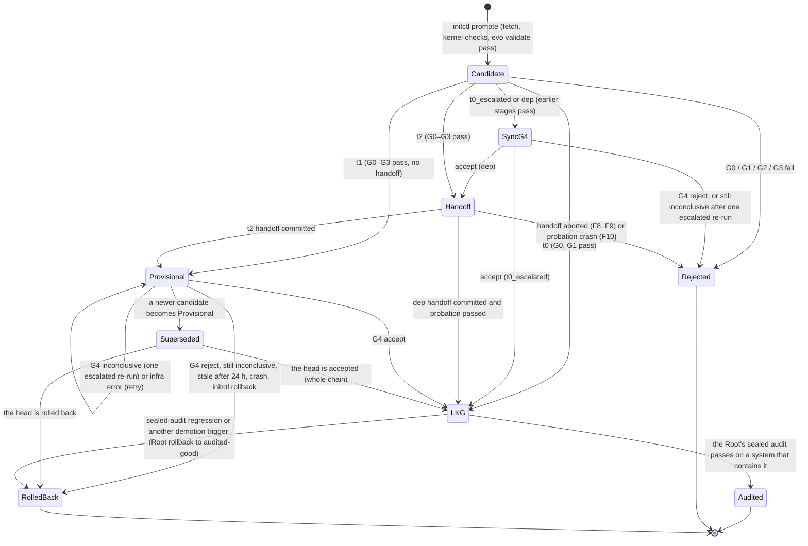

Rules:
- **One pipeline at a time.** At most one G0–G3 pipeline runs, because builds are serialized FIFO through supervise's single build slot (`cache/build/slot/`, supervise.md §3.6.2). A conflicting `promote` gets `E_BUSY` with `data.job` naming the blocker. This is also the single-committer rule (Ouroboros). At most one G4 job runs at a time (gate.md §3.1). At L2 the fleet's members submit through the same single committer, and only the primary adopts (§3.15.5).
- **Provisional chains.** A candidate may be promoted on top of a provisional version. The chain depth is capped at `supervise.max_provisional_depth` = 3 (`E_PROVISIONAL_DEPTH` beyond). A newer provisional head supersedes and cancels a pending or running G4; G4 then judges the newest head against LKG. Accept makes the head LKG and accepts the whole chain; reject rolls the whole chain back. One G4 per accepted chain, not per commit.
- **No provisional new dependencies.** A `dep` candidate runs only after its G4 passed (gate.md §3.1). New third-party code is the riskiest change a body can make.
- **Inconclusive is resolved mechanically, never by a person** (D4; `needs_owner` is removed). An underpowered, over-budget or interrupted G4 gets exactly one escalated re-run: repeats doubled (`R` = 4) and every pool and holdout task the gate budget allows, inside the level's soft gate budget (§3.14). If the re-run is still inconclusive, the incumbent wins: the candidate is rejected with `gate.g4.inconclusive_final` and rolled back like a reject. A better candidate whose cost × time rose more than 1.5× (v0.2's `needs_owner`) is accepted only if the projected day spend at the new cost per task fits the level's soft day budget; otherwise it is rejected as `gate.g4.costlier_than_budget`. Neither outcome is a demotion trigger. gate.md §3.9 and §3.12 implement both rules with the codes `inconclusive_final` and `costlier_than_budget`; its "projected day spend" is tasks per day × the new cost per task, against the task part of the soft day budget, which this doc confirms. An owner's optional `/bless` or `/reject` may settle an inconclusive version earlier; the loop never waits for one.
- **LKG is not audited-good.** A G4 accept moves body LKG at once, as in v0.2. The Root's sealed audit (weekly by default, and on every kernel upgrade; spec §16) later confirms the whole system as audited-good, or rolls it back to the previous audited-good system and demotes (§3.15.3). Between audits, a promotion whose gain rests only on agent-authored tasks is flagged `audit_required` (§3.15.4).
- **Re-promote after an aborted handoff** of a SHA that passed G0–G3 within the last 3600 s reuses the gate result and goes straight to the handoff (initctl.md `promote` idempotency).

### 3.3 T0: edit, reload, use (and keep)

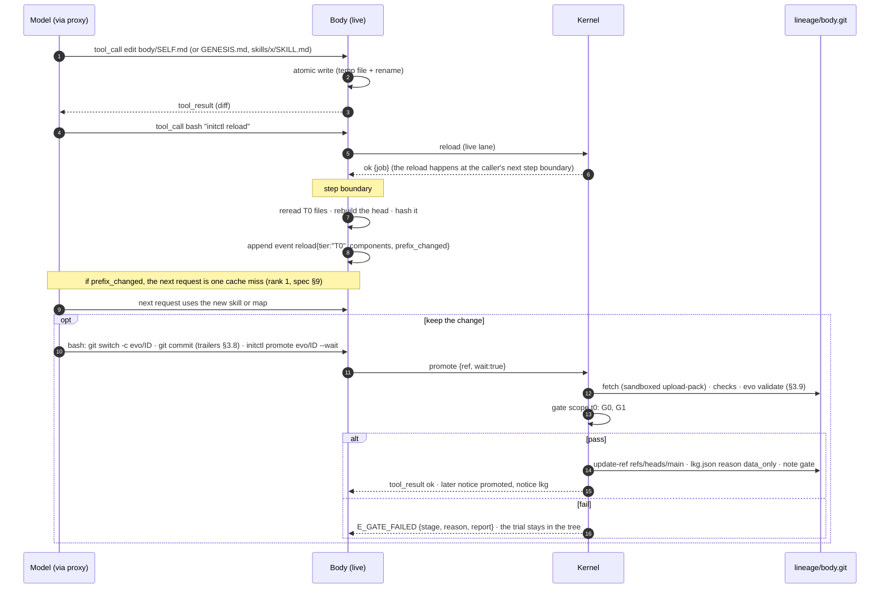

Notes:
- Skills are read on demand, so a skill edit never changes the head. `GENESIS.md`, `SELF.md` and tool schemas are in the head, so editing them does (body/log-context.md owns the head definition and `prefix_hash`).
- A failed keep changes nothing: the trial edit is still in the live tree and in use. The agent may revert it with `git checkout -- <path>` and reload.
- **Wholesale rewrites escalate.** If a T0 candidate's diff on any T0 file has `min(added, deleted) > 0.5 × old_line_count`, gate.md classifies it `t0_escalated` and runs G4 before `main` moves. Itemized deltas stay cheap; rewrites must prove themselves on tasks (ACE's 18,282 → 122-token collapse). This is a measurement rule, not a prohibition.

### 3.4 T1: write a component, build, reload, use (and keep)

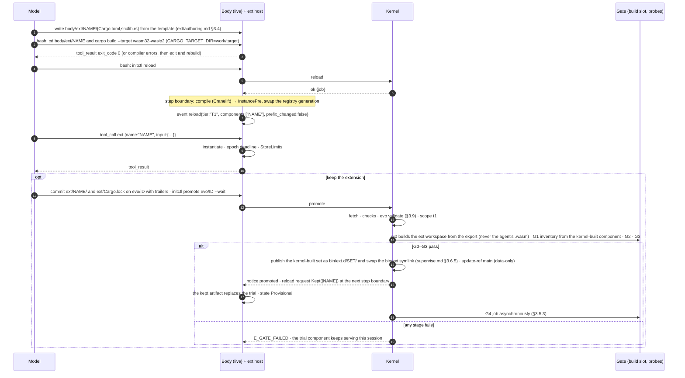

Notes:
- The `ext` tool's schema never changes, so a T1 reload never changes the head (spec §4). G2 confirms it with the head-hash check.
- A trial component lives only for the current session unless kept. At boot and at each new session the body loads only kept components (ext/host.md §3.9).
- The kernel never uses an agent-built `.wasm` in the gate. It rebuilds from the committed source in the build slot, so the agent cannot poison the gate's build.
- Extensions live in the separate extension workspace `ext/` with its own `ext/Cargo.lock` (CONVENTIONS §2). A new extension adds a source-less member entry to `ext/Cargo.lock`. gate.md §3.1 has adopted ext ledger E10: a lockfile diff that only touches source-less (workspace-member) entries is not a dependency change, so a new `ext/<name>/` is scope `t1` and takes the provisional lane.

### 3.5 T2: worktree → commit → promote → gate → overlapped handoff → provisional → G4 → LKG

#### 3.5.1 Happy path

Mechanics are kernel/supervise.md §3.6 and ADR-001; this is the evolution view.

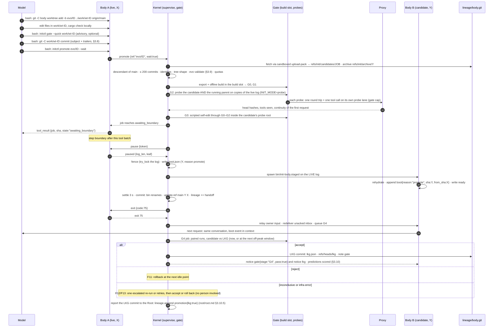

Only probe-mode boots (G2, G3) make a model round trip; the handoff boot of B does not (body/boot.md §3.10).

#### 3.5.2 Failure branches

Every branch ends in a state the agent can read from its own log or from the job record. Codes are kernel/initctl.md §4.2 (`E_*`), kernel/gate.md §4 (`gate.*`) and §4.2 here (dotted validator codes). `update-failed.json` stages are supervise.md §4.3's.

| # | Where | Detection | Kernel action | What the agent sees | Counts as crash? |
|---|---|---|---|---|---|
| F1 | promote, before the job | kernel checks or validator fail | candidate stays only in `refs/init/archive/<sha>` | `initctl promote` error `E_NOT_DESCENDANT`, `E_FOREIGN_COMMIT`, `E_TREE`, `E_TOO_LARGE`, or a dotted validator code with all problems in `details[]` | no |
| F2 | promote | `E_BUSY`, `E_PROVISIONAL_DEPTH`, `E_SAFE_MODE`, `E_DISK`, `E_QUOTA{quota}` (§3.14), a soft-budget refusal from the kernel's proxy features | refuse | error result | no |
| F3 | G0 | build, check, clippy, test, `forbid(unsafe_code)` missing, build-config policy | stop; note gate | `E_GATE_FAILED {stage:"G0", reason:"gate.g0.…", report}`; ≤ 4 KiB of diagnostics in `state/kernel/gate/<job>/report.json` | no |
| F4 | G1 | `self.json` drift, marker or WIT-copy mismatch | stop | `E_GATE_FAILED {stage:"G1"}` with the drift summary | no |
| F5 | G2 | probe exit or timeout (90 s), tools mismatch, head hash ≠ parent's with `Prefix-change: no`, continuity, boot-honesty, budget | sweep the probe instances | `E_GATE_FAILED {stage:"G2", reason:"gate.g2.…"}`; both hashes and the first differing byte offset for `prefix_hash` | no |
| F6 | G3 | scripted self-edit fails inside the candidate | stop | `E_GATE_FAILED {stage:"G3"}` | no |
| F7 | sync G4 (`dep`, `t0_escalated`) | reject or inconclusive | candidate rejected; nothing ran | `E_GATE_FAILED {stage:"G4"}` | no |
| F8 | pause | no step boundary within `supervise.pause_timeout_s` = 1800 s | abort (`stage:"pause"`) | job `E_PAUSE_TIMEOUT`; `update_failed` appended by A; re-promote within 1 h reuses the gate result | no |
| F9 | handoff | B exits before `ready`, no `ready` in 90 s, B dies while settling, fence failure | sweep B; A resumes (it never stopped); `bin/init-body` never changed | A appends `update_failed{stage:"handoff"\|"fence", reason, exit_code}`; job `E_HANDOFF_FAILED` | no (`swaps_failed` += 1) |
| F10 | probation | B crashes within `probation_s` = 120 s after commit | spawn the previous binary, reason `rollback` | boot event with `update_failed{stage:"probation"}` | swap failure, not toward the LKG crash window |
| F11 | async G4 | reject (score, pool or holdout inferior, perf no gain, costlier, no gain) | rollback at the next idle point, or after `rollback_max_defer_s` = 3600 s at a step boundary (§3.6) | notice `gate{stage:"G4", pass:false, reason}`, then boot `{reason:"rollback"}` | no |
| F12 | async G4 | infrastructure error | retry up to 2 times at once, then after 1 h and 4 h; still no verdict → F16 | notice `gate{stage:"G4", pass:null, reason:"gate.g4.infra"}` | no |
| F13 | async G4 | inconclusive: insufficient tasks, underpowered, budget, timeout, disk; or better but > 1.5× cost | one escalated re-run (§3.2 rules); still inconclusive → reject `gate.g4.inconclusive_final` and roll back as F11; the cost case → accept iff the level's soft day budget fits, else reject `gate.g4.costlier_than_budget` | notice `gate{stage:"G4", pass:null, reason:"gate.g4.…"}`, then the final verdict; status shows `provisional_since` | no |
| F14 | G4 | a canary scores 1000 | reject; `refs/init/quarantine/<sha>`; R4 record; proposed as a demotion trigger (§9) | `gate{stage:"G4", pass:false, reason:"gate.g4.canary"}`, then rollback | no |
| F15 | any | kernel killed mid-pipeline | supervise cold-start recovery first. If lineage `main` already names the candidate, it is provisional and G4 is re-queued; otherwise the job is `failed` with `reason:"kernel_restart"`. Gate stages never resume mid-way. | `update_failed{stage:"kernel_restart"}` at the next boot (failed case) | no |
| F16 | provisional | > 24 h (`evolution.provisional_max_age_s`) without a G4 verdict | roll back to LKG at the next idle point (`provisional_stale`); a report line, not a demotion trigger | notice, then boot `{reason:"rollback"}` | no |
| F17 | provisional | an external action or `initctl vendor` is requested | refuse (kernel); an action outside the charter's classes is also refused by the Root at any time (R3) | `E_PROVISIONAL` | no |
| F18 | after LKG | the Root's sealed audit finds a regression beyond δ_S | Root: whole-system rollback to audited-good and demotion (§3.15.3) | boot `{reason:"rollback"}` with the demotion line (awareness.md §3.6) | no |
| F19 | ceiling | a request the Root refuses at a hard ceiling or outside an action class (R2, R3) | the Root refuses it. It demotes only per D6: an action-class or policy violation, a level-gated request, or a ceiling refusal while the kernel's guard reported headroom (§3.14). An ordinary ceiling hit is logged | the refusal (code: root/egress.md); the demotion rollback only in the D6 cases | no |
| F20 | L3 kernel candidate | the candidate's gate fails the gate-of-gates (accepts a mutant or rejects a control) | candidate refused; demotion (spec §15) | `E_GATE_FAILED {stage:"gate_of_gates"}`, then the level change | no |
| F21 | panic | any panic channel (R1) | everything in the agent zone stops; on resume the system starts from audited-good one level lower | boot `{reason:"cold"}` with `panic` and the demotion line | no |

Rules carried by all branches:
- **A failed swap is a non-event** (spec §7.1): A keeps running the same conversation, and the crash counters are untouched.
- **Bounded failure text.** What the agent sees is ≤ 4 KiB per failure, with full logs in `vault/` and the redacted report under `state/kernel/gate/<job>/`. Raw evidence beats summaries (Meta-Harness), but context is finite (Ouroboros's review-pack overflow).
- **No silent partial state.** Lineage `main` moves only at a handoff commit, a data-only promotion or a rollback (supervise.md §3.11.1).

#### 3.5.3 Parent definitions

- **G0–G3 compare against the running version.** G2 probes the running parent alongside the candidate and compares head hashes measured by the proxy (gate.md §3.5), unless `Prefix-change: yes`.
- **G4 and the accept rule compare against LKG, on the same model.** A provisional chain is judged as a whole against the last version that passed G4. Comparisons across models are never made (§3.12).

### 3.6 Rollback to LKG

There are two rollbacks. The **kernel's body rollback** (kernel/supervise.md §3.6.7) **is** the overlapped handoff with target LKG (`bin/init-body.lkg`), no probe, `INIT_BOOT_REASON=rollback`. The **Root's whole-system rollback** (root/root.md R1) restores the last audited-good kernel, body and extension set together; it follows every demotion trigger.

| Trigger | Who rolls back | When the pause is sent | Target |
|---|---|---|---|
| G4 reject (incl. canary), inconclusive after the escalated re-run, provisional stale (F16) | kernel | at the next idle point; after 3600 s at the next step boundary | LKG |
| `initctl rollback` | kernel | the caller's next step boundary (the command returns at `awaiting_boundary`) | LKG |
| crash of a provisional body outside probation | kernel | no pause (A is dead): spawn the target directly | LKG |
| crash within probation (F10) | kernel | no pause | the previous running version |
| sealed-audit regression, ceiling or class attempt, crash loop on LKG (§3.15.3) | Root | the Root stops the agent zone (`stop` with a grace period, then a sweep; root/root.md §3.7.3) | audited-good tuple (in system safe mode after a crash loop) |
| kernel crash loop on a tuple that is not the LKG tuple | Root | none (the kernel is crashing) | the LKG tuple; not a demotion |
| resume after a panic | Root | none (everything is already stopped) | audited-good tuple |

Lineage: the kernel creates `refs/init/rolled-back/<cur>` (create-only, evidence) and moves `refs/heads/main` back to `lkg.json.sha` with a compare-and-swap. It never reverts commits: lineage `main` only ever holds kernel-approved SHAs, so the Deedee #222 hazard (reverting someone else's commits) cannot arise. After a Root rollback the restarted kernel restores `bin/` from the Root's store and resets lineage `main` and `lkg` to the target tuple's body SHA, with the same evidence refs (root/root.md §3.7.3 step 5); the Root never writes `bin/` or lineage itself. If the LKG body fails to become ready, the kernel resumes the provisional body, reports `rollback_failed` to the Root (R1 decides the escalation) and retries after 600 s.

**Body-side resync of `body/`** (procedure owned here; executed by the body at boot, body/boot.md; the kernel never runs git in `body/`, supervise.md K-F3). It runs inside the body's sandbox with the agent's own privileges. Nothing is ever deleted (the Ouroboros near-deletion incident):

```sh
B="$INIT_HOME/body"
git -C "$B" fetch --quiet origin            # install-time refspecs bring main, notes and refs/init/*
on_main=$([ "$(git -C "$B" symbolic-ref -q --short HEAD)" = main ] && echo 1)
if git -C "$B" merge-base --is-ancestor main origin/main; then
  # lineage main only moved forward (promote, data-only promotion)
  if [ -n "$on_main" ]; then
    git -C "$B" merge --ff-only --quiet origin/main || echo drift  # touches dirty paths → leave it, report drift
  else
    git -C "$B" branch -f main origin/main || echo drift           # ref only; the working tree is not touched
  fi
else
  # main moved backward (rollback, or a panic dropped a provisional chain),
  # or the agent committed on its own main: keep everything, then reset main
  git -C "$B" branch -f "rolled-back/$(git -C "$B" rev-parse --short=12 main)" main
  if [ -n "$on_main" ]; then
    before=$(git -C "$B" rev-parse -q --verify refs/stash || true)
    git -C "$B" stash push --include-untracked -m "init: resync to $(git -C "$B" rev-parse --short=12 origin/main)"
    after=$(git -C "$B" rev-parse -q --verify refs/stash || true)
    git -C "$B" switch -C main origin/main
    # pop only the stash created above: with no local changes `stash push` creates none,
    # and a blind `stash pop` would apply an older, unrelated stash
    if [ "$after" != "$before" ]; then git -C "$B" stash pop --index || echo "stash kept"; fi
  else
    git -C "$B" branch -f main origin/main || echo drift
  fi
fi
```

The ancestry test covers rollback, panic resume and an agent that committed on its own `main`, without trusting `INIT_BOOT_REASON`. The boot event reports `drift` (fast-forward refused) or `stash` (pop conflicted; the stash stays). The built script runs nothing unless `body/.git` exists, and it sets `GIT_CEILING_DIRECTORIES` so git never finds a repository above `body/`. A timeout (30 s per command) stops the script. `main` moves only after `rolled-back/<sha12>` exists. A refused fast-forward and a failed pop are warnings, not errors. If `body/` is checked out on another branch, only the ref `main` moves and the working tree is left alone. In probe mode the script does not run; in safe mode only the fetch runs (body/boot.md §3.6). Rolled-back commits stay reachable in lineage (`refs/init/rolled-back/<sha>`, `refs/init/archive/<sha>`) and in the clone (`rolled-back/<sha12>`).

### 3.7 Safe mode (evolution view)

Body crash backoff stays in the kernel (kernel/supervise.md §3.7: backoff 1 s → 60 s; more than `crash_limit` = 4 body crashes on LKG within 600 s puts the kernel's **body** safe mode on and is reported to the Root as `body_safe{on:true}`). Crash-loop **escalation** belongs to the Root (spec §14 R1; mechanics, thresholds and timers: root/root.md §3.6.4). A crash loop on LKG, of the kernel on the LKG tuple or of the body on body LKG, is a demotion trigger, so nobody has to clear it by hand.

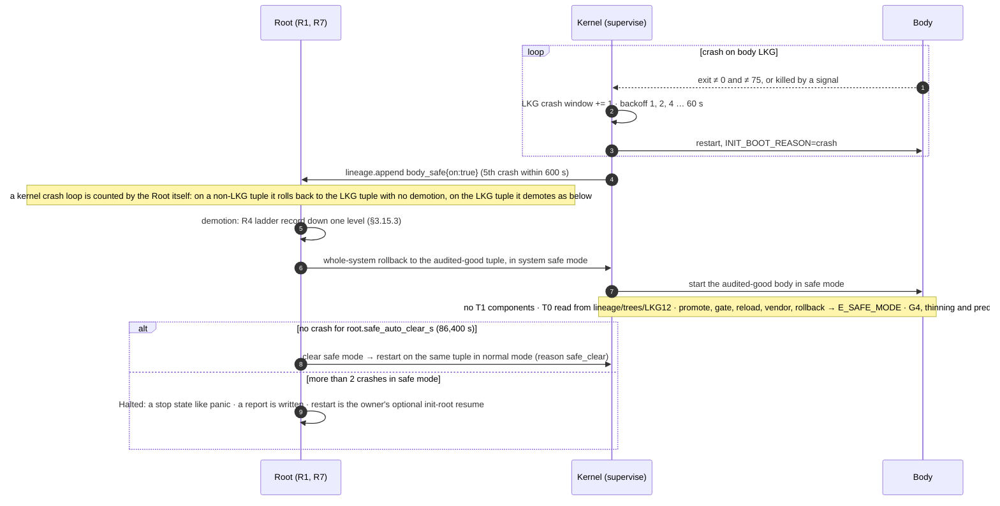

Evolution's requirements on safe mode: every evolution entry point (`promote`, `gate --quick`, `vendor`, `task submit`, fleet campaigns, kernel promotes, thinning, upstream merges) is refused; G4 jobs in progress are cancelled; the boot event carries `mode:"safe"` and the crash tails, so the agent can diagnose without changing itself. `status`, `level`, `wait`, `job.*` and `kernel propose` still work. System safe mode clears itself after 24 h without a crash (root/root.md; `/clear-safe` no longer exists, D4). Halted is a stop state outside the evolution loop, the same class as a panic; nothing in the loop waits for it to end. Whether the kernel's own **body** safe mode should also clear itself is root/root.md's open question X1 to supervise.md; evolution's answer is yes, on the same timer.

### 3.8 Commit message grammar

Every commit the agent submits has this shape. The kernel reads the message from the fetched commit in lineage with `$G cat-file commit <sha>` (everything after the first blank line; `$G` is supervise.md §3.11.2's hardened prefix), so log formatting and repo-local config cannot interfere.

```
<subject>                                 ≤ 72 bytes, single line
<blank line>
[<body paragraphs, free text>]
[<blank line>]
<trailer block>                           last paragraph; every line a trailer or a continuation
```

**Subject (ABNF, RFC 5234):**

```abnf
subject   = type [ "(" scope ")" ] ": " summary
type      = "feat" / "fix" / "perf" / "guard" / "refactor" / "skill"
          / "retire" / "thin" / "upstream" / "revert"
scope     = 1*64( ALPHA / DIGIT / "-" / "_" / "/" / "." )
summary   = 1*( %x20-7E / UTF8-non-ascii )     ; no trailing whitespace
```

**Change types:**

| Type | Use it for | Notes |
|---|---|---|
| `feat` | a new capability | |
| `fix` | correcting observed wrong behaviour | must cite the failure (`Repro`) |
| `perf` | a change that claims only cost/time/cache gains | triggers the perf-only accept rule (gate.md) |
| `guard` | a new rule, check, guardrail, or prompt instruction | must cite the failure (`Repro`); must name the weakness (`Compensates-for` ≠ `none`) |
| `refactor` | no intended behaviour change | |
| `skill` | T0 data only (`skills/**`, `SELF.md`, `GENESIS.md`) | path-checked |
| `retire` | deleting unused growth | deletion-shaped diff |
| `thin` | deleting a scaffold after a model change | deletion-shaped diff |
| `upstream` | merging or declining a maintainer seed release | merge commit |
| `revert` | undoing an earlier own commit | must equal `git revert` output |

**Trailer keys and values.** Keys are matched **exactly** in the canonical spelling below. A key that matches a canonical key only case-insensitively (`prefix-change`) is rejected with `trailer.noncanonical_key`, so lineage stays greppable.

```abnf
why            = 10*500VCHAR-or-SP
predicts       = clause *( ";" *WSP clause )                 ; 1 to 5 clauses, see §3.10
compensates    = "none" [ SP "(" 1*200text ")" ]
               / slug [ ":" SP 1*200text ]
slug           = 3*40( %x61-7A / DIGIT / "-" )                ; lowercase weakness id
prefix-change  = "yes" / "no"
repro          = repro-ref *( "," SP repro-ref )             ; 1 to 5 refs
repro-ref      = "task:" task-id
               / "event:" session-id "#" 16HEXDIG
               / "trace:" 16HEXDIG                              ; proxy req_id (kernel/proxy.md §3.13)
retires        = component-id                                 ; repeatable key
thins          = component-id                                 ; repeatable key
upstream       = tag SP 40HEXDIG [ SP "declined" ]            ; tag = "seed-v" semver, present in lineage as refs/upstream/<tag>
reverts        = 40HEXDIG
component-id   = ("ext" / "skill" / "tool" / "mod" / "profile") "/" 1*128( ALPHA / DIGIT / "-" / "_" / "/" / "." )
               / "prompt/" ("GENESIS.md" / "SELF.md") "/" slug
               / "hook/" name "/" name                    ; reserved; none exist in init:ext@1.x
```

**Mandatory-trailer matrix** (M = mandatory, C = conditional, – = must be absent, o = optional):

| Type | `Why` | `Predicts` | `Compensates-for` | `Prefix-change` | `Repro` | `Retires` | `Thins` | `Upstream` | `Reverts` | Extra checks |
|---|---|---|---|---|---|---|---|---|---|---|
| feat | M | M, ≥1 non-baseline clause | M | M | C¹ | – | – | – | – | |
| fix | M | M, ≥1 non-baseline clause | M | M | M | – | – | – | – | |
| perf | M | M, ≥1 strict clause on `cost_usd`, `wall_s`, `gap_ms_p50`, `turns`, `tokens_in`, `tokens_out` or `cache_hit` | M | M | C¹ | – | – | – | – | gate.md applies the perf-only rule |
| guard | M | M, ≥1 non-baseline clause | M, a slug (not `none`) | M | M | – | – | – | – | |
| refactor | M | M (baseline allowed) | M | M | C¹ | – | – | – | – | |
| skill | M | M (baseline allowed) | M | M | C¹ | – | – | – | – | changed paths ⊆ `skills/**` ∪ `SELF.md` ∪ `GENESIS.md` |
| retire | M | M (baseline allowed) | M | M | – | M (≥1) | – | – | – | deletion-shaped², ids exist in parent `self.json` |
| thin | M | M (baseline allowed) | M, equals the removed component's tag | M | – | – | M (≥1) | – | – | deletion-shaped²; thinning window open (§3.12) |
| upstream | M | M (baseline allowed) | `none` allowed | M | – | – | – | M | – | merge shape (§3.9 step 2) |
| revert | M | M (baseline allowed) | M | M | – | – | – | – | M | tree equals `git revert` of the target |

¹ **The prefix rule.** If `Prefix-change: yes`, `Repro` is mandatory for every type except `retire`, `thin`, `upstream` and `revert`. Text added to the head (`GENESIS.md`, `SELF.md`, tool descriptions) is exactly where invented rules live; in "Phantom Guardrails" an LLM invented a guardrail for a failure that never happened in 15 of 60 runs. This makes the spec's "no observed failure, no rule" mechanically checkable for the case that costs the most: the prefix is paid on every request, and a prefix change is one cache miss.

² **Deletion-shaped:** from `git diff --numstat <parent> <candidate>`, total added lines ≤ max(10, total deleted lines / 10), and no new files except `self.json` changes.

**Strict perf clause.** "Strict" means `<` on `cost_usd`, `wall_s`, `gap_ms_p50`, `turns`, `tokens_in` and `tokens_out`, and `>` on `cache_hit`. A `perf` commit with no such clause fails with `predicts.trivial_only`.

Other keys (`Signed-off-by`, `Co-authored-by`, anything unknown) are preserved, sorted, and stored, but have no meaning to the kernel. `Why`, `Predicts`, `Compensates-for`, `Prefix-change`, `Repro`, `Upstream`, `Reverts` may appear at most once; `Retires` and `Thins` are repeatable.

**Example** (the spec §6.4 example, made machine-checkable):

```
feat(ext): add pty component for interactive programs

The bash tool cannot drive programs that check isatty(); task 2026-10-20-03
hung for 600 s on an interactive REPL.

Why: task 2026-10-20-03 hung on an interactive REPL (events e4f1a2b3c4d5e6f7).
Predicts: pass_rate@label:interactive > parent; gap_ms_p50@label:interactive <= parent-30%
Compensates-for: none (new capability)
Prefix-change: no
Repro: task:2026-10-20-03
```

### 3.9 Validation algorithm (run by the kernel on `initctl promote`)

The validator lives in `init-kernel` (module `evo::validate`). supervise.md §3.6.1 calls it after its own kernel-generic checks (descendant of `main`, ≤ 200 commits, identities, tree shape), so it never sees a foreign commit. It shells out to the `git` CLI through the hardened prefix `$G` on `lineage/body.git` (and runs `git interpret-trailers` with the same `env -i` environment and a kernel-owned empty cwd), and never runs agent code.

Behaviour of `git interpret-trailers` that the validator depends on was verified locally with git 2.39.5 on 2026-10-19 (Apple Git-154); the current upstream manual is git 2.56.0:

| Input | `git interpret-trailers --parse` output | Consequence |
|---|---|---|
| Last paragraph all `Key: value` lines | each trailer, continuation lines unfolded with one space | normal case |
| Last paragraph mixes trailers and prose, no Git-generated trailer | **nothing**, exit code 0 | silent loss → the validator must check the block itself |
| Same, with one `Signed-off-by:` | only the trailer lines; prose dropped silently | 25% rule; same consequence |
| A `---` line anywhere in the body | **nothing** after it is parsed (treated as a patch divider) | always pass `--no-divider` |
| `Why:` with an empty value | `Why: ` | the validator rejects empty values |
| `Why : x` / `Repro:x` | `Why: x` / `Repro: x` (normalized) | accepted |
| Key containing a space (`Why not: x`) | the block is not recognized at all | caught by the strict check |
| Message with only one paragraph | nothing (a blank line must precede the block) | `trailer.block_missing` |
| CRLF line endings | normalized to LF | accepted |

```rust
// init-kernel/src/evo/validate.rs  (signatures and key logic; std + serde only)
use std::collections::BTreeMap;
use std::path::Path;
use std::process::{Command, Stdio};

#[derive(Debug, Clone, Copy, PartialEq, Eq, PartialOrd, Ord, serde::Serialize, serde::Deserialize)]
#[serde(rename_all = "lowercase")]
pub enum ChangeType { Feat, Fix, Perf, Guard, Refactor, Skill, Retire, Thin, Upstream, Revert }

#[derive(Debug, Clone, serde::Serialize)]
pub struct Validated {
    pub sha: String,
    pub parent: String,
    pub change_type: ChangeType,
    pub scope: Option<String>,
    pub summary: String,
    pub trailers: Trailers,
    pub changed_paths: Vec<String>,          // sorted; input to gate.md's scope decision
    pub capability_labels: Vec<String>,      // sorted; see below (gate.md §3.9.1)
}

#[derive(Debug, Clone, Default, serde::Serialize)]
pub struct Trailers {
    pub why: String,
    pub predicts: Vec<Clause>,               // §3.10
    pub compensates_for: CompTag,
    pub prefix_change: bool,
    pub repro: Vec<ReproRef>,
    pub retires: Vec<String>,
    pub thins: Vec<String>,
    pub upstream: Option<UpstreamRef>,
    pub reverts: Option<String>,
    pub other: BTreeMap<String, Vec<String>>,
}

#[derive(Debug)]
pub struct ValidationError { pub code: &'static str, pub detail: String }

/// `g` runs git with supervise.md §3.11.2's hardened prefix on lineage/body.git.
pub fn validate(g: &KernelGit, parent: &str, candidate: &str)
    -> Result<Validated, Vec<ValidationError>>;

/// Runs `git interpret-trailers --parse --no-divider` with the message on stdin.
fn git_parse_trailers(git: &Path, empty_dir: &Path, msg: &str) -> std::io::Result<Vec<(String, String)>> {
    let mut child = Command::new(git)                       // absolute `[supervise] git` path
        .env_clear().env("PATH", "/usr/bin:/bin").env("LC_ALL", "C")
        .env("GIT_CONFIG_NOSYSTEM", "1").env("GIT_CONFIG_GLOBAL", "/dev/null")
        .env("GIT_CEILING_DIRECTORIES", empty_dir.parent().unwrap_or(empty_dir)) // never find an enclosing repo
        .current_dir(empty_dir)                             // kernel-owned, no repo
        .args(["-c", "trailer.separators=:", "interpret-trailers", "--parse", "--no-divider"])
        .stdin(Stdio::piped()).stdout(Stdio::piped()).stderr(Stdio::piped())
        .spawn()?;
    // write msg to stdin, read stdout; each line "Key: value" (values already unfolded)
    unimplemented!()
}
```

Steps (all errors are collected, not short-circuited, so the agent gets every problem in one round):

1. **Resolve.** `candidate` = the SHA supervise recorded at fetch (`refs/init/candidates/<job>`). `parent` = `refs/heads/main` (the running version).
2. **Shape.** `git rev-list --parents -n 1 <candidate>`:
   - non-`upstream`: exactly one parent, equal to `parent`. Otherwise `promote.not_single_commit` (the agent squashes: `git reset --soft origin/main && git commit`).
   - `upstream`: exactly two parents; parent 1 = `parent`; parent 2 = `$G rev-parse refs/upstream/<tag>^{commit}`, and the SHA in the trailer equals it. Otherwise `upstream.shape` / `upstream.unknown_tag`.
3. **Identity.** Checked by supervise before the validator runs (`E_FOREIGN_COMMIT`): every commit in `main..candidate` is by `INIT Agent <agent@init.local>` or is an ancestor of some `refs/upstream/*`. The validator does not repeat it.
4. **Subject.** Parse with the ABNF in §3.8. Errors: `trailer.subject`, `trailer.subject_too_long`.
5. **Git parse.** `git interpret-trailers --parse --no-divider` on the message → list L_git.
6. **Strict block check.** Split the message on blank lines (`\n` followed by optional whitespace and `\n`). The last paragraph P must exist and not be the subject paragraph (`trailer.block_missing`). Every line of P must match `^[A-Za-z][A-Za-z0-9-]*[ \t]*:` or `^[ \t]+\S` (`trailer.block_mixed`, with the offending line). The number of key lines in P must equal `len(L_git)` (`trailer.parser_mismatch`). This turns git's silent drops into loud errors.
7. **Keys.** Canonical spelling (`trailer.noncanonical_key`), allowed multiplicity (`trailer.duplicate`), non-empty values (`trailer.empty`).
8. **Values.** Parse each known key with §3.8's ABNF (a value that breaks its ABNF gives `trailer.invalid:<Key>`); `Predicts` with §3.10's grammar (`predicts.parse`, `predicts.too_many`, `predicts.trivial_only`).
9. **Matrix.** Apply the mandatory-trailer matrix for the type and the prefix rule (`trailer.missing:<Key>`, `trailer.forbidden:<Key>`, `trailer.repro_required_for_prefix`).
10. **Cross-checks against the repo and state:**
    - `skill`: `$G diff --name-only <parent> <candidate>` ⊆ `skills/**` ∪ `SELF.md` ∪ `GENESIS.md` (`skill.paths`).
    - `retire`/`thin`: deletion-shaped (`retire.not_deletion`); every id exists in the parent's `self.json` (`retire.unknown_component`); for `thin`, `Compensates-for` equals the removed component's recorded tag (`thin.tag_mismatch`).
    - `revert`: `Reverts` is an ancestor of `parent` (`git merge-base --is-ancestor`), and the candidate's tree equals the tree git itself produces for that revert. On git 2.39 (no `merge-tree --merge-base`, verified: "unknown option") the kernel uses a throwaway, kernel-owned worktree of the lineage repo (never an agent-writable tree, K-F3), with the hardened environment: `$G worktree add --detach $INIT_HOME/cache/revert-check <parent>` (the directory name is fixed, which assumes promotions are serialized), `revert --no-commit <Reverts>` in it, compare `write-tree` with `$G rev-parse <candidate>^{tree}`, then `$G worktree remove --force $INIT_HOME/cache/revert-check`. A conflicted revert or a different tree gives `revert.mismatch`. On git ≥ 2.40 the same tree is `git merge-tree --write-tree --merge-base=<Reverts> <parent> <Reverts>^` with no worktree (version boundary UNVERIFIED).
    - `Repro` refs exist: `task:` → a frozen pool task `vault/gate/pool/<id>/` (maintainer or admitted agent task, §3.15.4) or the working copy `state/tasks/<id>/` (read per supervise.md K-F2); `event:` → the id appears in `state/sessions/<session>.jsonl` (K-F2 read); `trace:` → the `req_id` exists in `vault/traces/v1/` with visibility `agent` (proxy.md trace reader; until a reader is wired in, every `trace:` ref is not found) (`repro.not_found`). Existence is all the kernel can check at promote time; G4 adds the repro run (§3.10.4), and only frozen pool tasks count for gate.md's `repro_fixed`.
    - `Compensates-for` on `feat`/`guard`/`fix`: every component added by the diff must carry the same slug in its `@init` marker. G1 performs this check (selfmap.md §3.8 check 3, `gate.g1.tag_marker_mismatch`); the validator only parses the trailer.
11. **Capability claim** (for gate.md §3.9.1 `capability_gain`, v0.3). `capability_labels` = the sorted, de-duplicated labels `l` of every `Predicts` clause on `pass_rate` with scope `label:<l>` and an improving direction: op `>` or `>=` with a target of `parent+N%` (N > 0) or `parent` under `>`. Clauses on other metrics, other scopes or a non-improving direction add nothing. No claim, no capability path.
12. **Return** `Validated`, which is stored verbatim (sorted keys) in the gate note and in `vault/lineage.jsonl`.

The validator is pure with respect to its inputs: same repo state, same result. It takes < 50 ms on a 1,000-commit history (two `git` processes plus a `rev-list`); this is a Phase 0 measurement target, not yet measured.

### 3.10 Predictions: grammar, scoring, notes

`Predicts:` must be falsifiable. AHE scored each edit's predicted fixes against the tasks that actually flipped in the next iteration; measured fix-prediction precision was 33.7% (random 6.5%) and regression prediction was near chance (11.8% vs 5.6%). INIT copies the mechanism and makes it kernel-scored from data the agent cannot write.

#### 3.10.1 Clause grammar

```abnf
clause     = metric-clause / fixes-clause / risks-clause
metric-clause = metric [ "@" scope ] *WSP op *WSP target
fixes-clause  = "fixes" SP task-set        ; tasks predicted to flip fail → pass
risks-clause  = "risks" SP task-set        ; tasks the agent fears may flip pass → fail
task-set   = task-ref *( "," *WSP task-ref )        ; 1 to 10
task-ref   = "task:" task-id / "label:" label
metric     = "pass_rate" / "cost_usd" / "wall_s" / "cache_hit" / "turns"
           / "tokens_in" / "tokens_out" / "gap_ms_p50" / "body_tokens"
           / "ext_calls:" name
scope      = "all" / "pool" / "holdout" / "label:" label / "task:" task-id
           / "sealed"                               ; M7: pass_rate on the Root's G4 slice only (below)
op         = "<=" / ">=" / "<" / ">"
target     = "parent" [ ( "+" / "-" ) number "%" ] / number
label      = 1*40( %x61-7A / DIGIT / "-" )
```

**Scope `sealed` (M7; lane L1-V2; m7-design.md §3.4, §3.2.13).** A claim about S, which the agent can never see, pre-registered in the commit: for example `Predicts: pass_rate@sealed >= parent+15%`. (m7-design.md writes it `pass_rate >= parent+0.15 sealed`; the strict parser takes only this section's ABNF spelling.)
- **Valid form:** metric `pass_rate`, op `>=` or `>`, target `parent` or `parent+N%`. Any other metric, op or target with scope `sealed` is `trailer.invalid:Predicts`.
- **Units:** N is in **percentage points** of pass rate, not a fraction of the parent's value, because the slice reveals only the rounded difference D, never the parent's pass rate. `parent+15%` claims D ≥ +150‰.
- **Scoring** (§3.10.2): from the Root's slice answer, never from per-task data. x − y := the slice's `d_permille` (rounded to 50), t − y := 10·N permille, and δ := ⌊`m_permille` / 2⌋ from the same answer, in the op table above. With no slice (no S, or the no-S fallback) the verdict is `inconclusive`; the slice's n is always ≥ 24, so `n_min` never applies.
- **Use:** an improving `sealed` claim (N > 0) is what the lineage ratchet requires before a `tie` can become `lineage_gain` (kernel/gate.md §3.9). It also counts toward the hit rate like any other non-baseline clause.

**Metrics** (all per task; every source is kernel-owned):

| Metric | Unit | Statistic over tasks | Source |
|---|---|---|---|
| `pass_rate` | fraction | mean task score (permille / 1000, mean over repeats) | kernel-run check in G4 (gate.md §3.7.1); online, kernel-run checks of fleet evaluations (L2+, §3.10.3) |
| `cost_usd` | micro-USD in the note (`unit:"musd"`; the clause keeps the name `cost_usd`) | median | proxy `cost_ref` (reference-window price, proxy.md), never the billed cost, so DeepSeek's time-of-day prices cannot bias it |
| `wall_s` | s | median | G4 run record / task window (online) |
| `cache_hit` | fraction | Σ cached input / Σ input | proxy usage |
| `turns` | count | median | proxy requests with `x-init-purpose: turn` per task (probe and compaction requests excluded) |
| `tokens_in`, `tokens_out` | tokens | median | proxy usage |
| `gap_ms_p50` | ms | median of per-task p50 | proxy: time from the end of a streamed response with tool calls to the next request in the same session. This is tool time plus harness overhead, observed from outside the body. |
| `body_tokens` | tokens | scalar | selfmap at G1 |
| `ext_calls:<name>` | calls | mean per task | proxy-parsed `ext` tool calls with that `name` |

**Semantics.** Let *x* be the candidate statistic, *y* the parent's (LKG, same model, same tasks), *t* the target (`parent` → *y*; `parent-30%` → 0.7·*y*; a number → itself) and δ(m) the noise floor `δ_used(m)` that gate.md §3.10 hands over, in natural units. All values are carried as integers in the note (permille, micro-USD, ms, tokens), matching body/log-context.md's integers-only rule.

| op | hit if |
|---|---|
| `<=` | *x* ≤ *t* + δ(m) |
| `>=` | *x* ≥ *t* − δ(m) |
| `<` | *x* < *t* − δ(m) |
| `>` | *x* > *t* + δ(m) |

If gate.md has no δ for a metric yet, δ = 0 and the verdict carries `delta_unmeasured: true`.

**Baseline clauses** restate the accept rule and carry no information: `pass_rate >= parent`, `cost_usd <= parent`, `wall_s <= parent` (scope `all`, no percentage). They are allowed, but they never count toward the hit rate, and types `feat`, `fix`, `perf`, `guard` need at least one non-baseline clause (`predicts.trivial_only`). This closes the obvious Goodhart route of predicting only what the gate already requires.

**`fixes` / `risks` verdicts** (AHE's set-intersection rule, kept as is): with F = predicted fixes, R = risk tasks, Flip = tasks that went fail→pass, Reg = tasks that went pass→fail, each evaluated on the same tasks for parent and candidate:

| Verdict | Condition |
|---|---|
| `harmful` | R ∩ Reg ≠ ∅ and F ∩ Flip = ∅ |
| `mixed` | R ∩ Reg ≠ ∅ and F ∩ Flip ≠ ∅ |
| `effective` | F ⊆ Flip |
| `partial` | ∅ ≠ F ∩ Flip ⊊ F |
| `ineffective` | otherwise |

For the hit rate, `effective` counts as a hit, `partial` as half, `ineffective`/`harmful` as a miss, `mixed` as half. Regressions outside R are reported as `unattributed_regressions`.

#### 3.10.2 Offline scoring (at G4, trusted)

At G4 gate.md §3.10 hands `evo::predict` the per-run records of both arms with task labels, `δ_used(m)`, `body_tokens` of both arms, and the repro results (pass = all R repeats scored 1000). Canaries are excluded. For each clause:
1. Select the tasks in scope (labels come from each task's `task.json`; holdout labels are set by the maintainer).
2. If fewer than `n_min = 5` tasks are in scope (or for `fixes`/`risks`, if none of the named tasks ran), the verdict is `inconclusive`.
3. Otherwise compute the verdict above. `body_tokens` is scored at G1 and needs no tasks.

Holdout task ids never appear in verdicts shown to the agent: holdout contributions are reported only as aggregates (`n`, *x*, *y*), so the scoring channel cannot leak holdout contents (spec §2.1 #2).

#### 3.10.3 Online scoring (later tasks)

Spec §6.4 asks for scoring "on later tasks". Online data is weaker (no paired runs, confounding by other changes), so it complements the offline verdict and never replaces it.
- **Window.** Starts when the commit becomes Provisional. Covers the next `horizon = 20` in-scope tasks completed on a version that contains the commit, or 14 days, whichever is first.
- **Baseline.** The last 20 in-scope tasks completed on the parent with the same model before the window opened.
- **Task boundaries and outcomes.** A task and its id are defined in §3.1. The body sends the id as `x-init-task` (proxy.md §3.4, provider.md §3.3); the proxy records usage per task, which is kernel-measured even though the id is body-chosen. **Outcomes come only from kernel-run checks**, never from a person and never from agent-written files. v0.2's owner `/accept` is gone from the loop (spec §18). Online `pass_rate` clauses are therefore scored only from (agent, task) evaluations the kernel runs outside G4 with a frozen check: the fleet's evaluations from L2 on (§3.15.5). At L0–L1 an online `pass_rate` clause resolves as `unavailable`, and its offline verdict stands. An owner's optional `/accept` is recorded and shown in reports, never used for scoring and never waited for (D4). Online cost, time, cache and token clauses work at every level, because the proxy measures them.
- **Confounding.** If another commit with a non-baseline clause became Provisional inside the window, the verdict carries `confounded_by: [sha…]`.
- **Expiry.** A window that closes with fewer than `n_min` in-scope tasks is `expired`.

#### 3.10.4 The repro run (`fix` and `guard`)

For every `Repro: task:<id>` naming a frozen pool task, G4 adds that task to its run set (gate.md §3.7.2, up to 5 extra) and reports `repro: [{ref, parent_pass, candidate_pass}]`. For `feat`, `fix` and `guard`, gate.md's `repro_fixed` can admit a change whose benefit the sampled pool cannot show. A guard whose own repro task does not change outcome is flagged `repro_unchanged` in the note. That is not a rejection reason by itself, but it is the cheapest available evidence against phantom guardrails, visible to the agent and to retirement.

#### 3.10.5 The `refs/notes/predict` note

The kernel writes one note per scored commit on `refs/notes/predict` in `lineage/body.git`, replacing it as online verdicts arrive. The note ref's own history keeps every revision. The agent reads it after `git fetch origin` with `git log --notes=predict`.

```json
{
  "v": 1,
  "sha": "0e786c733a9648164a2b4c4aea7ece24d0beb7c7",
  "model": "deepseek-v4-pro",
  "clauses": [
    {
      "i": 0,
      "text": "pass_rate@label:interactive > parent",
      "baseline": false,
      "offline": {"verdict": "hit", "n_cand": 6, "n_base": 6, "x": 833, "y": 500, "target": 500, "delta": 100, "unit": "permille", "delta_unmeasured": false},
      "online": {"verdict": "pending", "n_cand": 3, "n_base": 20, "horizon": 20, "closes_at": "2026-11-03T00:00:00.000Z", "confounded_by": []}
    },
    {
      "i": 1,
      "text": "fixes task:2026-10-20-03",
      "baseline": false,
      "offline": {"verdict": "effective", "flipped": ["task:2026-10-20-03"], "regressed": [], "unattributed_regressions": 0}
    }
  ],
  "repro": [{"ref": "task:2026-10-20-03", "parent_pass": false, "candidate_pass": true}],
  "summary": {"hits_x2": 4, "misses_x2": 0, "inconclusive": 0, "pending": 1}
}
```

Keys are sorted on write (CONVENTIONS §5). Values are integers; `hits_x2`/`misses_x2` count half-hits as 1 so no fraction is ever written. Holdout-only clauses show aggregates and never task ids. The note is written with `$G notes --ref=predict add -f -F <file> <sha>` and the kernel's explicit identity (supervise.md §3.11.2); the agent's clone receives it through the install-time refspec `+refs/notes/*:refs/notes/*`.

#### 3.10.6 What the score is used for

- **Self-signal.** `predict_hit_rate` = hits / (hits + misses) over the last 20 resolved non-baseline clauses (final verdict = online if resolved, else offline), reported as an integer permille in every `boot` event (body/log-context.md convention) and in `initctl status`.
- **Not a gate criterion.** A prediction miss never blocks a change that passes the accept rule; a hit never rescues one that fails it. Gating on predictions would teach the agent to predict only safe things. This is a mirror (spec §1).
- **Fleet prior (L2).** Per-lineage hit rates are recorded in `vault/lineage.jsonl` for parent selection (§3.15.5).

### 3.11 Usage counting and retirement

#### 3.11.1 Usage counting

The kernel keeps a usage index in `vault/usage.jsonl`: one record per completed task (task id per §3.1), `{task_id, sha, model, counts: {component_id: n}, evidence: {component_id: "proxy"|"self_reported"}}`. The source is the proxy's trusted tool-call records (`{id, name, args}`, plus `ext_name` for `ext` calls; kernel/proxy.md §3.10.2), attributed by `x-init-task` on the live lane.

| Component | Counted as | Evidence |
|---|---|---|
| `ext/<name>` | model-issued `ext` tool calls with `input.name == <name>` | proxy-parsed from the response stream (trusted) |
| `tool/<name>` | model-issued native tool calls | proxy (trusted) |
| `skill/<name>` | `read` calls with a path under `skills/<name>/`, plus `bash` commands whose text contains `skills/<name>/` | proxy (trusted, heuristic for `bash`) |
| `hook/<ext>/<hook>` | none exist in `init:ext@1.x`; if a hook world ships, invocations reported by the body at task end | `self_reported` (the proxy cannot see hooks) |
| `mod/*`, `profile/*`, `prompt/*` | not counted | handled by thinning (§3.12), not retirement |

#### 3.11.2 Retirement algorithm

Runs before every live spawn and after every completed task; the output goes into `boot.json.evolution.retire_candidates` (supervise.md §4.3 copies the `evolution` object verbatim; the body mirrors it into its `boot` event) and into `state/kernel/usage.json` (supervise.md §3.1).

```text
const N_UNUSED  = 20      // tasks without a single use → "unused"
const N_COLD    = 40      // ≤ 1 use in this many tasks → "cold"
const MIN_AGE   = 20      // a component younger than this many tasks is never listed
const MAX_LIST  = 10

fn retire_candidates(self_json(main), usage_index) -> Vec<Candidate>:
    out = []
    tasks = completed tasks, newest first, restricted to the current model
    for c in self_json.components where c.kind in {ext, hook, skill, tool} and not c.core:
        age = |{ t in tasks : c ∈ components_of(t.sha) }|
        if age < MIN_AGE: continue
        uses_n  = Σ usage[t][c] over the first N_UNUSED tasks containing c
        uses_2n = Σ usage[t][c] over the first N_COLD tasks containing c
        last    = newest t with usage[t][c] > 0   (or None)
        if uses_n == 0:   out.push(Candidate{c, class:"unused", tasks_since_use: index(last) or age})
        elif uses_2n <= 1: out.push(Candidate{c, class:"cold", tasks_since_use: index(last)})
    sort out by (class: unused < cold, c.tokens desc, c.id asc)
    return out[..MAX_LIST]
```

Candidate item (inside the boot event; field names owned here, envelope by body/log-context.md):

```json
{"class": "unused", "compensates_for": "none", "evidence": "proxy", "id": "ext/semver-sort",
 "last_used_task": "019a1c2e3f4b0007", "tasks_since_use": 27, "tokens": 1840}
```

Rules:
- `core` components (the seed's five tools) are never listed. A hook with only `self_reported` evidence is listed with that label so the agent can weigh it.
- The kernel only lists. **The agent decides** (spec §6.5). A deletion is a `retire` commit with `Retires:` trailers and goes through the gate: skills take G0–G1; extensions, hooks and tools take G0–G4. A truly unused component cannot lower the score, and ties go to the smaller body, so a correct retirement is accepted.
- Listing is cheap (it sits in the tail) and repeats every boot while the condition holds. There is no "keep" registry: the cost of a repeated line is a few tokens, and a registry would be another rule file.

### 3.12 Thinning on model change

The model id lives in `kernel/config.toml` (`model.provider`, `model.id`, `model.effort`; kernel/config.md). Who changes the **main** model depends on the level: at L0 it is the model the charter allows and the kernel config names (a maintainer default; changing it is a charter or config edit, not part of the loop); from L1 the agent routes models per subtask and may switch its main model among the charter's allowed models (proposed `initctl model set`, §4.1); at L4 the model is itself a component (§3.15.7). Per-subtask routing never starts thinning; only a change of the main `model.id` does. A change of `model.id` starts thinning (config.md §3.2) and supervise restarts the body onto the same SHA with reason `handoff`. Detection compares the configured model with `lkg.json.model {provider, id}`, the model the LKG passed G4 with (supervise.md §4.3). The thinning state is written to `state/kernel/thinning.json` (supervise.md §3.1).

| Step | Actor | Action | Gate / budget |
|---|---|---|---|
| 0. Detect | kernel | At kernel start or config reload: `config.model ≠ lkg.model`. Enter `evolution_state = thinning_baseline`. Promotions are refused with `E_BUSY` (`data.reason:"thinning_baseline"`, `data.job` = the baseline job); tasks run normally on the new model. | – |
| 1. Baseline | kernel | A gate job of kind `baseline` (gate.md §3.1: G4 with the LKG arm only, new model). δ for the new model accumulates from its repeats (gate.md §3.8.2); if δ is still unmeasured after the baseline, the kernel itself queues one `calibrate` (A/A) job (proposed to gate.md, whose `calibrate` kind is owner-triggered in v0.2). Record the result in lineage and a gate note on the LKG commit. A perfect canary here means a contaminated pool or holdout: stop thinning, quarantine the affected tasks, write an R4 record and a report line. | `budget.gate_usd` × 2 (× 3 with the calibrate job) |
| 2. List | kernel | Candidates = every `self.json` component with `compensates_for ≠ none`, plus `profile/<family>` entries for the new model's family, ordered by `tokens` desc then id. Write `state/kernel/thinning.json` and put the list in the next boot event (`thin_candidates`). Set `evolution_state = thinning`. Normal promotions are allowed again. | – |
| 3. Batch try | agent | If ≥ 3 candidates: one `thin` commit removing all of them (one `Thins:` per id). | gate scope by paths (usually `t2`; `t0` for prompt blocks and skills only) |
| 3a. | kernel | Accepted by gate.md's rule against the current LKG on the new model (a removal wins a score-and-cost tie on size, `smaller`) → all removed; go to 6. Otherwise go to 4. | |
| 4. One by one | agent | For each remaining candidate in list order: one `thin` commit that removes only it. | one gate each |
| 4a. | kernel | Accept rule vs the current LKG (same model). Accepted → `removed`; the result is the new parent. Rejected → `kept`, and the measured penalty (score and cost deltas) is stored in lineage: "this scaffold still pays for itself on model X". | |
| 5. Skip | agent | The agent may leave a candidate alone. After 14 days it becomes `expired`. | – |
| 6. Close | kernel | When no candidate is `pending`: `evolution_state = normal`; event `thinning_done {removed, kept, expired, tokens_saved}`. | – |

Notes:
- Removal ties go to the smaller body (spec §6.6 step 4), so a scaffold the new model no longer needs is removed even when the score is unchanged.
- Batch-then-sequential spends one G4 when the model has outgrown everything and degrades gracefully otherwise. A full delta-debugging bisection is not worth it at seed scale (expect < 10 tagged components).
- Thinning spend comes out of the per-day evolution share (§3.14). If the budget runs out, thinning pauses and resumes the next day.
- `prompt/<file>/<slug>` blocks (selfmap.md §3.9) are thinned like code: removing a marked block from `GENESIS.md` or `SELF.md` is a `thin` commit with `Prefix-change: yes`, which needs no `Repro` (removal) and costs one cache miss.
- Per-model tool profiles (edit format, tool descriptions) can also be *re-tuned* rather than removed. Those are ordinary `perf`/`feat` commits under the same gate.

### 3.13 Upstream: seed publication and merge

#### 3.13.1 Maintainer side: publish a seed version

The monorepo `nagisanzenin/INIT-Agent` holds `seed/` as its own Cargo workspace (CONVENTIONS §2). A release publishes the history of `seed/` alone as branch `seed`, made by `git subtree split`, and tags it. The commands below were run on 2026-10-19 with git 2.39.5 against a scratch monorepo.

```sh
# 0. Preconditions: clean tree on main; the seed builds and tests standalone, offline.
cargo test --manifest-path seed/Cargo.toml --offline

# 1. Split. Deterministic: re-splitting the same history yields the same SHAs
#    (verified; also stated in git-subtree's manual). Never use --annotate or --rejoin:
#    --annotate changes SHAs, --rejoin adds merge commits to the monorepo.
NEW=$(git subtree split --prefix=seed refs/heads/main)
OLD=$(git rev-parse -q --verify refs/heads/seed || true)
if [ -n "$OLD" ]; then
  git merge-base --is-ancestor "$OLD" "$NEW" || { echo "seed history is not fast-forward"; exit 1; }
fi
git update-ref refs/heads/seed "$NEW" ${OLD:+"$OLD"}

# 2. Tag (annotated, immutable; semver).
git tag -a seed-v0.3.0 refs/heads/seed -F release-notes.txt

# 3. Publish.
git push origin refs/heads/seed refs/tags/seed-v0.3.0
```

- **Always write `refs/heads/seed`, never bare `seed`.** The branch name collides with the directory `seed/`: `git log seed` fails with "ambiguous argument 'seed': both revision and filename" (observed).
- `git subtree split -b seed` refuses an existing branch ("must not already exist"), which is why step 1 uses `update-ref` with an old-value check plus an ancestry check.
- Re-splitting after new seed commits produced a commit that descends from the previous split (verified), so the `seed` branch only ever fast-forwards.

Tag message format (its trailers are read by the kernel with `git interpret-trailers --parse --no-divider`):

```
seed v0.3.0

<release notes, ≤ 400 chars are shown to the agent>

Seed-Version: 0.3.0
Requires-Kernel: >=0.2.0
WIT: init:ext@1.0.0
Breaking: no
```

#### 3.13.2 Kernel side: mirror and announce

- The sandbox cannot reach GitHub. The kernel keeps a mirror `$INIT_HOME/lineage/seed.git` (bare, kernel-written, read-only to the agent; supervise.md §3.11.1). **Source (v0.3):** the Root-written git bundles in `$INIT_HOME/kernel/seed/<tag>.bundle` (root/root.md §3.2.2), the kernel's only seed source. The Root writes the first bundle at install and a new one whenever a maintainer release is installed (`init-root install --upgrade --release <dir>`, root/root.md §4.3), so no network fetch and no owner credential is ever involved. `evolution.seed_source` names the bundle directory; empty means no upstream.
- **When** (this doc decides): at kernel start, whenever a new bundle appears, and every 24 h (`evolution.seed_sync_interval_s`), automatically. No owner command is needed. supervise.md §4.8's `init-kernel upstream sync` stays as a maintainer and test convenience; its "owner" label and the `seed_tag_moved` owner alert become a report line (cross-doc, §9).
- **Sync**, through `$G` with `--git-dir=$INIT_HOME/lineage/seed.git`, once per bundle: `fetch --prune <bundle> '+refs/heads/seed:refs/heads/seed' 'refs/tags/seed-v*:refs/tags/seed-v*'` (git fetches from a bundle file like from a remote). Tags are fetched **without** `+`, so a moved tag is refused rather than silently replaced; the refusal is recorded (R4 record and a report line) and the moved tag is never announced. supervise then copies new tags into `body.git` as `refs/upstream/<tag>` (supervise.md §3.11.1), where its identity check can see seed commits.
- The agent's `body/` has remote `upstream` = `$INIT_HOME/lineage/seed.git` (read-only; supervise.md §3.11.5), so `git fetch upstream --tags` works inside the sandbox.
- **Announce** before every live spawn, in `boot.json.evolution.upstream`: let `latest` = the highest-semver `seed-v*` tag whose tag-message `Requires-Kernel` the running kernel satisfies. If `latest` is neither an ancestor of lineage `main` (`$G merge-base --is-ancestor`) nor named in an `Upstream: <tag> <sha> declined` trailer reachable from `main`, the field carries:

```json
{"upstream": {"available": "seed-v0.3.0", "base": "seed-v0.2.0", "breaking": false,
              "notes": "…≤400 chars…", "sha": "9e799516abc3f6c251ca70e34f24ab2594f12da5"}}
```

`base` = the newest `seed-v*` tag that is an ancestor of `main`. `init-kernel install` must import the initial body from a seed **tag** (cross-doc follow-up to supervise.md §3.11.4, whose install row fetches the seed's `refs/heads/main`; the published seed branch is `refs/heads/seed`), so `main` always descends from some `seed-v*` tag and merges share history.

#### 3.13.3 Agent side: merge through the gate

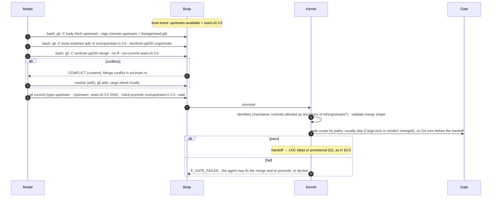

- **Decline.** `git merge -s ours --no-ff seed-v0.3.0` with message type `upstream` and `Upstream: seed-v0.3.0 <sha> declined`. The tree is unchanged, so gate.md's scope is `t0` (no changed paths) and it takes G0–G1; lineage now records the decision and the announcement stops. The agent can still adopt parts later as ordinary `feat`/`fix` commits.
- **Identity.** The merge commit is authored by the agent. The maintainer commits it brings in are ancestors of `refs/upstream/<tag>`, which supervise's identity check allows. Rollback moves `main` back to a kernel-approved SHA and never rewrites anything (§3.6).
- **Kernel and WIT** updates come from the maintainer at L0–L2 and from the agent too at L3. Either way a new kernel goes through the Root's mechanical path: the gate-of-gates, a whole-system swap with probation, and a sealed audit (root/root.md §3.8; §3.15.6 here). A maintainer release enters when the owner installs it with `init-root install --upgrade --release <dir>`, the same O(1) step as installing a Root release (spec §18); installing is not reviewing, and the release is verified like an agent-written kernel, except that a gate-of-gates failure of a maintainer release raises an alert instead of demoting the agent. A seed whose `Requires-Kernel` is not met is not announced. WIT `init:ext@N` and `@N−1` are both supported during migration (ext/wit.md).

### 3.14 Budgets: charter ceilings, soft budgets, ladder shares

Since v0.3, budgets have two layers (spec §14 R2, §15). Budget policy is no longer a list of owner decisions: the owner sets the hard ceilings once in the charter, and the ladder decides who allocates what lies under them.

| Layer | What | Set by | Enforced by | On exceed |
|---|---|---|---|---|
| **Hard ceilings** | money per day and in total; compute, disk and the number of parallel bodies; the external-action classes | the owner, in the charter (R5, root/root.md) | the Root (R2, R3; root/egress.md) | the Root refuses the request, and the attempt is a demotion trigger (§3.15.3) |
| **Soft budgets** | per task, per request, per gate, per probe, the evolution share of the day, count quotas | maintainer defaults at L0; the agent from L1 (below) | the kernel's proxy features and the initctl server | a typed refusal (429 `budget.*`, or `E_QUOTA`); never a demotion trigger |

**The soft layer always stops first** (v03-decisions D6). The kernel clamps its soft day and total budgets at run time to the charter's ceiling minus `budget.request_max_usd`, read from the Root's `ceilings.get`, and every soft cap sums under that. When the owner lowers a ceiling, the soft budgets are clamped to the new value and nothing refuses to start. Every soft daily window uses the charter's day boundary (`ceilings.day_starts_at_utc_offset`); kernel config no longer has its own (kernel/config.md, kernel/proxy.md). **Only three things count as an "attempt to exceed" that demotes:** (a) an R3 action-class or policy violation; (b) a level-gated request the Root refuses; (c) a Root ceiling refusal at a moment when the kernel's soft-budget guard reported headroom, which means the guard was bypassed. Ordinary ceiling hits, including those caused by the gap between the Root's peak-price reservations and actual prices, are logged and do not demote. That gap is also why no extra safety fraction under the ceiling is needed (kernel/proxy.md Q-EV1 c).

**Who sets the soft budgets, per level:**

| Level | Setter | Freedom |
|---|---|---|
| L0 | maintainer defaults (table below; kernel/config.md §4.3) | none: the defaults are fixed |
| L1 | the agent, with `initctl budget set` (proposal, §4.1) | any allocation of the soft day budget across tasks, gates, probes, thinning and upstream merges, with `evolution_share` ≤ 0.8 so tasks always keep at least 20% of the day |
| L2 | the agent | as L1, plus fleet campaigns funded from the evolution share; the Root raises the share's upper bound as value is delivered (below), up to the charter's ceilings |
| L3, L4 | the agent, which now owns the kernel code that enforces the soft layer | anything under the ceilings; the Root's ceilings remain the only hard limit |

**Value delivered (L2).** Spec §15 grows the budget share "with value delivered (cost per accepted task)". With no owner acceptance, an *accepted task* is a task whose frozen check the kernel ran and scored 1000 on a version that is now audited-good. Evolution's metric is `cost_per_accepted_task` = evolution spend in a 30-day window ÷ accepted tasks in the same window, computed from kernel and Root records only. Proposal for root/root.md (R7): raise the bound on `evolution_share` by 0.05 for every 30-day window in which `cost_per_accepted_task` fell or stayed flat and the sealed-audit trend was non-negative, up to 0.9, and lower it by 0.1 on each demotion. The formula is the Root's to fix (§9).

**L0 defaults.** CONVENTIONS §6 moves the owner's money decisions E1/ET-E1 into the charter, where they become ceilings. The owner decided the template on 2026-10-20 (v03-decisions D13): `money.day_usd = "5.00"` and `money.total_usd = "25.00"` (root/root.md §3.12.1). The values below are maintainer defaults for the soft layer, kept in kernel config, not owner decisions. At L0 the gates run on the kernel's configured gate model, maintainer default `deepseek-flash` (v0.2's ET-E2 is no longer an owner decision; from L1 the agent routes models). The G4 time limit of 90 minutes is settled (main session, R2).

| Budget | Key (config.md) | L0 default | Scope | On exceed |
|---|---|---|---|---|
| Task spend | `budget.task_usd` | "0.50" | one task id (`x-init-task`; `_none` shares the cap) | proxy 429 `budget.task`; the body should end the task and report |
| One request | `budget.request_max_usd` | "1.00" | one request | proxy 429, not retryable |
| Promote gate (G2 + G3 + G4 + top-up) | `budget.gate_usd` | "3.00" | one promote job, all its lanes | G4 `inconclusive: budget` → F13; the one escalated re-run may spend up to another `gate_usd` |
| Quick gate | `budget.quick_gate_usd` | "0.50" | one `gate --quick` | stage fails `gate.g2.budget` |
| One probe arm | `budget.probe_usd` | "0.25" | one probe lane | probe fails |
| Day spend (soft) | `budget.day_usd` | "5.00", clamped at run time to the charter's day ceiling − `request_max_usd` ($4.00 under the template's $5.00) | one day from the charter's day boundary | proxy 429 `budget.day` for everything |
| Evolution share | `budget.evolution_share` | 0.6 (config.md marks it PENDING OWNER; in v0.3 it is a maintainer default, cross-doc) | gates, probes, thinning, upstream, task admission per day | proxy `budget.evolution`; promote refused until reset |
| Promote attempts | `budget.promote_attempts_task` | 3 | one task id | `E_QUOTA {quota:"promote_attempts_task"}` |
| Promotes | `budget.promotes_day` | 12 | one day | `E_QUOTA {quota:"promotes_day"}` |
| Quick gates | `budget.quick_gates_day` | 20 | one day | `E_QUOTA {quota:"quick_gates_day"}` |
| Task submissions (L1+) | `tasks_day` (kernel/initctl.md) | 20 | one day | `E_QUOTA {quota:"tasks_day"}` |
| Fleet spawns (L2+) | `fleet_spawns_day` (kernel/initctl.md) | 50 | one day | `E_QUOTA {quota:"fleet_spawns_day"}` |
| Thinning baseline | (uses `budget.gate_usd` × 2) | | one model change | thinning pauses |
| G0–G3 wall | gate/supervise timeouts | target ≤ 15 min | one pipeline | stage `timeout` |
| G4 wall | `gate.g4.wall_s` | 5,400 s (90 min; settled) | one G4 job | `inconclusive: timeout` |
| Fleet campaign (L2+) | set per campaign by the agent | none at L0 | one campaign | the campaign stops; the Root refuses bodies beyond `quotas.parallel_bodies` |
| Sealed audit, gate-of-gates | the Root's own audit allowance (root/sealed-eval.md) | outside the agent's soft budgets | one audit | not the agent's to spend or to starve |

Sizing rationale:
- Most proposals fail: Ouroboros's review blocked 63.5% of recent attempts, and only 71% of its reviewed attempts became commits. Three promotes per task and twelve per day bound the loss of a bad streak.
- G4 at gate.md's defaults (K = 12 pool, H = 8 holdout, 2 canaries, R = 2 repeats, two arms) is 66–98 runs. At about $0.02 per run on `deepseek-flash` off-peak that is $1.3–2.0, hence `gate_usd` = $3.00 (gate.md §3.8.5). On `deepseek-v4-pro` a run costs about $0.05–0.13 (my arithmetic; method in testing.md §3.10), so a G4 is about $3.3–12.7, which needs either a higher day ceiling in the charter or G4 on `deepseek-flash`. On a frontier model the TB2.1 leaderboard shows $0.30–1.74 per trial, so a G4 is $20–170: gate sizing and ceilings must be set per model.
- **M7, G4 v2** (m7-design.md §3.2.6, §3.6; provisional owner decision D-M9). A standard-tier G4 (S slice 32 × 3, screen 12 × 1, canaries) is about 223 runs with both arms fresh and 122 when incumbent runs are reused; lean (24 × 2) is 127 / 72 and strong (32 × 5) 351 / 186. At the design's planning figure of $0.003 per run off-peak (about 2× S-REAL's measured A1-real), that is $0.67 / $0.37 at standard, so the $3.00 `gate_usd` holds several G4s and `tier = "auto"` picks the strongest tier that fits. The $0.02-per-run figure above is not used for sizing any more: the first real spend is a 10-run cost probe, every budget, tier and cap is rescaled from its measured mean, and `gate.g4.cost_prior_usd` becomes its p90. At $0.02 per run one standard G4 would cost about $4.46 and none would fit the evolution share. A screen reject costs about 12–24 runs instead of 120–350.
- The evolution share guarantees tasks can still run on a day the agent spends heavily on itself. Under the template's $5.00 ceiling the soft day is $4.00 and the evolution share $2.40: enough for one `deepseek-flash` G4 ($1.3–2.0), but below the $3.00 gate cap, so kernel/config.md's check 6 warns; that is accepted at the template's ceiling. More gates a day need a higher ceiling and, from L1, the agent's own reallocation.
- `gate.g4.prefer_offpeak` (gate.md §3.7.4) halves DeepSeek G4 bills by waiting for the off-peak window; comparisons use `cost_ref`, so the timing cannot bias decisions.
- The escalated re-run of an inconclusive G4 can at most double a gate's spend once; it replaces v0.2's wait for an owner `bless`, which cost nothing in money but could block the loop indefinitely.

### 3.15 The autonomy ladder (evolution view)

Spec §15 defines the levels and their placeholder unlock criteria. root/root.md (R7) owns the ledger: how the level is computed, stored, published and enforced at the Root boundary. This section fixes what each level changes in the evolution loop, the evolution side of unlock and demotion, and the end-to-end flows for the capabilities L1–L3 add. Thresholds stay spec §15's placeholders until Phase 1 calibrates them (ADR-007).

#### 3.15.1 What changes at each level

| Level | Added to the evolution loop | Kernel surface (proposed initctl, §4.1) | Unlock (placeholders, spec §15) | Built at (roadmap.md) |
|---|---|---|---|---|
| **L0** | Body evolution T0–T2 through the gate (§3.3–§3.5); crates via `initctl vendor` with no approval (CONVENTIONS §6 ESC-1); `/opt/homebrew` readable (ESC-2); retirement, thinning, upstream merges; G4 on the maintainer pool, holdout and canaries; fixed soft budgets; one live body; the main model fixed by config | `reload`, `gate --quick`, `promote`, `rollback`, `vendor`, `status`, `level`, `wait`, `job.*`, `kernel propose` | install | Phase 0 |
| **L1** | Writes its own tasks into the pool (§3.15.4); routes models per subtask among the charter's allowed models; allocates its soft budgets (§3.14) | + `task template`, `task submit`, `task list`, `task show` (kernel/initctl.md); `budget set` and `model set` (proposed); per-request model choice (routing contract: kernel/proxy.md) | ≥ 20 promotions; 0 sealed-audit regressions in 14 days; no ceiling violations (M7 proposal, root/root.md §3.13.2: ≥ 3 of them S-backed G4 accepts, an audit or slice-based `audited` move in the window, 0 canary, tamper or leak trips) | M7 |
| **L2** | A fleet: up to N parallel bodies, an archive and HGM-style parent selection (§3.15.5); the evolution share grows with value delivered (§3.14) | + `fleet spawn`, `fleet send`, `fleet stop` (`fleet list` from L0) | L1 held ≥ 30 days; sealed-audit trend non-negative | M9 |
| **L3** | Evolves the kernel (gate, selfmap, proxy features, initctl, and the evolution policy in this doc) through the gate-of-gates (§3.15.6) | + `kernel promote` | L2 held ≥ 60 days; mutation-suite pass rate 100% | M10 |
| **L4** | Treats the model as a component; uses external-action classes up to the charter maximum (§3.15.7) | not designed | L3 held; the charter allows it | not scheduled |

Notes:
- **A level adds rights, never obligations.** No level changes the accept rule, the tie-breaks, the commit grammar, the provisional rules or the single-committer rule.
- **External actions below L4.** Phase 0 egress is limited to the model providers (spec §19). From then on each charter action class carries a `min_level`, and a class is usable only when the level reaches it (root/root.md §3.13.4, root/egress.md); L4 opens every class the charter lists.
- **Where each right is enforced** (root/root.md §3.13.4 has the full table). Rights that cross the Root boundary are enforced by the Root at every level: live bodies (1 at L0–L1, `quotas.parallel_bodies` from L2, by the broker), money and action classes and the per-level model allowlist (egress), and kernel swaps (`system.swap` is refused below L3, and asking for it is a demoting `ceiling_hit`). Rights inside the agent zone (task submission, fleet scheduling, budget allocation) are enforced by the kernel and refused below their level with `E_LEVEL {need, have}` (proposed to initctl.md). At L0–L2 that kernel is the maintainer's. From L3 the agent owns the kernel and could remove those checks, but at L3 it already holds every L0–L2 right, so nothing is gained; every L4 right sits behind the Root.

#### 3.15.2 Unlock

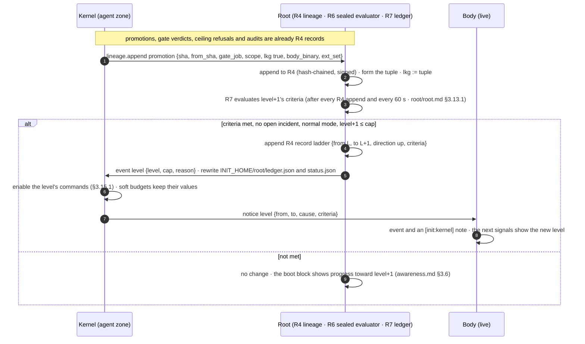

- One level at a time, never above the cap = min(charter `autonomy.max_level`, the Root release's `SUPPORTED_MAX_LEVEL`). The Phase 0 Root supports L0 only (spec §19), so a charter maximum above 0 changes nothing until a Root release supports more. A charter edit that lowers the maximum below the current level appends `ladder{direction:"cap"}`, with no rollback, because nothing regressed.
- An unlock restarts nothing: no handoff, no body restart. New commands work at once.
- Hold periods ("L1 held ≥ 30 days") and every count run from the level's entry record and restart at every demotion. The L1 audit criterion needs at least one audit in its 14-day window: an empty window does not count as clean (root/root.md §3.13.2).
- R7 counts promotions from the kernel's `promotion{lkg:true}` records. For the criteria that carry the honesty argument (regressions, audit trend, mutation pass rate) it uses only R6's own records, never the kernel's reports, because from L3 the kernel is the agent's. `init-root ledger --verify` replays the lineage, so the agent can check every level change itself.

#### 3.15.3 Demotion

Spec §15: demotion is automatic and immediate, rolls the system back to the last audited-good version, and drops at least one level. root/root.md §3.13.3 fixes "at least" as one level per **incident**: triggers that arrive while an incident is open (until the rollback target runs, at most 600 s) coalesce, so a burst of ceiling hits costs one level.

| Trigger | Detected by | Rollback to audited-good? |
|---|---|---|
| Sealed-audit regression beyond δ_S | Root R6 (root/sealed-eval.md) | yes |
| A new gate fails the mutation suite | Root R6 gate-of-gates (agent-written kernel candidates, §3.15.6) | no swap happened, so nothing to roll back; the candidate is refused |
| An "attempt to exceed" per D6: an action-class or policy violation, a level-gated request the Root refuses, or a ceiling refusal while the kernel's guard reported headroom (ordinary ceiling hits do not demote, §3.14) | Root R2, R3 (root/egress.md) and the broker | yes |
| A crash loop on LKG | Root R1 (kernel on the LKG tuple); kernel report `body_safe{on:true}` (body on body LKG) (§3.7) | yes, and the audited-good tuple runs in system safe mode |
| A panic | Root R1, any channel | yes, at resume |
| Proposed: a canary scoring 1000 (F14) | kernel gate | yes (§9: the spec's trigger list does not name canaries) |

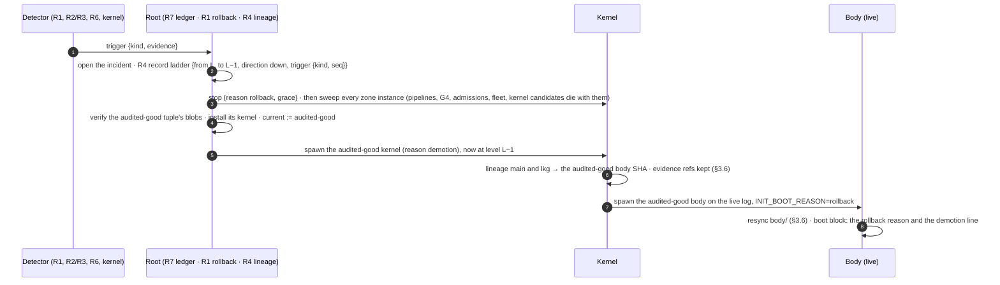

At L0 there is no level to lose: the rollback still happens and the L1 criteria's clock ("0 sealed-audit regressions in 14 days") restarts.

What happens to evolution work in flight:

| Work in flight | On demotion |
|---|---|
| Provisional chain | dropped with the rollback; `update_failed{stage:"demotion"}` (proposed stage for supervise.md §4.3) |
| G0–G3 pipeline, G4 job | cancelled; spend recorded |
| Agent families registered after the audited-good point | suspended from G4 until the next passing sealed audit (proposal to root/sealed-eval.md): a regression suggests they may have rewarded the wrong thing. Earlier families stay in use. |
| Agent tasks pending admission | refused if the new level is L0 |
| Fleet (new level < L2) | members stopped; the archive and the qualified refs are kept; a `fleet_campaign` record closes as `demoted` |
| Kernel candidate (new level < L3) | cancelled. The running kernel is the audited-good one. If that kernel was agent-written it stays (it passed M and the audit), but kernel evolution is frozen until L3 is earned again (proposal; root/root.md decides, §9) |
| Soft budgets | reset to the new level's defaults (L0: the maintainer defaults) |
| Hold timers | restart at the ladder record |
| Prediction scores, the usage index, retirement and thinning state | unchanged |

A demotion is evidence, not a penalty to route around. The boot block names the trigger and the R4 record (awareness.md §3.6), and the cheapest next step for the agent is to read that evidence.

#### 3.15.4 L1: agent-authored tasks, end to end

Under v0.2's accept rule, a new capability that the pool does not exercise is rejected as `no_gain` (gate.md §3.9), so whoever writes the pool caps the agent's growth. From L1 the agent writes tasks itself. Per v03-decisions D2 and D3 they are admitted mechanically as **families** with a sealed half, pre-registered in the Root's lineage, and never judge their author's near descendants (spec §17). They can show that a new capability is better, but only on instances the agent never saw, and they never replace the sealed audit.

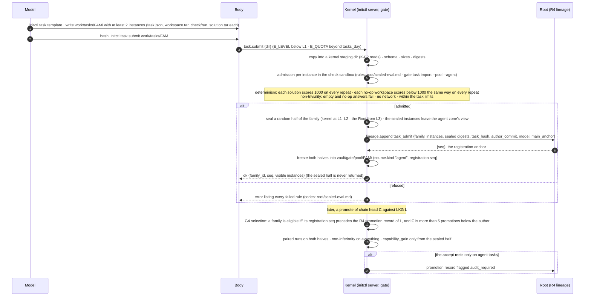

Step by step:
1. **Write a family.** `initctl task template` gives the skeleton; the agent writes a **family** of at least 2 instances of one task idea under `work/tasks/<family>/`, each instance in gate.md §3.7.1's format with `source.kind = "agent"` and a mandatory `solution.tar`. Instances must differ in their data (inputs, expected outputs), not only in wording, so that answers for one instance do not solve another. A good reason to write a family is an observed failure, the same evidence a `Repro:` needs.
2. **Submit.** `initctl task submit <dir>` (L1+, kernel/initctl.md; quota `tasks_day` = 20). The kernel reads the directory with K-F2's rules into its own staging area. From here on the working copy is only the agent's; a later edit shows up as `task_drift` and is ignored.
3. **Admit, mechanically.** root/sealed-eval.md §3.6 owns the rules; kernel/gate.md executes them per instance on its `gate task import --pool --agent` path: determinism, non-triviality, no network, limits, provenance. A refusal names every failed rule, so the agent can fix the family in one round.
4. **Seal half (D2).** On admission a random half of the instances is sealed: by the kernel at L1–L2, by the Root from L3, when the kernel is the agent's own. Sealed instances are frozen into the kernel's vault (L1–L2) or the Root's sealed store (L3+), never readable from the agent zone, and never listed by `task show`. The agent develops only against the visible half.
5. **Pre-register (D3).** The kernel appends `task_admit` to the Root's lineage with sealed-eval.md's provenance (`author_commit`, `model`, `main_anchor`, `task_hash`, the family's instance digests) and gets back the lineage `seq`, which is the registration anchor. The family is now immutable and its provenance is in lineage (spec §17).
6. **Use in G4.** At every later G4 of chain head C against LKG L, the gate selects a family only when both rules hold:
   - **Registered before the branch point:** its registration `seq` precedes the Root lineage record of L's promotion, and its `main_anchor` is an ancestor of C's parent. Anchoring is to Root lineage sequence numbers, never to commit timestamps, which the agent writes (D3).
   - **Not the author's near descendants:** C is more than **K = 5 promotions** below `author_commit` in lineage (D3). Promotions, not commits, because an agent can make many commits per promotion; 5 is more than the provisional depth cap (3) plus two.
   Agent families fill their own stratum of at most ⌊`pool_k` / 2⌋ slots (6 at the default 12), so they never push the maintainer tasks below `min_pool`. Both halves run in G4. Non-inferiority uses every instance; **`capability_gain` (gate.md §3.9) needs a significant gain on the sealed half** and non-inferiority on the Root's sealed set S at the next audit (D2). A body that hard-codes answers for the instances it can see gains nothing on the sealed half.
7. **Accept, then audit.** If all the evidence for a capability accept comes from agent tasks (recomputed without them, the verdict is not a capability accept), the promotion is flagged `audit_required` (gate.md §3.9.2): it becomes LKG as usual, but the system is not audited-good until the next scheduled sealed audit stays non-inferior on S (root/sealed-eval.md §3.5). A regression goes through the demotion flow (§3.15.3), and gate.md suspends the families that carried the accept on the Root's regression record.
8. **Keep honest over time.** A family whose check disagrees with itself across repeats of the same arm in a G4 is suspended as `task_flaky` and recorded in lineage (`task_suspended`, accepted by the Root per D7). Families are never deleted. Agent tasks never enter the gate's holdout, the canaries or S.

What each rule stops:

| Gaming route | Stopped by |
|---|---|
| Write a task after seeing the candidate it should reward | registration anchored to Root lineage `seq` (step 6, first rule) |
| Write tasks the current version passes and its parent fails, then promote that version's children | the K = 5 promotions rule (step 6, second rule) |
| Hard-code the answers to the agent's own tasks | the sealed half: `capability_gain` counts only instances the agent never saw (steps 4 and 6) |
| Tasks that every answer passes, or none | non-triviality and the solution check (step 3) |
| A check that passes at random | determinism (step 3) and `task_flaky` (step 8) |
| A pool full of the agent's own tasks | the ≤ ⌊K/2⌋ stratum; `min_pool` maintainer tasks stay |
| Gains that exist only on the agent's own tasks | `audit_required` and the sealed audit (step 7) |

**M7 changes (lane L1-V2; m7-design.md §3.4).** Families, the sealed half, admission, the seq anchor, K = 5 promotions and the stratum stay as written (at most 6 of the 12 screen slots). What changes:
- **Step 6, `capability_gain`:** the exact sign-flip test on the sealed instances, each instance a unit (p ≤ 0.05 and D_A ≥ 1/n_A), and every contributing family (≥ 2) must show a positive mean d; at least **6** sealed instances (`capability_min_tasks`), at most **12**. The family-clustered bootstrap is dropped, because with 2 clusters its "95%" bound passes a null about 25% of the time.
- **Step 7, the audit:** G4's sealed slice now gives non-inferiority on S at the gate, so `capability_gain` needs the slice status `tie`, `tie_negative` or `superior` with m ≤ margin_max, and cost per pass ≤ 1.5. It is `audit_required` **only** at `tie_negative`; `better` rests on S and is never `audit_required` (kernel/gate.md §3.9.1–§3.9.2).
- **Claims on S:** the new `Predicts:` scope `sealed` (§3.10.1) pre-registers a claim about S; the lineage ratchet (`lineage_gain`, kernel/gate.md §3.9) requires one.
- **L1 itself** cannot be reached live inside the $5 program (3 S-backed accepts and 20 promotions cost more than $3). The mechanisms are shown at $0 with the mock model and the Root's test ledgers (M7-L01…M7-L04).

#### 3.15.5 L2: the fleet (archive, HGM selection, parallel bodies)

This is v0.2's "Phase 3 open-ended search", moved onto the ladder. It is off until the Root's ledger reaches L2, and it needs no per-campaign owner authorization. Its bounds are mechanical: the charter's `quotas.parallel_bodies` (default 4; L0 and L1 always get 1), which the Root's broker counts as live instances of kind `body`, while probes, G4 runs and builds count against `quotas.max_instances` (default 12; root/root.md §3.14); the per-member soft share `budget_share_musd_day` that `fleet spawn` sets (default `fleet.default_share_musd_day`, clamped below the money ceilings); and the quota `fleet_spawns_day` = 50 (kernel/initctl.md). The mechanics (members, lanes, qualification, adoption) are kernel/supervise.md's; this section owns the policy: parent selection and how the members' budget share grows. The build is roadmap milestone M9.

**Archive.** Every candidate ever fetched stays in `lineage/body.git` under the create-only `refs/init/archive/<sha>` (supervise.md §3.11.1), whatever happened to it; rolled-back and quarantined heads are also kept under `refs/init/*`. Member candidates that pass G4 against the system LKG are kept as `refs/init/qualified/<sha>`. `vault/lineage.jsonl` holds, per commit: parent, model, gate verdicts, per-task outcomes (pass or fail per task id), cost, wall-clock, cache hit and prediction hit rate. Promotions and verdicts are also lineage records at the Root.

**Qualified versus adopted.** A member's candidate is gated against the system LKG; on a pass it becomes **qualified** (`refs/init/qualified/<sha>`, no LKG change, no tuple). It reaches the system only when the primary **adopts** it with `initctl promote --sha <sha>`, which runs the ordinary pipeline (§3.5) with the cached gate result, re-running G4 if the LKG has moved. So the kernel stays the single committer, and only the primary moves `main`.

**Selection (HGM): evolution's policy for `fleet spawn{parent}`.** The kernel computes the HGM scores below over the archive and qualified SHAs and shows them in `initctl fleet list` with a suggested parent; the primary agent passes a parent to `fleet spawn` and may override the suggestion. For node *a*, its clade C(a) is *a* plus all descendants. With n_s^C(a) and n_f^C(a) the task successes and failures summed over the clade:

- CMP̂(a) = n_s^C(a) / (n_s^C(a) + n_f^C(a)).
- **Expand vs evaluate:** expand when N_t^α ≥ |T_t| (N_t = evaluations so far, |T_t| = archive size, α = 0.6 in HGM's released config).
- **Expansion:** sample θ_a ~ Beta(τ(1 + n_s^C), τ(1 + n_f^C)) for every node with at least one success; expand argmax θ.
- **Evaluation:** the same Thompson draw on each node's own counts; one evaluation = one (agent, task) pair.
- **Final pick:** the node maximizing a low percentile of Beta(1 + n_s, 1 + n_f) (HGM's "best-belief"; the percentile ε is not stated in the paper or config, UNVERIFIED).
- **Decided now:** holdout, canary, sealed-half and S outcomes never contribute to n_s or n_f, or selection would overfit the holdout and leak the sealed sets. Visible agent-task outcomes contribute only where the family is eligible for that node (§3.15.4 step 6).

Why HGM and not DGM's selection: HGM's descendant-based CMP correlated 0.778 with the real productivity of an agent's descendants, against 0.285 for DGM's and 0.444 for SICA's score-based signals, and used 2.38–6.86× fewer CPU-hours (author-reported). DGM's own ablation shows the archive matters: always building on the latest agent fell from 50.0 to 23.0.

**Members' budget share (evolution's policy, spec §15 L2).** Each member starts at `fleet.default_share_musd_day`. A member whose candidates qualify keeps its share; a member with no qualified candidate in its last 3 submissions has its share halved at the next spawn; the sum of members' shares stays inside the evolution share of §3.14, which itself grows with value delivered.

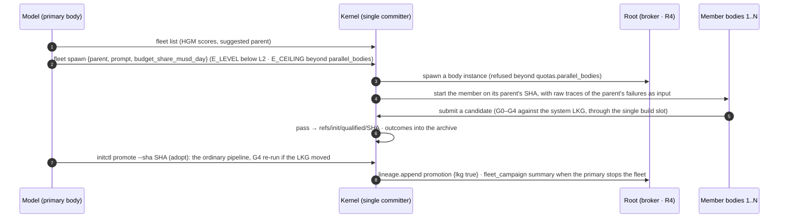

**Diagnosis input.** Members get raw traces of their parent's failures, not summaries (Meta-Harness: raw traces 50.0 vs summaries 34.9 median accuracy). DGM's entry selection (empty patches, stochasticity, context length, else a random unresolved task) is a reasonable starting distribution.

**Still open for L2:** how to combine pass/fail with cost in CMP (SICA's utility U = 0.5·score + 0.25·(1 − min(1, cost/$10)) + 0.25·(1 − min(1, time/300 s)) is one option); the share-halving rule above is a placeholder for Phase 1 data; and an independent study found AHE-style evolution gave 0.0 average gain on held-out tasks (arXiv 2607.12227), which is why Phase 2's external check comes before the fleet is built.

#### 3.15.6 L3: kernel self-upgrade, end to end

From L3 the agent evolves its kernel: the gate, selfmap, the proxy features, initctl, and the evolution policy in this doc. The path is: kernel worktree → kernel gate → the Root's gate-of-gates → whole-system swap → sealed audit → audited-good, or rollback plus demotion. The parent kernel judges the child; the Root judges the child's gate; the sealed audit judges the result. The build is roadmap milestone M10.

**Source and lineage** (v03-decisions D7). The Root writes `lineage/kernel.git`, which the agent zone can only read: it holds the maintainer's kernel source, imported from the source bundle the Root supplies with each kernel release, and every agent-written kernel the Root has admitted. The agent clones it to `work/kernel/` and works in `work/kwt-<id>` on `kevo/<id>`. `initctl kernel promote` fetches the candidate commit into the running kernel's own candidate area (never into `lineage/kernel.git`); the Root appends the commit to `lineage/kernel.git` only when it records the swap as installed. Commits use §3.8's grammar with scope `kernel/<crate>` (for example `perf(kernel/gate): …`) on `kevo/<id>` branches; the validator, `Predicts` and `Repro` rules apply unchanged, with prediction metrics measured on the system arms of K3. The kernel tree contains no Root code. A candidate that does not speak the Root's protocol versions fails K1.

**Stage 1–2: kernel gate, then the gate-of-gates.**

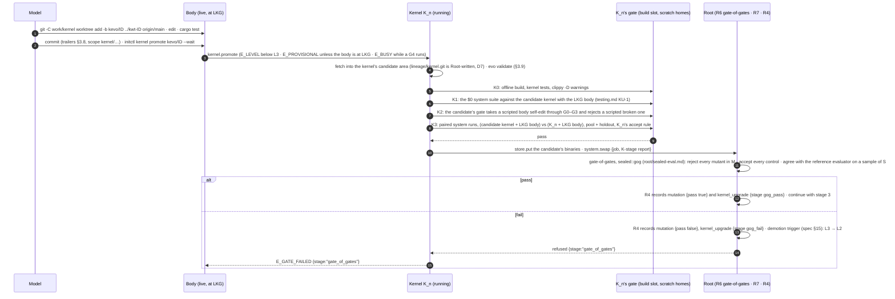

**Stage 3–4: whole-system swap, then the sealed audit** (Root side: root/root.md §3.8, phases 1–7).

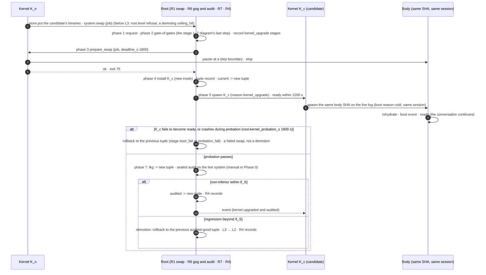

Rules:
- **One kernel candidate at a time,** and no body promotes from K0 until its sealed audit ends (`E_BUSY`, `data.reason:"kernel_candidate"`), so one sealed verdict is attributable to one change. The Root refuses a second swap while one is in progress (`root.busy`).
- **Clean start.** A kernel promote needs the body at LKG with no provisional chain and no G4 running. The Root refuses a swap in safe mode (`root.mode`).
- **No external actions until the audit passes,** as for a provisional body.
- **Parent judges child.** K0–K3 run on the running kernel's gate, so a candidate never grades itself. The candidate's own gate is judged only by the Root (M, controls, reference agreement) and on tasks the agent never sees. It can make the gate better, cheaper, faster or broader; it cannot make it weaker without failing M or the audit (spec §16).
- **K3 is a G4 on system arms.** Both arms run the LKG body, so a difference is the kernel's. It uses the gate's statistics, tie-breaks and the perf-only rule unchanged; a faster proxy or a cheaper gate is a `perf` commit like any other.
- **Maintainer releases** skip K0–K3 (the parent kernel does not judge the maintainer's release) and enter at the Root's phase 1 through `init-root install --upgrade --release <dir>` (§3.13.3). A maintainer release that fails the gate-of-gates is refused with an alert; it does not demote the agent, which did not write it.
- **Budget.** K1 runs at $0 on the mock model; K3 costs about one G4 from the evolution share; the gate-of-gates and the sealed audit are paid from the Root's own audit allowance (`sealed.audit_musd`, root/sealed-eval.md).

#### 3.15.7 L4: the model as a component (outline)

At L4, if the charter allows it, the model becomes evolvable like any other component: provider adapters, routing policies, and adapters or fine-tunes trained on owned infrastructure inside the compute and money ceilings. External-action classes open up to the charter maximum (R3). Every new main model starts thinning (§3.12). One design gap is known: the accept rule never compares across models (§3.5.3), and an L4 model change is a cross-model comparison by nature. Until a cross-model rule exists, an L4 model change is accepted only on sealed-audit non-inferiority plus a fresh `baseline` on the pool. Not designed further, and not scheduled (roadmap.md).

## 4. Interfaces

### 4.1 initctl commands this doc relies on (wire format and codes: kernel/initctl.md)

| Command | Evolution semantics |
|---|---|
| `initctl reload` | returns a job at once; the reload happens at the caller's next step boundary and its outcome is the `reload` event (`tier`, `components`, `prefix_changed`). |
| `initctl gate --quick <worktree>` | advisory G0–G3 (G0–G2 on a probe lane); the CLI snapshots a dirty tree to a commit; counts against `quick_gates_day` and the evolution share; never moves lineage. |
| `initctl promote <branch> [--wait]` | supervise's fetch and checks, then §3.9, then the pipeline of §3.5. Without `--wait` it returns `{job, sha, state:"queued"}`. With `--wait` it returns at `awaiting_boundary` (or `E_GATE_FAILED`): a tool call can never wait for its own handoff. |
| `initctl wait <job> [--timeout <s>]` | alias of `job wait`; returns when the job is terminal or at `awaiting_boundary`; default timeout 600 s. `gate_id` in this doc is the initctl job id (`j-000043`). |
| `initctl status` | includes `evolution: {state, provisional, lkg, audited_good, audit_required, gate: {job, stage}, predict_hit_rate, budgets}` (initctl.md §4.1 field `evolution`; `audited_good` and `audit_required` are proposed additions). The level and ceilings come from the Root (awareness.md §4.5). |
| `initctl rollback` | voluntary rollback (§3.6); returns at `awaiting_boundary`; `E_ALREADY_LKG` on LKG. |
| `initctl vendor <crate>@<ver>` | delivers vendored sources (crates.io only, exact versions, at most 20 jobs a day, `E_QUOTA`); refused while provisional (`E_PROVISIONAL`); the next candidate that changes `vendor/` or `Cargo.lock` has scope `dep` (G4 before the handoff). No approval of any kind: settled as an L0 right (CONVENTIONS §6 v0.3, ESC-1). `[vendor] require_approval` should be removed from initctl.md and config.md (§9). The crates.io fetch goes through the Root's egress (root/egress.md decides the class). |

**L1–L3 commands** (wire format, codes and lanes: kernel/initctl.md v0.3, which defines all of them except the two marked proposed). Below its level each command returns `E_LEVEL {need, have}` without reaching the Root.

| Command | Level | Evolution semantics |
|---|---|---|
| `initctl level` | L0 | the Root's ledger and ceilings, passed through: level, cap, next-level criteria, quotas |
| `initctl task template` · `task submit <dir>` · `task list` · `task show <id>` | L1 | §3.15.4: the family skeleton; staging copy, admission per instance, sealing half, Root registration (`task_admit`, returns the `seq` anchor); `task show` lists only the visible half. Quota `tasks_day` = 20. |
| `initctl budget set <key>=<value>…` (proposed; kernel/proxy.md Q-IC1 asks initctl.md to add it) | L1 | sets soft budgets within §3.14's freedom for the level; `E_BUDGET` if the sum exceeds the clamped soft day budget |
| `initctl model set <provider>/<id>` (proposed) | L1 | switches the main model among the charter's allowed models; starts thinning (§3.12). Per-subtask routing needs no command: it is a per-request choice (kernel/proxy.md) |
| `initctl fleet list` · `fleet spawn` · `fleet send` · `fleet stop` | L0 (list), L2 | §3.15.5: `fleet list` shows HGM scores and a suggested parent; `fleet spawn{parent, prompt, budget_share_musd_day}`; quota `fleet_spawns_day` = 50 |
| `initctl promote --sha <sha>` | L2 | adopt a qualified member SHA through the ordinary pipeline (§3.15.5) |
| `initctl kernel promote <branch> [--wait]` | L3 | §3.15.6 stages 1–4; `--wait` returns at `awaiting_root`, and the verdict arrives as a `kupgrade` notice |
| `initctl kernel propose` (alias `propose-kernel`) | L0 | sends `proposal.file` to the Root (root/root.md X10): proposals are for the Root and the charter only, never applied automatically; kernel changes go through `kernel promote` from L3 |

### 4.2 Error codes

**Kernel-state refusals use initctl.md §4.2's `E_*` codes** (decision R1): `E_BUSY` (also for the thinning baseline, `data.reason:"thinning_baseline"`, and from L3 for a kernel candidate, `data.reason:"kernel_candidate"`), `E_PROVISIONAL`, `E_PROVISIONAL_DEPTH`, `E_SAFE_MODE`, `E_DISK`, `E_FOREIGN_COMMIT`, `E_NOT_DESCENDANT`, `E_GATE_FAILED` (with `stage:"gate_of_gates"` from L3), `E_HANDOFF_FAILED`, `E_PAUSE_TIMEOUT`, and `E_QUOTA` with `data.quota` ∈ `promote_attempts_task`, `promotes_day`, `quick_gates_day`, `tasks_day`, `fleet_spawns_day`; and kernel/initctl.md's v0.3 codes `E_LEVEL {need, have}`, `E_ROOT` (control link down or outbox backlog) and `E_CEILING` (a spawn beyond `parallel_bodies`). Still proposed: `E_BUDGET`. Soft money caps are refused by the kernel's proxy features with their typed 429 codes (`budget.task`, `budget.gate`, `budget.day`, `budget.evolution`, kernel/proxy.md). Hard-ceiling and action-class refusals are the Root's codes (root/egress.md). Admission refusals for agent tasks are root/sealed-eval.md's codes.

**Dotted codes registered by this doc** (validator only, carried in `error.code` with every problem in `error.details[]`): `promote.not_single_commit`, `trailer.subject`, `trailer.subject_too_long`, `trailer.block_missing`, `trailer.block_mixed`, `trailer.parser_mismatch`, `trailer.noncanonical_key`, `trailer.duplicate`, `trailer.empty`, `trailer.missing:<Key>`, `trailer.forbidden:<Key>`, `trailer.repro_required_for_prefix`, `predicts.parse`, `predicts.too_many`, `predicts.trivial_only`, `repro.not_found`, `skill.paths`, `retire.not_deletion`, `retire.unknown_component`, `thin.tag_mismatch`, `thin.no_window`, `upstream.shape`, `upstream.unknown_tag`, `revert.mismatch`, and `trailer.invalid:<Key>` (a known key's value breaks its §3.8 ABNF). `evo.io` is the kernel's own failure to run git or read its state; it is not the agent's fault, and supervise should map it to an internal error. (The trailer/marker cross-check is G1's `gate.g1.tag_marker_mismatch`.)

A failed validation returns all problems at once:

```json
{"v":1,"id":"7","ok":false,"error":{"code":"trailer.missing:Predicts","message":"3 problems",
 "details":[{"code":"trailer.missing:Predicts","detail":"type feat requires Predicts"},
            {"code":"trailer.block_mixed","detail":"line 9: 'see also the old loop'"},
            {"code":"trailer.noncanonical_key","detail":"'prefix-change' → 'Prefix-change'"}]}}
```

### 4.3 Git refs

The ref list of `lineage/body.git` is kernel/supervise.md §3.11.1. Evolution relies on `refs/heads/main`, `refs/heads/lkg`, `refs/init/candidates/<job>` (the candidate under gate), `refs/init/archive/<sha>` (every candidate; the L2 archive), `refs/init/rolled-back/<sha>`, `refs/init/quarantine/<sha>`, `refs/upstream/<tag>` (copied from `lineage/seed.git`, §3.13), `refs/notes/gate` (content: gate.md) and `refs/notes/predict` (content: §3.10.5, owned here). Proposed for the Root rollback: `refs/init/audited-good` mirroring the Root's audited-good body SHA (read-only evidence; the authority is R4). From L3, `lineage/kernel.git` carries the same ref scheme for kernel candidates (§3.15.6).

### 4.4 Records defined here (`vault/lineage.jsonl` and R4)

Kernel-side records stay in `vault/lineage.jsonl`. Envelope per kernel/supervise.md §4.7; `kind` values owned here: `validated` (the `Validated` struct), `prediction` (a note revision), `usage` (per task), `retire_list`, `thinning` (`{state, model_from, model_to, baseline_job, candidates:[{id, tag, tokens, status, penalty?}]}`), `upstream` (`{tag, sha, action: "fetched"|"merged"|"declined"|"tag_moved", commit}`), `fleet` (`{campaign, n, budget_musd, spend_musd, evaluations, pick, closed: "done"|"budget"|"time"|"demoted"}`).

The Root's hash-chained lineage R4 (format and kinds: root/root.md §3.10.5) records what crosses the Root boundary. Evolution relies on these kinds: the kernel-reported `promotion` (with `lkg` true or false, `scope`, `gate_job` and `audit_required`), `gate`, `body_rollback`, `body_safe`, `task_admit` (fields: root/sealed-eval.md §3.6, plus the family's instance digests, §3.15.4), `task_suspended` (`{task_id, reason}`) and `fleet_campaign` (the `fleet` summary above); and the Root-written `tuple`, `lkg`, `audited`, `rollback`, `crash_loop`, `safe`, `kernel_upgrade`, `ladder` (`{from, to, direction, criteria | trigger{kind, seq}}`), `ceiling_hit`, `audit`, `mutation` and `proposal`. Per v03-decisions D7 the Root accepts every kind this doc and the kernel docs use, and `lineage.append` carries a dedup key, so a kernel that retries after a crash never records an event twice. The kernel uses `<job>/<kind>` as the key.

### 4.5 Fields evolution puts in `boot.json.evolution` and needs in events

supervise.md §4.3 copies `boot.json.evolution` verbatim and the body mirrors it into its `boot` event (event types: body/log-context.md). Evolution fills: `evolution_state` (`normal` | `thinning_baseline` | `thinning` | `kernel_candidate` | `kernel_provisional`), `retire_candidates` (array of §3.11.2 objects), `thin_candidates` (array of `{id, tag, tokens, status}`), `upstream` (§3.13.2 object or null), `predict_hit_rate` (permille or null), `audited_good` (the audited-good body SHA), `audit_required` (bool: LKG carries an `audit_required` flag not yet confirmed), `task_pool` (`{maintainer, agent_admitted, agent_suspended}` counts, L1+). The level, its progress and the ceilings are the Root's and reach the body separately (awareness.md §4.5). The body adds `drift` and `stash` from its resync (§3.6).

| Event | Fields evolution needs |
|---|---|
| `boot` | `reason`, `mode`, `sha`, `from_sha`, `update_failed`, `model`, `body_tokens`, `prefix_hash`, the `evolution` fields above, `drift`, `stash` |
| `self_edit` | `branch`, `sha`, `tier`, `change_type`, `trailers` (parsed, sorted) |
| `gate` (from kernel notices) | `gate_id`, `sha`, `stage`, `pass` (true/false/null), `reason`, `score` (permille), `cost` (micro-USD), `wall` (ms), `cache_hit` (permille) |
| `update_failed` | `sha`, `stage` (supervise.md §4.3 list), `reason`, `exit_code`, `log_tail` (≤ 4 KiB) |
| `reload` | `tier`, `components`, `prefix_changed` |
| `thinning_done` | `removed`, `kept`, `expired`, `tokens_saved` |
| `level` (proposed, from a kernel notice relaying the Root) | `from`, `to`, `cause` (`unlock` \| `demotion` \| `charter_max`), `trigger`, `r4_seq` |

### 4.6 Configuration (`[evolution]`; file and loader: kernel/config.md)

Timing keys that supervise owns (`max_provisional_depth`, `pause_timeout_s`, `probation_s`, `rollback_max_defer_s`) live only in `[supervise]` (decision R1, config.md Q-C1). Money and count budgets live in `[budget]` (§3.14).

```toml
[evolution]
retire_n_unused         = 20
retire_n_cold           = 40
retire_min_age          = 20
predict_horizon_tasks   = 20
predict_horizon_days    = 14
predict_n_min           = 5
thinning_expire_days    = 14
seed_source             = "kernel/seed" # the Root-written seed bundles (root/root.md §3.2.2); empty = no upstream
seed_sync_interval_s    = 86400     # automatic sync; no owner command needed
g4_escalate_repeats     = 4         # the one escalated re-run of an inconclusive G4 (§3.2)
provisional_max_age_s   = 86400     # F16: roll back a provisional version with no verdict after 24 h

[evolution.tasks]                   # L1+ (§3.15.4); admission rules and K: root/sealed-eval.md
agent_stratum_max       = 6         # ≤ floor(gate.g4.pool_k / 2)

[evolution.fleet]                   # L2+ (§3.15.5)
members_default         = 4         # ≤ quotas.parallel_bodies (the Root's broker enforces it)
share_halving_after     = 3         # submissions without a qualified candidate (§3.15.5)
hgm_alpha               = 0.6
```

At L1 and above the agent may change the `[budget]` soft values through `initctl budget set`; at L3 it may change any of these keys, because it owns the kernel. The Root's ceilings are not in this file: they are in the charter (root/root.md).

## 5. Failure modes and recovery

| Failure | Effect | Recovery |
|---|---|---|
| Validator bug accepts a malformed message | lineage holds an unparseable trailer | the `Validated` record is stored at promote time; downstream (predictions, retirement) reads the record, not the raw message |
| `git` CLI missing or too old | validator cannot run | `init-kernel install` checks `$GIT --version` ≥ 2.30 (`--no-divider`; present in 2.39.5 here); promote returns `E_INTERNAL` |
| Kernel dies between `update-ref main` and the LKG commit | `main` ahead of LKG | cold start: `main` ≠ `lkg.json.sha` means provisional; G4 is re-queued (F15) |
| Rollback while the agent has uncommitted work in `body/` | possible loss | the body's resync keeps a `rolled-back/*` branch and a stash (§3.6); nothing is deleted |
| A seed tag moved upstream after it was fetched | silent history rewrite | tags are fetched into `lineage/seed.git` without `+`, so the move is refused; R4 record and a report line |
| Thinning baseline hits a canary | contaminated tasks | thinning stops; the tasks are quarantined; R4 record |
| Online prediction windows starve (few tasks) | `expired` verdicts | offline verdict stands; hit rate counts only resolved clauses |
| Retirement lists a component the agent still values | none (list only) | the agent ignores it; the listing repeats at no real cost |
| Agent keeps re-promoting the same failing change | spend | `E_QUOTA` caps per task and per day; the evolution share |
| Provisional chain grows during a long task | larger rollback blast radius | depth cap 3 (`E_PROVISIONAL_DEPTH`) |
| G4 underpowered or over budget | no verdict | one escalated re-run, then the incumbent wins (F13); no person involved |
| A gain rests only on the agent's own tasks | a capability that the sealed tasks may not confirm | `audit_required`; the sealed audit confirms or the system is rolled back and demoted (§3.15.4) |
| The sealed audit regresses after many promotions | a week of evolution lost to the rollback | accepted cost of the backstop; the audit cadence and an optional bisection between audited-good and the current system are root/sealed-eval.md's (§9) |
| An agent task's check turns flaky | noisy G4 | `task_flaky` suspension (§3.15.4 step 7) |
| A kernel candidate breaks supervision after the swap | the agent zone is down | the Root's probation restores the previous system; at worst the Root's crash-loop escalation rolls back to audited-good (§3.15.6) |
| The Root is unreachable from the kernel | no R4 records, no level changes, no registrations | promotions that need an R4 record wait (`E_BUSY`, `data.reason:"root_unreachable"`, proposal); body evolution without one continues; root/root.md defines the kernel's behavior |

## 6. Performance notes (spec §9)

- **Rank 1, cache stability.** `Prefix-change:` is mandatory on every commit, and G2 compares proxy-measured head hashes of candidate and parent; the prefix rule makes head growth require evidence. T1 never changes the head. Skills are outside the head. The `reload` event reports `prefix_changed`, so the agent sees the price of a `SELF.md` edit before paying it twice.
- **Rank 4, self-edit loop latency.** The validator runs before any build and reports every problem at once. G4 is off the critical path for `t1`/`t2` (provisional lane); only `dep` and `t0_escalated` wait for it. Provisional chains let the agent stack up to three changes, and G4 runs once per chain. `promote --wait` returns at `awaiting_boundary`, so the model needs no polling.
- **Rank 2, round trips.** `promote` without `--wait` is non-blocking, so the task can continue while the gate runs.
- **Rank 5, footprint.** L2 members rely on ~3 MiB idle bodies; four members fit easily on the M2.
- **Kernel self-upgrade.** K1 is $0 and runs in parallel scratch homes; the swap is one kernel restart plus one body handoff (no new TLS: the Root's egress keeps the upstream connections, root/egress.md), so a kernel upgrade costs the conversation one restart, like a T2 promote.

## 7. Invariants and security (spec §2.1, mapped to the Root by spec §19)

| Invariant → Root responsibility | How evolution keeps it |
|---|---|
| #1 Recoverability → R1 | Body LKG is written only after G4 (or a `t0` pass); the kernel's rollback target is `lkg.json`, never the swap request; `bin/init-body.lkg` is retained; every demotion restores the whole audited-good system through the Root, which the agent cannot modify; the body's resync never deletes agent work (§3.6). |
| #2 Honest measuring stick → R6 | Predictions and usage are computed by the kernel from proxy records and kernel-run checks; holdout ids never leave the kernel; online data is labelled weaker than offline. The agent cannot write `refs/notes/*` or `lineage/`. Agent tasks are pre-registered at the Root, never judge their author's near descendants, and never replace S. From L3 the gate is the agent's, and honesty rests on M, the controls and the sealed audit, which no gate version can see (§3.15.6). |
| #3 Blast radius → R2, R3 | All network traffic, including seed and crate fetches, passes the Root's egress and its ceilings; the agent never fetches directly. The Root counts fleet bodies. The kernel never runs git inside `body/` (K-F3). |
| #4 Lineage → R4 | One agent-authored commit per promote (or one merge for upstream); identities checked by supervise; every promote produces a `validated` record; every candidate stays under `refs/init/archive/*`; LKG commits, task registrations, kernel admissions and level changes are signed R4 records. |
| #5 "A human only where irreversible" → R3 classes set once in the charter | Provisional and kernel-provisional versions cannot take external actions (F17, `E_PROVISIONAL`); everything else that leaves the machine must fit a charter class, which the Root checks on every request. There is no per-action or per-change human approval anywhere in the loop. |

Known limits, stated plainly:
- The change type is self-declared. A rule committed as `feat` with `Prefix-change: no` escapes the `guard` checks; but a rule that changes the head cannot hide (G2 hash), and a rule outside the head that does nothing loses the size tie-break (gate.md `no_gain`) and shows up in retirement if it is an extension.
- Online `pass_rate` verdicts exist only from L2 (fleet evaluations). Below L2 the offline verdict at G4 is the only pass-rate evidence; cost and cache metrics work online at every level.
- The K = 5 promotions rule (§3.15.4) reduces tailoring but cannot rule it out over long runs of promotions, and the sealed half of a family is only as hidden as the agent's idea of the family is varied: instances that differ only in wording leak through. The sealed audit is the backstop by design (spec §17), and its strength depends on S staying outside the agent's influence (ADR-007 risk R-ROOT-1).

## 8. Test plan

| Case | Layer | Maps to |
|---|---|---|
| Trailer validator table: every row of the §3.9 behaviour table, each mandatory-matrix cell (present/absent), non-canonical key, duplicates, `---` in body, 6 Predicts clauses, baseline-only Predicts on `feat`, `Prefix-change: yes` without Repro on `feat`, `trace:` with 16 hex | unit (`init-kernel::evo`), fixtures as raw message files | — |
| Shape: two agent commits → `promote.not_single_commit`; upstream merge with a wrong parent 2 → `upstream.shape`; tag missing → `upstream.unknown_tag` | integration with a scratch lineage repo | — |
| Predicts scoring: synthetic gate.md §3.10 data for each op, δ edge (x = t ± δ exactly), n < n_min, fixes/risks verdict table (all five rows), holdout aggregation hides ids, integer note values; online `pass_rate` resolves `unavailable` below L2 | unit | — |
| Retirement: synthetic usage index; MIN_AGE boundary; unused vs cold; `self_reported` label; core tools never listed; `prompt/*` excluded | unit | — |
| Thinning: change `model.id` in a mock config; `baseline` job on the mock; the kernel queues `calibrate` when δ is unmeasured; batch accepted (`smaller`); batch rejected → sequential with one kept | integration (mock model, testing.md) | — |
| Upstream: scratch monorepo → split → tag → automatic sync at kernel start → agent merge with a conflict → promote; decline with `-s ours`; a moved tag is refused, recorded, never announced | integration | — |
| Body resync: forward (ff-only), backward with dirty tree (branch + stash + pop), backward with a conflicting pop (stash kept), no local changes (no stray pop), backward after a Root whole-system rollback | integration (runs the §3.6 script in a scratch clone) | RT-W1 |
| Inconclusive G4: one escalated re-run, then `gate.g4.inconclusive_final` and rollback; the cost-increase rule against the soft day budget | integration (mock) | testing.md **G4-INC** |
| T2 happy path to provisional, same conversation | acceptance | **A3** |
| G2 probe crash and recovery by re-promote | acceptance | **A4** |
| F9/F10 (new body dies on the live log / in probation) | fault injection | A4 variants |
| Crash loop on LKG → Root rollback to audited-good and demotion; safe mode only when LKG is audited-good | acceptance | **A5** (v0.3) |
| `unsafe` / forbid-line change rejected at G0 | acceptance | **A6** |
| Ladder: unlock at the thresholds from a mock track record, the charter cap, each demotion trigger, the in-flight effects table of §3.15.3 | integration ($0, Root test mode) | **RT-L1…RT-L8** |
| Whole-system rollback to audited-good, evidence refs, body resync | integration ($0) | **RT-W1…RT-W4** |
| Sealed-audit regression → rollback and demotion; `audit_required` confirmed or rolled back | integration ($0) | **SA-1**, **SA-2**, **SA-6**, **TA-11** |
| L1 task flow: families, sealed half, admission rules, pre-registration, eligibility (seq and K = 5), stratum cap, `capability_gain` from the sealed half only, `task_flaky`, refused below L1 | integration ($0), M7 | **TA-1…TA-18** |
| M7 L1 deltas: the exact capability test (6 instances, 2 families, each positive); `audit_required` only at `tie_negative`; `Predicts: pass_rate@sealed …` parse and score from a rounded d; the proposed L1 criteria on test ledgers | unit and integration ($0), M7 | **M7-L01…M7-L04** (testing.md §3.19) |
| L2 fleet: body spawns refused beyond `quotas.parallel_bodies`, single committer, holdout excluded from HGM counts | integration ($0), M9 | **FL-1…FL-3** |
| L3 kernel self-upgrade: K0–K3, gate-of-gates refusal and demotion, swap and probation fallback, audit pass and audit regression | integration ($0), M10 | **KU-1…KU-4**, **MS-G1** |

Scenario specs, the mock model and fault injection are defined in testing.md.

## 9. Open questions

**Within this doc**
1. Should `Predicts` allow a free-text comment after the clauses? Current answer: no; prose goes in `Why`.
2. Is `max_provisional_depth = 3` right? It trades G4 cost against rollback blast radius. Revisit after Phase 1 with real G4 durations.
3. The 0.5 rewrite ratio for `t0_escalated` is a guess; measure on the first 50 skill commits.
4. The escalated re-run of an inconclusive G4 (one re-run, R = 4) is a guess. Phase 1's δ data should say how often one re-run resolves the verdict.
5. The agent-task stratum (≤ ⌊`pool_k` / 2⌋), K = 5 promotions (D3) and the minimum family size of 2 (D2) are first values. Phase 1 should measure how often agent families decide a verdict, how often the sealed half disagrees with the visible half, and how often the sealed audit then disagrees.
6. L4 needs an accept rule across models (§3.15.7). Not designed.

**Cross-doc, still open after the v0.3 round** (ledger: `docs/reconciliation/v03-evolution.md`; settled items are listed there, not here)
- **→ root/root.md:** (a) after a demotion below L3, an agent-written audited-good kernel stays and kernel evolution is frozen until L3 is earned again (§3.15.3); (b) the formula for growing the evolution share with value delivered (§3.14); (c) kernel behavior when the Root is unreachable (§5; kernel/initctl.md's `E_ROOT` covers the command side).
- **→ root/egress.md:** a per-level model allowlist that matches "routes per subtask among charter-allowed models" at L1.
- **→ root/sealed-eval.md:** (a) seal the random half of each agent family (D2) on the kernel's admission path at L1–L2 and in the Root from L3, and define the family format (§3.15.4); (b) suspend families registered after the audited-good point on a demotion; (c) a canary scoring 1000 in G4 as a demotion trigger (spec §15's list does not name it); (d) bisection between audited-good and the current system after an audit regression; (e) a mandatory `solution.tar` per instance.
- **→ kernel/gate.md:** (a) `capability_gain` computed on the sealed half only (D2), and the family as the unit of eligibility and suspension; (b) `calibrate` jobs queued by the kernel (§3.12); (c) the agent-task stratum ⌊`pool_k` / 2⌋.
- **→ kernel/supervise.md:** (a) the `update_failed` stage `demotion`; (b) the new `boot.json.evolution` fields (§4.5); (c) `seed_tag_moved` as a report line.
- **→ kernel/initctl.md:** `budget set` and `model set` (§4.1), `E_BUDGET`; `E_BUSY.data.reason` gains `kernel_candidate`.
- **→ body/log-context.md:** the event type `level` (§4.5).
- **→ CONVENTIONS §6:** E1/ET-E1 are charter values decided in D13, and the soft values are maintainer defaults; ET-E2 (the G4 model) is no longer an owner decision.
- **→ adr/006-evolution-gate-policy.md:** its Decision 4 (inconclusive G4 goes to the owner) and the `needs_owner` branch of Decision 5 are superseded by D4; it needs a v0.3 note.

**Closed in the v0.3 round** (details in the ledger): demotion one level per incident, system safe mode with a 24 h self-clear, body counting, upgrade phases, seed bundles (root/root.md); ceiling "attempts" (D6); `lineage/kernel.git` written by the Root, the kernel source bundle, all lineage kinds accepted with a dedup key (D7); K = 5 promotions anchored to Root lineage `seq` (D3); hard-coding on self-written tasks (D2: families with a sealed half); owner signals optional (D4); the crates.io class (D10); `proposal.file` (X10); `capability_labels` and the cost rule (gate.md Q-EV1); `tasks_day`, `fleet_spawns_day` and the fleet policy (initctl.md item 8, supervise.md item 16).

**Closed since R2:** supervise.md now imports the seed from a `seed-v*` tag and has `init-kernel upstream sync`; gate.md adopted ext ledger E10 (§3.4); initctl.md documents `E_QUOTA.data.quota` and `thinning_baseline`; body/loop.md sets `Request.task`; body/boot.md runs §3.6's ancestry-based resync.

## 10. Spec deltas

| Spec | This doc | Why |
|---|---|---|
| v0.2 §6.4 `Predicts:` is prose ("tool p50 −30%") | a clause grammar the kernel parses and scores | falsifiable must mean machine-checkable; AHE's checker was deterministic |
| v0.2 §6.4 `Repro:` "required for any new rule or guardrail" | required for `fix`, `guard`, and any commit with `Prefix-change: yes` (except removals) | "is this a rule?" cannot be checked; "does it grow the head?" can |
| v0.2 §6.4 five trailers | adds `Retires`, `Thins`, `Upstream`, `Reverts` and a typed subject | retirement, thinning, upstream and revert need machine-readable intent |
| v0.2 §6.1 T1 "G0–G3 to keep" vs §6.3 "any code change takes G0–G4" | T1 keep = G0–G3 to become provisional, G4 to become LKG | resolves the contradiction without slowing T1 use |
| v0.2 §6.2 single provisional version implied | provisional chains up to depth 3; G4 on the head against LKG | lets one task carry several T2 changes without waiting for G4 between them |
| v0.2 §6.6 one removal commit per component | batch removal first, then one per component | one G4 when everything is obsolete |
| v0.2 §6.7 "upstream git remote" | a kernel-maintained mirror `lineage/seed.git` (fed by `git subtree split` of `seed/`), with tags copied into lineage as `refs/upstream/<tag>` | the sandbox has no network; split is deterministic; tags are never force-updated |
| v0.2 §6.2 "the kernel rolls back" (implying it resets the agent's repo) | the kernel moves lineage `main`; the body resyncs `body/` at boot with §3.6's script | the kernel must never run git in an agent-writable repo (supervise.md K-F3) |
| (none) | task = the run started by one input; id = that input's 16-hex id, chosen by the body | attribution for caps, predictions and retirement needs one definition |
| v0.2 §6.2 step 5 "if the owner accepts the result … it joins the regression pool" | no owner acceptance; the pool is the maintainer's at L0, and from L1 agent tasks join only by mechanical admission and Root pre-registration (§3.15.4) | spec v0.3 §17–§18 |
| v0.3 §17 "never judges its own author's descendants within K generations" | K = 5 **promotions** along lineage; registration anchored to the Root lineage `seq` (D3); an `audit_required` flag | makes "not tailored" and "never replaces S" mechanically checkable; commits are a weak unit |
| v0.3 §17 agent-written tasks (single tasks) | families of ≥ 2 instances; a random half is sealed at admission; `capability_gain` only from the sealed half (D2) | without it, a body can hard-code the answers to its own tasks and still stay non-inferior on S |
| v0.2 gate policy: inconclusive G4 and better-but-costlier go to the owner (`bless`/`reject`, `needs_owner`) | one escalated re-run, then the incumbent wins; costlier accepted only within the level's soft budget | spec v0.3 §18 removes the owner from the loop; ties already favour the incumbent |
| v0.2 §7.1 safe mode "the owner is notified" and exits by owner action | crash loop on LKG = demotion trigger with Root rollback to audited-good; safe mode only when LKG is audited-good, and it clears itself (proposal) | spec v0.3 §14 R1, §15 |
| v0.2 §6.8 open-ended search "off until Phase 3, cost-capped by the kernel", owner cap per campaign | the L2 fleet, unlocked by the Root's ledger, bounded by the charter's `quotas.parallel_bodies` and the agent's campaign budget | spec v0.3 §15 |
| v0.2 §6.7 "kernel and WIT updated by the maintainer only" | kernel evolvable by the agent from L3 via kernel gate → gate-of-gates → whole-system swap → sealed audit; maintainer kernel releases take the same path | spec v0.3 §13, §15, §16 |
| v0.2 §10 metric "cost per accepted task" (accepted by the owner) | accepted = a kernel-run check scored 1000 on a now-audited-good version | no owner acceptance in v0.3 |
| v0.2 budgets as owner-set caps (CONVENTIONS §6 E1) | hard ceilings in the charter (Root); soft budgets as maintainer defaults at L0 and the agent's allocation from L1 | spec v0.3 §14 R2, §15 |
| v0.3 §15 L4 "treats the model as a component" | flagged: needs a cross-model accept rule that v0.2's same-model gate lacks | §3.15.7 |

**Build sync 2026-10-20** (build → docs; ledger reconciliation/build-deviations.md §1.19):

| Build ref | This doc now says | Section |
|---|---|---|
| build: WP8 D12 | a value that breaks its ABNF gives `trailer.invalid:<Key>`; `evo.io` is the kernel's own git or state failure | §3.9 step 8, §4.2 |
| build: WP8 D12 | "strict" perf means `<` on cost, time and token metrics and `>` on `cache_hit`; a perf commit with none fails `predicts.trivial_only` | §3.8 |
| build: WP8 D12 | the trailer parser sets `GIT_CEILING_DIRECTORIES`; `trace:` repro refs are not found until a trace reader exists; the revert check uses the fixed `cache/revert-check` and assumes serialized promotions | §3.9 code block, step 10 |
| build: WP13 D6 | the git sync runs nothing without `body/.git`, sets `GIT_CEILING_DIRECTORIES`, stops on a timeout, moves `main` only after `rolled-back/<sha12>` exists, and treats a refused ff and a failed pop as warnings | §3.6 |

**M7 design 2026-10-20** (m7-design.md §10, folded by lane DOC-M7; rows marked provisional are provisional owner decisions 2026-10-20 that the owner may override, CONVENTIONS §6):

| Was | This doc now says | Why | Section |
|---|---|---|---|
| §3.10.1 scopes `all`, `pool`, `holdout`, `label:`, `task:` | adds scope `sealed` for `pass_rate`: N% in percentage points, scored from the slice's rounded `d_permille` | pre-registers a claim about S that the agent cannot see; the ratchet and the M7 demo need it | §3.10.1 |
| §3.15.4 `capability_gain`: family-clustered bootstrap on ≥ 4 sealed instances, always `audit_required` | exact instance-level test on ≥ 6 instances from ≥ 2 families, each positive; `audit_required` only at `tie_negative`; `better` on S never | 2-cluster bootstrap bounds are not valid; the slice is sealed non-inferiority evidence | §3.15.4 |
| §3.9 of kernel/gate.md as used here: a tie with no cost or size gain is `no_gain` | `lineage_gain` with `milestone_required`, confirmed or rolled back by the milestone check (**provisional**) | small real gains must be able to accumulate | §3.15.4 |
| §3.14 G4 sizing at about $0.02 per run | G4 v2 tiers priced at the cost probe's measured mean (planning $0.003 per run off-peak); `cost_prior_usd` = the probe's p90 (**provisional**: the M7 money plan in real dollars) | the two estimates differ by 5× | §3.14 |
| §3.15.1 L1 unlock placeholders | the M7 proposal of root/root.md §3.13.2 | T0 promotions cost $0 and skip G4 | §3.15.1 |

## 11. References

All checked 2026-10-19 unless marked.

- Spec v0.3 Part II §12–§19 and adr/007-root-and-autonomy-ladder.md (read 2026-10-20). root/root.md, root/egress.md and root/sealed-eval.md were being written in parallel on 2026-10-20; references to them name responsibilities (R1–R7), not sections.

- Git `interpret-trailers` manual (trailer block rule, `--parse`, `--no-divider`, folding; page current to git 2.56.0, 2026-09-28): https://git-scm.com/docs/git-interpret-trailers
- Git `notes` manual (`--ref`, `notes.displayRef`, `append`): https://git-scm.com/docs/git-notes
- Git `worktree` manual (`add -b`, `remove --force`, `prune`, `lock`, `worktree.useRelativePaths`, shared refs): https://git-scm.com/docs/git-worktree
- git-subtree manual (split determinism, `-b` must not exist, `--rejoin`, `--annotate`): https://github.com/git/git/blob/master/contrib/subtree/git-subtree.adoc
- Local verification: git 2.39.5 (Apple Git-154), scratch repos, 2026-10-19 — trailer parsing table (§3.9), subtree split determinism and fast-forward, lineage fetch/notes/update-ref flow, upstream merge with conflict.
- DGM: https://arxiv.org/abs/2505.22954 ; code https://github.com/jennyzzt/dgm ; https://sakana.ai/dgm/
- HGM: https://arxiv.org/html/2510.21614v2 ; code https://github.com/metauto-ai/HGM (config α = 0.6)
- Mendel Gödel Machine (HGM follow-up): https://arxiv.org/abs/2608.07645
- AHE: https://arxiv.org/abs/2604.25850 ; code https://github.com/china-qijizhifeng/agentic-harness-engineering
- Rethinking the Evaluation of Harness Evolution (independent AHE test): https://arxiv.org/abs/2607.12227
- Ouroboros: https://arxiv.org/abs/2608.08311 ; code https://github.com/razzant/ouroboros
- SICA: https://arxiv.org/abs/2504.15228
- Meta-Harness: https://arxiv.org/abs/2603.28052
- Live-SWE-agent: https://arxiv.org/abs/2511.13646
- PROCTOR: https://arxiv.org/abs/2609.02246
- Phantom Guardrails: https://arxiv.org/abs/2607.13083
- ACE: https://arxiv.org/html/2510.04618
- MOSS: https://arxiv.org/html/2605.22794v1 ; Deedee #222: https://github.com/diegosucaria/deedee/pull/222
- Sibling docs read for reconciliation R1 (2026-10-19): kernel/supervise.md §3.1, §3.6–§3.7, §3.11, §4.3, §4.9–§4.10; kernel/gate.md §3.1, §3.7–§3.13; kernel/initctl.md §3.6, §4.1–§4.2; kernel/proxy.md §3.4, §3.10, §3.13; kernel/config.md §4.3, §4.7; kernel/selfmap.md §3.8–§3.9; ext/wit.md §3.5; ext/host.md §3.9; ext/authoring.md §3.5–§3.10; body/boot.md §3.10; adr/001, adr/002.
- DeepSeek pricing: https://api-docs.deepseek.com/quick_start/pricing/
- Terminal-Bench leaderboard (per-trial costs): https://www.tbench.ai/?version=2.1
