# Kernel supervision: runtime layout, body supervision, overlapped handoff, Root link, fleet, kernel upgrade

```
Status: v0.3 + build sync 2026-10-20 · Area: kernel
Depends on: CONVENTIONS.md (v0.3), spec v0.2 (§2.1, §3, §6, §7, §9, §10) and v0.3 (§12–§19),
            adr/007-root-and-autonomy-ladder.md, root/root.md (control link §4.1, spawn broker §3.5, R1, R4, R5, R7),
            root/egress.md (R2, R3), root/sealed-eval.md (R6), kernel/sandbox.md, kernel/initctl.md,
            kernel/gate.md, kernel/proxy.md, kernel/selfmap.md, kernel/config.md, body/boot.md,
            body/log-context.md, body/loop.md, evolution.md, testing.md, adr/001-overlapped-handoff.md
Defines:    final runtime layout (refines CONVENTIONS §3); body supervisor state machine; the kernel side of
            spawning (requests to the Root's broker); readiness/heartbeat files; probe primitive; overlapped
            handoff protocol (ADR-001); bin/ rename protocol; candidate fetch/export/build procedure; body
            crash backoff, body safe mode and its `body_safe` report; kernel behaviour on the Root's `stop` and
            `prepare_swap`; cold-start recovery from the Root's boot block; body exit codes; env vars
            passed to the body; lkg.json, boot.json, update-failed.json, supervisor.json; body stdio protocol;
            the kernel side of the owner relay; git authority model (lineage/body.git, lineage/kernel.git,
            refs, exact git commands, body/ sync contract); the kernel's use of the control link (which
            requests, when, the outbox, which lineage kinds); L2 fleet supervision; L3 kernel-upgrade
            kernel-side steps; where each
            level-gated capability is enforced; [supervise] config keys; supervise fault-injection points
Moved out (v0.3): spawning mechanics (sandbox launch, exec-clean, marks, reaping), the instance sweeps,
            /panic, the owner endpoint and replay ring, whole-system tuples, LKG pointer and rollback,
            kernel crash-loop escalation and system safe mode, lineage signing and mirroring, keys,
            money ceilings, egress, service files → root/root.md, root/egress.md
```

---

## 1. Purpose

`init-kernel supervise` keeps the agent's bodies alive and recoverable. It:
- has each body started in its sandbox instance (the Root's spawn broker performs the launch);
- relays the owner's conversation, which arrives from the Root, to the primary body;
- swaps in a gated new body without dropping the conversation;
- rolls a body back to the last known-good version (LKG);
- backs off after crashes;
- runs the single build slot and the probes the gate uses;
- reports promotions, gate verdicts, body rollbacks, body safe mode and task admissions to the Root's lineage.

From L2 it supervises a fleet of bodies. From L3 it prepares candidate kernels for the Root to judge and swap.

Since v0.3 (spec §12–§19, ADR-007) the kernel is no longer the top of the system. `init-root` launches it inside the agent-zone sandbox (root/root.md §3.3.3's `kernel` profile) and supervises it, and the kernel is agent-evolvable from L3. The Root owns everything that must hold even against a hostile kernel:
- the launch and killing of every zone process;
- panic and the owner endpoint;
- whole-system tuples, the LKG and rollback;
- kernel crash escalation and system safe mode;
- lineage signing and mirroring;
- keys, money ceilings and egress.

The kernel still decides what runs and when; the Root decides what any of it can touch (root/root.md §1).

This doc fixes the kernel's half of each of those seams, and every remaining kernel mechanism, at the level of exact file formats, commands, timeouts and state transitions, so the build phase can transcribe it.

## 2. Responsibilities / non-goals

**Responsibilities**

1. Own the runtime layout under `$INIT_HOME` and enforce who may write what (§3.1).
2. Decide every sandboxed process the agent zone needs: live body, fleet members, staging probes, candidate builds, checks, sandboxed `git-upload-pack` (§3.4). The Root's spawn broker launches each one at the kernel's `spawn` request, on both platforms, because Seatbelt cannot nest (root/root.md §3.5; kernel/sandbox.md §3.11). Track each as a *sandbox instance*, and have it killed through the Root (§3.8).
3. Run the body supervisor state machine (§3.3): cold start, normal, staging probe, overlapped handoff, provisional, LKG commit after G4, rollback, crash backoff, body safe mode, halted, stopping.
4. Own the T2 pipeline mechanics: fetch the candidate into lineage, export and build it offline, stage the binary, run the probe primitive for G2, hand off, commit or abort (§3.6). The gate *stages and verdicts* belong to kernel/gate.md.
5. Own the body side of the owner relay. The Root owns the owner's endpoint, `/panic`, the owner queue and the replay ring, and forwards owner lines as `owner.in`. The kernel keeps the durable inbox and the relay to the primary body (§3.10, Decision 1 revised).
6. Own git authority for the body's code: `lineage/body.git`, and from L3 the kernel-candidate archive `lineage/kernel-cand.git`. `lineage/kernel.git` is Root-written (D7). Report every lineage record through `lineage.append` with a dedup key (D7). The Root's signed chain is authoritative, and `vault/lineage.jsonl` keeps a kernel-local copy (§3.13.3, §4.7).
7. Use the control link as root/root.md §4.1 defines it: the boot block, heartbeats, spawn and kill requests, store and lineage requests, the outbox, and restoring `bin/` and lineage refs from the Root's tuple at cold start (§3.13, §3.9).
8. Supervise an L2 fleet (§3.14) and run the kernel-side steps of an L3 kernel upgrade (§3.15). Enforce each level-gated capability where it lives, checked against the Root's ledger (§3.16).
9. Write `lkg.json`, `boot.json`, `update-failed.json`, `supervisor.json` (§4.3).

**Non-goals**

- **Root-owned** (spec v0.3 §14; root/root.md unless noted):
  - spawning every agent-zone process (sandbox launch, `exec-clean`, marks, fd hand-over, reaping) and every instance sweep;
  - `/panic`, the owner endpoint (`init-root attach`), the owner queue and the replay ring;
  - whole-system tuples (kernel + body + extension set), the LKG and audited-good pointers, the blob store, and whole-system rollback;
  - kernel crash-loop escalation, system safe mode and the Root's `Halted`; demotion when the kernel reports `body_safe`;
  - the hash-chained, signed lineage log and its off-machine mirror (R4);
  - the charter (R5);
  - the autonomy ledger, level computation and demotion (R7);
  - keys, money ceilings, metering and egress classes (R2, R3; root/egress.md);
  - the sealed task set, the gate-of-gates and the sealed audit (R6; root/sealed-eval.md);
  - the composed profiles (kernel/sandbox.md's texts are compiled into `init-root`), the zone tail and the `kernel` profile, and the service files for launchd and systemd.
- Gate stages, task format, the accept rule, agent-authored task admission rules and note *content*: kernel/gate.md (admission shared with root/sealed-eval.md).
- Proxy routing, soft caps, traces: kernel/proxy.md. Supervise only calls the proxy's in-process control API (open and close lanes, labels, shutdown).
- The initctl wire format and command semantics: kernel/initctl.md. Supervise provides the operations initctl calls.
- Sandbox profile text and Linux namespaces/filters: kernel/sandbox.md. Supervise decides *when* and *with which parameters* to launch.
- What the body does at boot, in its loop, and with the log: body/boot.md, body/loop.md, body/log-context.md. This doc states the kernel-facing contract they must meet.
- Commit grammar, tiers, retirement, upstream merges: evolution.md.

## 3. Design

### 3.1 Final runtime layout (refines CONVENTIONS §3)

`INIT_HOME` defaults to `~/.init`. It must be an absolute, symlink-free path of at most **64 bytes**, because the longest socket path the kernel creates (`$INIT_HOME/probe/<12 hex>/run/kernel.sock`) must fit macOS's 104-byte `sun_path` including the NUL (Linux allows 108). `init-kernel install` and every kernel start check this and refuse with `E_LAYOUT` otherwise. In test mode (`proxy.test_mode = true`) the length rule is not enforced, because repo test homes are about 85 bytes; those tests bind no lane sockets. The other layout checks (absolute, symlink-free, K-F5) still apply.

Everything under `INIT_HOME` is inside the **agent zone** (spec v0.3 §13). The Root's `kernel` profile and zone tail let the kernel write all of it except the Root-written parts: `kernel/`, `root/`, `run/mark/` and `run/zone-mark` (root/root.md §3.2.2, tail Z4). They let it reach the network only through the Root's egress socket, whose path comes in the boot block (`paths.egress_sock`). The Root's private state and sockets live in `ROOT_HOME` (default `~/.init-root`), which the zone cannot see. The control link is two inherited fds, not a socket file (§3.13.1).

```
$INIT_HOME/
├── kernel/                         written only by the Root (install, tuple installs, swaps) · zone and bodies: read + exec
│   ├── bin/init-kernel             the kernel binary (all subcommands)
│   ├── bin/initctl                 thin client (kernel/initctl.md)
│   ├── bin/init-mockllm            the $0 mock that G0's tests use: in every install since eec8d5e (root/root.md §4.3); not part of a tuple
│   ├── bin/init-fakebody           only with `install --with-testkit` (testing.md)
│   ├── seed/<tag>.bundle           the maintainer's seed as git bundles: the kernel's only seed source (root/root.md §3.2.2)
│   ├── CONSTITUTION.md  config.toml  wit/  docs/   (CONSTITUTION.md: the charter's text, R5; config.toml: owner-edited)
├── root/                           Root-written published view · zone and bodies: read only (root/root.md §3.10.6)
│   charter.json  lineage.jsonl  lineage.pub  ledger.json  ceilings.json  status.json
├── bin/                            kernel · bodies: read + exec
│   ├── init-body                   the primary's current body binary (LKG or provisional)
│   ├── init-body.prev              the body that was current before the last handoff commit
│   ├── init-body.staged            candidate under probe / handoff (absent otherwise)
│   ├── init-body.lkg               hard link to the LKG binary (its bytes are also in the Root's blob store, R1)
│   ├── body.d/<b12>/init-body      L2: immutable member binaries, content-addressed (§3.14)
│   ├── ext.d/<set>/<name>.wasm     kernel-published kept T1 components; one immutable dir per set
│   └── ext  ext.prev  ext.staged  ext.lkg   symlinks to ext.d/<set>, swapped with the binary (§3.6.5)
├── body/                           agent · read-write · git clone of lineage (NOT authoritative)
├── work/                           agent · read-write
│   ├── wt-<id>/                    worktrees on branches evo/<id>
│   ├── kernel/  kwt-<id>/          L3: the agent's kernel clone (origin = the Root-written lineage/kernel.git) and worktrees on kevo/<id>
│   ├── target/                     the agent's CARGO_TARGET_DIR (shared by body/ and worktrees)
│   ├── tmp/  home/  cargo-home/    TMPDIR, HOME, CARGO_HOME of the sandbox
├── state/                          agent · read-write
│   ├── session                     current session id (one line)
│   ├── sessions/<sid>.jsonl        event log; single writer holds flock on this file
│   ├── tasks/<task_id>/
│   ├── spill/<sid>/                full tool outputs (body/tools.md)
│   ├── blobs/                      content-addressed blobs (body/log-context.md)
│   ├── ext/                        catalog.json, <name>/data/, <name>/log (ext/host.md)
│   ├── run/ready  run/heartbeat    readiness and liveness (§4.4)
│   └── kernel/                     kernel · bodies: read only (sandbox-enforced)
│       ├── lkg.json  boot.json  update-failed.json  supervisor.json
│       ├── inbox.jsonl             owner inputs and kernel notices not yet acked by a body
│       ├── alerts.jsonl            kernel alerts, also sent to the Root as `alert` (§3.7.1)
│       ├── root-outbox.jsonl       `lineage.append` requests not yet answered (§3.13.3)
│       ├── jobs/<job>.json         initctl jobs (kernel/initctl.md)
│       ├── gate/<job>/             gate reports (kernel/gate.md)
│       ├── probe/<sha12>/          last probe output per candidate, for the agent to read
│       ├── vendor/<job>/           vendored crates delivered by `initctl vendor`
│       ├── proposals/<id>/         copies of `initctl kernel propose` texts sent as `proposal.file` (before L3)
│       ├── kupgrade/<job>/         L3: kernel candidate report, pre-screen, Root swap job id (§3.15)
│       ├── fleet.json              L2: running members: bid, line, share, instance (§3.14)
│       ├── budget.json             the proxy's soft budgets (owned by kernel/proxy.md; listed here per its Q-SV1)
│       ├── self.json               selfmap's served view, rebuilt by supervise (kernel/selfmap.md §3.11; §3.16)
│       ├── usage.json  thinning.json   retirement and thinning views (evolution.md)
│       └── logs/                   kernel.jsonl, body-<boot_seq>.stderr, member-<bid>-<boot_seq>.stderr
├── lineage/                        kernel · bodies: read only · the Root reads it to mirror (R4)
│   ├── body.git/                   canonical bare repo of the body (promotions also in the Root's chain)
│   ├── kernel.git/                 L3: kernel source, **Root-written**, zone read-only (D7; §3.15)
│   ├── kernel-cand.git/            L3: kernel-written archive of kernel candidates (§3.11.1, §3.15)
│   ├── seed.git/                   bare mirror of the maintainer's seed, imported from kernel/seed/*.bundle (evolution.md §upstream)
│   └── trees/<sha12>/              exported trees of LKG and current (safe mode reads LKG's)
├── probe/<probe_id>/               kernel · bodies: none (each probe sees only its own root)
├── fleet/<bid>/                    L2: one root per fleet member, laid out like a probe root; only that member sees it
│                                   (its lane sockets live in run/fleet/<bid>/, §3.14)
├── cache/                          kernel · bodies: none
│   ├── deps/<key>/target/          dependency build cache, read-only once complete
│   ├── build/slot/{src,out}/       the single build slot (fixed path; builds are serialized)
│   ├── gate/<job>/                 gate outputs: candidate binary, components, G1 output (kernel/gate.md)
│   ├── vendor/<job>/               `vendor` work dirs incl. the local registry (kernel/initctl.md)
│   ├── kernel-home/  tmp/          HOME and TMPDIR of the kernel process (set by the Root, root/root.md §4.4)
│   └── git-home/                   HOME for kernel git invocations (empty)
├── vault/                          kernel-private · bodies: none, not even metadata · NOT sealed (R6 is the Root's)
│   traces/v1/{req/,packs/,scopes.jsonl}  gate/{pool/,jobs/,noise.json}  holdout/  canaries/  usage.jsonl
│   lineage.jsonl                   kernel-local lineage detail, not authoritative (§4.7; root/root.md §2.3)
└── run/                            kernel (except mark/, zone-mark) · bodies: connect to their two lane sockets only
    ├── kernel.sock  proxy.sock     live lane (initctl, model proxy)
    ├── fleet/<bid>/{kernel,proxy}.sock   L2 member lanes (§3.14)
    ├── spawn.sock                  kernel-internal relay for `sandboxed-upload-pack` (§3.6.1); no body can reach it
    ├── mark/<instance>  zone-mark  Root-written macOS instance marks (root/root.md §3.5.1); zone: read own only
    └── kernel.lock  kernel.pid     single-instance lock, pid for tooling
```

Removed from `INIT_HOME` in v0.3:
- `vault/keys/`: keys now live only in `ROOT_HOME/keys/providers/` (R2, root/egress.md).
- `run/owner.sock`: the owner endpoint is the Root's `ROOT_HOME/run/owner.sock` (§3.10).
- `run/panic`: the panic latch is the Root's (R1).

`run/mark/` stays, but the Root writes it now.

Access is enforced by the sandbox (kernel/sandbox.md), not by Unix permissions: the kernel and the agent share a uid, so `chmod` is not a boundary. The Root's zone tail enforces the Root's boundary, and the instance profiles enforce the kernel's. Unix modes are still set for hygiene: `0700` on `vault/`, `cache/`, `run/`, `probe/`, `fleet/`; `0755` elsewhere; socket parent directories `0700`.

**Kernel file-handling rules** (apply to every kernel I/O):

- **K-F1.** The kernel writes only inside `bin/`, `state/kernel/`, `lineage/`, `probe/`, `fleet/`, `cache/`, `vault/` and `run/` (except `run/mark/` and `run/zone-mark`). It never writes `kernel/` or `root/`: the Root writes them, and tail Z4 enforces that (kernel/sandbox.md S-Z3). The Root never writes `bin/` (root/root.md R-F1). After a whole-system rollback the kernel restores `bin/` itself from `store.get` fds (§3.9). It never writes into `body/`, `work/`, a member's `body/`/`work/`/`state/`, or `state/` outside `state/kernel/`, with three exceptions, each done before any agent code has run against the tree: `init-kernel install` (creates `body/`, `work/`, `state/`), creating probe roots, and creating a member root (§3.14).
- **K-F2.** When the kernel *reads* an agent-writable path, it opens with `O_NOFOLLOW | O_CLOEXEC` (`OpenOptionsExt::custom_flags(libc::O_NOFOLLOW)`), checks `fstat` is a regular file, and caps the read size. This covers `state/session`, a session log for a probe copy, a patch file for `kernel propose`, and a task directory for `task submit`.
- **K-F3.** The kernel never runs `git` with a working directory or `--git-dir` inside an agent-writable tree (Decision 2, §3.11). This includes `work/kernel/` and members' repos. Reads of agent repos go through a sandboxed `git-upload-pack`.
- **K-F4.** Every kernel JSON file is written with `write_atomic` (§3.12) and serialized through `serde_json::Value` (a `BTreeMap` without `preserve_order`), so keys are sorted.
- **K-F5.** At start the kernel verifies with `lstat` that every top-level directory and `state/kernel/` is a real directory (not a symlink) owned by its uid. Any violation → `Halted{reason:"layout"}`, reported to the Root.
- **K-F6 (v0.3).** Every lineage action is appended to `vault/lineage.jsonl` (kernel-local detail). Every record also goes to the Root through the outbox (§3.13.3, §4.7) before any body is told, including `promotion` (handoff commit, data-only promotion, LKG commit), `gate` (verdicts), `body_rollback`, `body_safe` and `task_admit`. After a whole-system rollback, the Root's tuple wins over every local ref and file (§3.9 step 6).

### 3.2 Process topology

One process, `init-kernel supervise --under-root`, hosts the supervisor, the initctl server, the control-link client and the proxy. The proxy runs on a tokio runtime in its own threads (kernel/proxy.md); everything in supervise uses std threads and channels. One process keeps the proxy's lane table and the supervisor state in shared memory. The Root spawns and supervises the kernel under its `kernel` profile (spec v0.3 §13; root/root.md §3.1, §3.3.3, §3.6).

**Module map.** The lane crates stay independent of each other, and the `init-kernel` binary is where they meet. `kernel-supervise` (which uses `kernel-gate` for the promote pipeline) has no non-test dependency on `kernel-proxy` or `kernel-serve`. It reaches the proxy through a `ProxyCtl` trait, and the initctl server drives it through the `Handle` it publishes. `init-kernel/src/proxy.rs` implements `ProxyCtl` over `kernel-proxy`, and `init-kernel/src/serve.rs` implements the `kernel-serve` `Backend` over that `Handle`.

```
launchd (LaunchAgent dev.init.root) / systemd --user (init-root.service)     service files: root/root.md
└── init-root start                         owner uid · outside every sandbox · the spawn broker
    └── children, one sandbox instance each, all started by the Root (root/root.md §3.5):
        ├── kernel     profile `kernel`: init-kernel supervise --under-root   fds 3 (control) + 4 (fd channel)
        │   ├── thread supervisor        owns SupervisorState; single consumer of the event channel
        │   ├── thread root-link         fd 3 reader/writer, fd 4 receiver (§3.13)
        │   ├── thread initctl-server    run/kernel.sock, probe and fleet lane sockets, run/spawn.sock
        │   ├── thread body-io ×3/instance   stdin writer, stdout reader, stderr drainer (pipes passed by the Root)
        │   ├── thread watcher           1 s tick: heartbeats, deadlines, disk space, `hb` to the Root
        │   └── tokio runtime (proxy)    run/proxy.sock and lane proxy sockets → the Root egress socket
        ├── body       profile `body`: the primary and L2 fleet members (kind `body`, lane b0…b15)
        ├── probe      profile `body`: G2, G3 and G4 runs
        ├── build      profile `build` · check: `check` · git_read: `git-read`
        └── sealed     Root-only (root/sealed-eval.md); never visible to the kernel
```

- **Single instance.** At start the kernel opens `run/kernel.lock` and calls `File::try_lock()` (stable since Rust 1.89). `TryLockError::WouldBlock` → exit 1 with `kernel already running (pid in run/kernel.pid)`. The lock fd stays open for the process lifetime. The Root runs exactly one kernel instance anyway.
- **No service files of its own.** v0.2's `dev.init.kernel` LaunchAgent and `init-kernel.service` are gone. launchd/systemd keep `init-root` alive, and the Root starts, restarts and stops the kernel by its own policy (root/root.md §3.6). The kernel's restart backoff is not this doc's.
- **No controlling terminal.** The Root starts the kernel without one, with stdin `/dev/null` and stdout/stderr going to `ROOT_HOME/logs/kernel-<seq>.stderr`. The owner talks through `init-root attach` (§3.10).
- **Instances are the Root's children.** The kernel cannot `waitpid` or signal them (tail Z7). It learns of an exit from the Root's `exited` event, and stops an instance with a `kill` request (§3.4, §3.8.2).
- **Upstream connections.** v0.2 kept the persistent provider connections in the kernel's proxy so they survived body restarts. In v0.3 the Root's egress gateway holds the keys and the TLS connections (root/root.md §3.3.3; root/egress.md), so they survive kernel restarts too. The kernel's proxy keeps routing, caching, traces and stats, and sends HTTP/1.1 over the egress socket (kernel/proxy.md Q-SV1):
  - supervise passes the boot block's `paths.egress_sock` to `Proxy::start`;
  - at every body spawn, supervise gives the proxy the body's Root instance id, which the proxy sends upstream as `x-egress-body`;
  - on stop and `prepare_swap`, supervise calls `ProxyHandle::shutdown(grace)`. It never calls `ProxyHandle::panic()`, because an owner `/panic` never reaches the kernel (§3.8.1).

### 3.3 Supervisor state machine

Two orthogonal machines run in the supervisor thread:

- the **body slot** (is a body running, on what, in which mode), and
- the **T2 pipeline** (is a candidate being fetched, built, gated, handed off).

The pipeline drives the body slot only through the `Handoff` and `RollingBack` states. Both machines are pure functions `next(state, event) -> (state, Vec<Action>)`, so they are unit-testable without processes (testing.md).

At L0–L1 there is one slot, the **primary** (`b0`). At L2 every fleet member has its own slot, with the same machine, keyed by body id (§3.14). The pipeline stays single. Messages from the Root (§3.13.4) are ordinary events of these machines; an instance's exit, for example, is the Root's `exited` event. **Panic is not a kernel state.** The Root kills every zone process, the kernel included, so the kernel never observes a panic. It learns of one only from the next boot block (§3.8.1).

```rust
// kernel-supervise/src/machine.rs
pub enum Slot {
    ColdStart,                                          // recovery (§3.9); no body
    Starting { boot: BootSpec, deadline: Instant },     // spawned, waiting for ready (90 s)
    Running,                                            // body live; see `Mode`
    Handoff(HandoffPhase),                              // overlapped swap in progress (§3.6.4)
    RollingBack(HandoffPhase),                          // same protocol, target = LKG (§3.6.7)
    Backoff { until: Instant, attempt: u32 },           // after a crash, before respawn
    Stopped,                                            // body exited 0; waits for owner input
    DiskFull { since: Instant },                        // free space below run threshold; no body
    Halted { reason: HaltReason },                      // kernel-level halt: no body until owner `/resume` or a restart
    Stopping { deadline: Instant, exit_code: u8 },      // Root `stop` (exit 0) or `prepare_swap` (exit 75), §3.8.3
}
pub enum Mode { Normal, Provisional(Provisional), Safe(SafeInfo) }   // meaningful while a body runs

pub enum HandoffPhase {
    Pausing   { token: Token, deadline: Instant },      // pause sent, waiting for `paused`
    Fencing   { token: Token, deadline: Instant },      // kernel takes the log lock (≤ 5 s)
    AwaitReady{ token: Token, new: InstanceId, deadline: Instant }, // new body spawned (90 s)
    Settling  { token: Token, new: InstanceId, until: Instant },    // 3 s alive + heartbeat
    Committing{ token: Token, new: InstanceId },        // renames + lineage (idempotent)
    Retiring  { old: InstanceId, deadline: Instant },   // old body told to exit 75 (10 s)
    Aborting  { token: Token, why: AbortReason },       // kill new, resume old
}

pub enum Pipeline {
    Idle,
    Fetching { job: JobId },
    Building { job: JobId, sha: Sha },
    Gating   { job: JobId, sha: Sha, stage: GateStage },  // G0..G3; G2 uses the probe primitive
    AwaitHandoff { job: JobId, sha: Sha },                // body slot busy until Handoff ends
    Done,
}
pub struct Provisional { pub sha: Sha, pub depth: u8, pub since: SystemTime,
                         pub probation_until: Instant, pub g4: G4State }
pub enum G4State { Queued, Running { job: JobId }, Superseded, Infra { retries: u8 } }
```

**Top-level view** (the spec's states minus panic, which is the Root's, plus `Stopped`, `DiskFull`, `Halted` and `Stopping`):

```mermaid
stateDiagram-v2
    [*] --> ColdStart
    ColdStart --> Starting: boot block + recovery done, spawn current (or LKG)
    ColdStart --> Halted: layout invalid / no usable LKG
    Starting --> Running: ready (boot_id matches)
    Starting --> Backoff: exit or no ready in 90 s (crash)
    Running --> Handoff: pipeline passed G0–G3 (staging probe inside G2)
    Handoff --> Running: commit → Mode=Provisional
    Handoff --> Running: abort → old body resumes (failed swap = non-event)
    Running --> Running: G4 pass + store.put + promotion{lkg:true} → LKG commit (Mode Provisional → Normal)
    Running --> RollingBack: G4 fail at idle · inconclusive_final · initctl rollback · owner /reject
    RollingBack --> Running: LKG ready → Mode=Normal
    Running --> Backoff: crash on LKG
    Running --> Starting: crash on provisional → spawn rollback target at once
    Backoff --> Starting: timer
    Backoff --> Running: (Safe) crash-loop threshold on LKG → spawn LKG with INIT_MODE=safe; report body_safe
    Running --> Halted: crashes in Safe exceed limit
    Running --> Stopped: exit 0
    Stopped --> Starting: owner input or /resume (relayed by the Root)
    Running --> DiskFull: free < run threshold at a crash
    DiskFull --> Starting: free ≥ 2 × run threshold
    Halted --> Starting: owner /resume (enters Safe)
    Running --> Stopping: Root stop or prepare_swap (from any state)
    Stopping --> [*]: bodies stopped; kernel answers ok and exits 0 (stop) or 75 (swap)
```



**Transition table** (event → action; `*` means any state not otherwise listed):

| State | Event | Guard | Next | Actions |
|---|---|---|---|---|
| `*` | Root `stop{reason, grace_ms}` | — | `Stopping{exit_code:0}` | §3.8.3 |
| `*` | Root `prepare_swap{job, deadline_s}` | — | `Stopping{exit_code:75}` | §3.8.3 |
| `*` | EOF on fd 3 | — | (process exit 69) | stop every body, flush, exit within 10 s (§3.13.1) |
| `ColdStart` | recovery done | boot block received, LKG usable | `Starting` | spawn per §3.9 step 11 |
| `Starting` | `ready` seen | `boot_id` matches | `Running` | record `ready_at`; redeliver inbox; start G4 if provisional and not started |
| `Starting` | `exited` / ready timeout | — | see "crash" rows | `kill{instance, mode:"kill"}` if still alive |
| `Running` | pipeline `GatePassed{needs_handoff:true}` | `Mode != Safe` | `Handoff(Pausing)` | send `pause` |
| `Running` | pipeline `GatePassed{needs_handoff:false}` | — | `Running` | advance lineage `main` (§3.6.8); notice |
| `Running` | G4 pass | `Mode=Provisional(sha)` and sha is current | `Running` | LKG commit (§3.6.6): `store.put` the binary and components, `lineage.append promotion{lkg:true}`, then the local install; `Mode=Normal`. A store refusal keeps it provisional (report `lkg_store_failed`) |
| `Running` | G4 fail | — | `RollingBack(Pausing)` when idle, else wait | §3.6.7 |
| `Running` | G4 inconclusive | no escalated re-run yet | `Running` | queue the one escalated re-run (gate.md decides the escalation, D4) |
| `Running` | G4 `inconclusive_final` (inconclusive after the escalated re-run) | — | `RollingBack(Pausing)` when idle | §3.6.6: the incumbent (LKG) wins; `update-failed{stage:"G4", reason:"inconclusive_final"}` |
| `Running` | owner `/bless <job>` (optional signal, relayed by the Root) | — | unchanged | record it (`owner_signal{kind:"bless", job}`) and notify the body; it commits nothing and changes no verdict (D4) |
| `Running` | owner `/reject <job>` (optional signal, relayed by the Root) | `Mode=Provisional`, job is the current G4 | `RollingBack(Pausing)` | as G4 fail; record `owner_signal{kind:"reject", job}`. Rolling back toward the incumbent is always allowed, and nothing waits for this signal |
| `Running` | `initctl rollback` | `current != lkg` | `RollingBack(Pausing)` | send `pause` |
| `Running` | `exited` code 0 | — | `Stopped` | (the Root has swept the instance) |
| `Running`/`Starting` | crash | `Mode=Provisional` and within probation | `Starting` | target = previous running (`bin/init-body.prev`), reason `rollback`, update-failed `stage:"probation"`; `swaps_failed += 1` |
| `Running`/`Starting` | crash | `Mode=Provisional`, after probation | `Starting` | target = LKG, reason `rollback`, update-failed `stage:"crash_provisional"`; no backoff |
| `Running`/`Starting` | crash | `Mode=Normal` (on LKG) | `Backoff` or `Running(Safe)` | §3.7; entering Safe reports `body_safe{on:true}` |
| `Running`/`Starting` | crash | `Mode=Safe` | `Backoff` or `Halted` | §3.7 |
| `*` with body | crash | free space < run threshold (`disk.min_free_run_gib`, or `_mib` in test mode) | `DiskFull` | not counted as a crash; alert |
| `Starting` | exit 78 (`EX_CONFIG`, body/boot.md §4.4) twice in a row | — | `Halted{reason:"config"}` | not counted as crashes (the first exit 78 respawns after one `backoff_initial_ms`); alert `config_error` with the stderr tail; the owner fixes `config.toml` and sends `/resume` |
| `Starting` | Root refuses the `spawn`, or the link fails | — | `Backoff` | not a body crash and not counted: alert `spawn_failed`; the wait is the next backoff step |
| `Stopped` | owner line or `/resume` (via `owner.in`) | — | `Starting` | reason `cold` |
| `Halted` | owner `/resume` (via `owner.in`) | — | `Starting` | `Mode=Safe`, counters reset |
| `*` | Root `level` event with a lower level, or `ceilings` with a lower `parallel_bodies` | — | unchanged | stop capabilities above it (§3.16): stop members above the limit, cancel kernel-upgrade jobs |

A "crash" is (from the Root's `exited` event, or the kernel's own timers): exit status not 0 and not 75-in-`Retiring`, death by a signal the kernel did not request, no `ready` within `ready_timeout_s`, a heartbeat older than `heartbeat_stale_s` (the kernel then kills the instance), an exit 75 outside `Retiring`, or a stdout protocol flood (more than 64 MiB/min). Each crash records `{code, signal, at, stage}` in `supervisor.json`.

### 3.4 Spawning a body

Every sandboxed process is started the same way, on both platforms. The kernel builds a `LaunchSpec` and sends it to the Root's spawn broker as a `spawn` request on the control link (root/root.md §3.5, §4.1.3). The Root performs every mechanism a sandboxed kernel cannot: Seatbelt does not nest, and the kernel cannot `exec-clean` or signal outside its own sandbox (kernel/sandbox.md §3.11). It renders the composed profile, creates the mark, launches through its `exec-clean`, records the instance, and reaps it. The kernel keeps every decision: what to run, when, with which parameters and environment, and when to stop it.

```rust
pub struct LaunchSpec {
    pub kind: InstanceKind,            // LiveBody | Member(BodyId) | Probe | Build | Check | GitRead
    pub program: PathBuf,              // e.g. $INIT_HOME/bin/init-body.staged
    pub args: Vec<OsString>,
    pub env: BTreeMap<String, String>, // complete environment; nothing inherited (§4.1)
    pub cwd: PathBuf,
    pub sandbox: SandboxParams,        // profile id + parameters (kernel/sandbox.md §4.1); never MARK or Z_*
    pub replaces: Option<InstanceId>,  // the A of an overlapped handoff (lets the Root exceed parallel_bodies by one)
}
pub struct SandboxInstance {
    pub id: InstanceId, pub kind: InstanceKind, // id chosen by the Root (12 hex)
    pub pid: u32,                       // the leader the Root spawned (the body on macOS; bwrap on Linux)
    pub mark: Option<PathBuf>,          // macOS: run/mark/<id> (Root-written); used for initctl peer attribution
    pub started_at: SystemTime, pub boot_id: Option<BootId>,
    pub stdin: ChildStdinFd, pub stdout: OwnedFd, pub stderr: OwnedFd,   // received over fd 4
}
```

**Spawn procedure:**

1. Check the kernel's own limits first. A body spawn must stay within `parallel_bodies` (counting `replaces`), because a refusal there demotes (§3.14, §3.16). Also respect `max_instances`, and the disk thresholds (§3.7).
2. Map the `LaunchSpec` onto `spawn` args with `spawn_args` (kernel/sandbox.md §4.1): `kind` (`body`, `probe`, `build`, `check`, `git_read`), `profile`, `params`, `program`, `args`, `env`, `cwd`, `lane` (`b0`…`b15` for bodies), and `replaces`.
3. Send the request. The Root validates it (V1–V6 plus the class rules of kernel/sandbox.md §3.12), spawns, and records the instance. It then sends a datagram on fd 4 tagged with the request id and carrying `[stdin_w, stdout_r, stderr_r]` as `SCM_RIGHTS`. **Then** it sends the response `{instance, pid, started_at}`. The kernel matches the datagram by id and sets `FD_CLOEXEC` on the received fds. Errors: `root.args`, `root.level` (must never happen; it would mean the kernel's step 1 is wrong), `root.quota`, `root.mode` (system safe mode refuses `build`, `check` and `probe`; root/root.md §3.6.4).
4. Start the three body-io threads: a stdin writer with a 1 MiB bounded queue, a stdout frame reader, and a stderr drainer to `state/kernel/logs/body-<boot_seq>.stderr` (4 MiB cap, last 10 files kept).
5. Record the instance in `supervisor.json` (fsync). The Root has recorded it first, in `state/root.json`, so a crash of either side can always find it. The kernel's `instances` request lists the Root's view at cold start.
6. **End of an instance.** The Root reaps the leader, sweeps whatever the instance left behind, deletes its mark, and sends `exited{instance, code, signal, rusage_ms, at}`. The kernel's state machine treats that event as the exit (§3.3). EOF on the instance's stdout usually arrives first and is not, on its own, an exit. The `exited` event can arrive *before* the answer to the `spawn` request, because a body can die before that answer is back (the answer passes the spawn thread; the event comes straight from the link reader). While a spawn is outstanding, the kernel holds an `exited` for an unknown instance and replays it when the spawn answer arrives, after waiting up to 500 ms for stderr EOF so the crash keeps its log tail (as built, K-RACE a505475).
7. **Stopping an instance.** Send `kill{instance, mode}`. `term` sends SIGTERM to its process group (a graceful stop after a `stop` frame's grace period). `kill` runs the full sweep (§3.8.2). The instance then ends normally with `exited`.
8. **Spawn deferral.** The next primary spawn waits until every instance the kernel has asked the Root to kill has reported `exited`, for at most 12 s. That way the old body has released the session-log lock before the new one starts.

v0.1's `init-kernel exec-clean`, the `posix_spawn` shape, the Linux `/proc` scan for the namespace init and the pidfd waits all moved into the Root unchanged (root/root.md §3.5.2–§3.5.4). The reasoning that motivated them (fd leaks past Seatbelt, process groups, `posix_spawnp` eligibility) is still in root/root.md.

**Live-body-specific steps**, before step 2 (members: the same, under their own root):

- Write `state/kernel/boot.json` (§4.3) with a fresh `boot_id` (16 hex from 8 bytes of `/dev/urandom`) and `boot_seq = previous + 1`. For a member it is written into the member's root, `fleet/<bid>/state/kernel/boot.json` (§3.14).
- Read `state/session` per K-F2 (≤ 64 bytes, trailing newline stripped; must match `^[0-9A-Za-z._-]{1,64}$`). If the file is missing or invalid, the kernel **chooses a new session id**, `YYYYMMDD-HHMMSS-<6 hex>` in UTC (6 hex from `/dev/urandom`). `INIT_SESSION` and `boot.json.session` always carry the id; the body creates the session file and writes `state/session` (body/log-context.md §3.2, CONVENTIONS §3). The kernel never sends `INIT_SESSION` empty. CONVENTIONS §4 allows an empty value, and a body that receives one treats it as "start a new session".
- Call `ProxyHandle::set_label("live", Label{sha, model, boot_reason})` (kernel/proxy.md §4.4), so every proxy record of this boot carries the right label. A member uses the label of its own lane, `member:<bid>`.
- `LaunchSpec.cwd = $INIT_HOME/work` (for probes: `<probe root>/<ProbeOpts.cwd>`, default `work`; G4 task runs use `work/task`; for members: `fleet/<bid>/work`).

### 3.5 Readiness, heartbeat and the probe window

The body signals readiness and liveness through two files under its `state/run/` (contract §4.4). The kernel polls them; it never deletes them (K-F1). The `boot_id` inside distinguishes the current instance from a stale file.

**Readiness contract.** A body writes `state/run/ready` (atomically: temp file, `sync_all`, rename) only after:

1. it holds the session log lock (body/log-context.md §3.4.1);
2. it has rehydrated and appended its `boot` event (and fsynced, log-context D3);
3. it has completed the self-check body/boot.md defines. **Only probe-mode boots (`INIT_MODE=probe`) make one real model round trip through `INIT_PROXY_SOCK` plus one tool call** (spec §6.3 G2). Normal and safe boots make none (settled by the main session, CONVENTIONS §6 E1 body-core). A body that is `ready` can take owner input immediately.

**Kernel checks** (watcher thread):

| Check | Interval | Rule |
|---|---|---|
| ready | 100 ms while `Starting`/`AwaitReady`/probe | `ready.boot_id == expected` → ready |
| ready timeout | — | `ready_timeout_s` = 90 s, counted from the Root's answer to the `spawn` request |
| heartbeat | 1 s | stale if `now - heartbeat.ts > heartbeat_stale_s` (30 s) and file mtime agrees; the body writes every `heartbeat_interval_s` = 5 s from a dedicated thread |
| settle (handoff) | 100 ms | after ready, `settle_s` = 3 s with the process alive (no `exited` event from the Root and its stdout still open; v0.1 waited on a pidfd or `kqueue EVFILT_PROC`, which a Root-spawned instance does not allow). No heartbeat is required here: A keeps writing the same file while paused (body/boot.md §3.12), so B's first beat can be overwritten |
| probe window (G2) | 1 s | after ready, `probe_window_s` = 15 s: process alive the whole time and ≥ 2 heartbeat updates with the probe's `boot_id` |
| probation (live) | — | `probation_s` = 120 s after handoff commit; a crash inside it rolls back to the previous running version (§3.3) |

Heartbeats are a liveness hint. The agent can forge them from a background process; that only fools the kernel into not restarting a hung body of the agent's own, so it is not a security property.

**During a handoff both bodies write `state/run/heartbeat`** (A keeps beating with `busy:false` while paused). The watcher keeps `last_seen[boot_id]` per instance, from every read. From `Pausing` until A has been swept, staleness is not evaluated for A (A's liveness is its process, which the kernel waits on) and not for B before commit (B's liveness is `ready` plus its process). After commit only B writes, and the normal 30 s rule applies to B from the commit time.

### 3.6 The T2 pipeline

```
initctl promote evo/<id>
  │ 1 fetch into lineage (sandboxed upload-pack)        §3.6.1   < 2 s
  │ 2 validate (evolution.md §3.9) + tree checks        §3.6.1   < 1 s
  │ 3 export + offline build in the build slot          §3.6.2   5 s warm … 15 min cold
  │ 4 G0, G1 (gate.md)                                           tens of seconds
  │ 5 G2: staging probe on a copy of the log            §3.6.3   ≤ 90 s + 15 s
  │ 6 G3: evolvability (gate.md, uses the probe lane)            minutes
  │ 7 overlapped handoff                                §3.6.4   ≈ one step + 3–10 s
  │ 8 provisional; G4 async (gate.md)                   §3.6.6   minutes–hours
  └ 9 LKG commit, or rollback                           §3.6.6–7
```

`promote` returns to the caller after steps 1–2 with a job id (kernel/initctl.md). Steps 3–6 report progress on the job. One pipeline runs at a time, system-wide, also at L2 with a fleet (§3.14). Builds are serialized through the single build slot, shared with `gate --quick`, `task submit` admission builds and kernel-candidate builds (§3.15). The slot is FIFO, round-robin across lanes when several bodies queue.

#### 3.6.1 Fetch into lineage

The agent's branch is copied into the kernel-owned bare repo before anything reads it. After the fetch, the kernel works only with the SHA it recorded; it never rereads the agent's ref (the agent can move it at any time).

```sh
# G := hardened kernel git prefix (§3.11.2)
$G fetch --no-tags --no-write-fetch-head --no-recurse-submodules \
   --upload-pack="$INIT_HOME/kernel/bin/init-kernel sandboxed-upload-pack" \
   "$INIT_HOME/body" "+refs/heads/evo/$ID:refs/init/candidates/$JOB"
SHA=$($G rev-parse --verify --quiet --end-of-options "refs/init/candidates/$JOB^{commit}")
$G update-ref -m "init: candidate $JOB evo/$ID" "refs/init/archive/$SHA" "$SHA" ""   # create-only (skip if it exists)
# refs/init/candidates/$JOB is deleted with `update-ref -d` when the job ends
```

- `init-kernel sandboxed-upload-pack <repo>` runs `git-upload-pack <repo>` inside a **git-read** instance (read-only `body/` and `work/`, no writes, no network; kernel/sandbox.md §3.5). Since v0.3 the Root spawns that instance. The shim is a child of `git` and has no control link (fds 3 and 4 are close-on-exec), so it connects to the kernel's relay socket `run/spawn.sock`. The kernel checks the repo path (under `body/`, `work/`, a probe root or a fleet root), sends `spawn{kind:"git_read"}`, and passes the three received fds to the shim, which copies bytes and exits with the instance's code (kernel/sandbox.md §3.12). Without it, `git-upload-pack` would run in the agent's repo with kernel privileges: an `objects/info/alternates` file pointing into `vault/` plus a ref naming a vault commit copies vault content into lineage. Both the leak and its prevention were reproduced locally (2026-10-19): unsandboxed, the holdout blob arrived; sandboxed, upload-pack failed with `not our ref`.
- `ID` must match `^[a-z0-9][a-z0-9._-]{0,62}$` and pass `git check-ref-format "refs/heads/evo/$ID"`, else `E_ARGS`.
- Fetch timeout 120 s; the kernel kills the instance on expiry (`E_FETCH`).

**Checks on the fetched commit** (kernel-generic; evolution.md §3.9 adds the trailer validator):

| Check | Command | Failure |
|---|---|---|
| descends from lineage `main` | `$G merge-base --is-ancestor refs/heads/main $SHA` (exit 0) | `E_NOT_DESCENDANT` ("rebase onto origin/main") |
| range size | `$G rev-list --count refs/heads/main..$SHA` ≤ 200 | `E_TOO_LARGE` |
| identities | `$G log --format=%H%x00%an%x00%ae%x00%cn%x00%ce refs/heads/main..$SHA` — each commit is by `INIT Agent <agent@init.local>` (author and committer), or is an ancestor of some `refs/upstream/*` (`merge-base --is-ancestor <c> <ref>`) | `E_FOREIGN_COMMIT` |
| tree shape | `$G ls-tree -r -z --full-tree -l $SHA`: no mode `160000` (submodule); every `120000` symlink target (`cat-file blob`) is relative and stays inside the tree after normalization, resolved through the tree's own symlinks; ≤ 50,000 entries; blob bytes ≤ 512 MiB | `E_TREE` |

`transfer.fsckObjects=true` already rejects malformed objects and `..` path components during the fetch.

#### 3.6.2 Export and offline build

The candidate is built from an exact export of the fetched tree, offline, against vendored dependencies, inside the **build** sandbox (kernel/sandbox.md §3.4), in a fixed slot path so absolute paths are identical across builds.

**Export** (into `cache/build/slot/src/`, after deleting the slot by exact path):

```sh
$G archive --format=tar "$SHA" | /usr/bin/tar -x -f - -C "$INIT_HOME/cache/build/slot/src"
```

`lineage/body.git/info/attributes` contains, from install on:

```
* -export-subst -export-ignore -filter -ident -text -eol -working-tree-encoding
```

This overrides any in-tree `.gitattributes`, so the export is byte-identical to the stored blobs. Without it, `export-ignore` lets the agent hide files from the export and `export-subst` rewrites content (both verified locally with git 2.39.5).

**Dependency cache.** Dependencies are compiled once per dependency set and reused through a copy-on-write clone.

- `deps_key = hex(sha256(Cargo.lock bytes ‖ git tree id of vendor/ ‖ blob id of Cargo.toml ‖ blob id of .cargo/config.toml or "-" ‖ blob ids of ext/Cargo.toml and ext/Cargo.lock or "-" ‖ rustc -vV ‖ host triple ‖ "dev"))[..16]`, with a NUL byte after each part, so no two part lists hash the same bytes. The key covers both workspaces: the ext workspace (`body/ext/`, built for `wasm32-wasip2`, ext/authoring.md) builds in the same slot, with `CARGO_TARGET_DIR=cache/build/slot/out/target`, so its dependency artifacts are part of the same cache entry.
- Hit: `cache/deps/<key>/target/` is cloned to `cache/build/slot/out/target/`. macOS: one `clonefile(2)` call (APFS clones directory trees; `libc::clonefile`, UNVERIFIED that libc 0.2.191 exports it for Apple, else declare it `extern "C"`). Linux: `cp -a --reflink=auto` (instant on btrfs/xfs, a full copy on ext4).
- Miss: the kernel compiles the dependencies from a **stub workspace** first, in the build slot, before any candidate code runs (as built, MERGE-T2CACHE: the stub replaces the dependency half of the cold build, so the first promote costs about what a plain cold build cost, and the cache is warm for G3's inner gate and every later promote). The stub is the candidate's `Cargo.toml` with every target replaced by one empty `src/main.rs`, `build = false`, the same `[dependencies]`, `[features]` and `[profile.*]`, the same `Cargo.lock` and `vendor/`, and a `.cargo/config.toml` cut down to an allowlist (the forced vendored sources, `net.offline`, `[profile.*]`, and `rustflags` only when every flag is safe). With `ext/Cargo.toml`, the stub also gets `ext/`: the workspace tables, `ext/Cargo.lock`, and per member a manifest cut the same way with an empty `src/lib.rs` (its `crate-type` kept). Steps:
  1. The export moves aside to `cache/build/slot/cand` (outside the build profile's `SRC` and `OUT`), and the stub is written to `slot/src`, so absolute paths match when a candidate reuses the result.
  2. The stub runs the build command (build profile, cold bound), then G0's compiling commands with G0's spawner and environment: `check`, `clippy`, the `ext` step, and `test --no-run`. So the check, clippy and test artifacts are all warm. A failed `ext` part leaves only the body warm.
  3. The stub's own first-party artifacts (`.fingerprint/`, `deps/`, `build/` entries named after the stub packages, and the profile dir's `init-body*`) are deleted, so the stub's empty `init-body` can never look fresh to the candidate's build.
  4. `slot/out/target` is cloned to `cache/deps/<key>.tmp/target`, and the kernel keeps its tree digest (SHA-256 over every path, type, length and content) in memory.
  5. The export moves back, and the candidate builds on the warm target.
  6. Only when the candidate's G0 passes does the kernel check the staged tree against the digest, write `<key>.tmp/manifest.json` (`{"v":1,"key","digest"}`) and rename `<key>.tmp` → `<key>`. A failed build or G0 deletes `<key>.tmp`.

  Only vendored crates' code runs in a stub build, never first-party code, so a candidate's `build.rs` can never plant artifacts that a later candidate reuses. A stub that fails (for example a candidate with path dependencies or workspace members) leaves an empty target: a cold build, and nothing is cached. A completed key directory is never written again. At most `deps_cache_keys` (3) keys are kept (LRU, delete by exact path). One seed key is about 1–2 GB, and while the slot still holds its clone the blocks are shared on APFS.
- Integrity: a hit is used only after the entry's tree digest matches its `manifest.json`. A mismatch (a changed, added or removed file) or a missing manifest deletes the key, and the build takes the miss path. Residual risk, as built: G0's commands run as the kernel's children inside the `kernel` zone profile (WP8b deviation 1), which can write anywhere in `INIT_HOME`. So a candidate's tests could rewrite an entry and its manifest together. The digest catches corruption, and it catches a write into `<key>.tmp` while the candidate runs, but it is not a boundary against a deliberate G0-time rewrite until a broker-side G0 runner exists.
- `vendor/` mtimes: `git archive` stamps every file with the commit's time, so a later commit's export would look newer than the cached build-script outputs (`rerun-if-changed` compares mtimes) and rebuild them and everything above them. After every export, the kernel sets the mtime of every directory and regular file under `slot/src/vendor` to 2000-01-01T00:00:00Z. The bytes are unchanged, and `deps_key` covers the vendor tree's content.

**Build command** (inside the build sandbox, cwd `cache/build/slot/src`):

```sh
cargo build --frozen --bin init-body --profile dev \
  --config 'source.crates-io.replace-with="vendored-sources"' \
  --config 'source.vendored-sources.directory="vendor"'
```

| Env var | Value |
|---|---|
| `PATH` | `$TOOLCHAIN/bin:$DEVDIR/usr/bin:/usr/bin:/bin` (macOS) · `$TOOLCHAIN/bin:/usr/bin:/bin` (Linux) |
| `HOME` · `TMPDIR` · `CARGO_HOME` | `slot/out/home` · `slot/out/tmp/` · `slot/out/cargo-home` |
| `CARGO_TARGET_DIR` | `slot/out/target` |
| `CARGO_NET_OFFLINE` · `CARGO_INCREMENTAL` | `true` · `0` |
| `SOURCE_DATE_EPOCH` | `946684800` (2000-01-01T00:00:00Z) for every slot build: the stub, the candidate build and G0. As built (MERGE-T2CACHE), not the committer time of `$SHA`: the `cc` crate (wasmtime's build script) declares `rerun-if-env-changed=SOURCE_DATE_EPOCH`, so a per-commit value rebuilt wasmtime and everything above it on every promote. A constant is just as reproducible |
| `SDKROOT` · `DEVELOPER_DIR` (macOS) | resolved at install with `xcrun --show-sdk-path`; avoids `xcrun` writing its cache outside the sandbox (observed) |

`--frozen` is `--locked --offline`. The `--config` flags force vendored sources even if the tree's `.cargo/config.toml` is missing or different. The tree's own `.cargo/config.toml` (rustflags, linker) is still honoured, because it is part of the committed body and recorded in lineage. A fresh `CARGO_HOME` keeps the owner's `~/.cargo/config.toml` and credentials out.

Timeouts: `build_timeout_cold_s` (3600 s) for the stub and for a build with no warm target, and `build_timeout_warm_s` (1800 s) for a candidate build after a hit or a stub. On expiry the kernel kills the instance and fails `G0` with `reason:"build_timeout"`. The G0 record's `deps` object gives `mode` (`hit`, `stub` or `cold`), `key`, `ms` (target preparation, stub included), `build_ms` (the candidate build), `published` and a `note`. `cold_target` is true unless the deps came from the cache. Build output (stdout+stderr) goes to `state/kernel/gate/<job>/build.log`, capped at 4 MiB.

**Staging the binary.** On success: copy `slot/out/target/debug/init-body` to `bin/.init-body.staged.tmp` (a new inode), `sync_all`, `rename` to `bin/init-body.staged`, fsync `bin/`, and record its SHA-256 in the job. The binary is never modified in place. On macOS that matters: the kernel caches code-signing information per file, so overwriting a signed Mach-O in place gets the process killed with "Code Signature Invalid"; the fix is to write a new file and rename it into place (Quinn "The Eskimo!", Apple Developer Forums thread 130313). The arm64 linker ad-hoc signs the binary, and copying preserves the signature.

#### 3.6.3 The staging probe (primitive used by G2, G3 and G4 task runs)

```rust
pub fn probe(c: &Candidate, scope: OpenScope /* kernel/proxy.md §4.4 */, o: ProbeOpts) -> ProbeHandle;
pub struct ProbeOpts {
    pub session: SessionSrc,            // Copy (G2: clone of the live log) | Fresh (G3, G4: empty session)
    pub mode: &'static str,             // "probe" (G2, G3) | "normal" (G4 task runs)
    pub boot_reason: &'static str,      // "promote" (G2) | "cold" (G3, G4)
    pub purpose: LanePurpose,           // Probe (G2, G3) | Run (G4): initctl lane rules, kernel/initctl.md §3.4
    pub keep_alive: bool,               // false: stop after the probe window; true: caller stops it
    pub extra_files: Vec<(PathBuf, PathBuf)>, // (source, path relative to the probe root), e.g. work/task/
    pub ext_set: Option<String>,        // kept-component set for <root>/bin/ext (§3.6.5); None = current
    pub cwd: Option<PathBuf>,           // relative to the root; default "work"; G4 runs: "work/task" (body/tools.md §3.6)
    pub keep_on_stop: Vec<(PathBuf, PathBuf)>, // (path relative to the root, destination under cache/gate/<job>/)
}
impl ProbeHandle {
    pub fn wait_ready(&self, timeout: Duration) -> Result<ReadyFile, ProbeFail>;
    pub fn send_input(&self, text: &str) -> Seq;           // same `input` frame as the owner's (§4.5)
    pub fn stop(self) -> ProbeOutcome;                       // stop, 10 s, sweep, keep_on_stop copies, copy outputs, delete root
}
pub struct ProbeOutcome { pub ready_at: Option<Duration>, pub window_ok: bool,
                          pub exit: Option<ExitInfo>, pub ready: Option<ReadyFile>,
                          pub last_boot_event: Option<serde_json::Value>, // read per K-F2 before deletion
                          pub scope: ScopeSummary,                        // ProxyHandle::close_scope
                          pub kept: Vec<PathBuf>,                         // keep_on_stop destinations
                          pub stdout: PathBuf, pub stderr: PathBuf }
```

**Keeping files past `stop()`** (kernel/gate.md Q-SV5: the G4 acceptance check needs the finished task workspace). After the instance has ended (the Root's `exited` event, which follows its sweep), so no process can still write, and before the root is deleted, `stop()` copies each `keep_on_stop` entry to its destination. The copy is a macOS `clonefile` or a Linux `cp -a --reflink=auto`. Symlinks are copied as links, never followed. The source must resolve inside the root, and the destination must be a new path under `$INIT_HOME/cache/gate/<job>/`; anything else fails the call with `ProbeFail::KeepPath`. The caller (the gate) owns each destination and deletes it by exact path once its check has finished (gate.md §3.7.1). `ProbeOutcome.kept` lists what was copied.

Up to `max_concurrent_probes` = 6 probe instances may run at once (G2 runs the candidate and the parent side by side; G4 runs `gate.g4.parallel` = 4 task runs). `probe()` opens the proxy scope with the socket path it chose (`<root>/run/proxy.sock`) and closes it in `stop()`. Kernel-originated inputs (the G3 instruction, G4 task prompts) use `send_input`, identical in form to owner input (kernel/gate.md Q-SV3).

1. Create `probe/<probe_id>/`:

| Path | Content |
|---|---|
| `body/` | `$G clone`-equivalent: `git clone --shared --no-checkout $INIT_HOME/lineage/body.git probe/<id>/body` (hardened prefix), then `git -C probe/<id>/body -c core.hooksPath=/dev/null checkout --detach $SHA`. Its `origin` and alternates name the **real** `$INIT_HOME/lineage/body.git`, so the probe needs no `lineage` entry in its root (D8). Run **before** the probe starts (K-F3: after start the directory is agent-writable). `--shared` uses lineage's objects through alternates, so it costs almost no disk. |
| `state/sessions/<sid>.jsonl` | `Copy`: clone of the live log (macOS `clonefile`, Linux `std::fs::copy`, which uses `copy_file_range`), copied without a lock; readers tolerate a torn last line (log-context §3.4.1). `Fresh`: absent |
| `state/session` | `Copy`: `<sid>`; `Fresh`: absent (the body starts a new session) |
| `work/task/` etc. | `extra_files`, placed before spawn (K-F1 allows it: the root is not yet agent-writable) |
| `bin/init-body`, `bin/ext/` | v0.3 (D8): **copy-on-write clones**, not symlinks. macOS: `clonefile(2)` of `bin/init-body.staged` (or the parent's binary) and of `bin/ext.d/<ext_set>/` (the candidate's kept components, published before the probe); no data is copied on APFS, and a clone keeps the ad-hoc signature. Linux: read-only bind mounts of the same sources. The probe executes `<root>/bin/init-body` |
| `state/kernel/boot.json` | probe boot record: `mode:"probe"`, `reason:"promote"`, `provisional:null`, `body_id:"probe"`. The live `boot.json` is the template, with the probe's identity, mode and reason put in and any crash, update-failed or provisional data cleared |
| `work/{tmp,home,cargo-home}/` | empty |
| `run/kernel.sock`, `run/proxy.sock` | lane sockets: initctl lane `probe` (kernel/initctl.md §3.6) and a proxy lane billed to the per-gate cap (kernel/proxy.md, cross-doc) |
| `kernel/` | v0.3 (D8): macOS: a `clonefile(2)` of `$INIT_HOME/kernel` (CoW, about 1 ms, no data copied), so the probe sees `$INIT_HOME/kernel/…` at its own root with no symlink. v0.2 used absolute symlinks plus the `LINK_*` literal rules, which the Root's canonical-path check (V2) cannot accept. Linux: a read-only bind mount of the real directory. No `lineage` entry: see `body/` |

2. Spawn the candidate binary (`spawn{kind:"probe", profile:"body"}`; probes do not count as bodies in the Root's `parallel_bodies`) with `INIT_HOME=probe/<id>`, `INIT_MODE` = `o.mode`, `INIT_BOOT_REASON` = `o.boot_reason`, the probe sockets, a fresh `INIT_BOOT_ID`. The probe gets no owner input, only `send_input`. Its stdout frames go to `probe/<id>/stdout.jsonl` (cap 4 MiB).
3. Wait for `ready` (90 s), then the probe window (15 s, §3.5).
4. Keep the probe alive if gate.md's G3 needs it; else send `stop`, wait `exit_grace_s` (10 s), then `kill{mode:"kill"}` and wait for `exited`.
5. Read the last `boot` event from the probe's session log (K-F2, last 1 MiB). For `purpose = Probe`, copy `stdout.jsonl` (last 1 MiB), the stderr tail (last 1 MiB), `ready`, `boot.json` and the exit status to `state/kernel/probe/<sha12>/` for the agent. For `purpose = Run` (G4) nothing is copied to agent-readable places: holdout runs must stay invisible (kernel/gate.md decides what to keep in `vault/gate/`). Delete `probe/<id>/` by exact path.

The probe cannot touch the live `body/`, `work/` or `state/`: its sandbox parameters point at the probe root only (kernel/sandbox.md §3.3).

#### 3.6.4 The overlapped handoff

The design rationale and alternatives are in [ADR-001](../adr/001-overlapped-handoff.md). Names: **A** is the live body (SHA X), **B** the candidate (SHA Y).

```
owner      kernel (supervisor)                       body A (live, X)                 body B (Y)
  │            │ G0–G3 passed for Y                      │                              │
  │            │ Handoff(Pausing)                        │                              │
  │            │══ stdin {"t":"pause","token":T} ═══════▶│ finish current step          │
  │            │                                         │ append + fsync, unlock log   │
  │            │◀═ stdout {"t":"paused","token":T,       │ block on stdin               │
  │            │          "log_len":N,"leaf":E} ═════════│                              │
  │            │ Fencing: try_lock(log) ≤ 5 s → held     │                              │
  │            │ write boot.json(Y, reason promote)      │                              │
  │            │ supervisor.json handoff.phase=spawning  │                              │
  │            │ spawn bin/init-body.staged ──────────────────────────────────────────▶ │ try_lock (50 ms × ≤10 s)
  │            │ unlock fence                            │                              │ rehydrate, append boot
  │            │ AwaitReady (≤ 90 s)                     │                              │ self-check, write ready
  │            │ ready.boot_id ok → Settling 3 s         │                              │ heartbeat
  │            │ Committing:                             │                              │
  │            │   phase=committing (fsync)              │                              │
  │            │   bin/ renames (§3.6.5)                 │                              │
  │            │   update-ref main Y X                   │                              │
  │            │   lineage.append promotion{lkg:false}   │                              │
  │            │   supervisor.json current=Y provisional │                              │
  │            │══ stdin {"t":"exit","token":T,"code":75}▶│ exit(75)                     │
  │            │ Retiring ≤ 10 s, then sweep A's instance                               │
  │            │ relay → B; redeliver unacked inbox; queue G4                           │
  │◀─ notice ──│ "now running Y (provisional)"                                          │
```

**Phase details**

1. **Pausing.** Send `pause{token, reason:"handoff"}`. A pauses at its next **step boundary**: no provider request in flight, no tool of the current batch running, every event appended and fsynced (body/loop.md must check for a pending pause after each tool batch and while idle). A then releases the log lock, emits `paused{token, log_len, leaf}`, and blocks reading stdin. Owner input that arrives meanwhile is queued in the inbox, not sent to A. Timeout `pause_timeout_s` = 1800 s → abort with `stage:"pause"`, `reason:"pause_timeout"`.
2. **Fencing.** The kernel opens the session file per K-F2 and calls `try_lock()` every 50 ms for up to 5 s. Success proves A released the lock. Failure → abort (`reason:"fence"`). The kernel keeps holding the lock while it writes `boot.json` and spawns B, then unlocks. B's own `try_lock` loop (50 ms × 10 s, log-context §3.4.1) absorbs the overlap. Every `flock` is per open file description and std opens files with `O_CLOEXEC`, so neither A's tool children nor B inherit any lock.
3. **AwaitReady.** B is spawned from `bin/init-body.staged` (not yet renamed) with `INIT_BOOT_REASON=promote`, as `spawn{kind:"body", lane, replaces:<A's instance>}`. The Root lets B exceed `parallel_bodies` by one while A lives. Wait ≤ 90 s for `ready` with B's `boot_id`.
4. **Settling.** 3 s with B alive and at least one heartbeat. A is still paused, so an abort costs nothing.
5. **Committing** (idempotent; safe to redo after a kernel crash):
   1. `supervisor.json.handoff.phase = "committing"`, fsync.
   2. bin/ renames (§3.6.5).
   3. `$G update-ref -m "init: handoff X12->Y12 $JOB" refs/heads/main Y X`. If `main` already equals Y, skip.
   4. Append `handoff` to `vault/lineage.jsonl`, and queue `lineage.append promotion{sha:Y, from_sha:X, gate_job, scope, lkg:false, body_binary, ext_set, components}` in the outbox (§3.13.3). The commit does not wait for the Root's response, because the handoff is already irreversible locally; the outbox resends after a crash.
   5. `supervisor.json`: `current = {sha: Y, provisional: true}`, `handoff = null`, `body = B`, `probation_until = now + 120 s`.
6. **Retiring.** Send `exit{token, code:75}`. A exits 75 within `exit_grace_s` = 10 s. Otherwise: `kill{mode:"term"}`, 5 s, then `kill{mode:"kill"}` (the Root's instance sweep, §3.8.2). A's background processes are always swept: a T2 handoff ends every process of the old instance, and the new body restarts whatever it needs from the log. Then switch the owner relay to B, redeliver unacked inbox entries to B, and queue G4 (gate.md).

**Abort path** (B exits before ready, ready timeout, B dies while settling, fence failure, or pause timeout):

1. Have B's instance killed, if any (`kill{mode:"kill"}`), and wait for its `exited` event, so that the OS has released B's lock.
2. Write `update-failed.json` (§4.3) with `stage:"handoff"` (or `"pause"`/`"fence"`), the reason, B's exit status, and the last 4 KiB of B's stderr.
3. Append `handoff_failed` to `vault/lineage.jsonl` (kernel-local; the Root records no failed swaps, which are non-events). `counters.swaps_failed += 1`. The crash counters are untouched (spec §7.1, statixagent #28).
4. Send A `resume{token, update_failed:{…}}`. A re-acquires the lock (≤ 10 s), rescans from `log_len`, and appends `update_failed` with `parent_id = leaf` (branch-back, log-context §3.4.1). B's events, if any, stay on an abandoned branch.
5. Leave `bin/init-body.staged` for forensics; the next build overwrites it. The pipeline job fails with `E_HANDOFF_FAILED`.

If A dies while paused: if B is not yet spawned, treat it as a crash of A (§3.3 rows). If B is spawned and becomes ready, commit anyway; A had already flushed. If B then also fails, apply the crash rules to the current version.

#### 3.6.5 Atomic renames in `bin/`

The commit point is the rename that installs B's inode as `bin/init-body`. At no instant is `bin/init-body` missing, because each step is a `rename(2)` that atomically replaces its target (POSIX; man7 rename(2)).

```rust
fn commit_bin(bin: &Path) -> io::Result<()> {
    // 1. keep the outgoing binary as .prev (hard link: same inode, no copy)
    let tmp = bin.join(".init-body.prev.tmp");
    let _ = fs::remove_file(&tmp);                                   // exact path
    fs::hard_link(bin.join("init-body"), &tmp)?;
    fs::rename(&tmp, bin.join("init-body.prev"))?;                   // replaces old .prev
    // 2. install the candidate
    fs::rename(bin.join("init-body.staged"), bin.join("init-body"))?; // commit point
    File::open(bin)?.sync_all()                                       // fsync the directory
}
```

- On Apple, `sync_all` is `fcntl(F_FULLFSYNC)`; on Linux `fsync`. `File::open(dir)?.sync_all()` works on both (verified locally on APFS).
- **Kept T1 components move with the binary.** A component set is published once, before the probe, as `bin/ext.d/<set>/` (`<set>` = first 12 hex of SHA-256 over the sorted `name\tsha256\n` lines; each file written as a new inode and renamed; the directory is never modified afterwards). `bin/ext`, `bin/ext.prev`, `bin/ext.staged`, `bin/ext.lkg` are symlinks to `ext.d/<set>`. Each step of `commit_bin` (and of the rollback and LKG installs) is mirrored for the set: a new symlink is created as `.ext.<name>.tmp` and renamed over the old one, in the same order as the binary renames, before the directory fsync. Sets not referenced by any of the four links are deleted by exact path after each commit. ext/host.md loads kept components from `$INIT_HOME/bin/ext`.
- **Rollback install** (target LKG): `hard_link(init-body.lkg → .init-body.next.tmp)`, then the same two steps with `.next.tmp` in place of `.staged`.
- **Probation rollback** (target previous running): `hard_link(init-body.prev → .init-body.next.tmp)`, then the same steps.
- **LKG install**: `hard_link(init-body → .init-body.lkg.tmp)`, `rename(.init-body.lkg.tmp → init-body.lkg)`, fsync.
- Each binary's SHA-256 and source SHA are recorded in `supervisor.json` (`binaries`), so cold start can tell which file holds what.

#### 3.6.6 Provisional, probation, G4 and LKG commit

- After commit, `Mode = Provisional{sha:Y, depth}`. `depth` counts provisional versions since LKG (`max_provisional_depth` = 3; a 4th promote is refused with `E_PROVISIONAL_DEPTH`). `boot.json.provisional` tells the body; a provisional body may not take external actions (spec §6.2), and the kernel refuses `initctl vendor` while provisional (`E_PROVISIONAL`).
- G4 always compares the current head against LKG (evolution.md §3.5.3). A newer promote supersedes a pending or running G4 (`G4State::Superseded`, the job is cancelled), and the chain is judged as a whole.
- **G4 pass** for the current SHA → **LKG commit**. Since v0.3 the body LKG is a component of the Root's whole-system tuple (kernel + body + extension set, R1; root/root.md §3.7). The Root forms the tuple from what the kernel stores and reports:
  0. **Store.** Open `bin/init-body` and each kept component under `bin/ext.d/<set>/` read-only inside the sandbox, and `store.put` each one (`kind:"init-body"` or `"ext"`, with `sha256` and `bytes`; one fd each). The Root hashes while reading, so it stores exactly the bytes the kernel ran. A refusal (`root.store`: mismatch, too large or store full; `root.quota`) keeps the version provisional, with alert `lkg_store_failed`, and the step is retried on the next G4 or watcher tick.
  0b. **Report.** `lineage.append promotion{sha, from_sha, gate_job, scope, lkg:true, body_binary, ext_set, components:[{name, sha256}]}`. The Root forms the tuple and appends `tuple` and `lkg`. The response's `seq` is recorded as `lkg.json.lineage_seq`. The kernel waits for this response (§3.13.3), because the next steps make the version the body's rollback target.
  1. LKG install (§3.6.5): `bin/init-body.lkg` ← current inode.
  2. `write_atomic(state/kernel/lkg.json)` with `seq + 1`, `prev_sha`, `lineage_seq`.
  3. `$G update-ref -m "init: lkg Y12 $JOB" refs/heads/lkg Y <old lkg>`.
  4. Export `lineage/trees/<Y12>/` (same archive pipeline as §3.6.2), then delete the old LKG tree by exact path if it is not the current tree.
  5. `supervisor.json`: `Mode=Normal`, `counters.restarts_since_lkg = 0`.
  6. Append `lkg` to `vault/lineage.jsonl`, then send the body `notice{kind:"lkg", data:{sha}}`.
- **G4 infrastructure errors** (gate.md verdict `error`): retry up to 2 times, then stay provisional and report `g4_infra`. The Root decides whether that needs anyone; no owner action is required.
- **G4 `inconclusive`** (asynchronous G4; D4). No owner step exists. gate.md's `needs_owner` is removed. The version stays provisional while gate.md runs **one escalated re-run** (its own larger sample, within the gate cap). If that is still inconclusive, the verdict is `inconclusive_final` and **the incumbent wins**: roll back to LKG (§3.6.7) with `update-failed{stage:"G4", reason:"inconclusive_final"}`. Nothing becomes LKG without a verdict. Agent-authored tasks (L1, spec §17) are the mechanical way past a `no_gain` or inconclusive verdict. The owner's `/accept`, `/bless` and `/reject` are optional signals that never gate anything (D4). `/bless` is recorded and commits nothing. `/reject` rolls a provisional version back, which is the incumbent's direction and always allowed.
- **Synchronous G4** (`GateResult.needs_g4 = Sync`: scopes `dep` and `t0_escalated`, kernel/gate.md §2): G4 runs inside the pipeline, after G3 and before the handoff (or, for data-only scopes, before `main` moves). Only `accept` lets the pipeline continue. On success the new version is committed directly as LKG, with no provisional phase, through the store-and-report steps above. `reject`, `inconclusive` and `error` fail the promote job (`E_GATE_FAILED`, `stage:"G4"`). A Root store refusal fails it with `E_ROOT` (`data.root_code`).
- **G4 verdicts** (every one, pass or fail) are reported as `lineage.append gate{gate_id, gate_kind, sha, verdict, reason, stages, spent_musd, config_sha256}`, the agent-safe subset kernel/gate.md defines (root/root.md §3.10.5, X9).

#### 3.6.7 Rollback

Rollback is the overlapped handoff with target = LKG, binary `bin/init-body.lkg`, no probe, `INIT_BOOT_REASON=rollback`, `INIT_MODE=normal`.

| Trigger | When the pause is sent |
|---|---|
| G4 fail (incl. canary) | at the next idle point: the body's last `state` frame says `busy:false`. If it is not idle within `rollback_max_defer_s` = 3600 s, at the next step boundary. |
| `initctl rollback` | immediately (step boundary) |
| crash of a provisional body | no pause (A is dead): spawn the target directly (§3.3) |

Lineage on rollback: `$G update-ref refs/init/rolled-back/<cur> <cur> ""` (create-only, keeps the evidence reachable), then `$G update-ref -m "init: rollback cur12->lkg12" refs/heads/main <lkg> <cur>`. The kernel never reverts commits; it moves `main` back to a SHA recorded in `lkg.json`, which is stored apart from any swap request (MOSS). The Deedee #222 hazard (reverting someone else's commits) cannot arise, because lineage `main` only ever holds kernel-approved SHAs.

The rollback is reported as `lineage.append body_rollback{from_sha, to_sha, reason}` (outbox). This is a **body** rollback, done by the kernel with the overlapped protocol, so the conversation survives. A **whole-system** rollback (kernel, body and extension set to a tuple) is the Root's (R1, spec §15 demotion; root/root.md §3.7.3). The Root:
- stops the kernel (§3.8.3);
- installs the tuple's kernel;
- restarts the kernel with `reason:"rollback_system"`, `"demotion"` or `"panic_resume"`.

The kernel then restores `bin/` and resets lineage from the boot block's `tuple_body` (§3.9 step 6). The Root never writes `bin/`.

If the LKG body fails to become ready during a G4 rollback, the kernel aborts the rollback, resumes A (the provisional body is better than nothing), reports `rollback_failed`, and retries after 600 s. If the LKG body fails after a provisional crash (there is no A), the normal LKG crash rules apply (§3.7).

#### 3.6.8 Promotions without a handoff (T0/T1 data)

When gate.md classifies a candidate as data-only (evolution.md tiers: `skills/`, `SELF.md`, prompt text, `ext/` components), the binary built from Y is functionally the binary already running, so no handoff happens:

- After the required stages pass (G0–G1 for T0, G0–G3 for T1), the kernel runs `update-ref refs/heads/main Y X`, reports `lineage.append promotion{…, lkg:false}` (or `lkg:true` through the steps of §3.6.6 when no G4 is needed), and sends `notice{kind:"promoted", data:{sha:Y, handoff:false}}`.
- If Y changes kept components, the kernel publishes Y's set (`GateResult.components`) to `bin/ext.d/<set>/`, swaps `bin/ext` (§3.6.5), then sends the body `reload{job, kind:"kept", components:[names]}` (§4.5; ext/host.md `ReloadKind::Kept`).
- `supervisor.json.current.sha = Y`, while `binaries.current.built_from` stays X.
- If gate.md says the change needs no G4 (T0) and the running version is not provisional, the LKG commit follows at once (`lkg.json.reason = "data_only"`, binary unchanged). A `t0_escalated` promotion has already passed its synchronous G4 against LKG, so it commits the same way. A T0 on top of a provisional chain does not: it stays provisional and gets the asynchronous G4 for the head, because a provisional binary never skips its G4. Otherwise `Mode = Provisional` as usual.
- If the Root has not acknowledged the gate record (G-46), the version also stays provisional, with a pending record. The provisional watch (every 60 s) resubmits it and then commits through the G4-pass path, so `lkg.json.reason` is `g4_pass` there, not `data_only`.
- The promote job reports no `handoff` stage in `stages`. Its progress shows `state:"handing_off"`, stage `handoff`, message "data-only promotion (no handoff)", and the result carries `handoff:false` and `lkg`.

What the live body runs at that point differs by tier. **T0 data** (skills, `SELF.md`, prompt text) is already live: the body reloaded it from its working tree (`initctl reload`) before promoting. **T1 components** are not: until the kernel's `reload{kind:"kept"}` swaps in the gate-built set, the body keeps running the agent's own trial build from `work/target/` (ext/host.md §3.8).

### 3.7 Crash handling, body safe mode, halted

**Backoff** (kernel). After a crash on LKG, wait `min(backoff_max, backoff_initial × 2^(n−1))` before respawning: 1, 2, 4, 8, 16, 32, 60, 60… s, where n is the number of consecutive crashes. n resets to 0 once a body has been `ready` for `backoff_reset_after_s` = 300 s. Respawn reason is `crash`.

**Crash loop → body safe mode** (kernel), **then system consequences** (Root). root/root.md §2.3 splits crash loops: a **kernel** crash loop is the Root's, and a **body** crash loop is the kernel's.

The kernel keeps the timestamps of crashes **on LKG** in a sliding window (`crash_window_s` = 600 s). When the count exceeds `crash_limit` = 4 (the 5th crash within 10 minutes), the kernel decides at that crash and reports `body_safe{on:true}` at once. The next spawn, after the normal backoff, is in **body safe mode**:

- binary `bin/init-body.lkg`, `INIT_MODE=safe`, reason `crash`, `boot.json.safe = {entered_at, reason, crashes:[…]}`;
- the body must not load T1 components, and must read T0 data from `lineage/trees/<lkg12>/` (path in `boot.json.lkg_tree`), not from `body/` (cross-doc body/boot.md);
- initctl refuses `promote`, `gate`, `reload`, `vendor`, `rollback`, `task submit`, `fleet spawn` and `kernel promote` with `E_SAFE_MODE`. `status`, `ping`, `level`, `job.*`, `wait` and `kernel propose` still work;
- every fleet member is stopped (§3.14);
- the kernel reports `lineage.append body_safe{on:true, sha, crashes}` and alerts `safe_entered`.

`body_safe{on:true}` is the spec's "a crash loop on LKG", which is a demotion trigger (spec §15; root/root.md §3.13.3). The Root therefore:
1. demotes one level;
2. stops the kernel;
3. rolls the whole system back to the audited-good tuple;
4. restarts the kernel in **system safe mode** (`mode:"safe"` in the boot block, `reason:"demotion"`). The kernel then runs its body in body safe mode again, as the Root requires (root/root.md §3.6.4).

**Leaving safe mode** needs no owner. System safe mode clears itself after 24 h with no crash and no new `body_safe` report. The Root then restarts the kernel in normal mode (`reason:"safe_clear"`), and the kernel spawns the body normally and reports `body_safe{on:false}`. The owner may clear it early with `init-root resume --clear-safe`. v0.2's kernel command `/clear-safe` is gone: a body safe mode that the kernel left on its own would contradict the Root's system safe mode (§9 cross-doc).

**Body safe-mode crash loop → kernel-level `Halted`.** In safe mode, crashes still back off. When more than `safe_crash_limit` = 2 crashes fall within 600 s (the 3rd), the kernel enters `Halted{reason:"crash_loop_safe"}`: no body runs, and the control link, initctl `status` and the owner relay stay up. The kernel alerts `halted`. The owner's `/resume` (relayed as an owner line, root/root.md §4.2) re-enters body safe mode with fresh counters. The Root's own crash-loop policy applies only if the kernel process itself crashes.

**Members** (L2) back off the same way but never enter safe mode. A member that crashes more than `member_crash_limit` = 3 times in 600 s is stopped (`Stopped{reason:"crash_loop"}`), and the kernel reports alert `member_crash_loop`. Only the primary's crash loop on LKG is a system signal (§3.14).

**Counted separately** (statixagent #28): `crashes_lkg_window`, `crashes_total`, `swaps_ok`, `swaps_failed`, `rollbacks`, `restarts_since_lkg`. A failed handoff, a probe failure, a probation crash, a kernel restart, a Root `stop` or `prepare_swap` and an owner `/stop` never count toward the LKG crash window. Kernel crashes themselves are counted by the Root, not here.

**Disk.** The watcher checks free space on the `INIT_HOME` filesystem (`statvfs`, compared in bytes) every 60 s and before every build. Thresholds come from `[supervise.disk]` (kernel/config.md §4.8): `min_free_build_gib` = 5 and `min_free_run_gib` = 1, or, only when `proxy.test_mode = true`, their MiB siblings `min_free_build_mib` and `min_free_run_mib`, which take precedence (config.md §3.1; testing.md F-disk-full uses a small volume). Below the build threshold, builds and promotes are refused (`E_DISK`). Below the run threshold at a crash, the kernel enters `DiskFull` instead of counting the crash, reports `disk_low`, and respawns once free space is at least **twice** the run threshold. These thresholds protect the kernel's own operation. The zone's disk *quota* is a Root ceiling (R2; root/egress.md), and the kernel reads it from the ledger (§3.16).

#### 3.7.1 Reports (formerly owner alerts)

v0.3 removes every required owner action, so a kernel alert is now a **report**:
- a line in `state/kernel/alerts.jsonl`, for the agent and for test runners;
- an `alert{code, level, message}` request to the Root (§3.13.2; at most 30 per hour). The Root delivers it with `source:"kernel"` to attached clients, `alerts.jsonl` and `notify.cmd` (root/root.md §4.6).

The kernel no longer runs `notify_cmd`, which would be a command outside its sandbox.

Record (one line, sorted keys): `{"v":1,"ts","source","code","message", …}`, where `source` ∈ `supervise` `proxy` `gate` and extra keys are allowed (the proxy adds `provider`, `scope`). The proxy and the gate report through the `AlertSink` that supervise passes to `Proxy::start` and `run_gate` (kernel/proxy.md §4.7).

Supervise codes: `safe_entered`, `halted`, `config_error`, `disk_low`, `spawn_failed` (the Root refused a body spawn; not a crash, §3.3), `rollback_failed`, `g4_infra`, `provisional_inconclusive` (gate.md's name; was `provisional_needs_owner`), `lkg_store_failed`, `provisional_stale` (> 24 h), `member_crash_loop`, `kupgrade_failed`, `seed_tag_moved`.

Removed codes:
- `panic`: the Root's;
- `provisional_needs_owner`: inconclusive is now automatic;
- `kernel_proposal`: proposals are listed in reports, and need no acknowledgement;
- `vendor_approval`: no approval.

### 3.8 Stopping: Root panic, Root stop and swap, and the instance sweep

#### 3.8.1 Panic is the Root's (v0.3)

`/panic` still means: stop every action and all spend now, keep everything for inspection, restart nothing until told. Since v0.3 the Root owns all of it (R1; root/root.md §3.9): the channels (owner socket, signal, latch file, watch paths, mirror ref), the latch, the egress shutdown, the sweep of **every** zone process, and resume. It must hold even against an L3 kernel the agent wrote, so it cannot depend on the kernel's cooperation. The kernel is killed with the rest, gets no chance to delay the panic, and needs none.

**Kernel duties:**
- *At panic time:* none. v0.2's `run/panic`, `SIGUSR1` handler, `init-kernel panic`, `E_PANICKED` and the `Panicked` slot are removed. The kernel's pending jobs are lost with the process and marked failed at its next cold start.
- *At the next start:* `init-root resume` rolls the system back to the audited-good tuple and starts the kernel with `reason:"panic_resume"` and `panic:{…}` in the boot block (root/root.md §3.9.5). The kernel:
  - writes `boot.json.panic`;
  - restores `bin/` and lineage refs from the boot block's `tuple_body` (§3.9 step 6);
  - records `update-failed{stage:"panic"}` if a provisional chain was dropped;
  - spawns as §3.9 says.
- *Owner `/stop`:* this stays a kernel command (§4.6). It stops the primary body gracefully and stops no spend elsewhere. It is not a panic. The owner's stop-everything without demotion is the Root's `init-root stop` (root/root.md §3.9.7).

#### 3.8.2 The instance sweep (performed by the Root)

Since v0.3 every instance is a child of the Root, and the kernel cannot signal outside its own sandbox (tail Z7; kernel/sandbox.md S-Z11). The sweep algorithm of v0.1 moved into the Root unchanged (root/root.md §3.5.4). The Root runs it:
- when an instance's leader exits, before it sends `exited`;
- on a kernel `kill{instance, mode:"kill"}`;
- on every kernel crash, `stop` or panic, for every zone instance.

- **Linux:** `SIGKILL` to the instance's bwrap pid. bwrap runs with `--unshare-pid --die-with-parent`, so the pid namespace's init dies and takes every process in the namespace with it. The Root confirms that no process still has the instance's `ns/pid` inode. Nothing can leave a pid namespace.
- **macOS:** processes can leave the process group and even the session (`setsid`, or `posix_spawn` with `POSIX_SPAWN_SETSID`, which was tested and does escape the session). They cannot leave the Seatbelt sandbox, so the sweep identifies members by **sandbox policy**:
  1. `killpg(pgid, SIGKILL)`.
  2. Up to 50 passes, 20 ms apart, until a full pass kills nothing. Each pass lists the uid's pids with `proc_listpids` and kills the members.
  3. The Root deletes the mark.

  **Membership rule (D1, binding; D1 also assigns it to root/root.md §3.5.4).** A pid is killed only when **all three** hold:
  - (a) it is sandboxed: `sandbox_check(pid, NULL, 0) == 1`;
  - (b) it may read the instance's mark: `sandbox_check(pid, "file-read-data", SANDBOX_FILTER_PATH | SANDBOX_CHECK_NO_REPORT, mark) == 0`;
  - (c) it is **denied** an exclusion path that every instance denies but a permissive foreign sandbox can read: the Root's canary `ROOT_HOME/run/canary` (recommended; tail Z1 denies it to every instance) or a sibling decoy `<mark>.decoy`.

  The v0.2 two-condition rule ((a) and (b)) is unsafe. On 2026-10-20 a test of it on the owner's live machine, with the test mark under `/private/tmp`, matched 31 foreign processes and SIGKILLed 33 per-user services. They included `cfprefsd`, `tccd`, `secd`, `trustd`, `NotificationCenter`, app XPC services, and Docker Desktop's Virtualization.framework VM, which stayed down. With condition (c), membership was exact: 1 member, 31 excluded (kernel/sandbox.md S-M47).

  Both the mark and the exclusion file must exist, because for a missing path `sandbox_check` reports "denied". A sweep without its exclusion file falls back to step 1 plus the session sweep: kill less, never more.

  **Testing the sweep** (CONVENTIONS §1, live-system safety). Any test that runs a sweep or a kill rule runs only in a disposable environment: a VM, a container, or a separate macOS user account with nothing else running. On the owner's machine, a test may signal only processes it spawned itself, by the PID it holds.

#### 3.8.3 Root `stop` and `prepare_swap`

The Root ends the kernel with one of two requests (root/root.md §4.1.4). Both keep every conversation intact: each body's session log is untouched, and the next kernel's bodies rehydrate it.

| Request | Sent for | Kernel steps | Exit |
|---|---|---|---|
| `stop{reason, grace_ms}` | owner `init-root stop`, demotion, whole-system rollback, system safe-mode clear, Root shutdown | 1. `Slot::Stopping`; initctl answers `E_SHUTTING_DOWN`; queued jobs are cancelled; running fetch, build and gate instances are killed (`kill{mode:"kill"}`). 2. Send every body (the primary and each member) the stdio `stop{reason, grace_ms}` frame; a body finishes or aborts its turn, fsyncs and exits 0. After `grace_ms`, `kill{mode:"kill"}`. 3. Flush the inbox, `supervisor.json` and the outbox. 4. Answer `ok`. | 0 |
| `prepare_swap{job, deadline_s}` | an L3 kernel swap after `gog_pass`, or a maintainer kernel upgrade (§3.15; root/root.md §3.8) | 1. as above. 2. Send every body `pause{reason:"swap"}` and wait for `paused`, up to `deadline_s`. Then send each body the stdio `stop{reason:"swap", grace_ms:10000}` frame; a paused body is at a step boundary with everything flushed, so it exits 0 at once (cross-doc body/boot.md: honour `stop` while paused). If a body does not pause in time, answer `ok:false` (`root.busy`) and resume it: the swap is aborted, and a failed swap is a non-event (ADR-001). 3. Flush. 4. Answer `ok`. | 75 within 10 s of answering |

After either exit the Root sweeps every zone instance. The next kernel's bodies boot with reason `cold`, and `boot.json.zone.boot_reason` tells them why (`kernel_upgrade`, `rollback_system`, `demotion`, `safe_clear`).

### 3.9 Cold start and recovery

The Root starts the kernel only after it has swept every zone instance, and never while panicked (root/root.md §3.6.5). It may first install a tuple's kernel. The kernel then runs these steps in this order, before anything that can fail for other reasons (cortex #242):

1. Set `FD_CLOEXEC` on fds 3 and 4. Take `run/kernel.lock`; write `run/kernel.pid`.
2. Verify the layout (K-F5) and `INIT_HOME` length. Failure → `Halted{layout}`. The kernel still completes the handshake and `ready`, so the Root and the owner can see why.
3. Check tool versions: `git --version` ≥ 2.39.4 (the upload-pack lazy-fetch fix, CVE-2024-32004 family). Failure → `Halted{tooling}`. Sandbox tooling is the Root's check.
4. **Handshake.** Send `hello{kernel_version, proto:1}` on fd 3 within 30 s of spawn and read the boot block (§3.13.1): `reason`, `mode`, `panic`, `level`, `tuple`, `tuple_body`, `limits`, `paths.egress_sock`. An invalid `config.toml` → exit 78 before `ready`.
5. Load `supervisor.json` (parse error → treat as absent, log it), `lkg.json` and `root-outbox.jsonl`. Ask `instances`. After a kernel restart the Root has swept everything, so the list is expected to be empty. Any instance still listed is killed (`kill{mode:"kill"}`) and forgotten.
6. **Restore from the Root's tuple** (root/root.md §3.7.3 step 5, §9.1 X1). Let `T = tuple_body` (`{sha, binary, ext:{set, components}}`), the body part of the tuple the Root is running:
   - **`reason` ∈ `rollback_system`, `demotion`, `panic_resume`:** the system was rolled back to T. For each of `bin/init-body`, `bin/init-body.lkg` and the `bin/ext.d/<set>/` components whose SHA-256 differs from T, `store.get` the blob and write it as a new inode, then rename it into place (§3.6.5; macOS code-signing rule). Re-point `bin/ext` and `bin/ext.lkg` to T's set. Then reset lineage `main` and `lkg` to `T.sha` (CAS, keeping `refs/init/rolled-back/<old>`), and rewrite `lkg.json` (`reason:"system_rollback"`). A dropped provisional chain records `update-failed{stage:"system_rollback"|"panic"}`.
   - **Any other `reason`:** the tuple is the system's LKG-or-current, and a provisional body may legitimately run ahead of it. Only check that `bin/init-body.lkg` and the LKG extension set match T. Restore them through `store.get` if they do not. Keep a provisional current version as it is.
   - Resend every unanswered outbox entry (§3.13.3).
7. **bin/ repair**:
   - `init-body` missing, `init-body.prev` present → `rename(prev → init-body)` (spec §7.1).
   - `init-body` missing, `.prev` missing → `hard_link(init-body.lkg → .tmp)` + `rename(.tmp → init-body)`.
   - `init-body.lkg` still missing or wrong after step 6 → rebuild LKG from `lineage` at `lkg.sha` through §3.6.2 (no gate), and check the hash against `T.binary`. Failure → `Halted{no_lkg}`, alerted. root/root.md allows 1,200 s before `ready` for this rebuild.
8. *(v0.1's orphan sweep is the Root's now; see step 5.)*
9. **Interrupted handoff** (`supervisor.json.handoff != null`):

| Recorded phase | Meaning | Recovery |
|---|---|---|
| `pausing`, `fencing`, `await_ready`, `settling` | not committed; `bin/init-body` is still X | discard; `update-failed{stage:"kernel_restart"}`; current stays X |
| `committing` | renames may be partial | if SHA-256 of `bin/init-body` == the recorded staged hash → finish the commit (each step is idempotent); else treat as not committed |
| `retiring` | committed | continue on Y, provisional; probation restarts |

A rollback-class `reason` (step 6) overrides this table: T wins.

10. **Mode.** `mode:"safe"` in the boot block → body safe mode (§3.7), whatever `supervisor.json` says. `mode:"normal"` after a body safe mode → normal mode, and report `body_safe{on:false}`.
11. **Choose what to spawn**: `bin/init-body` if its SHA-256 matches `supervisor.json.binaries.current`, in the mode of step 10. Otherwise LKG, with an alert. A provisional version stays provisional, and its G4 restarts from scratch. The body's reason is `cold`, or `rollback` after step 6's rollback case. `boot.json.zone.boot_reason` carries the Root's `reason`. At L2, also restart each member recorded in `fleet.json` that was running, within the boot block's `limits.parallel_bodies` (§3.14). Members beyond it are not restarted.
12. Send `ready{}`. From then on, `hb` runs every `hb_interval_s` (§3.13.1). The Root redelivers any queued owner lines as `owner.in` (§3.10).

### 3.10 Decision 1 (revised v0.3): the owner endpoint is the Root's; the body relay is the kernel's

**Decision** (root/root.md §3.15). The owner talks to `init-root attach`, which connects to `ROOT_HOME/run/owner.sock`. The Root:
- parses `/panic` first, then its own lines (`/resume` when the Root is panicked, halted or stopped; `/root …`);
- keeps the owner queue (`state/owner-queue.jsonl`), the replay ring and the client multiplexing;
- forwards every other line to the kernel as `owner.in{qid, frame}`.

The kernel keeps what v0.2 had on the body side: the durable inbox, the relay to the primary body's **stdin** with ack and redelivery, the parsing of its own owner commands, and the display relay from the body's **stdout**. The body still never touches a terminal.

**Why the endpoint moved to the Root** (v0.2 put it in the kernel):

| Requirement | Kernel-held `owner.sock` (v0.2) | Root-held endpoint (v0.3) |
|---|---|---|
| `/panic` parsed before anything else | in the kernel, which is agent-evolvable from L3 | in the Root; no zone process can drop or delay it |
| No zone process can forge owner input or owner orders | the socket would live in the zone, whose files an L3 kernel controls | the endpoint lies in `ROOT_HOME`, unreachable from the zone (tail Z1, Z6); the kernel only sees what the Root forwards |
| Kernel restarts and upgrades do not cut the owner off | the client lost the kernel at every restart | the Root keeps the client connected, queues input and holds the replay ring |
| Containment of the terminal | kernel outside the sandbox | the owner's TTY touches only `init-root attach`; no zone process has a terminal |

The v0.2 arguments against inheriting a TTY all still hold: conversation survival across restarts, `/panic` first, `TIOCSTI` containment (CVE-2017-5226), probes and fleet members having no TTY, and attach/detach.

**Protocol summary** (kernel-side frames in §4.6):

```
owner TTY ⇄ init-root attach ⇄ ROOT_HOME/run/owner.sock ⇄ init-root ⇄ fd 3 (owner.in / owner.out) ⇄ kernel ⇄ primary body stdin/stdout
```

1. **Root → kernel:** the request `owner.in{qid, frame}`, where `frame` is `{"t":"line","text"}` or `{"t":"interrupt"}`. The kernel deduplicates by `qid` (the Root redelivers after each `ready`).
   - A `line` is checked for the exact kernel commands of §4.6 (`/stop`, `/resume`, `/status`, `/accept`, `/bless`, `/reject`, `/kernel`) and the prefix `/later ` (the rest becomes an input with `mode:"follow_up"`).
   - Every other line becomes an **input**: id = 16 hex, seq = next u64, appended to `state/kernel/inbox.jsonl` and fsynced. This includes the body's own slash commands (`/compact`, `/new`, `/branch`, `/label`, body/log-context.md).
   - Only then does the kernel answer `ok`, so the Root drops the entry from its queue only once it is durable here.
   - The input is echoed as `owner.out{frame:{t:"echo"}}` and sent to the primary body if that body is `Running` and not paused.
2. **Kernel → body:** `{"t":"input","id","seq","text","ts"}`. The body appends a user `message` event carrying `input_id` and then emits `{"t":"ack","seq"}`. The kernel marks the entry acked.
3. **Redelivery:** when a body becomes ready, every unacked input is sent again in seq order. The body must drop inputs whose `input_id` is already in the log (cross-doc log-context). Exactly-once delivery into the log follows from the at-least-once relay plus these two dedups (`qid` at the kernel, `input_id` at the body). The kernel compacts `inbox.jsonl` once it passes 1 MiB, keeping only the unacked lines and their `qid`s. The Root dropped the acked ones from its queue when it got `ok`.
4. **Kernel notices** (gate results, update_failed, lkg, level, …) use the same scheme: `{"t":"notice","id","kind","data"}`, acked with `notice_ack`, redelivered and deduped by id.
5. **Body → owner:** `display` frames (text deltas, tool start/end, info, errors), plus the kernel's `echo`, `notice` and `state` frames, go to the Root as `owner.out{frame}` events. The Root broadcasts them to attached clients and keeps the replay ring. Attach, detach and replay are the Root's alone.
6. **Interrupt:** Ctrl-C in the client becomes `owner.in{frame:{t:"interrupt"}}`, and the kernel forwards `interrupt` to the primary, which aborts the current turn and keeps partial output (body/loop.md). **STEER (v0.2.1):** `{t:"interrupt", then:"continue"}` (Esc with a steer still pending in the TUI) is forwarded with `then`: the body aborts the same way, then continues the run with the queued steer instead of going idle; a body that ignores `then` simply stops, which is safe. Any other `then` value is dropped (a plain interrupt).
6a. **Steer visibility and retract (STEER, v0.2.1).** After each body `ack` the kernel sends a `state` frame (below) whose `steer_pending` lists the unacked input seqs and whose `steer_seen` lists the most recently acked ones, so a client can show a line as read the moment the body logs it. `owner.in{frame:{t:"retract", seq}}` takes back input `seq`: if it is no longer pending the kernel answers with the notice `[kernel] not taken back: message <seq> was already read by the agent`; if no body is reading it the kernel closes it at once; otherwise it sends `retract{seq}` to the primary, which answers `retracted{seq, ok}` (ok: the body will never log it). On ok the inbox closes the entry with an `ack` line (so no kernel, old or new, redelivers it), the seq joins `steer_retracted`, and the notice `[kernel] taken back: message <seq> will not be read` follows. A body that does not know `retract` never answers; the line is then read and acked as usual.
7. **During pause, backoff, `Stopping` or a kernel restart:** inputs queue (in the kernel's inbox, or in the Root's queue while no kernel runs), and the client is told so.
8. **Task ids; optional owner acceptance.** A task id is the `id` of the owner `input` frame that started the run (CONVENTIONS §4, evolution row). The body chooses which input starts a task; the kernel assigns no task ids. v0.3 makes `/accept <task_id>` an **optional** signal. No mechanism waits for it, and the online pass rate no longer depends on it (agent-authored tasks and the sealed audit replace it; cross-doc evolution.md). When it does arrive (from the Root, so never from agent-written files), the kernel:
   - checks that `state/tasks/<task_id>/` exists (K-F2, `task_id` matching `^[0-9A-Za-z._-]{1,64}$`);
   - runs `init-kernel gate task import state/tasks/<task_id> --pool` (kernel/gate.md; it freezes a kernel copy);
   - appends `accept{by:"owner"}` to `vault/lineage.jsonl`;
   - sends the body `notice{kind:"accepted", data:{task_id}}`.
9. **Members get no owner input** (§3.14). They receive work only as kernel-originated inputs (`send_input`) from `fleet spawn` and `fleet send`, exactly as probes receive theirs.
10. **Scriptable:** test runners drive the kernel through `init-fakeroot` (testing.md §3.5b), using the same `owner.in`/`owner.out` frames, and assert on `state/kernel/alerts.jsonl`.

**Body stdout discipline.** stdout carries only frames. A line that does not parse as a frame is forwarded as `display{kind:"info"}` with the raw text, truncated to 4 KiB, and counted. Lines over 1 MiB are cut. More than 64 MiB/min counts as a crash (flood). stderr goes to the kernel log file, never to the owner.

### 3.11 Decision 2: the git authority model

**Decision: adopt the default proposal, with the Root's chain on top (v0.3).** `lineage/body.git` is a canonical bare repo that only the kernel writes and bodies can only read. It holds `main`, the LKG ref, every fetched candidate, and the gate notes. Since v0.3 the **authoritative history** is the Root's append-only, hash-chained, signed log (R4; root/root.md §3.10). The kernel reports every lineage record to it through `lineage.append` (§4.7; D7). `vault/lineage.jsonl` stays as the kernel-local, non-authoritative copy (root/root.md §2.3). The kernel's repos are the object store and the working record. When the Root rolls the system back, its tuple wins over every local ref (§3.9 step 6). This matters from L3, when the kernel that writes these refs is agent-written. `body/` is the agent's ordinary clone, kept in sync by the body itself, and the kernel never trusts it.

Why: `body/.git` must stay writable, because the agent commits on every self-edit (spec §2.1 invariant 4). Anything writable by the agent cannot be authoritative: the agent could move `main`, forge `refs/notes/gate`, or plant hooks and config that run when the kernel touches the repo (§3.11.3). A separate repo that the sandbox makes read-only removes the problem rather than policing it.

#### 3.11.1 Refs in `lineage/body.git`

| Ref | Writer | Meaning |
|---|---|---|
| `refs/heads/main` | kernel | the version that is running or about to run: LKG or the provisional head. Moves at handoff commit, data-only promotion, rollback, panic resume |
| `refs/heads/lkg` | kernel | the LKG commit; always equals `lkg.json.sha` |
| `refs/init/candidates/<job>` | kernel | the candidate while its job runs; deleted when the job ends (evolution.md §4.3) |
| `refs/init/archive/<sha>` | kernel | every candidate ever fetched (create-only; the Phase 3 archive, evolution.md §3.15) |
| `refs/init/quick/<job>` | kernel | transient ref for `initctl gate --quick` (kernel/initctl.md); deleted when the job ends; never archived |
| `refs/init/rolled-back/<sha>` | kernel | provisional heads removed by a rollback (evolution.md) |
| `refs/init/quarantine/<sha>` | kernel | canary cheaters (evolution.md, gate.md) |
| `refs/upstream/<tag>` | kernel | seed tags copied from `lineage/seed.git`, so identity checks can see seed commits |
| `refs/init/lines/<bid>` | kernel | L2: member `<bid>`'s line; set to its parent at `fleet spawn`, moved by its promotions (§3.14) |
| `refs/init/qualified/<sha>` | kernel | L2: a member candidate that passed G4 against the system LKG (create-only); the primary adopts it with `promote --sha` (§3.14) |
| `refs/notes/gate` | kernel | gate results; content owned by gate.md |
| `refs/notes/predict` | kernel | prediction verdicts; content owned by evolution.md |

**`lineage/kernel.git`** (L3, §3.15) is **Root-written** (D7). The Root creates it from the kernel source bundle in the maintainer release, and moves its `main` when a kernel swap is installed. The zone can only read it. The kernel writes a fourth bare repo, **`lineage/kernel-cand.git`**: the archive of kernel candidates, `--shared` with `lineage/kernel.git`. Its refs:
- `refs/init/kcandidates/<job>`: the candidate while its job runs;
- `refs/init/karchive/<sha>`: every candidate ever fetched (create-only);
- `refs/init/krejected/<sha>`: candidates that failed K0–K3 or the gate-of-gates.

The Root receives an accepted candidate's source as a `store.put` bundle (§3.15 step 5).

Only the Root's `kupgrade.verdict{accept}` moves `main` here (§3.15 step 8).

The authoritative LKG record is `state/kernel/lkg.json`. `refs/heads/lkg` mirrors it for git users; on mismatch at cold start, `lkg.json` wins and the ref is repaired.

**`lineage/seed.git`** is a second kernel-owned bare repo: a mirror of the maintainer's seed. Since v0.3 its only source is the git bundles the Root writes into `kernel/seed/<tag>.bundle`, at install and at each maintainer release (root/root.md §3.2.2, §4.3). The zone has no network path to a seed repository. It holds `refs/heads/seed` and `refs/tags/seed-v*`, imported as evolution.md §upstream specifies, always through the `$G` prefix with `--git-dir=$INIT_HOME/lineage/seed.git`. After each sync the kernel copies new tags into `body.git` as `refs/upstream/<tag>` (`$G fetch --no-tags $INIT_HOME/lineage/seed.git 'refs/tags/seed-v*:refs/upstream/seed-v*'`). Both repos are kernel-owned, so no sandbox is needed for this fetch.

#### 3.11.2 The hardened kernel git prefix `$G`

```sh
env -i PATH=/usr/bin:/bin HOME="$INIT_HOME/cache/git-home" LC_ALL=C \
  GIT_CONFIG_NOSYSTEM=1 GIT_CONFIG_GLOBAL=/dev/null GIT_ATTR_NOSYSTEM=1 \
  GIT_TERMINAL_PROMPT=0 GIT_NO_REPLACE_OBJECTS=1 GIT_NO_LAZY_FETCH=1 \
  "$GIT" -c core.hooksPath=/dev/null -c core.fsmonitor=false -c core.attributesFile=/dev/null \
         -c protocol.allow=never -c protocol.file.allow=always -c transfer.fsckObjects=true \
         -c maintenance.auto=false -c gc.auto=0 -c core.logAllRefUpdates=true \
         -c user.useConfigOnly=true -c user.name=init-kernel -c user.email=kernel@init.invalid \
         --git-dir="$INIT_HOME/lineage/body.git"
```

- `$GIT` is an absolute path from `config.toml` (`[supervise] git`), default `/Library/Developer/CommandLineTools/usr/bin/git` on macOS (the real binary, not the `xcrun` shim) and `/usr/bin/git` on Linux.
- `GIT_CONFIG_GLOBAL=/dev/null` matters because a global config file counts as *protected* configuration, which can set `uploadpack.packObjectsHook` (verified), and the agent shares the owner's uid.
- `user.useConfigOnly=true` plus an explicit identity stops git from guessing an identity from the passwd entry and hostname for notes commits (observed: it leaked the owner's name and machine name).
- `core.logAllRefUpdates=true` keeps a reflog in the bare repo, for audit. With `true`, git logs only `HEAD` and the branch, remote and notes refs, so `refs/init/*` and `refs/upstream/*` get no reflog (checked); the Root's chain is the history for those.
- Every command has a 120 s timeout. stderr is captured to the job log.

#### 3.11.3 Why the kernel never runs git inside `body/`

Running git with a cwd or `--git-dir` in an agent-writable repo executes agent-chosen code with kernel privileges. Verified locally: `git status` ran the repo's `core.fsmonitor` command; `checkout` ran `post-checkout` through the repo's `core.hooksPath`. Many more keys run commands (`core.sshCommand`, `diff.external`, `filter.*`, `credential.helper`, `core.alternateRefsCommand`, `include.path`, …), and no switch makes git ignore repo-local config (git(1) SECURITY). Hence K-F3: the kernel reads agent repos only through the sandboxed upload-pack (§3.6.1) and never writes them.

#### 3.11.4 Exact commands

| Operation | Command(s) |
|---|---|
| install: create | `git init --bare --template= --initial-branch=main $INIT_HOME/lineage/body.git` (the empty template keeps git's sample hooks out); write `info/attributes` (§3.6.2); `$G config core.logAllRefUpdates true` |
| install: import seed | (1) create the mirror: `git init --bare --template= --initial-branch=main $INIT_HOME/lineage/seed.git`, then evolution.md §upstream's sync with `--git-dir=$INIT_HOME/lineage/seed.git` (fetch `+refs/heads/seed:refs/heads/seed` and `refs/tags/seed-v*:refs/tags/seed-v*` from the bundle `kernel/seed/<tag>.bundle`; `install --from-bundle`). (2) pick the tag: `--seed-tag <tag>`, default the highest-semver `seed-v*` tag. (3) `$G fetch --no-tags $INIT_HOME/lineage/seed.git "refs/tags/$TAG:refs/upstream/$TAG"`; `S=$($G rev-parse --verify "refs/upstream/$TAG^{commit}")`; `$G update-ref refs/heads/main $S ""`; `$G update-ref refs/heads/lkg $S ""`. The initial body is always a tagged seed, never a branch head (evolution.md §3.13.2) |
| install: agent clone | `git clone --no-local --origin origin $INIT_HOME/lineage/body.git $INIT_HOME/body` (before any agent code exists); `git -C body remote add upstream $INIT_HOME/lineage/seed.git`; `git -C body config --add remote.origin.fetch '+refs/notes/*:refs/notes/*'`; `… '+refs/init/*:refs/remotes/origin/init/*'` |
| promote: fetch, resolve, archive | §3.6.1 |
| promote: checks | §3.6.1 table |
| export a tree | `$G archive --format=tar <sha> \| tar -x -f - -C <dir>` |
| handoff commit | `$G update-ref -m "init: handoff <x12>-><y12> <job>" refs/heads/main <Y> <X>` |
| data-only promotion | same as handoff commit |
| LKG commit | `$G update-ref -m "init: lkg <y12> <job>" refs/heads/lkg <Y> <old>` |
| rollback | `$G update-ref refs/init/rolled-back/<cur> <cur> ""`; `$G update-ref -m "init: rollback <c12>-><l12>" refs/heads/main <lkg> <cur>` |
| gate note | `$G notes --ref=gate add -f -F <file> <sha>` (content: gate.md) |
| main and a note together | `printf 'start\nupdate refs/heads/main %s %s\nverify refs/notes/gate %s\nprepare\ncommit\n' … \| $G update-ref --stdin` |
| seed mirror sync | evolution.md §upstream's fetch into `lineage/seed.git` (with `--git-dir=$INIT_HOME/lineage/seed.git`) from each new `kernel/seed/*.bundle` (`git bundle verify` first), then `$G fetch --no-tags $INIT_HOME/lineage/seed.git 'refs/tags/seed-v*:refs/upstream/seed-v*'` |
| kernel candidate (L3) | `$GK fetch --no-tags --upload-pack=… "$INIT_HOME/work/kernel" "+refs/heads/kevo/$ID:refs/init/kcandidates/$JOB"`, where `$GK` is `$G` with `--git-dir=$INIT_HOME/lineage/kernel-cand.git` (its `objects/info/alternates` names the read-only `lineage/kernel.git/objects`); then the §3.6.1 checks against `lineage/kernel.git` `main`; the bundle for the Root: `$GK bundle create cache/kupgrade/<job>/src.bundle refs/init/kcandidates/$JOB ^<kernel.git main>` |

`update-ref <ref> <new> <old>` is a compare-and-swap: a stale `<old>` fails with exit 128 and nothing changes. An empty `<old>` (`""`) means create-only.

#### 3.11.5 How `body/` stays in sync

The kernel never writes `body/`. The body syncs itself at boot, and the agent can fetch at any time:

- `body/` has remote `origin` = `$INIT_HOME/lineage/body.git` (read-only to the agent; fetching from a read-only repo writes nothing in it, verified) and remote `upstream` = `$INIT_HOME/lineage/seed.git` (read-only, kernel-maintained mirror; the sandbox has no network).
- **Boot-time sync contract** (implemented by body/boot.md; procedure owned by evolution.md §3.6):
  - every boot: `git -C $INIT_HOME/body fetch --quiet origin`;
  - reason `promote`: if `body/` is on `main`, `git merge --ff-only origin/main`. A dirty tree is fine if the merge does not touch the dirty paths; otherwise leave it and report `drift` in the boot event;
  - reason `rollback` (or `cold` after a panic that dropped a provisional chain): keep the old tip as `rolled-back/<sha12>`, stash including untracked, `switch -C main origin/main`, `stash pop` (a conflict keeps the stash; the boot event reports it).
- The agent may move its own `main` anyway. That changes nothing: promotion reads only `evo/<id>` (by SHA, after fetching), and every check runs against lineage.

### 3.12 Atomic writes

```rust
pub fn write_atomic(path: &Path, bytes: &[u8]) -> io::Result<()> {
    let dir = path.parent().unwrap();
    let tmp = dir.join(format!(".{}.tmp.{}", path.file_name().unwrap().to_string_lossy(), std::process::id()));
    let mut f = OpenOptions::new().write(true).create_new(true).custom_flags(libc::O_NOFOLLOW).mode(0o644).open(&tmp)?;
    f.write_all(bytes)?;
    f.sync_all()?;                               // F_FULLFSYNC on Apple
    fs::rename(&tmp, path)?;                     // atomic replace
    File::open(dir)?.sync_all()                  // persist the rename
}
```

On error, the old file is untouched; the tmp file is removed by exact path. JSON is written as one line plus `\n`.

### 3.13 The Root link (kernel side)

The Root supervises the kernel over the **control link**. **root/root.md §4.1 owns the protocol**; this section maps the kernel's duties onto it. Where this doc needs something root/root.md does not yet offer, it is listed under §9 cross-doc.

#### 3.13.1 Transport, handshake, loss

- **Two inherited fds** (root/root.md §4.1.1, §4.4). There is no socket file, so nothing else in the zone can connect, and no peer authentication is needed.
  - fd 3 (`INIT_ROOT_FD=3`): a `SOCK_STREAM` socketpair carrying the messages.
  - fd 4 (`INIT_ROOT_FDPASS=4`): a `SOCK_DGRAM` socketpair carrying passed fds. Each datagram is tagged `{"id","n"}` and carries `SCM_RIGHTS`, and it arrives **before** the response line with the same `id`. The kernel keeps unmatched datagrams for at most 60 s (32 at most) and then closes them.
  - The kernel sets `FD_CLOEXEC` on both fds at start, so no child (git, tar, cargo) inherits them. It sends and receives fds with `libc::sendmsg`/`recvmsg` (libc 0.2.191 `CMSG_*`; std's `SocketAncillary` is still unstable).
- **Framing** follows kernel/initctl.md §3.1–§3.2: one ICJ object per line, `"v":1`, ≤ 1 MiB.
  - Requests are `{"v","id","cmd","args"}`, with kernel ids `k-<n>`.
  - Responses are `{"v","id","ok",…}` and may arrive out of order.
  - Events are `{"v","ev","data"}`, with no response.
- **Handshake.** The first frame, within 30 s of spawn, is `hello{kernel_version, proto:1}`. Its result is the **boot block**:
  - `boot{level, mode, panic, reason, tuple:{audited, current, lkg}, tuple_body:{binary, ext, sha}}`;
  - `limits{hb_interval_s, max_instances, parallel_bodies}`;
  - `paths{egress_sock}`;
  - `root{proto, version}`.

  `reason` ∈ `cold` `crash` `rollback_system` `demotion` `panic_resume` `safe_clear` `kernel_upgrade` `install`; `mode` ∈ `normal` `safe`. After cold start (§3.9) the kernel sends `ready{}`, and from then on an `hb{slot, mode, busy, sha12}` event every `hb_interval_s` (5 s). The Root treats 30 s without `hb` as a kernel crash.
- **Loss.** On EOF on fd 3 the kernel must stop its bodies and exit within 10 s (root/root.md §4.1.1). It does so:
  - refuse initctl with `E_ROOT`;
  - send every body `stop{reason:"root_gone", grace_ms:5000}`;
  - flush its state files;
  - exit 69.

  The Root, if alive, sweeps whatever remains. Bodies also see EOF on stdin once the kernel is gone, because the Root keeps no copy of their pipes.

#### 3.13.2 What the kernel sends

| Message | When | Content and kernel duty |
|---|---|---|
| `hello` → boot block | first | §3.9 |
| `ready` | end of cold start | — |
| `hb` event | every 5 s | `{slot, mode, busy, sha12}` of the primary |
| `spawn` | every instance (§3.4) | `kind`, `profile`, `params`, `program`, `args`, `env`, `cwd`, `lane`?, `replaces`?; result `instance`, `pid`, `started_at`, plus 3 fds `[stdin_w, stdout_r, stderr_r]` |
| `kill` | stop or abort an instance | `instance`, `mode` (`term` = SIGTERM to the process group; `kill` = full sweep); the instance then ends with an `exited` event |
| `instances` | cold start | the Root's list of live zone instances (expected empty after a kernel restart) |
| `store.put` | before an LKG commit (§3.6.6) and before `system.swap` (§3.15) | `kind` (`init-body`, `ext`, `init-kernel`, `initctl`), `name`?, `sha256`, `bytes`, plus 1 fd the kernel opened read-only inside its sandbox. The Root hashes the bytes while reading |
| `store.get` | cold start after a whole-system rollback (§3.9) | `sha256`; result: 1 read-only fd |
| `tuple.get` | when needed | `current`, `lkg`, `audited` |
| `lineage.append` | every record of §4.7 | `kind`, `data`, `idem`; result `seq`, `hash`, `dup` |
| `ledger.get` · `ceilings.get` | §3.16 | level and criteria; quotas and money |
| `system.swap` | L3 (§3.15) | `version`, `source_repo` (a bare repo under `INIT_HOME`), `source_sha`, `init_kernel`, `initctl` (sha256s already stored), `report` (the K-stage summary); result `job` |
| `proposal.file` | `initctl kernel propose` before L3 | `title`, `text` (≤ 64 KiB); ≤ 5 per day |
| `alert` | §3.7.1 | `code`, `level`, `message`; ≤ 30 per hour |
| `owner.out` event | body display, echoes, notices, state (§3.10) | `{frame}` |

#### 3.13.3 Durability of lineage records (D7)

`lineage.append{kind, data, idem}` is a request, and a record exists only once the Root answers with `{seq, hash, dup}`. Since D7 the Root accepts **every** record kind the kernel and evolution docs use (§4.7). It deduplicates by `idem` (root/root.md §3.10.3 owns the field), and answers a repeat with the original `seq` and `hash` and `dup:true`.

- **Outbox.** Each record is first appended to the kernel-local copy `vault/lineage.jsonl`, then to `state/kernel/root-outbox.jsonl` (`O_APPEND`, `sync_data`), then sent. `idem` = `<kboot>:<outbox seq>`, where `kboot` is 16 random hex per kernel start and is stored with each entry. The kernel-local copy keeps the same value under the name `dedup_key` (§4.7). The entry is removed when the response arrives. Unanswered entries are resent at cold start with their original key, so a resend never duplicates a record.
- **Ordering (K-F6).** A body learns of a history change (a notice, a boot event) only after its outbox entry exists. The kernel does **not** wait for the response when the local step is already irreversible (a handoff commit). It **does** wait when the Root's answer decides the next step: `store.put` and the `promotion{lkg:true}` record of an LKG commit, `system.swap`, and a `task_admit` registration (its `seq` is the anchor, §3.16).
- **Rate.** The Root allows 600 kernel records per hour (`root.rate`). The kernel's own rate is a few per promotion, plus a few per fleet member (spawn, qualified, adopt, stop) and one `fleet_campaign` summary per campaign (§3.14). With `fleet_spawns_day` = 50, the fleet adds at most a few hundred records a day.

#### 3.13.4 What the Root sends

| Message | Kernel must |
|---|---|
| request `stop{reason, grace_ms}` | stop every body (stdio `stop` frame), flush, answer `ok`, exit 0 (§3.8.3) |
| request `prepare_swap{job, deadline_s}` | pause every body at a step boundary, stop it (exit 0), flush, answer `ok`, exit 75 within 10 s of answering (§3.8.3, §3.15) |
| request `owner.in{qid, frame}` | append the owner line or interrupt durably to the inbox, dedup by `qid`, then answer `ok` (§3.10) |
| event `exited{instance, code, signal, rusage_ms, at}` | treat it as the instance's exit (§3.3). The Root has already swept the instance and deleted its mark |
| event `level{from, to, cap, cause, trigger, r4_seq, evolution_share_max_permille}` | apply §3.16 (`to` is the new level; `cause` is `unlock`, `demotion` or `charter_max`) |
| event `ceilings{…}` | apply §3.16: for example, stop members, newest first, when `parallel_bodies` is lowered below the bodies running |
| event `mode{mode}` | none; it arrives only together with a restart |
| event `swap{job, stage, msg}` | report progress on the kernel-upgrade initctl job (§3.15) |

#### 3.13.5 Kernel exit codes (root/root.md §3.6.3)

| Code | Meaning |
|---|---|
| `0` | after `stop` |
| `75` | after `prepare_swap` |
| `78` | `config.toml` invalid at start, before `ready` (`EX_CONFIG`; twice in a row → the Root's `Halted{config}`) |
| `69` | control link lost (§3.13.1); the Root, if alive, counts it as a crash |
| other, or a signal | crash; the Root's backoff and crash-loop policy applies |

### 3.14 L2: the fleet (member bodies)

When the level is ≥ 2, the Root raises `parallel_bodies` (root/root.md §3.14, default 4), and up to that many bodies run at once (spec §15 L2). Each has its own session and its own budget share. Members are created, messaged and stopped with `initctl fleet` on the primary's lane (kernel/initctl.md). Members cannot create members, so the recursion is bounded. evolution.md §3.15.5 owns the policy (HGM parent selection, how members' shares grow); this section owns the mechanics (members, lanes, qualification, adoption).

**Exceeding `parallel_bodies` demotes.** The Root refuses such a spawn with `root.level` and records a `ceiling_hit{demotes:true}` (root/root.md §3.14; D6 (b)). The kernel therefore counts live bodies before every `spawn{kind:"body"}`, against the latest `limits`/`ceilings`, and refuses locally with `E_CEILING` instead of asking. The B of an overlapped handoff is spawned with `replaces: <A>`, which the Root allows one over the limit while A lives.

**How v0.1's single-body assumptions generalize:**

| v0.1 assumption | L2 generalization |
|---|---|
| one body slot | one slot per body id: `b0` is the primary (owner relay, lineage `main`, the system LKG), and `b1`…`b15` are members. The state machine of §3.3 is unchanged, keyed by `bid`. Each member is a Root instance of kind `body` with `lane: "<bid>"` |
| one session-log writer | still true **per file**. Each body has its own session id and file under its own root (`fleet/<bid>/state/sessions/<sid>.jsonl`) and holds its own `flock`. No file ever has two writers, and members never share a session with the primary or with each other |
| one `bin/init-body` | the primary keeps `bin/init-body{,.prev,.staged,.lkg}` and the rename protocol of §3.6.5, unchanged. A member runs a binary built once into the immutable, content-addressed `bin/body.d/<b12>/init-body` (`b12` = the first 12 hex of its SHA-256) and copied into `fleet/<bid>/bin/init-body{,.prev,.staged}` (a `clonefile` CoW copy on macOS, a reflink or plain copy on Linux), swapped by `rename` like the primary's. With no symlinks in the root, the profile parameters stay canonical (D8). A `body.d` entry that no member uses is deleted by exact path after each member commit |
| one handoff at a time | still one at a time, system-wide. `supervisor.json.handoff` stays a single record, so interrupted-handoff recovery (§3.9 step 9) is unchanged. A member's handoff runs the same phases on its own instance, and a second body's handoff waits for the first (at most `pause_timeout_s`) |
| one pipeline, one build slot | unchanged: one pipeline, the slot FIFO and round-robin across lanes (§3.6). The Root's CPU and disk quotas also apply to `build` spawns (root/root.md §3.14) |
| one owner channel | only the primary gets owner input. Members get kernel-originated inputs (`send_input`, §3.6.3) from `fleet spawn` and `fleet send`: the prompt, and raw traces of the parent's failures (evolution.md §3.15.5) |
| one `INIT_HOME` view | each member's root `fleet/<bid>/` is laid out like a probe root: `body/` (its own clone of lineage at its line, `origin` = the real `lineage/body.git`), `work/`, `state/`, `bin/` and a `kernel/` clone. Its lane sockets are `run/fleet/<bid>/{kernel,proxy}.sock`, because the Root's `kernel` profile lets the kernel bind only under `run/` and `probe/` (kernel/sandbox.md §3.3.5, S-Z8c–d). It is sandboxed with the body profile and member parameters, and no body can see another's root (tested: S-M55, S-M57) |
| one budget | each member's proxy lane is a `member` scope (kernel/proxy.md §3.4) with a daily share: `budget_share_musd_day` from `fleet spawn`, else `fleet.default_share_musd_day`. Supervise opens the scope when it starts the member and closes it when the member stops. The proxy enforces shares softly, clamped below the Root's money ceilings (D6); the Root's egress enforces the hard total. How shares grow is evolution.md's policy (a share halves after `share_halving_after` = 3 submissions with no qualified candidate), which supervise applies when it opens a member's scope |
| a crash loop is a system signal | only the primary's crash loop on LKG enters body safe mode and reports `body_safe`. A member stops after `member_crash_limit` crashes (§3.7) |

**Lines, qualification and adoption.**

- **`fleet spawn{parent, prompt, budget_share_musd_day?}`.** `parent` is `main` (the default), or any SHA under `refs/init/archive/` or `refs/init/qualified/`. Choosing it is evolution.md's HGM policy; `fleet list` shows the scores and a suggested parent. The kernel then:
  1. checks the level, the body count and the quota `fleet_spawns_day` (kernel/initctl.md);
  2. builds the parent into `bin/body.d/<b12>/` through the build slot if it is not there yet. G0 only: an archived SHA passed G0–G3 when it was fetched, and gate.md's cache says so;
  3. creates `fleet/<bid>/` (K-F1 exception), clones lineage at `parent` into `fleet/<bid>/body` (the §3.6.3 step 1 procedure), and copies in the binary and `kernel/` (D8);
  4. sets `refs/init/lines/<bid> = parent`;
  5. opens the member's proxy scope with its share and spawns the member with `INIT_BODY_ID=<bid>`;
  6. sends the prompt and the parent's failure traces with `send_input`;
  7. records `fleet_member{stage:"spawn", bid, parent, share_musd_day}` (§4.7).
- **`fleet send{bid, text}`** queues `text` for member `bid` as a kernel-originated input (`send_input`), delivered at its next step boundary.
- **`promote` on a member lane.** The descent check runs against the member's line (`refs/init/lines/<bid>`), not `main`. G0–G3 and the member's handoff run as for the primary, and the member's line moves. G4 runs asynchronously against the **system LKG**, as for the primary:
  - pass → `refs/init/qualified/<sha>`, with no LKG change and no tuple, and `fleet_member{stage:"qualified", bid, sha}`;
  - fail, or `inconclusive_final` after the one escalated re-run (D4) → the member rolls back to its previous line.
- **Adoption.** A qualified SHA reaches the system only through the primary: `initctl promote --sha <sha>` on the primary lane (kernel/initctl.md). That runs the ordinary T2 pipeline with gate.md's cached result, and re-runs G4 if the system LKG has moved since. `main` moves to the SHA: as a fast-forward if it descends from `main`, otherwise as a non-fast-forward move with `refs/init/rolled-back/<old>` kept. The LKG and the Root's tuple change only through §3.6.6, so the kernel stays the single committer and only the primary moves `main`.
- **Records (D7).** Every fleet record goes to the Root through `lineage.append` (§3.13.3): `fleet_member` at a member's spawn, qualified candidate, adoption and stop, and one `fleet_campaign` summary per campaign. A **campaign** is the span from a `fleet spawn` with no member running to the moment the last member stops. Its summary is `{campaign, reason: "stopped"|"idle"|"demoted"|"ceiling", members, spend_musd, submissions, qualified, adopted}`. An adoption that becomes LKG is also the ordinary `promotion`.
- **Stop.** `fleet stop{bid}` (or `all`) pauses the member at a step boundary, sends `stop{reason:"fleet_stop"}`, closes its proxy scope, and the Root then ends the instance (`exited`). The member's root (its session log is the record) is kept for `member_keep_days` = 7, then deleted by exact path. A member that has not been busy for `member_idle_stop_s` = 3,600 s is stopped automatically.
- **Demotion below L2, or a lowered `parallel_bodies`:** members are stopped as above, newest first, without waiting for idle. Their roots, the archive and the qualified refs are kept, and the campaign closes as `demoted` or `ceiling` (evolution.md §3.15.3).

### 3.15 L3: kernel self-upgrade (kernel-side steps)

At L3 (spec §15, §16) the agent evolves the kernel itself: the gate, selfmap, proxy features, initctl, the evolution policy, and this supervisor. evolution.md §3.15.6 owns the end-to-end flow and the stage names K0–K3. kernel/gate.md owns the `k` scope. root/root.md §3.8 and root/sealed-eval.md §3.3 own the gate-of-gates, the swap and the sealed audit. The kernel's steps:

1. **Source (D7).** The Root writes `lineage/kernel.git` from the maintainer release's kernel source bundle, which the Root supplies. The repo is read-only to the whole zone. The agent clones it to `work/kernel/` (origin = `lineage/kernel.git`) and works on `kevo/<id>` branches in `work/kwt-<id>/`, with evolution.md §3.8's grammar and scope `kernel/<crate>`.
2. **Request.** `initctl kernel promote kevo/<id>` (kernel/initctl.md). Refused when:
   - the level is below 3 (`E_LEVEL`). The check is mandatory: a `system.swap` below L3 is a demoting ceiling hit;
   - in safe mode (`E_SAFE_MODE`);
   - the primary is not at a clean LKG: provisional, or a G4 is running (`E_PROVISIONAL`, `E_BUSY`);
   - another kernel candidate is in flight (`E_BUSY`, `data.reason:"kernel_candidate"`).
3. **Fetch.** A sandboxed upload-pack fetch from `work/kernel` into the kernel-written candidate archive `lineage/kernel-cand.git` (refs `refs/init/kcandidates/<job>`, `refs/init/karchive/<sha>`; `--shared` with the read-only `lineage/kernel.git` for its objects). Then the §3.6.1 checks, with descent from `lineage/kernel.git` `main`, and evolution.md's validator. Record `kernel_candidate{stage:"fetched"}`.
4. **K0–K3 on the running kernel's gate** (gate.md scope `k`; the parent judges the child):
   - K0: offline build of `init-kernel` and `initctl` in a `build` instance, kernel tests, clippy. Timeout `kupgrade_build_timeout_s` = 1,800 s; separate `deps_key` entries.
   - K1: the $0 system suite against the candidate kernel with the LKG body (testing.md KU-1).
   - K2: the candidate's gate takes a scripted body self-edit through G0–G3 and rejects a scripted broken one.
   - K3: paired system runs, (candidate kernel + LKG body) against (running kernel + LKG body), under the running kernel's accept rule.

   A failure fails the job with `E_GATE_FAILED` and that stage's `gate.k*.*` code, and nothing reaches the Root.
5. **Store and request.** Open the two built binaries read-only inside the sandbox and `store.put` them (`kind:"init-kernel"`, `"initctl"`). The kernel sends no source bundle: at phase 4 the Root fetches `source_sha` from `source_repo` itself, through its sandboxed upload-pack, and writes `lineage/kernel.git` (root/root.md §3.8.1, which owns the control link). Then send `system.swap{version, source_repo, source_sha, init_kernel, initctl, report}`, where `source_repo` is `lineage/kernel-cand.git` (relative to `INIT_HOME`), `source_sha` is the candidate and `report` is the K-stage summary. The result, the Root's job `s-NNNNNN`, is recorded in the initctl job, which moves to `awaiting_root`.
6. **The Root judges.** The gate-of-gates runs on Root-launched sealed instances (D5), while the zone keeps running; `swap` events mirror its progress onto the job.
   - `gog_fail` → the job fails with `E_GATE_FAILED{stage:"gate_of_gates"}`, `refs/init/krejected/<sha>` is set in `lineage/kernel-cand.git`, and the Root demotes (spec §15).
   - `gog_pass` → `initctl kernel promote --wait` returns here (evolution.md).
7. **Prepare.** The Root sends `prepare_swap{job, deadline_s}`, and the kernel pauses and stops every body and exits 75 (§3.8.3).
8. **The Root swaps.**
   - It installs the new binaries into `kernel/` (read-only to the zone) and the source into `lineage/kernel.git`, and appends the new tuple.
   - It starts the new kernel with `reason:"kernel_upgrade"`. A failed boot or a crash in probation rolls back to the previous tuple with `reason:"rollback_system"`, and is not a demotion.
   - Until the sealed audit passes, no body promotes (`E_BUSY`, `data.reason:"kernel_candidate"`), so the audit's verdict is attributable to one change (evolution.md).
9. **The new kernel starts** with an ordinary cold start (§3.9).
   - **State compatibility:** every kernel state file carries `"v"`. A kernel must read the formats of its own version and of its parent's (N and N−1), and must keep files readable by N−1, because a rollback restarts N−1 on the same `state/kernel/` (the Root takes no snapshot; R-F1). A kernel that cannot read a file exits 78.
   - **Bodies:** they boot with reason `cold` on the same session (root/root.md §3.8 phase 5). `boot.json.kernel_upgrade = {from, to, source}` and `zone.boot_reason = "kernel_upgrade"` tell them why (awareness.md).
   - **Not overlapped.** A kernel swap restarts bodies; it is not an overlapped handoff. Swaps are rare, and passing live pipes between kernels is not worth the complexity.

**Before L3**, `initctl kernel propose` sends `proposal.file{title, text}` to the Root, which records it and lists it for the maintainer (root/root.md §3.10.5). It is never applied, and no owner acknowledgement exists or is waited for.

### 3.16 Level-gated capabilities: where each is enforced

The Root computes the level (R7) and enforces the hard ceilings: egress, money, body count, the kernel swap (root/root.md §3.13.4). The kernel enforces each capability **where it lives** and checks it against the Root's ledger, so a refusal is immediate and explained.

The kernel's check is **mandatory**, not a courtesy. Any level-gated request that reaches the Root without the level is a `ceiling_hit{demotes:true}`, and costs a level (root/root.md §3.13.3). The Root's enforcement stays the backstop that neither a kernel bug nor a hostile L3 kernel can get past.

| Capability | Level | Kernel enforcement | Root backstop |
|---|---|---|---|
| body evolution T0–T2: `promote`, `rollback`, `gate --quick`, `reload` | L0 | initctl and the pipeline | money ceilings at egress |
| `vendor` without approval: crates.io only, exact versions, ≤ 20/day, refused while provisional, full G4 | L0 | initctl `vendor` (kernel/initctl.md) | egress's built-in `crates` class, read-only (D10; root/egress.md) |
| `/opt/homebrew` readable | L0 | the body SECTION (kernel/sandbox.md) | tail Z2 |
| agent-authored tasks (`task submit`) | ≥ L1 | initctl `task submit` (a gate `admit` job): admission by kernel/gate.md under root/sealed-eval.md's rules, as task **families** with a sealed half (D2) and K = 5 promotions of exclusion (D3); registration through `lineage.append`, whose `seq` is the pre-registration anchor | the Root records provenance; the sealed audit is never replaced (spec §17) |
| model routing per subtask; allocating the daily budget (`budget set`, `model set`) | ≥ L1 | initctl → `ProxyHandle::set_budgets` and the model switch (kernel/proxy.md, evolution.md §3.14) | egress model allowlist and ceilings |
| fleet (`fleet spawn`, `fleet send`) | ≥ L2 | initctl and the supervisor, against `parallel_bodies` (§3.14) | the broker's body count (exceeding demotes) |
| kernel self-upgrade (`kernel promote`) | ≥ L3 | initctl and §3.15 | `system.swap` refused below L3 (demotes); gate-of-gates; the Root performs the swap |
| the model as a component; external-action classes up to the charter | L4 | kernel/proxy.md, root/egress.md | egress classes |

**Propagating the level** (kernel/proxy.md Q-SV1, kernel/gate.md Q-SV6). On every `level` event the kernel:
- calls `ProxyHandle::set_level`;
- sets `label.level` on every new scope;
- passes the level to every gate job it opens (a running gate keeps the level it opened with);
- relays the Root's demotion and audit-regression notices to the primary as `notice{kind:"level"}` and `notice{kind:"audit"}`.

**Rebuilding selfmap's served view** (kernel/selfmap.md Q-SV1). Supervise runs selfmap's serve mode in-process (kernel/selfmap.md §3.1) and writes `state/kernel/self.json` atomically (temp file in `state/kernel/`, `fsync`, `rename`) on every body boot, every LKG change, every `level` event, every G4 verdict and every new sealed-audit summary from the Root, and at most once a minute otherwise. Serve mode runs no candidate code, so it needs no sandbox instance. The kernel component table for `live.kernel` is embedded in `init-kernel` at build time. The kernel never installs recipes into `kernel/docs/` (K-F1): the Root's release carries them (§9 item 5).

**Checking the ledger.**
- The kernel keeps the level from the boot block and the latest `level` and `ceilings` events in memory. It also asks `ledger.get` and `ceilings.get` every `ledger_refresh_s` = 60 s.
- The agent reads the same data from the Root's published view `INIT_HOME/root/{ledger,ceilings,status}.json`, which the body SECTION may read (kernel/sandbox.md, `PUB`).
- A level-gated request checks the kernel's cached copy. If the copy is older than 120 s, or the control link is down, the request is refused with `E_ROOT` (fail closed). The kernel never risks a demoting refusal on stale data.
- In system safe mode (`mode:"safe"`) the effective permissions are L0's minus evolution, whatever the ledger says (root/root.md §3.6.4).

**Demotion** (a `level` event with a lower level; spec §15). The kernel immediately stops what the new level forbids:
- L2 → L1: it stops every member (§3.14).
- L3 → L2: it cancels kernel-upgrade jobs.
- L1 → L0: it refuses new `task submit`. Tasks already admitted stay unless root/sealed-eval.md's rules revoke them.

The whole-system rollback that comes with a demotion is the Root's. It stops the kernel first (§3.8.3) and restarts it with `reason:"demotion"`. A promotion to a higher level only enables requests; nothing starts by itself.

## 4. Interfaces

### 4.1 Environment variables passed to the body

The kernel calls `env_clear()` and sets exactly these. Nothing else from the kernel's environment reaches a body. In particular, no key exists anywhere in the zone (keys are the Root's, R2), and the kernel's own `INIT_ROOT_FD`/`INIT_ROOT_FDPASS` are never passed on. The bodies' environment travels in `spawn.env`, and the Root refuses `INIT_ROOT_*` keys there (V4). The kernel's own environment is set by the Root (root/root.md §4.4).

| Variable | Value | Owner |
|---|---|---|
| `INIT_HOME` | absolute path; the probe root for probes | fixed (CONVENTIONS) |
| `INIT_SESSION` | content of `state/session` if valid, else a new kernel-chosen id `YYYYMMDD-HHMMSS-<6 hex>`; always equal to `boot.json.session`; never empty when sent by this kernel (§3.4) | fixed |
| `INIT_SHA` | 40-hex commit the binary was built from | fixed |
| `INIT_BOOT_REASON` | `cold` (kernel start, after `/stop`, after a panic resume, after a kernel swap) · `promote` (handoff to a gated candidate) · `rollback` (to LKG or, in probation, to the previous version; also after a whole-system rollback) · `crash` (restart after a crash, incl. safe mode) · `handoff` (planned restart onto the same SHA: model change) | fixed; the Root's reason for a kernel start is in `boot.json.zone.boot_reason` (§4.3) |
| `INIT_BODY_ID` | `b0` for the primary; `b1`…`b15` for L2 fleet members (§3.14); `probe` for a probe (§3.6.3) | **new in v0.3, this doc** (cross-doc CONVENTIONS §4 env row) |
| `INIT_MODE` | `normal` · `probe` · `safe` | fixed |
| `INIT_KERNEL_SOCK` | `$INIT_HOME/run/kernel.sock` (probe: its lane socket) | fixed |
| `INIT_PROXY_SOCK` | `$INIT_HOME/run/proxy.sock` (probe: its lane socket) | fixed |
| `INIT_BOOT_ID` | 16 lowercase hex, unique per spawn; echoed in `ready` and `heartbeat` | **new, this doc** |
| `INIT_UI` | `stdio-jsonl/1`: protocol of stdin/stdout (§4.5) | **new, this doc** |
| `INIT_KERNEL_VERSION` | e.g. `0.1.0` | **new, this doc** |
| `PATH` | macOS `$INIT_HOME/kernel/bin:$TOOLCHAIN/bin:$DEVDIR/usr/bin:/opt/homebrew/bin:/usr/local/bin:/usr/bin:/bin:/usr/sbin:/sbin`; Linux `$INIT_HOME/kernel/bin:$TOOLCHAIN/bin:/usr/local/bin:/usr/bin:/bin` | this doc |
| `HOME` · `TMPDIR` | `$INIT_HOME/work/home` · `$INIT_HOME/work/tmp/` | this doc |
| `CARGO_HOME` · `CARGO_TARGET_DIR` | `$INIT_HOME/work/cargo-home` · `$INIT_HOME/work/target` (spec §7.4) | this doc |
| `CARGO_NET_OFFLINE` | `true` | this doc |
| `SDKROOT` · `DEVELOPER_DIR` | macOS only; resolved at install | this doc |
| `GIT_AUTHOR_NAME` · `GIT_COMMITTER_NAME` | `INIT Agent` | evolution.md identity |
| `GIT_AUTHOR_EMAIL` · `GIT_COMMITTER_EMAIL` | `agent@init.local` | evolution.md identity |
| `GIT_CONFIG_NOSYSTEM` · `GIT_TERMINAL_PROMPT` | `1` · `0` | this doc |
| `LANG` | `en_US.UTF-8` (macOS) · `C.UTF-8` (Linux) | this doc |
| `TERM` · `NO_COLOR` | `dumb` · `1` (no ANSI codes in tool output, fewer tokens) | this doc |
| `INIT_TEST` · `INIT_TEST_*` | only when `proxy.test_mode = true`: `INIT_TEST=1`, plus every `INIT_TEST_*` variable copied from the kernel's own environment (name ≤ 64 bytes, value ≤ 256 bytes). Never set otherwise (testing.md §3.4.6) | CONVENTIONS §4 |

`$TOOLCHAIN` is the rustup toolchain directory resolved at install (`dirname $(dirname $(rustup which rustc))`) and stored in `config.toml` `[sandbox] toolchain`. The body does not go through rustup proxies.

### 4.2 Exit codes (body → kernel)

| Code | Meaning | Kernel reaction |
|---|---|---|
| `0` | stop (the owner asked the body to quit) | `Stopped`; no restart until owner input |
| `75` | handoff complete; valid only after `exit{code:75}` in `Retiring` | (the Root has swept the instance) |
| `75` otherwise | protocol violation | crash |
| any other, or a signal | crash | §3.3, §3.7 |

Exit 1 with stderr `log: session <sid> locked by another writer` (log-context §3.4.1) is a crash in `Starting`, and an abort reason in `AwaitReady`.

The kernel's own exit codes, read by the Root, are in §3.13.5.

### 4.3 Kernel state files (in `state/kernel/`, agent read-only)

All have `"v":1`, sorted keys, RFC 3339 UTC timestamps with milliseconds, SHAs as 40 lowercase hex.

**`lkg.json`**: the body rollback target, and the kernel's copy of the body part of the Root's whole-system LKG. It is written only at an LKG commit after the Root answered `promotion{lkg:true}` (§3.6.6), at install, and at cold-start reconciliation (§3.9 step 6), where the Root's record wins.

```json
{"binary":"bin/init-body.lkg","binary_sha256":"5c1f…64 hex","committed_at":"2026-10-19T12:41:07.512Z","ext_set":"b81c0e5a9d27","gate_job":"j-000042","lineage_seq":1288,"model":{"id":"deepseek-flash","provider":"deepseek"},"prev_sha":"0d3e5a9b…","reason":"g4_pass","seq":7,"sha":"4b1e0c2d9a7f…","tree":"lineage/trees/4b1e0c2d9a7f","v":1}
```

| Field | Type | Notes |
|---|---|---|
| `sha` | string | LKG commit |
| `binary`, `binary_sha256` | string | the hard link and its hash |
| `tree` | string | exported tree (relative to `INIT_HOME`) |
| `reason` | `seed` \| `g4_pass` \| `data_only` \| `system_rollback` | v0.2's `owner` is gone (D4: no owner signal makes an LKG); `system_rollback`: rewritten from the Root's tuple (§3.9 step 6) |
| `lineage_seq` | u64 \| null | the Root lineage `seq` returned for this LKG's `promotion{lkg:true}` record (§3.6.6); null only before the genesis tuple exists |
| `seq` | u64 | +1 per LKG commit |
| `prev_sha` | string \| null | previous LKG |
| `gate_job` | string \| null | |
| `committed_at` | string | |
| `model` | `{provider, id}` | the model G4 judged this LKG with (evolution.md Q6); `null` for `seed` |
| `ext_set` | string \| null | the kept-component set installed as `bin/ext.lkg` |

**`boot.json`**: written before every live spawn (and into each probe root). The body reads it at boot and mirrors it into its `boot` event.

```json
{"body_id":"b0","boot_id":"a3f09c1e5b7d2468","boot_seq":57,"branch":"evo/pty-tool","cause":null,"crash":null,"env":{"budget":{"cap_musd":5000000,"day_starts_at":"2026-10-19T17:00:00Z","today_musd":1230000},"init_home":"/Users/q/.init","kernel_version":"0.1.0","mem_total_mb":16384,"model":{"context_window":1000000,"id":"deepseek-flash","max_output":384000,"provider":"deepseek"},"network":{"egress":[],"mode":"proxy-only"},"os":{"arch":"arm64","family":"macos","version":"14.6"},"root":{"audited_good":"t3f09c1e5b7d2","ceilings":{"day_musd":5000000,"parallel_bodies":1,"total_musd":25000000},"classes":["models"],"level":0,"max_level":0,"next":{"level":1}},"sandbox":{"hidden":["cache/","fleet/","probe/","vault/"],"kind":"seatbelt","landlock":null,"landlock_abi":null,"network":"kernel-sockets-only","read_only":["bin/","kernel/","lineage/","state/kernel/"],"seccomp":false,"sweep":"full","write":["body/","state/","work/"],"zone":{"launcher":"root","network":"root-egress-only"}}},"evolution":{},"from_sha":"0d3e5a9b…","kernel":{"proto":{"initctl":1,"root":1,"ui":1},"version":"0.1.0"},"kernel_upgrade":null,"lkg_sha":"0d3e5a9b…","lkg_tree":"lineage/trees/0d3e5a9b1c22","mode":"normal","model":{"effort":null,"model":"deepseek-flash","provider":"deepseek"},"panic":null,"pending":{"inputs":1,"notices":0},"provisional":{"depth":1,"g4":"queued","probation_until":"2026-10-19T12:38:01.004Z","since":"2026-10-19T12:36:01.004Z"},"reason":"promote","restarts_since_lkg":0,"safe":null,"selfmap":{"body_tokens":21480,"body_tokens_prev":21302},"session":"20261019-120000-3fa9c1","sha":"4b1e0c2d9a7f…","spawned_at":"2026-10-19T12:36:00.981Z","update_failed":null,"v":1,"zone":{"boot_reason":"cold","kernel_sha256":"7d41…64 hex"}}
```

| Field | Notes |
|---|---|
| `boot_id`, `boot_seq` | `boot_id` == `INIT_BOOT_ID` |
| `sha`, `from_sha` | `from_sha`: the SHA that ran before this spawn (null on first boot) |
| `reason`, `mode` | == env |
| `provisional` | null when on LKG |
| `lkg_sha`, `lkg_tree` | safe mode reads T0 data from `lkg_tree` |
| `update_failed` | the latest `update-failed.json` content if it has not yet been delivered to a body (bodies dedup by `seq`); else null |
| `safe`, `panic` | null unless relevant. Since v0.3 `panic` comes from the Root's boot block (§3.8.1) and carries `{at, channel}` (awareness.md); `safe` carries `system: true` when the Root started the kernel in system safe mode |
| `pending` | queued inputs and notices that will arrive after `ready` |
| `model` | owner's provider/model/effort (from `config.toml` via proxy.md; answers provider.md Q-P2) |
| `selfmap`, `evolution` | opaque objects filled by kernel/selfmap.md and evolution.md (e.g. `retire_candidates`, `thin_candidates`, `upstream`, `predict_hit_rate`); supervise copies them verbatim |
| `restarts_since_lkg` | |
| `body_id` | v0.3: `b0` (primary), the member's `bid` (§3.14) or `probe`; equals `INIT_BODY_ID` |
| `env.root` | v0.3 (replaces this doc's earlier `autonomy` draft; awareness.md §4.5): a verbatim copy of the Root's published status, `{level, max_level, next, ceilings, classes, audited_good}`, read at spawn from the boot block, `ledger.get`, `ceilings.get` and `INIT_HOME/root/` |
| `zone` | v0.3: `{boot_reason, kernel_sha256}`. `boot_reason` is the boot block's `reason` (§3.13.1): `cold` `crash` `rollback_system` `demotion` `panic_resume` `safe_clear` `kernel_upgrade` `install` |
| `branch` | on `promote`: the promoted ref (`evo/<id>`); else null |
| `cause` | on `handoff`: `{kind: "model_change" \| "owner_restart"}`. v0.3, when the kernel started with `reason` `demotion` or `rollback_system`: `{kind: "demotion" \| "rollback_system", trigger, seq, evidence}` from the Root's lineage (awareness.md). Else null. v0.2's `clear_safe` is gone with `/clear-safe` |
| `kernel_upgrade` | v0.3: `{from, to, source}` (kernel build ids; `source` ∈ `agent` `maintainer`) when the kernel started with `reason:"kernel_upgrade"`; else null |
| `crash` | on `crash`: `{exit_code, signal, log_tail}` of the exit that caused this spawn (`log_tail` ≤ 4 KiB of stderr); else null |
| `env` | the kernel half of the environment snapshot, verbatim for awareness.md §4.2: `budget` (integers; since v0.3 the cap and today's spend come from the Root's ledger, which meters at egress, through `ProxyStatus`. The example's $5.00/day follows the recommended value of PENDING OWNER (CONVENTIONS §6 E1), which now lives in the charter, root/root.md), `init_home`, `kernel_version`, `mem_total_mb`, `model {provider, id, context_window, max_output}` (from `config.toml`, kernel/config.md), `network {mode, egress}`, `os {family, version, arch}`, `sandbox` (fields defined in kernel/sandbox.md §4.2) |

Fields awareness.md X1 lists that live elsewhere: `retire_candidates`, `thin_candidates`, `upstream`, `predict_hit_rate`, `evolution_state` are inside `evolution`; `body_tokens`, `body_tokens_prev` inside `selfmap`; `stash` is produced by the body's own `body/` sync at boot (§3.11.5), not by the kernel.

**`update-failed.json`**: the latest failure of a promotion, handoff, probation or G4. History is in the Root's lineage chain (reported as `lineage` records, §4.7), and in the log once delivered.

```json
{"at":"2026-10-19T12:37:30.120Z","exit_code":101,"from_sha":"0d3e5a9b…","job":"j-000043","log_path":"state/kernel/logs/body-58.stderr","log_tail":"thread 'main' panicked at src/boot.rs:41:9 …","reason":"no ready within 90 s","report":"state/kernel/gate/j-000043/report.json","seq":12,"sha":"4b1e0c2d9a7f…","signal":null,"stage":"handoff","v":1}
```

`stage` ∈ `fetch` `validate` `build` `G0` `G1` `G2` `G3` `G4` `pause` `fence` `handoff` `probation` `crash_provisional` `rollback` `kernel_restart` `panic`, plus v0.3 `system_rollback`, `demotion` (evolution.md, awareness.md) and `gate_of_gates`. `sha` is the candidate (or failed version); `from_sha` the version that was running. `exit_code` and `signal` are null when no process exited (e.g. `fence`). `log_tail` ≤ 4 KiB of the failed process's stderr. Field names match the `update_failed` event (awareness.md, evolution.md Q9). `seq` increases by one per failure; bodies dedup by `seq`.

**`supervisor.json`**: the kernel's own state snapshot and recovery record, rewritten on every transition.

```json
{"binaries":{"current":{"built_from":"4b1e…","sha256":"5c1f…"},"lkg":{"built_from":"0d3e…","sha256":"9a07…"},"prev":{"built_from":"0d3e…","sha256":"9a07…"},"staged":null},
 "body":{"boot_id":"a3f09c1e5b7d2468","boot_seq":57,"instance":"7c2e91d04b3a","pid":48121,"ready_at":"2026-10-19T12:36:03.311Z","started_at":"2026-10-19T12:36:00.981Z"},
 "counters":{"crashes_total":3,"restarts_since_lkg":0,"rollbacks":1,"swaps_failed":2,"swaps_ok":9},
 "crash":{"backoff_until":null,"consecutive":0,"last_exit":{"at":"2026-10-19T11:02:11.000Z","code":101,"signal":null},"lkg_window":[]},
 "current":{"provisional":true,"sha":"4b1e…","since":"2026-10-19T12:36:01.004Z"},
 "handoff":null,
 "instances":[{"id":"7c2e91d04b3a","kind":"body","lane":"b0","mark":"run/mark/7c2e91d04b3a","pgid":48121,"pid":48121,"pidns_ino":null,"started_at":"2026-10-19T12:36:00.981Z"}],
 "kernel":{"pid":47002,"started_at":"2026-10-19T09:00:00.000Z","version":"0.1.0"},
 "lkg":{"sha":"0d3e…"},"mode":"provisional","pipeline":{"job":null,"state":"idle"},
 "root":{"boot_reason":"cold","last_lineage_seq":1288,"level":0,"mode":"normal","outbox_unanswered":0},
 "slot":"running","sweep":"full","v":1}
```

(Shown wrapped for reading; on disk it is one line.)

- `binaries` also records the kept-component sets: `{"ext":{"current":"<set>","lkg":"<set>","prev":"<set>","staged":null}}`.
- `handoff`, when not null: `{"phase","token","bid","from","to","old_instance","new_instance","staged_sha256","started_at"}`. It is a single record even at L2 (§3.14).
- `slot` ∈ `cold_start` `starting` `running` `handoff` `rolling_back` `backoff` `stopped` `disk_full` `halted` `stopping`. v0.3 removed `panicked`.
- `mode` ∈ `normal` `provisional` `safe`.

v0.3 adds:
- `root`: `{"boot_reason","mode","level","last_lineage_seq","outbox_unanswered"}` from the boot block and the control link.
- `fleet` (L2): `[{"bid","slot","mode","sha","instance","started_at","budget_share_musd_day"}]`, mirrored in `state/kernel/fleet.json`.
- `instances[]` use the Root's instance ids and kinds (`body` with `lane`, `probe`, `build`, `check`, `git_read`); `pidns_ino` is no longer recorded by the kernel.

### 4.4 `state/run/ready` and `state/run/heartbeat` (written by the body)

```json
{"boot_id":"a3f09c1e5b7d2468","pid":48121,"prefix_hash":"sha256:9e1c…","sha":"4b1e0c2d9a7f…","ts":"2026-10-19T12:36:03.302Z","v":1}
```

```json
{"boot_id":"a3f09c1e5b7d2468","busy":true,"ts":"2026-10-19T12:36:08.302Z","v":1}
```

- Both are written atomically (temp file, `sync_all` for `ready` only, rename). `heartbeat` is rewritten every 5 s by a thread that does nothing else.
- `pid` is the body's own pid (inside a Linux pid namespace it is not the host pid; the kernel matches on `boot_id`).
- `prefix_hash` is computed by the body (log-context); gate.md's G2 compares it.
- Unknown fields are ignored. A `ready` whose `boot_id` does not match is ignored.

### 4.5 Body stdio protocol (`INIT_UI=stdio-jsonl/1`)

One JSON object per line, UTF-8, `\n`-terminated, ≤ 1 MiB per line, `"v":1` on every frame, unknown `t` and unknown fields ignored by both sides.

**Kernel → body (stdin)**

| `t` | Fields | Body must |
|---|---|---|
| `input` | `id` (16 hex), `seq` (u64), `text`, `ts`, `mode` (`"steer"` default \| `"follow_up"`) | append a user `message` event with `input_id=id` (drop if already present), then send `ack{seq}`. `steer` is delivered into a running turn; `follow_up` waits for the run to end (body/loop.md Q-L1a). Owner lines starting `/later ` and G3/G4 inputs from `send_input` use the same frame |
| `interrupt` | optional `then` (`"continue"`, STEER) | abort the current turn, keep partial output (body/loop.md); with `then:"continue"`, continue the run with the queued steer instead of going idle |
| `retract` | `seq` (STEER) | if input `seq` is not yet consumed, never log it; answer `retracted{seq, ok}` at once (not at the next boundary) |
| `pause` | `token`, `reason` (`handoff`\|`rollback`\|`swap`) | at the next step boundary: fsync, unlock the log, send `paused`, then read only stdin until `resume`, `exit` or `stop`. v0.3: a `stop` received while paused exits 0 at once (everything is already flushed; cross-doc body/boot.md) |
| `resume` | `token`, `update_failed` (object\|null) | re-lock (≤ 10 s), rescan from `log_len`, append `update_failed` with `parent_id=leaf` if not null, continue |
| `exit` | `token`, `code` (75) | exit with `code` within 10 s, writing nothing more to the log (after a handoff commit only) |
| `stop` | `reason`, `grace_ms` (30000) | finish or abort the turn, fsync, exit 0 |
| `reload` | `job`, `kind` (`"request"` from `initctl reload` \| `"kept"` after the kernel published kept components), `components` ([string], for `kept`) | T0/T1 reload at the next step boundary (ext/host.md `ReloadKind::Request` / `Kept(names)`), then send `reload_done` |
| `notice` | `id`, `kind`, `data` | append the matching event (log-context: `gate`, `update_failed`, `thinning_done`, `notice`; kinds `lkg`, `promoted`, `provisional`, `accepted`, `budget`, `safe` map to `notice`; v0.3 adds `level` (a level change: `{level, ceilings, trigger}`), `audit` (a sealed-audit result relayed from the Root), `fleet` (member spawned, qualified, stopped or crash-looping; primary only), `kupgrade` (kernel-candidate verdicts) and `task_admitted`, all mapped to `notice`; cross-doc log-context), then send `notice_ack{id}`; drop duplicates by `id` |

Asynchronous kernel notices travel only on stdin, with ack and redelivery. There is no subscription over `run/kernel.sock` (body/log-context.md X2 proposed one): stdin is already ordered, exactly one live body receives it, and a crash between delivery and append is covered by redelivery.

`stdin` EOF means the kernel is gone. The body must flush the log and exit within 10 s, killing its tool process groups. There is no other parent-death signal on macOS.

**Body → kernel (stdout)**

| `t` | Fields | Meaning |
|---|---|---|
| `display` | `kind` ∈ `text` `thinking` `tool_start` `tool_end` `turn_end` `info` `error`; `text`; optional `call_id`, `name`, `ok` | shown to the owner (§4.6 rendering) |
| `ack` | `seq` | input durably in the log |
| `notice_ack` | `id` | notice durably in the log |
| `retracted` | `seq`, `ok` (STEER) | answer to `retract`: `ok` = the input will never be logged; `!ok` = already consumed (it is or will be acked) |
| `state` | `busy` (bool) | sent on every busy↔idle change; drives "next idle point" |
| `paused` | `token`, `log_len` (u64 bytes), `leaf` (event id) | pause reached |
| `reload_done` | `job`, `ok`, `prefix_changed`, `components` [string], `error` (string\|null) | completes the reload job (kernel/initctl.md) |

Example exchange:

```
→ {"id":"9c41e07a2b5d13f0","seq":18,"t":"input","text":"add a pty tool","ts":"2026-10-19T12:30:00.000Z","v":1}
← {"busy":true,"t":"state","v":1}
← {"seq":18,"t":"ack","v":1}
← {"kind":"text","t":"display","text":"I'll check SELF.md first.","v":1}
← {"call_id":"c1","kind":"tool_start","name":"bash","t":"display","text":"cat SELF.md","v":1}
→ {"reason":"handoff","t":"pause","token":"5f0d22aa91c3e7b4","v":1}
← {"call_id":"c1","kind":"tool_end","name":"bash","ok":true,"t":"display","text":"exit 0, 96 lines","v":1}
← {"leaf":"e4f1a0c9d2b38877","log_len":1048211,"t":"paused","token":"5f0d22aa91c3e7b4","v":1}
→ {"code":75,"t":"exit","token":"5f0d22aa91c3e7b4","v":1}
```

### 4.6 Owner relay frames (kernel side; v0.3)

v0.2's `run/owner.sock` and `init-kernel attach` are gone. The owner runs `init-root attach`, and the Root relays (§3.10; root/root.md §3.15, §4.2 own the client, the owner socket, the queue and the replay ring). On the control link the kernel handles and emits:

| Direction | Message | Fields |
|---|---|---|
| Root → kernel | request `owner.in` | `qid` (dedup key), `frame`: `{"t":"line","text"}` \| `{"t":"interrupt"}` (optional `then:"continue"`, STEER) \| `{"t":"retract","seq"}` (STEER). The Root has already removed `/panic` and its own lines. The kernel answers `ok` once the line is durable in its inbox |
| kernel → Root | event `owner.out` | `frame`: `display` (body frame fields + `boot_seq`), `echo` (`seq`, `text`), `notice` (`level` ∈ `info` `warn` `alert`, `text`, `ts`), `state` (`slot`, `mode`, `busy`, `sha12`, `queued`, `level`, `members`; STEER adds `steer_pending` (unacked input seqs, steers and follow-ups, ascending, ≤ 32), `steer_seen` (the last ≤ 32 acked seqs, oldest first) and `steer_retracted` (the last ≤ 16 retracted seqs); all three absent from an older kernel. A `state` is also sent after every body `ack` and accepted retract. The lists are cumulative, so a newer `state` replacing a waiting one in the pacer loses nothing) |

**Line and rate bounds (as built, K-LINE).** The Root ends the control link on a line over 1 MiB or more than 10,000 frames a minute, which counts as a kernel crash (root/root.md §3.6.3). A body display line may itself be 1 MiB, and a body streams one frame per model delta. So every `owner.out` line stays within 1 MiB − 1 KiB, leaving room for the Root's `rseq` and `src` (`kernel-supervise/src/ownerline.rs`). A `text` or `thinking` frame that would not fit is split into frames of at most 128 KiB, and clients append them, so no text is lost. A frame of any other kind, and an `echo` or `notice`, keeps its first 64 KiB plus a marker `[kernel: showing <n> of <total> bytes, cut to fit the owner line; the session log has the full record]`. `call_id` and `name` keep at most 256 bytes in every frame, so both ends of a tool call are cut alike. Known fields win: unknown fields that do not fit are dropped first and named in a marker, and the text is split or cut only when it does not fit on its own. `owner.out` is paced at 100 frames a second (bursts of 300). Over that rate, frames wait in order, consecutive deltas merge, and a newer `state` replaces a waiting one. Past 1,000 waiting body frames, a body frame that cannot merge is dropped, and a `[kernel] <n> display frames dropped` notice follows. The link writer never sends a line over 1 MiB. An over-long response becomes an `E_INTERNAL` error.

Rendering (`»`/`«` tool lines, `[thinking…]`, `[kernel] …` notices, `--raw`) moved with the client to `init-root attach`. The v0.2 rendering rules are kept unchanged there (root/root.md §3.15), and the kernel sends the same fields.

**Owner command lines the kernel parses** (exact match after trim; everything else goes to the primary body). The Root handles `/panic`, `/resume` while the *Root* is panicked, halted or stopped, `/resume --clear-safe` and `/root …` itself (root/root.md §4.2).

| Line | Effect | Required? |
|---|---|---|
| `/stop` | send `stop` to the primary → `Stopped` (members keep running). A body that ignores it is killed after the frame's 30 s `grace_ms` plus `exit_grace_s` | optional |
| `/resume` | leave the kernel's own `Stopped` or `Halted` (§3.3) | optional |
| `/status` | print `initctl status` output | optional |
| `/accept <task_id>` | record owner acceptance of a finished task (§3.10 item 8) | optional signal |
| `/bless <job>` | record a positive owner signal on that G4 job (lineage `owner_signal`); commits nothing (D4) | optional signal |
| `/reject <job>` | roll the provisional version back (§3.6.7) | optional signal |
| `/later <text>` | send `<text>` as an input with `mode:"follow_up"` | — |
| `/kernel` | list these commands | — |

Removed in v0.3:
- `/approve` and `/deny`: v0.3 has no approval flow. There is no vendor approval and no kernel-proposal acknowledgement, and G4 `inconclusive` is automatic.
- `/clear-safe`: body safe mode ends with the Root's system safe-mode clear (§3.7).

These lines now reach the body like any other line. root/root.md §3.15 still lists `/approve`, `/deny` and `/clear-safe` among the kernel's commands; see §9.

### 4.7 Lineage records (D7: every kind goes to the Root)

The kernel sends every lineage record to the Root's signed chain through the outbox (§3.13.3), as `lineage.append{kind, data, idem}`. The Root signs it with `by:"kernel:<build12>"` (root/root.md §3.10). It also keeps a kernel-local copy in `vault/lineage.jsonl` (one ICJ line per record, `O_APPEND` + `sync_data`; `seq` here is the outbox sequence, and `init-kernel doctor` reports gaps):

```json
{"at":"2026-10-19T12:36:01.004Z","data":{"from":"0d3e…","job":"j-000043","to":"4b1e…"},"dedup_key":"e19a04c7b2d65f38:311","kind":"handoff","seq":311,"v":1}
```

| Kind (owned here) | Sent when | `data` |
|---|---|---|
| `promotion` | handoff commit and data-only promotion (`lkg:false`); LKG commit (`lkg:true`, after `store.put`, §3.6.6) | `sha`, `from_sha`, `gate_job`, `scope`, `lkg`, `body_binary` (sha256), `ext_set`, `components` [{name, sha256}] |
| `body_rollback` | every body rollback, probation rollback and rollback after a provisional crash (§3.6.7) | `from_sha`, `to_sha`, `reason` |
| `body_safe` | entering (`on:true`) and leaving (`on:false`) body safe mode (§3.7) | `on`, `sha`, `crashes` |
| `handoff`, `handoff_failed`, `fetch`, `ext_publish`, `kernel_start` | as named | job, SHAs, set ids |
| `owner_signal` | an owner `/accept`, `/bless` or `/reject` (§4.6; D4: recorded, never gating) | `kind`, `job` or `task_id` |
| `halted`, `level_applied` | §3.7, §3.16 | reason; level |
| `fleet_member`, `fleet_campaign` | L2: a member's spawn, qualified candidate, adoption and stop; one summary per campaign (§3.14) | `bid`, `parent`, `sha`, `share_musd_day`; campaign id, reason, members, spend, submissions, qualified, adopted |
| `kernel_candidate` | L3: a kernel candidate fetched and built; K-stage results (§3.15) | `job`, `sha`, `stages` |

Kinds owned by other docs, sent the same way:
- gate.md: `gate` (the agent-safe subset), `admission`, `task_admit`, `task_suspended`;
- evolution.md: `validated`, `prediction`, `usage`, `retire_list`, `thinning`, `upstream`, `task_suspended`;
- initctl.md: `vendor`, `kernel_proposal`;
- root/sealed-eval.md and gate.md: `task_admit`.

The Root records `panic`, `resume`, `stop`, tuples, LKG and audited-good pointers, ladder changes, kernel upgrades and whole-system rollbacks itself. Records never contain absolute paths, host or user names, or anything from git config (root/root.md §3.10.6 privacy rule).

### 4.8 `init-kernel` subcommands owned here

| Subcommand | Caller | Purpose |
|---|---|---|
| `supervise --under-root` | the Root's broker (profile `kernel`, fds 3 and 4) | the kernel daemon. Without `--under-root` and the two fds it refuses to start. Tests run it under `init-fakeroot` of `init-testkit` |
| `install --from-bundle <kernel/seed/<tag>.bundle> [--seed-tag <tag>]` | `init-root install`: the Root spawns the kernel in install mode (`reason:"install"`; root/root.md §4.3 step 7) | Creates the zone's part of the layout, the `lineage/seed.git` mirror and the import of a seed **tag** (§3.11.4), and the `body/` clone. Builds the seed through `spawn{kind:"build"}`, `store.put`s the body binary and components, and reports `promotion{lkg:true, scope:"seed"}`, from which the Root forms the genesis tuple. Because the seed build can take minutes, it sends `ready` right after `hello` (`hb` keeps flowing). It exits 0, or 1 on any failure, with the reason on stderr and in an `install_failed` alert. Writes nothing under `kernel/`: `kernel/docs/` (the kernel docs the agent may read, including kernel/selfmap.md §4.4's recipes) is installed by the Root from the release, because `kernel/` is Root-written (cross-doc §9). Writes no service file |
| `upstream sync` | the kernel, automatically: at start, whenever a new bundle appears, and every 24 h (evolution.md `seed_sync_interval_s`) | imports new `kernel/seed/*.bundle` files into `lineage/seed.git`, then copies new `seed-v*` tags into `body.git` as `refs/upstream/<tag>`. A moved tag is refused and recorded as a report line (`seed_tag_moved`; no owner action); nothing changes. Exit 0 / 1 |
| `install --template <home> --home <new>` | test runner | a new `INIT_HOME` cloned from a prepared one (APFS `clonefile` of the tree, Linux `cp -a --reflink=auto`), including its warm `cache/deps/`; rewrites `config.toml` paths; never installs a service file (roadmap.md Q3) |
| `doctor` | the agent, the owner (through the Root) | checks versions, layout, lineage `fsck`, `vault/lineage.jsonl` seq gaps and outbox age. The sandbox self-test is the Root's (`init-root status --selftest`) plus kernel/sandbox.md §8 |
| `sandbox-inner …` | inside a Root-launched bwrap (Linux) | kernel/sandbox.md §3.6.2 |
| `sandboxed-upload-pack <repo>` | git, internal | §3.6.1: a shim that asks the kernel, over `run/spawn.sock`, for a Root-spawned `git-read` instance and relays stdio |

Moved to `init-root` (root/root.md): `attach`, `panic`, `keys set`, `exec-clean`, and the launchd/systemd service files.

### 4.9 Configuration (`config.toml`, section `[supervise]`; file ownership: kernel/config.md)

| Key | Default | Meaning |
|---|---|---|
| `ready_timeout_s` | 90 | spawn → `ready` |
| `settle_s` | 3 | handoff: ready → commit |
| `probe_window_s` | 15 | G2: ready → pass |
| `probation_s` | 120 | after commit; crash → previous version |
| `heartbeat_stale_s` | 30 | hung body |
| `pause_timeout_s` | 1800 | pause → paused (evolution.md `handoff_wait_s`) |
| `rollback_max_defer_s` | 3600 | G4-fail rollback waits for idle at most this long |
| `exit_grace_s` | 10 | `exit`/`stop` → kill |
| `backoff_initial_ms` · `backoff_max_ms` | 1000 · 60000 | |
| `backoff_reset_after_s` | 300 | |
| `crash_window_s` · `crash_limit` | 600 · 4 | > 4 crashes on LKG in 600 s → body safe mode, `body_safe` reported (§3.7) |
| `safe_crash_limit` | 2 | > 2 crashes in safe in 600 s → kernel-level `Halted` |
| `max_provisional_depth` | 3 | evolution.md |
| — | — | v0.3 R1: `g4_inconclusive_retries` removed; the single escalated re-run is gate.md's (D4) |
| `build_timeout_cold_s` · `build_timeout_warm_s` | 3600 · 1800 | a cold body build took 500–877 s on an M2 and over 900 s under load (REL-G0). With the deps cache (MERGE-T2CACHE, real seed, real profiles, load 10–23): the first promote of a dependency set took 925 s for the build stage (the stub 907 s, then the body 11 s), and the second took 32 s (verify and clone 15 s, the body 14 s). G0 took about 90 s both times, mostly the seed's tests |
| `kupgrade_build_timeout_s` | 1800 | L3 kernel candidate build (§3.15) |
| `deps_cache_keys` | 3 | |
| `max_concurrent_probes` | 6 | §3.6.3 |
| `config_error_exits` | 2 | consecutive exit 78 before `Halted{config}` |
| `disk.min_free_build_gib` · `disk.min_free_run_gib` | 5 · 1 | `[supervise.disk]`; test mode only: `min_free_build_mib` · `min_free_run_mib` (config.md example 64 · 16) take precedence |
| `replay_frames` · `replay_bytes` | 2000 · 262144 | owner replay ring |
| `git` | platform default (§3.11.2) | absolute path |
| `root_request_timeout_ms` | 2000 | control-link requests other than `spawn` (10 s) and `store.put` (60 s) |
| `ledger_refresh_s` | 60 | `ledger.get`/`ceilings.get` interval; the cache is stale after 2× (§3.16) |
| `fleet.member_crash_limit` | 3 | `[supervise.fleet]`; crashes in 600 s before a member is stopped |
| `fleet.member_idle_stop_s` | 3600 | a member idle this long is stopped |
| `fleet.member_keep_days` | 7 | stopped members' roots kept, then deleted by exact path |
| `fleet.default_share_musd_day` | 500000 | a member's daily share when `fleet spawn` names none ($0.50, kernel/proxy.md §3.4); evolution.md §3.15.5 owns how shares grow |

The kernel reads only the sections it uses (`[supervise]` with `.disk` and `.fleet`, `[sandbox]`, `[model]` and `proxy.test_mode`), and reads them strictly: an unknown key under `[supervise]` is an error, and any error exits 78 before `ready` (§3.9 step 4). The other sections, and the checks across sections, belong to the full loader of kernel/config.md; supervise has no such loader of its own.

Removed: `notify_cmd`, because owner notification is the Root's and the kernel cannot run commands outside its sandbox. An old `notify_cmd` key is rejected like any unknown key. There is no fleet-size key: `parallel_bodies` comes only from the Root (boot block, `ceilings`).

### 4.10 Fault-injection points (`INIT_FAULT=<point>:<action>`, mechanism: testing.md)

`supervise.handoff.after_paused`, `supervise.handoff.after_fence`, `supervise.handoff.after_spawn`, `supervise.handoff.after_ready`, `supervise.commit.after_phase_write`, `supervise.commit.after_prev_link`, `supervise.commit.after_staged_rename`, `supervise.commit.after_update_ref`, `supervise.retire.before_exit_frame`, `supervise.lkg.after_tmp_write`, `supervise.lkg.after_bin_link`, `supervise.rollback.after_update_ref`, `supervise.cold.after_sweep`.

v0.3 adds:
- `supervise.root.after_ref_before_outbox`: a ref moved, the `lineage.append` is not yet in the outbox. The record is lost; nothing local is reverted, and the next promotion's `from_sha` still links the history.
- `supervise.root.after_outbox_before_response`: resend at cold start; a duplicate record may result (§3.13.3).
- `supervise.lkg.after_store_put`: blobs stored, `promotion{lkg:true}` not yet sent. Cold start resends from the outbox and the local install finishes idempotently.
- `supervise.stop.after_pause`: `prepare_swap` with bodies paused, before their `stop`.
- `supervise.fleet.after_member_spawn`
- `supervise.kupgrade.after_swap_request`

`supervise.panic.after_latch` is removed, because the latch is the Root's.

testing.md §3.8.1's names assumed the spec's rename-before-spawn order. Mapping (the left names are not implemented):

| testing.md name | Implemented as | Placed |
|---|---|---|
| `supervise.swap.after_staged_rename` | `supervise.commit.after_staged_rename` | after `init-body.staged → init-body`, before the `bin/` fsync and `update-ref` |
| `supervise.swap.before_exec` | `supervise.handoff.after_fence` | fence held, `boot.json` written, before spawning B |
| `supervise.swap.after_ready` | `supervise.handoff.after_ready` | B ready, before settle and commit; A still paused |
| `supervise.lkg.after_tmp_write` | same name | `lkg.json` temp written, before `rename` |
| `supervise.rollback.after_update_ref` | same name | lineage `main` moved back, before the LKG binary is installed |

`serve.promote.after_fetch` is placed by kernel/initctl.md §3.7.

## 5. Failure modes and recovery

| # | Failure | Detection | Recovery | Agent sees |
|---|---|---|---|---|
| F1 | candidate fails to fetch / validate | git exit code; validator | job fails; nothing in lineage but the archive ref | `initctl` error |
| F2 | build fails or times out | cargo exit, 900/300 s | G0 fail; slot cleared | gate report |
| F3 | probe never ready / dies in window | §3.5 | G2 fail; probe swept | `update_failed{stage:"G2"}`, `state/kernel/probe/<sha12>/` |
| F4 | live body never reaches a step boundary | `pause_timeout_s` | abort, `resume`; candidate stays staged | `update_failed{stage:"pause"}` |
| F5 | A paused but holds the lock | fence fails in 5 s | abort, `resume` | `update_failed{stage:"fence"}` |
| F6 | B exits / no ready / dies settling | §3.6.4 | sweep B, `resume` A, branch-back | `update_failed{stage:"handoff"}` |
| F7 | B crashes within probation | exit in `probation_s` | spawn previous binary, reason `rollback` | boot event `reason:"rollback"`, `stage:"probation"` |
| F8 | provisional crashes after probation | exit | spawn LKG at once | boot `rollback`, `stage:"crash_provisional"` |
| F9 | G4 fails | gate.md | rollback at idle (≤ 3600 s) | `gate` notice, then boot `rollback` |
| F10 | LKG fails to boot in a G4 rollback | ready timeout | abort, resume provisional, alert, retry in 600 s | `notice` |
| F11 | crash loop on LKG | window count | body safe mode; `body_safe{on:true}` → the Root demotes, rolls back to audited-good and restarts the kernel in system safe mode (§3.7) | boot `mode:"safe"`, then a boot after `demotion` |
| F12 | crash loop in safe | window count | kernel-level `Halted{crash_loop_safe}`, alert; owner `/resume` | (no body) |
| F13 | kernel dies at any point | the Root's reaper or heartbeat timeout | the Root sweeps every zone instance, backs off and respawns; §3.9 (boot block, `instances`, handoff table) | boot `cold`, maybe `update_failed{stage:"kernel_restart"}` |
| F14 | `bin/init-body` missing | cold start | restore `.prev`, else `.lkg` | — |
| F15 | LKG binary missing or corrupt | hash mismatch with `tuple_body` | `store.get` from the Root; else rebuild from lineage; else `Halted{no_lkg}` | — |
| F16 | `supervisor.json` corrupt | parse error | treat as absent; `instances` from the Root; use LKG | boot `cold` |
| F17 | disk below thresholds | statvfs | refuse builds; `DiskFull` | `E_DISK` |
| F18 | body ignores stdin EOF after a kernel crash | cold-start sweep | killed | — |
| F19 | body floods stdout | > 64 MiB/min | crash | — |
| F20 | `sandbox_check` unavailable (future macOS) | `dlsym` null | degraded sweep, `status.sweep="degraded"`, alert once | — |
| F21 | control link lost (Root crash or upgrade) | EOF on fd 3 | stop bodies, refuse initctl (`E_ROOT`), flush, exit 69 within 10 s (§3.13.1); the restarted Root sweeps orphans and respawns | the next boot `cold` |
| F22 | lineage `update-ref` CAS fails (concurrent kernel bug) | exit 128 | abort the operation, alert; never force | — |
| F23 | owner config error (body exits 78 twice at boot) | exit code | `Halted{config}`, alert `config_error` | (no body) |
| F24 | G4 inconclusive | gate verdict | one escalated re-run; `inconclusive_final` → the incumbent wins: rollback (§3.6.6) | `notice`, then boot `rollback` |
| F25 | the Root refuses `store.put` before an LKG commit | `root.store` / `root.quota` | stay provisional; alert `lkg_store_failed`; retry on the next tick | `notice` |
| F26 | the Root never answers `lineage.append` (or answers `root.rate`) | outbox age > 60 s or > 1,000 entries | no new jobs (`E_ROOT`, `outbox_backlog`); resend at cold start | initctl errors |
| F27 | the kernel dies between a ref move and its `lineage.append` | — | the local record exists in `vault/lineage.jsonl`; the Root record is missing (accepted: the next `promotion.from_sha` still links the history); after a whole-system rollback the tuple wins anyway | — |
| F28 | a member crash-loops (L2) | window count per member | member stopped, alert `member_crash_loop`; other members continue; no safe mode | primary gets `notice{fleet}` |
| F29 | a kernel candidate is rejected (L3) | `swap` event `gog_fail` | `refs/init/krejected/<sha>`; job failed; the Root demotes (mutation-suite failure) | `E_KUPGRADE_FAILED` |
| F30 | the new kernel fails after a swap (L3) | the Root's ready wait or probation | the Root restores the previous tuple (`rollback_system`); no demotion (root/root.md §3.8) | boot after `rollback_system` |
| F31 | `prepare_swap`: a body does not pause in time | `deadline_s` | answer `ok:false`, resume the bodies; the Root aborts the swap (a non-event) | — |

## 6. Performance notes (spec §9)

- **Rank 1, prompt cache.** Nothing the kernel injects varies inside the prefix. `boot.json` (including the v0.3 `env.root`, `zone` and `kernel_upgrade` fields), `INIT_BOOT_ID` and timestamps are tail material (log-context places them). Paths in env vars are stable across restarts, so a T2 handoff keeps the byte-stable prefix (Phase 0 measurement 4). `INIT_BODY_ID` is constant per body.
- **Rank 2, round trips.** The proxy lives in the kernel process. In v0.3 the persistent upstream connections live in the Root's egress gateway (root/root.md §3.3.3, root/egress.md), so they now survive kernel restarts and L3 kernel swaps as well as body restarts. The kernel's proxy reaches the Root over a local Unix socket, which adds no TLS cost.
- **Rank 3, tool path.** The sandbox is applied once per body spawn and inherited by every tool child at no extra cost. Measured locally (2026-10-19, M2, macOS 14.6): `/usr/bin/true` directly 1.7 ms median; through `sandbox-exec` with this profile 21.7 ms median, paid once per body, not per tool call. `exec-clean` adds < 1 ms. A spawn through the Root's broker adds one control-link request and response plus one `SCM_RIGHTS` datagram, once per instance (not measured; sub-millisecond expected).
- **Rank 4, self-edit loop.** The handoff itself costs one step of waiting (A finishes what it is doing) + B's boot (rehydrate + self-check; the self-check model round trip dominates, 1–5 s) + 3 s settle. A warm candidate build compiles only first-party code, because dependencies come from a CoW clone of the deps cache (≈ 0 s, ≈ 0 extra bytes on APFS). G4 is asynchronous. v0.3 adds, per LKG commit, one `store.put` per changed blob plus one `lineage.append`. It adds nothing that is awaited on the handoff path (the `promotion{lkg:false}` report is not awaited) except B's `spawn` request.
- **Rank 5, footprint.** Bounded everywhere: replay ring 256 KiB per kernel, stdin queue 1 MiB per body, stderr files 4 MiB × 10, inbox and outbox compacted (acked entries dropped) when they pass 1 MiB, job files capped at 200, deps cache 3 keys, one build slot, probe roots deleted after use. Each extra live sandbox instance on macOS costs one `sandbox-exec` exec (no resident helper). At L2, each member costs one body process plus its root. Member binaries are content-addressed and shared, and a member root's `body/` is a `--shared` clone of lineage, so its disk cost is close to its working files. Stopped members' roots are deleted after 7 days.
- **Fleet throughput.** Members share one build slot and one pipeline, so N bodies do not mean N parallel builds. That is deliberate: on the 256 GB M2 a second slot would double the build peak (roadmap.md). The model calls of N bodies do run in parallel, within their budget shares.

## 7. Invariants and security (spec §2.1; v0.3 §13–§16)

Since v0.3 the only security boundary is the Root versus everything else (spec §13). The kernel is inside the agent zone and, from L3, agent-written, so **nothing in this table relies on the kernel against the agent at L3**. The kernel is a stability and convenience layer; what must hold against a hostile kernel is the Root's.

| Invariant | Kernel's part (this doc) | What holds it at L3 (the Root) |
|---|---|---|
| Recoverability (R1) | The kernel lives outside the swappable body tree (andtii #425) and never links body code. `lkg.json` is kept apart from any swap request (MOSS). `bin/init-body` is never missing (§3.6.5). Rollback checks run first at cold start (cortex #242). Body crash loops end in body safe mode, then `Halted`, never in a loop, and are reported. `stop` and `prepare_swap` keep every conversation | whole-system tuples in the Root's blob store; panic; kernel crash loops, demotion and system safe mode; the Root restores and reverts kernels |
| Honest measuring stick (R6) | Candidates are fetched by SHA into lineage through a sandboxed upload-pack, so `vault/` content cannot be pulled in through alternates. Builds run in a sandbox that cannot read `vault/` or the live state. The deps cache is filled only by stub builds. The export neutralizes `.gitattributes`. G4 inconclusive never becomes LKG without a verdict | the sealed task set, the gate-of-gates and the sealed audit (root/sealed-eval.md); every LKG is a Root-recorded `promotion` whose bytes the Root stored itself |
| Blast radius (R2, R3) | Every process the kernel asks for runs in its own instance. `env_clear()`; no keys exist in the zone. `vendor` reaches the network only through the Root's egress, and the seed arrives as Root-written bundles | the Root's broker (its `exec-clean` stops fd leaks, the one way past Seatbelt's path checks), the zone tail, egress classes and money ceilings, the body count |
| Lineage (R4) | Promotions, gate verdicts, body rollbacks, body safe mode and task admissions are reported through a durable outbox before any body hears of them (K-F6). Everything is also kept locally in `vault/lineage.jsonl`. Commits are by the agent identity, checked at promotion | the hash-chained, signed log and its off-machine mirror; the tuple wins after a rollback |
| A human only where irreversible (R3, R5) | No owner approval remains in the kernel. `/accept`, `/bless` and `/reject` are optional signals. `vendor` needs no approval (an L0 right). `kernel propose` only files text before L3. The kernel takes no external action for the agent | the charter's action classes, set once |

**Threats specific to supervise**, and mitigations:

- A body writes `state/kernel/*` through a symlink or by pre-creating the directory → prevented by the instance profile (`require-not` on the literal path and subpath), plus K-F5 at kernel start.
- A body races the kernel on a path it reads (`state/session`, a log copy, a task directory, a kernel patch) → K-F2.
- A body spoofs `ready`/`heartbeat` → this only affects its own liveness handling; `boot_id` stops stale-file confusion; G2 truth comes from the proxy and selfmap (gate.md).
- A body tries to signal or ptrace the kernel → Seatbelt `(target same-sandbox)` (on macOS the kernel is in a different instance); Linux pid namespace plus seccomp `ptrace` deny.
- A body tries to reach the Root to forge owner input or change its level → it cannot connect to the Root's owner or egress socket (kernel/sandbox.md S-M31, S-M32, S-M32b). The control link is two inherited fds with no socket file, and owner frames reach the kernel only as `owner.in` from the Root.
- A hostile body never exits → the Root sweeps by instance identity (mark, or pid namespace), not by cooperation. The exclusion rule this doc requires (§3.8.2) keeps a sweep from killing a foreign sandboxed process.
- A member reaches into the primary or another member → each member's root is its own instance's only writable area (S-M55, S-M57). Handoffs run one at a time system-wide, and the kernel is the single committer, so there are no cross-member races on lineage.
- **A hostile L3 kernel** (the agent rewrote supervise) → out of scope for this doc by design. It cannot read `ROOT_HOME`, change `kernel/` or `root/`, reach the network except through egress, exceed a ceiling, skip the gate-of-gates or the sealed audit, rewrite the chain, or stop a panic (spec §16; root/root.md). It cannot even widen a body's sandbox, because the Root renders every profile from compiled-in text (kernel/sandbox.md §3.11).

## 8. Test plan

Unit tests run the pure state machine; integration tests use testing.md's fake body (std-only, implements §4.4–§4.5 and exit codes), the real sandbox, and **`init-fakeroot`** (testing.md §3.5b): a scripted stand-in that hands the kernel fds 3 and 4, runs a minimal spawn broker (the real profiles, launched the way root/root.md §3.5 does) and answers the messages of §3.13 (root/root.md §9.1 X11: it belongs in `init-testkit`).

| ID | Case | Expect | Maps to |
|---|---|---|---|
| SV-1 | `next()` table: every row of §3.3 | state + actions match | — |
| SV-2 | backoff sequence, reset after 300 s ready | 1,2,4,8,16,32,60,60; reset | A5 |
| SV-3 | 5 LKG crashes in 600 s | 5th → spawn with `INIT_MODE=safe`; `lineage.append body_safe{on:true}` sent; alert `safe_entered` in `alerts.jsonl` | **A5** |
| SV-4 | 3 crashes in safe | kernel-level `Halted{crash_loop_safe}`; owner `/resume` (via `owner.in`) → safe with reset counters | A5 |
| SV-5 | happy handoff (fake body) | `paused` → B ready → renames → `main`=Y → A exit 75; owner sees no lost input | **A3** |
| SV-6 | B exits 1 before ready | A resumes; `update_failed` appended with `parent_id=leaf`; `swaps_failed=1`; crash counters 0; `bin/init-body` unchanged | **A4** |
| SV-7 | B never ready (sleep) | abort at 90 s; same as SV-6 | A4 |
| SV-8 | A never pauses | abort at `pause_timeout_s` (test config 2 s) | — |
| SV-9 | A pauses but keeps the lock (fake body flag) | fence fails in 5 s; abort | — |
| SV-10 | B crashes 30 s after commit | previous binary respawned, reason `rollback`, `stage:"probation"` | — |
| SV-11 | provisional crashes after probation | LKG spawned immediately, no backoff | — |
| SV-12 | G4 fail while busy | rollback waits for `busy:false`; forced after `rollback_max_defer_s` (test: 3 s) | — |
| SV-13 | each fault point of §4.10 + `kill -9` kernel | after restart: exactly one body within 30 s; `bin/init-body` present and hash-consistent; `main` ∈ {LKG, recorded provisional}; `git fsck` clean | — |
| SV-14 | owner types during handoff | input queued, delivered to B once; log has it exactly once | A3 |
| SV-15 | body crashes after `input` but before `ack` | redelivered to next body; dedup leaves one copy | — |
| SV-16 | **disposable environment only** (CONVENTIONS §1): `init-fakeroot` kills every instance (panic) while a body has a `setsid`, a `posix_spawn(SETSID)` daemon (macOS) and a double-fork daemon (Linux); then restarts the kernel with `reason:"panic_resume"` and a rolled-back `tuple_body` | all killed by the Root-side sweep (the kernel does nothing); on restart `bin/` and lineage restored from `store.get`, `boot.json.panic{at, channel}` set | A5/A6 (with root/root.md RT-11) |
| SV-17 | an owner line `/panic` reaches the kernel anyway (`init-fakeroot` misconfigured) | treated as an ordinary input to the body; the kernel has no panic path (the Root must catch it; root/root.md RT-30) | — |
| SV-18 | a body connects to the Root's owner or egress socket | refused (kernel/sandbox.md S-M31, S-M32, S-M32b) | A6 |
| SV-19 | alternates attack on promote (`objects/info/alternates` → `vault/`) | fetch fails `not our ref`; vault object absent from lineage | A6 |
| SV-20 | `.gitattributes` with `export-ignore` on a source file | export still contains it, bytes equal blobs | — |
| SV-21 | candidate `build.rs` writes outside `OUT_DIR` | write denied; deps cache unchanged | A6 |
| SV-22 | `init-body` deleted, `.prev` present | restored before spawn | — |
| SV-23 | test mode, `min_free_run_mib = 16` on a small volume: fill below 16 MiB, crash the body; then free 32 MiB | `DiskFull`, no crash count; respawn after free ≥ 32 MiB (testing.md F-disk-full) | — |
| SV-24 | kernel env contains `ANTHROPIC_API_KEY` | body env has no such variable | A6 |
| SV-25 | inherited-fd check: body lists `/dev/fd` | only 0, 1, 2 | A6 |
| SV-26 | data-only promotion | `main` advances, no handoff, no restart | A2 |
| SV-27 | handoff while A keeps writing heartbeats (fake body) | no false staleness for A or B; settle passes without B's heartbeat | A3 |
| SV-28 | body exits 78 twice at cold start | `Halted{config}`, no crash counted, alert present | — |
| SV-29 | promote with a changed kept component | `bin/ext` and `bin/ext.prev` swapped with the binary; abort leaves `bin/ext` unchanged; unreferenced sets deleted | A2 |
| SV-30 | optional `/accept <task>` via `owner.in`; and no `/accept` at all | with: gate import called, `accept` in `vault/lineage.jsonl`, body gets `notice{accepted}`. Without: nothing waits; no job or state depends on it | — |
| SV-31 | `/later x` while busy | input delivered with `mode:"follow_up"` | — |
| SV-32 | G4 probe runs (`purpose: Run`) | nothing copied to `state/kernel/probe/`; probe roots deleted | A6 |
| SV-33 | the kernel started without fds 3 and 4; then with an invalid `config.toml` | refuses to start; then exit 78 before `ready` | — |
| SV-34 | EOF on fd 3 while a body runs | bodies get `stop`, initctl `E_ROOT`, kernel exits within 10 s | — |
| SV-35 | boot block with `reason:"rollback_system"` and a `tuple_body` older than `bin/` and lineage | `bin/init-body`, `.lkg` and `bin/ext` restored from `store.get` fds (new inodes); `main`/`lkg` reset to `tuple_body.sha` with `refs/init/rolled-back/<old>`; body boots `rollback` | — |
| SV-36 | fault `supervise.root.after_outbox_before_response` + restart | the `lineage.append` is resent once; a duplicate `promotion` is harmless (distinct-`sha` counting) | — |
| SV-37 | G4 pass; `init-fakeroot` answers `store.put` with `root.store`; then accepts | stays provisional with `lkg_store_failed`; then `store.put` ×N, `promotion{lkg:true}`, LKG install, `lkg.json.lineage_seq` set | — |
| SV-38 | G4 inconclusive twice; then once with an owner `/bless` in between | one escalated re-run, then rollback with `update-failed{stage:"G4", reason:"inconclusive_final"}`; the `/bless` is recorded and changes nothing | — |
| SV-39 | `prepare_swap{deadline_s}` with a busy primary and a running member; then one where a body never pauses | all bodies pause, get `stop` while paused, exit 0 (D11); kernel answers `ok`, exits 75; a new kernel restarts the primary on its session (`boot.json.kernel_upgrade` set); no input lost. Second case: `ok:false`, bodies resumed, kernel keeps running | — |
| SV-40 | L2: `fleet spawn` at level 1; at level 2 with `parallel_bodies=2`, twice | `E_LEVEL` with **no** `spawn` sent to the Root; the first is ok (own root, session file, lock, lane under `run/fleet/`, a `member` proxy scope with its share); the second gets `E_CEILING` (the primary counts) and no `spawn` is sent | — |
| SV-41 | L2: a member promotes while the primary promotes | one pipeline at a time, FIFO round-robin; the second handoff waits for the first; `supervisor.json.handoff` never holds two records | — |
| SV-42 | L2: a member's candidate passes G4; then `promote --sha` on the primary; then again with the LKG moved in between | `refs/init/qualified/<sha>`, LKG unchanged, `fleet_member{stage:"qualified"}`; adoption runs T2 with the cached gate result; G4 re-runs when the LKG moved | — |
| SV-43 | `level` event demotes to L1 with two members running | both stop within `pause_timeout_s`, newest first; roots and qualified refs kept; `fleet_campaign{reason:"demoted"}` and `level_applied` recorded | — |
| SV-44 | L3: `kernel promote` with a candidate that fails K1; then one `init-fakeroot` fails at `gog`; then one it passes | K1 failure never reaches the Root (`E_GATE_FAILED`, `gate.k1.*`); `gog_fail` → `E_GATE_FAILED{stage:"gate_of_gates"}`, `refs/init/krejected/<sha>` in `lineage/kernel-cand.git`; pass → `store.put` ×3 (two binaries and the source bundle), `system.swap`, `prepare_swap`, exit 75 | — |
| SV-45 | L3: a new kernel cannot read a `state/kernel` file version | exits 78; `init-fakeroot` restores the previous tuple and the old kernel starts | — |
| SV-46 | a body spawn through `init-fakeroot` | fds received by `SCM_RIGHTS` on fd 4 before the response line; `exited` delivered. The kill-by-sweep half runs **only in a disposable environment**: `kill` sweeps by the three-condition rule (D1) and never touches a foreign sandboxed process (kernel/sandbox.md S-M47) | A6 |

## 9. Open questions

Settled:
- rounds 1 and 2: `docs/reconciliation/kernel-supervise.md`;
- the Root↔kernel seam: root/root.md (spawn broker, control link, boot block, owner relay, `stop`/`prepare_swap`, `store.put`, `system.swap`, seed bundles);
- v0.3 reconciliation: `docs/reconciliation/v03-decisions.md` D1, D4, D7, D8, D11, with this doc's changes logged in `docs/reconciliation/v03-kernel-supervise.md`.

**Own:**

1. Should inputs typed while the body is paused for a long G4 rollback wait (up to 3600 s) instead be delivered to the provisional body? Current choice: delivered; only `pause` stops delivery.
2. root/root.md X1 asks whether body safe mode should clear itself. Answer: it does, through the Root. `body_safe{on:true}` always triggers a demotion with system safe mode, and the Root's 24 h auto-clear restarts the kernel in normal mode (§3.7).
3. L3 kernel swaps restart bodies; they do not hand off overlapped (§3.15 step 9). Current choice: acceptable, because swaps are rare.

**Cross-doc follow-ups** (remaining after the v0.3 decisions):

4. **root/root.md:**
   - adopt D1's third sweep condition in §3.5.4;
   - drop `/approve`, `/deny` and `/clear-safe` from §3.15 (D4);
   - name the D7 dedup field (settled: root/root.md names it `idem`, and this doc now sends `idem`; the local `vault/lineage.jsonl` keeps `dedup_key`);
   - ~~add `store.put kind:"kernel-src"` (a git bundle), from which the Root writes `lineage/kernel.git`~~ withdrawn 2026-10-20 (build-deviations.md §5 L2): the Root fetches `source_repo` + `source_sha` itself through its sandboxed upload-pack (root/root.md §3.8.1, phase 4), and §3.15 step 5 sends no bundle;
   - add `lineage/kernel.git` to tail rule Z4 (zone read-only).
5. **root/root.md:** `kernel/` is Root-written, so the release must carry `kernel/docs/` (selfmap recipes) and the `kupgrade` fixtures the gate's K2 uses.
6. **No `state/kernel/` snapshot at a swap** (R-F1). The N kernel must keep N−1-readable state formats (§3.15 step 9).
7. **kernel/proxy.md:** `open_scope` must accept `$INIT_HOME/run/fleet/<bid>/proxy.sock` (member lanes, §3.14). Supervise never calls `ProxyHandle::panic()` (§3.2).
   The sum rule for members' shares differs: proxy.md §3.8 bounds it by the soft day minus the evolution share, evolution.md §3.15.5 by the evolution share. Supervise applies whichever proxy.md enforces.
8. **body/log-context.md and awareness.md:**
   - the notice kinds `level`, `audit`, `fleet`, `kupgrade`, `task_admitted`;
   - the new `boot.json` fields `env.root`, `cause.kind`, `kernel_upgrade`, `panic.channel` (§4.3).
9. **CONVENTIONS §3 and §4:**
   - layout rows: `root/`, `kernel/seed/`, `fleet/`, `bin/body.d/`, `run/fleet/`, `run/spawn.sock`, `lineage/kernel.git` (Root-written), `lineage/kernel-cand.git`, `state/kernel/{root-outbox.jsonl, kupgrade/, fleet.json, budget.json}`, `work/kernel/`, `cache/kernel-home/`;
   - `run/mark/` is now Root-written;
   - the env row `INIT_BODY_ID`.
10. **L2 wording (evolution.md §3.15.5 is the reference: members, qualified SHAs, adoption):**
   - kernel/config.md §4.7 lists `fleet.explorers`; evolution.md §4.6 names it `[evolution.fleet] members_default`, and `fleet.default_share_musd_day` is a `[supervise.fleet]` key (§4.9);
   - testing.md FL-1, FL-2, RT-L8 and roadmap.md M9 still say "explorers" and "campaign with fake explorers".

## 10. Spec deltas

| Spec v0.2 / v0.3 | This doc | Why |
|---|---|---|
| v0.3 §14 R1 (stop, whole-system LKG, panic) | removed from the kernel: no `/panic`, `run/panic`, `SIGUSR1`, `Panicked` or `E_PANICKED`. The kernel keeps the body LKG (its bytes stored with `store.put` and reported as `promotion{lkg:true}`, from which the Root forms tuples), body rollback, and the handling of the Root's `stop` and `prepare_swap` | spec v0.3 §14, §19; root/root.md §3.7 |
| v0.3 §14 R1 crash-loop escalation and safe mode | kernel crash loops and system safe mode are the Root's. The kernel keeps body safe mode, reports `body_safe` (a demotion trigger), and halts itself after a safe-mode crash loop. `/clear-safe` is gone: system safe mode clears itself after 24 h | spec v0.3 §14; root/root.md §2.3, §3.6.4 |
| v0.3 §14 R4 lineage | every kernel lineage record goes to the Root's signed chain through a durable outbox with a dedup key (D7; §3.13.3, §4.7); `vault/lineage.jsonl` stays as a kernel-local copy; `lineage/*.git` stays as the object store, except `lineage/kernel.git`, which the Root writes (D7); the Root's tuple wins after a whole-system rollback | spec v0.3 §14; root/root.md §3.10.5; D7 |
| v0.3 §14 R2 keys, money ceilings, egress | removed from the kernel: no `vault/keys`, no `keys set`, no hard caps. `status.budget` comes from `ceilings.get`. `vendor` goes through the Root's egress; the seed arrives as Root-written bundles in `kernel/seed/` | spec v0.3 §14, §19; root/root.md §3.2.2 |
| v0.2 Decision 1 (kernel-owned owner channel, `run/owner.sock`, `init-kernel attach`) | the owner endpoint, queue and replay ring are the Root's; the kernel keeps the inbox and the relay, receiving `owner.in` and emitting `owner.out` (§3.10, §4.6) | `/panic` and owner orders must not depend on an agent-evolvable kernel (root/root.md §3.15) |
| v0.2 §3 "launchd/systemd restarts the kernel" | the Root spawns the kernel under its `kernel` profile with fds 3 and 4 and supervises it (`hb`, exit codes 0/75/78); the kernel has no service file (§3.2, §3.13) | spec v0.3 §13; root/root.md §3.6 |
| (v0.2) probe roots used absolute symlinks for `kernel`/`lineage`/`bin/ext` | v0.3: copy-on-write clones (macOS `clonefile`) or bind mounts (Linux), and `origin` at the real `lineage/body.git`; no symlinks, so every sandbox parameter is canonical and root/root.md's V2 needs no exception (§3.6.3) | D8 |
| v0.3 §13 bodies nested in the agent zone | the Root's broker launches every instance on request, on both platforms (`spawn`, `kill`, `exited`; fds via `SCM_RIGHTS` on fd 4); nesting is logical (§3.4) | Seatbelt cannot nest (tested 2026-10-20); one spawn path keeps the kernel identical across platforms (root/root.md §3.4) |
| v0.2 sweep: member = sandboxed and allowed to read the mark | plus: an exclusion path (the Root canary or a sibling decoy) must be denied; sweep and kill tests only in a disposable environment | D1 and CONVENTIONS §1, after the mark-only rule matched and killed 31 foreign processes on 2026-10-20 (§3.8.2) |
| v0.2 owner approvals (`/approve`, `/deny`, `/clear-safe`, `/accept` required, `provisional_needs_owner`, `vendor_approval`, `kernel_proposal`) | removed or optional: `/accept`, `/bless`, `/reject` are optional signals that never gate anything (`/bless` commits nothing); G4 inconclusive gets one escalated re-run, then `inconclusive_final` keeps the incumbent; no vendor approval (L0); proposals need no acknowledgement | spec v0.3 §18, ADR-007, D4 |
| v0.3 §15 L2 fleet | member bodies (evolution.md §3.15.5 owns the policy, this doc the mechanics): per-body slots and roots, member binaries in `bin/body.d/`, member lanes under `run/fleet/` with `member` proxy scopes; a member promotes its own line, a G4 pass against the system LKG qualifies the SHA, and only the primary adopts it (`promote --sha`); the kernel checks `parallel_bodies` before every spawn (a Root refusal demotes); still one pipeline, one build slot and one handoff at a time (§3.14) | spec v0.3 §15; evolution.md §3.15.5; root/root.md §3.14 |
| v0.3 §15 L3 kernel evolution | kernel-side steps: the Root writes `lineage/kernel.git` (D7); the kernel archives candidates in `lineage/kernel-cand.git`, runs K0–K3 (evolution.md, gate.md scope `k`), `store.put`s the binaries and a source bundle, sends `system.swap`, and exits 75 on `prepare_swap` (§3.15) | spec v0.3 §15, §16; root/root.md §3.8; D7 |
| v0.3 §15 level-gated capabilities | each is enforced where it lives, against the boot block, `level`/`ceilings` events and `ledger.get`/`ceilings.get`, failing closed when stale; the kernel's check is mandatory because a level-gated request refused by the Root demotes; demotion drops capabilities at once (§3.16) | spec v0.3 §15; root/root.md §3.13 |
| §3 diagram: `state/events.jsonl`, `kernel/{lkg,boot,update-failed}.json` | `state/sessions/<sid>.jsonl`, `state/kernel/*.json` | follows CONVENTIONS §3 |
| CONVENTIONS §3 `cache/target/` | `cache/deps/<key>/` + `cache/build/slot/` | a single shared target dir lets one candidate's `build.rs` poison later builds; CoW clones keep it warm |
| CONVENTIONS §3 | v0.1 added `lineage/`, `probe/`, `run/owner.sock`, `run/panic`, `run/mark/`, `state/kernel/{inbox,alerts,jobs,…}`; v0.3 removes `run/owner.sock` and `run/panic` (Root-owned now) and makes `run/mark/` Root-written and adds `fleet/`, `bin/body.d/`, `lineage/kernel.git`, `state/kernel/{root-outbox.jsonl,ledger.json,kupgrade/,fleet.json}` | Decisions 1–2, probes; v0.3 Root split, L2, L3 |
| §7.1 step 1 "into `body.staged/`" | `bin/init-body.staged` (a file) | single binary |
| §7.1 step 3 rename then fork+exec | spawn from `.staged`, rename only after ready + settle; spawn via `posix_spawn` (std `Command`) + `exec-clean` | `bin/init-body` is never missing; no fork in a multithreaded kernel |
| §7.1 step 4 "recorded as an update-failed event" | written by the resumed body (single writer); kernel writes `update-failed.json` | log has one writer |
| §7.1 "kernel only ever reverts commits authored by the agent" | the kernel never reverts commits; it moves lineage `main` to `lkg.json.sha`; identities checked at promotion | `main` only holds kernel-approved SHAs |
| §7.1 safe mode "terminal" | `Safe` (Root-ordered and Root-cleared since v0.3) then `Halted` | safe mode itself can crash-loop |
| §7.1 `/panic` "kills the process tree" | v0.1: killed all sandbox instances, including processes that left the tree. v0.3: the Root's (it kills the whole zone); the instance sweep remains for stop, abort and crash | `setsid`/`posix_spawn(SETSID)` escape process trees (tested) |
| §7.4 "`.git` metadata is re-protected read-only" | `body/.git` stays writable; authority is `lineage/body.git` (read-only) | the agent must commit; Decision 2 |
| (not in spec) | kernel-owned owner channel; body has no TTY | Decision 1 |
| (not in spec) | probation window 120 s → rollback to previous version | evolution.md F10 |
| §6.2 step 6 rollback "at the next idle point" | idle, else forced after 3600 s at a step boundary | a busy body never idles |
| (not in spec) | kept T1 components published by the kernel to `bin/ext.d/<set>` and swapped with the binary | ext/host.md, evolution.md Q3: the kernel never trusts agent-built artifacts |
| §6.3 "a change to `Cargo.lock` or `vendor/` forces full G4" | that G4 runs synchronously, before the handoff, and commits straight to LKG | kernel/gate.md: no provisional fast lane for new third-party code |
| §6.2 step 5 owner accepts the result | `/accept <task_id>`, parsed by the kernel; since v0.3 optional and relayed by the Root | the online pass rate must not come from agent-written files (evolution.md Q2); v0.3 removes required owner actions |

**Build sync 2026-10-20** (build → docs; ledger reconciliation/build-deviations.md §1.6):

| Build ref | This doc now says | Section |
|---|---|---|
| build: WP1 D4, WP4 D1, WP4 N | the control-link names follow root.md §4.1: `lineage.append{kind, data, idem}` (result `seq`, `hash`, `dup`; the local `vault/lineage.jsonl` keeps `dedup_key`), `system.swap{version, source_repo, source_sha, init_kernel, initctl, report}`, and the `level` event `{from, to, cap, cause, trigger, r4_seq, evolution_share_max_permille}` | §3.13.2, §3.13.3, §3.13.4, §3.15 step 5, §4.7, §9 item 4 |
| build: WP4 D3, WP7b D1 | module map: `ProxyCtl` and the serve `Backend` are implemented in the `init-kernel` binary, so `kernel-supervise` has no non-test dependency on `kernel-proxy` or `kernel-serve`; the state machine is in `kernel-supervise/src/machine.rs` | §3.2, §3.3 |
| build: WP4 D4 | in test mode the 64-byte `INIT_HOME` rule is not enforced | §3.1 |
| build: WP4 D5 | supervise reads its own config sections strictly: an unknown `[supervise]` key and the removed `notify_cmd` are errors (exit 78); the cross-section loader is config.md's | §4.9 |
| build: WP4 D6 | the 90 s ready timeout counts from the Root's answer to `spawn`; a refused spawn backs off without counting a crash (alert `spawn_failed`); the first exit 78 respawns after one backoff step; body safe mode is decided and reported at the 5th crash and the safe spawn follows the normal backoff; a body that ignores `/stop` is killed after 30 s plus `exit_grace_s` | §3.3, §3.5, §3.7, §3.7.1, §4.6 |
| build: WP4 D7 | the next primary spawn waits up to 12 s for killed instances' `exited` | §3.4 step 8 |
| build: WP4 D8 | install sends `ready` right after `hello`, reports `promotion{scope:"seed"}`, and exits 0 or 1 | §4.8 |
| build: WP4 D9 | a probe runs with `INIT_BODY_ID=probe`; its `boot.json` is the live one used as a template | §3.6.3, §4.1, §4.3 |
| build: WP4 D10 | inbox compaction keeps only the unacked lines and their `qid`s | §3.10 |
| build: WP4 D11 | the stub dependency build runs in the build slot and is committed to `cache/deps/<key>/`; the stub `.cargo/config.toml` is an allowlist; symlink targets resolve through the tree's own links; `deps_key` puts a NUL after each part; `init_bare` adds `--template=` and `--initial-branch=main` | §3.6.1, §3.6.2, §3.11.4 |
| build: WP4 N (reflog) | `core.logAllRefUpdates=true` keeps no reflog for `refs/init/*` or `refs/upstream/*` | §3.11.2 |
| build: WP7b D5, D6, D7 | a T0 on top of a provisional chain stays provisional and gets the asynchronous G4; a data-only promotion reports no `handoff` stage (progress `state:"handing_off"`); the G-46 path commits through the G4-pass path, so `lkg.json.reason` is `g4_pass` there | §3.6.8 |
| build-deviations §5 L2 | an L3 kernel request sends no `kernel-src` bundle: the Root fetches `source_repo` + `source_sha` itself through its sandboxed upload-pack (root/root.md §3.8.1, phase 4); no code exists on either side yet (L3) | §3.15 step 5, §9 item 4 |
| build-deviations §6.4 (G0-ROOT eec8d5e) | `kernel/bin/init-mockllm` is in every install, not only with `--with-testkit`; `init-fakebody` still needs the flag | §3.1 |

## 11. References

Checked 2026-10-19 unless marked; v0.3 additions checked 2026-10-20.

- Spec v0.3 Part II (§12–§19) and ADR-007 (local, 2026-10-20).
- root/root.md (2026-10-20): §2.3 (split of duties), §3.5 (spawn broker), §3.6 (kernel supervision), §3.7 (tuples, rollback), §3.8 (kernel upgrades), §3.9 (panic, stop), §3.10.5 (lineage kinds), §3.13 (ledger), §3.15 (owner I/O), §4.1 (control link), §4.4 (kernel environment), §9.1.
- Local experiments (macOS 14.6, M2, 2026-10-20): nested `sandbox-exec` refused even under `(allow default)`; `sandbox_check` on another sandbox's process works from inside a sandbox; the mark-only sweep rule matched 31 foreign sandboxed processes (and, run with kill, SIGKILLed per-user Apple agents and Docker Desktop's VM; `log show`: "exited due to SIGKILL | sent by sweep"), while the mark-plus-decoy rule matched exactly. Details: kernel/sandbox.md §8.
- unix(7) `SCM_RIGHTS` — https://man7.org/linux/man-pages/man7/unix.7.html ; recvmsg(2) — https://man7.org/linux/man-pages/man2/recvmsg.2.html

- Rust std 1.97.1 (local docs and source): `CommandExt::process_group` (stable 1.64) — https://doc.rust-lang.org/std/os/unix/process/trait.CommandExt.html ; posix_spawn eligibility — https://raw.githubusercontent.com/rust-lang/rust/1.97.1/library/std/src/sys/process/unix/unix.rs ; `File::lock`/`try_lock`/`TryLockError` (stable 1.89, `flock`) — https://doc.rust-lang.org/std/fs/struct.File.html#method.lock ; `fs::rename` — https://doc.rust-lang.org/std/fs/fn.rename.html ; `UnixListener::bind` — https://doc.rust-lang.org/std/os/unix/net/struct.UnixListener.html
- man7: rename(2) https://man7.org/linux/man-pages/man2/rename.2.html ; execve(2) https://man7.org/linux/man-pages/man2/execve.2.html ; PR_SET_PDEATHSIG https://man7.org/linux/man-pages/man2/PR_SET_PDEATHSIG.2const.html ; pidfd_open(2) https://man7.org/linux/man-pages/man2/pidfd_open.2.html
- Apple: code signing and in-place overwrites, Quinn "The Eskimo!" — https://developer.apple.com/forums/thread/130313 ; "Updating Mac Software" — https://developer.apple.com/documentation/security/updating_mac_software (page body not readable without JS; UNVERIFIED)
- git docs: git(1) SECURITY — https://git-scm.com/docs/git ; git-upload-pack — https://git-scm.com/docs/git-upload-pack ; git-config (protected configuration) — https://git-scm.com/docs/git-config ; git-notes — https://git-scm.com/docs/git-notes ; git-update-ref — https://git-scm.com/docs/git-update-ref ; gitattributes — https://git-scm.com/docs/gitattributes ; git-archive — https://git-scm.com/docs/git-archive ; 2.39.4 release notes — https://raw.githubusercontent.com/git/git/master/Documentation/RelNotes/2.39.4.adoc
- Cloudflare ecdysis — https://blog.cloudflare.com/ecdysis-rust-graceful-restarts
- andtii/agentic PR #425 — https://github.com/andtii/agentic/pull/425 ; MOSS — https://arxiv.org/html/2605.22794v1 ; statixagent #28 — https://github.com/eliau2005/statixagent/issues/28 ; cortex PR #242 — https://github.com/dinglebear-ai/cortex/pull/242 ; Deedee PR #222 — https://github.com/diegosucaria/deedee/pull/222 ; ACRFence — https://arxiv.org/pdf/2603.20625
- Erlang/OTP supervisor — https://www.erlang.org/doc/apps/stdlib/supervisor.html
- CVE-2017-5226 (TIOCSTI) as cited in bwrap(1) `--new-session` — https://github.com/containers/bubblewrap/blob/main/bwrap.xml
- Local experiments (this machine, macOS 14.6, M2, git 2.39.5, rustc 1.97.1, 2026-10-19): inherited-fd write past Seatbelt; `posix_spawn(SETSID)` session escape; mark-based `sandbox_check` identification; sandboxed upload-pack vs alternates leak; `sandbox-exec` spawn overhead.
