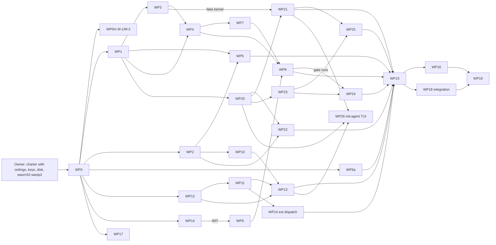

# Build-phase roadmap: milestones, parallel work, critical path, disk, risks

```
Status: v0.3 + build sync 2026-10-20 + M7 fold (m7-design.md §10) · Area: overview
Depends on: CONVENTIONS.md (v0.3), overview.md, spec v0.3 (Part I §10, §11; Part II §12–§19),
            adr/007-root-and-autonomy-ladder.md, every doc in docs/ (each work package implements one),
            root/root.md, root/egress.md, root/sealed-eval.md, evolution.md, testing.md,
            docs/reconciliation/*.md
Defines:    milestones M0–M11 and their definitions of done (Phase 0 = M0–M6; the ladder phases M7, M9,
            M10, M11); work packages WP0–WP26 (one crate/area each, including the `root` lane WP20–WP25 and the `init-agent` TUI, WP26)
            with inputs, outputs and estimates; the dependency graph and critical path; the agent lane
            plan; the disk plan; the risk burn-down tied to spec §11 and ADR-007; what the owner provides
            and when (the charter with its ceilings, the keys, the disk)
```

---

## 1. Purpose

Turn the docs into a running Phase 0 seed with the least wall-clock and money, without lowering quality. The build is done by several coding agents in parallel, one crate or area each, against contracts the docs already fix. This doc says who builds what, in what order, what "done" means, and what can go wrong.

Spec v0.3 changes the plan in three ways. Phase 0 now also builds the Root, `init-root`, in its own lane (spec §19). The owner's inputs shrink to the charter (with its ceilings), the keys and the disk, because every approval decision left the loop (spec §18). And the work after Phase 0 is organized by the autonomy ladder: agent-authored tasks (L1), the fleet (L2), kernel self-upgrade (L3), each built just before the agent can earn it.

## 2. Responsibilities / non-goals

**Owns:** milestones and their definitions of done (DoD), the work breakdown, dependencies, critical path, estimates, agent lanes, the build-phase disk plan, the risk burn-down, and the owner-input schedule.

**Non-goals:** the design of any component (each WP implements its doc); test definitions (testing.md); runtime budgets (evolution.md §3.14, kernel/config.md §4.3); the ladder's thresholds (spec §15, root/root.md).

## 3. Design

### 3.1 Principles

| Principle | What it means here | Quality guard |
|---|---|---|
| Contract-first parallelism | Every WP builds against a doc, not against another WP's code. Shared types land first (WP1). | A contract change goes through the owning doc first (CONVENTIONS §1), then code. |
| $0 first | The mock model, the fake body and the fake kernel (WP2, WP3) come before anything that would need a key. A2–A6 and every Root, ladder, mutation, audit and task-admission test run at $0 (testing.md §3.13–§3.17). | Real-model tests still run once per milestone that needs them (M3, M4, M6). |
| Long jobs on the critical path first | Kernel supervise → initctl server → gate G2/G3 → handoff is the longest chain; it starts at hour 0. | Off-path lanes absorb slips without moving the finish. |
| The Root is its own lane | `init-root` is built against root/root.md, root/egress.md and root/sealed-eval.md, and tested with `init-fakekernel`, so it never waits for the kernel lanes; the kernel lanes test under `init-fakeroot` (root/root.md X11; testing.md §3.5b), so they never wait for the Root. | The two meet at WP15 and WP18, where the full Root + kernel + body scenarios must pass; the fakes enforce nothing, so every security property is tested against the real `init-root`. |
| One writer per area | One agent per crate/area, its own git worktree and branch. The integrator is the only one who merges to `main` (single committer, as in INIT itself). | `ci fast` must pass before a merge; `ci full` before a milestone closes. |
| Shared build caches | One `CARGO_TARGET_DIR` per workspace for the build agents (§3.8). | Cargo's build-directory lock serializes concurrent builds; correctness is unaffected. |
| Measure before locking | M-1 and M-2 (testing.md §3.11) run at M0, before the body is written on top of wasmtime. | If they fail their thresholds, the stack decision is reopened (a maintainer decision, with the R1/R2 fallbacks ready) before M3. |
| Ladder just in time | Each level's mechanisms are built while the agent is still earning that level: the spec's hold periods (L1 held ≥ 30 days for L2, L2 held ≥ 60 days for L3) are the build window. | Each mechanism's $0 suite must pass before the ledger can reach its level; if a level unlocks early, its rights are simply not offered yet (the kernel lacks the commands), which is safe. |

### 3.2 Milestones

**Phase 0 (M0–M6), at L0:**

| M | Name | Definition of done (all must hold) | Agent-hours | Wall-clock (6 lanes) |
|---|---|---|---|---|
| **M0** | Preflight and skeleton | The owner has written the charter (§3.9.1; the values decided in v03-decisions D13), created the lineage mirror repo, stored the DeepSeek key with `init-root keys set deepseek`, freed disk to ≥ 35 GB (CONVENTIONS §5), installed `wasm32-wasip2` (`rustup target add`, ext/authoring.md §3.2) and set up the disposable test account (§3.9.1, testing.md §3.1a; not required for v0.1, which runs in owner-machine mode, ADR-008; required before `live-sweep` is ever enabled). Repo skeleton: `kernel/` workspace with `init-kernel`, `initctl`, `init-proto`, `init-testkit`; `root/` workspace with `init-root` (CONVENTIONS §2); `seed/` workspace with `init-body` and vendored `serde` 1.0.229, `serde_json` 1.0.154, `wasmtime` and `wasmtime-wasi` **=48.0.6** (LTS, ext/host.md §3.2), `wit-bindgen` =0.63.0 for extensions; `wit/init-ext/v1/` stub; all three workspaces `cargo build --offline` clean; **M-1 and M-2 measured** on the skeleton; free disk ≥ 20 GB after all of this | 5 | 0.5 day |
| **M1** | Contracts in code, $0 harness | `init-proto` types for initctl and the kernel JSON files with serde round-trip tests; `initctl` thin client; the WIT world file per ext/wit.md; `init-mockllm` (upstream and socket modes, provider.md §3.12 format, strict DeepSeek checks, probe/G3/task responders, cache simulation); `init-fakebody` (including `crash_first:<n>`), `init-fakekernel` and `init-fakeroot` (testing.md §3.5a, §3.5b); scenario runner with the Root steps; `init-root` skeleton: charter parsing (R5), R4 record types, owner socket, test mode, fake clock | 28 | end of day 1 |
| **M2** | Kernel core and Root core | **Kernel:** supervise under the Root (spawns through the Root's broker, readiness, heartbeat, exit codes, body backoff, the `body_safe` report, cold-start recovery from the Root's tuple, owner input relayed from the Root as `owner.in`, build slot with `cache/deps/`, `probe()`, install `--from-bundle`, lineage and `seed.git` from the Root's seed bundles); proxy features (routing, lanes, soft budgets clamped under the ceilings, stats, `cost_ref`, head hashes, traces, forwarding to the Root's egress socket); initctl server; the sandbox profiles (compiled into `init-root` per root/root.md X2) with `init-kernel doctor --sandbox-selftest`. **Root:** R1 (spawn broker, start, stop and sweep the agent zone, kernel crash-loop escalation, panic from every channel with the latch, owner I/O and `init-root attach`), R2 (keys, reservations and metering, hard ceilings per day and in total, compute, disk and body quotas, provider-only egress), R4 (hash-chained, signed lineage with verify and the published view). Tests: **owner-machine mode (v0.1, ADR-008):** a build without `live-sweep` may run on the owner's live account. Such a build signals only the pids the Root holds, and it is verified live by tests/rsafe.rs (the source audits, the sweep dry-run over the real process table, and the owner-machine variants of SW-1…SW-5) and tests/wp21.rs (RT-P*). The disposable-environment **SW-1…SW-6** (sweep safety, D1) are required before any build enables `live-sweep`, and no `live-sweep` build runs on the owner's live account. Then the sandbox suite with the S-Z group, F-crash-boot, F-hang, F-kill-kernel, RT-P1…P11, RT-C1…C10, RT-E1, RT-E2, T-S5…T-S8 (disposable), and the Root's unit tests and the kernel scenarios under `init-fakeroot` (live) | 55 | days 2–3 |
| **M3** | Seed body core | provider (DeepSeek chat completions, SSE, `reasoning_content` round trip), loop, the four file/shell tools, log with torn-tail recovery, context with byte-stable head, compaction, boot (probe mode, the `body/` resync script of evolution.md §3.6), `GENESIS.md`, `SELF.md`, the v0.3 constitution text (awareness.md §3.3; OW-1 pending, built as written), level and ceilings in the boot block and signals. Tests: seed L1 suite, **A1 (mock)**, **M-5** in socket mode, F-corrupt-tail, T-AW-12/13; **E2E-1..E2E-4** on DeepSeek (the key is in place from M0) | 26 | days 2–3 |
| **M4** | T1 extensions | ext host (Cranelift, pooling, `InstancePre`, epochs, `StoreLimits`, deny-by-default WASI, `init:ext/process`), `ext` tool, reload path, the separate extension workspace `seed/ext/` with its own `ext/Cargo.lock`, template and skill (CONVENTIONS §2, ext/authoring.md §3.3–§3.9). Tests: H0, H1, H23, **A2 (mock)**, A2b (scope `t1`), M-2 rerun through the real reload path, **M-3** (10 trials on DeepSeek) | 10 | days 3–4 |
| **M5** | T2, gate, handoff; whole-system rollback; minimal R6 and R7 | selfmap; gate G0–G3, G4 with the paired design and statistics (gate.md §3.7–§3.9), task import, notes, the mechanical resolution of inconclusive G4s (no owner `bless`/`reject`), LKG reports to the Root; `evo` validator and prediction data path; promote pipeline; overlapped handoff; data-only promotions with `bin/ext.d/` sets; provisional, probation, rollback; **Root:** whole-system LKG and rollback to audited-good, a stand-in sealed set S, M with the six mutant classes and three controls, the gate-of-gates harness run against the maintainer gate, a manual sealed audit, the L0 ledger with criteria evaluation and every demotion trigger wired. Tests (disposable environment wherever the real Root runs, testing.md §3.1a): **A2b, A3, A4, A5 (v0.3), A6 (mock)**, **M-4**, `g4-smaller`, G4-INC, OPT-SIG-1, RT-W1…W5, RT-L1…L7 and RT-L9 (test ledgers), MS-1…MS-7, MS-C1…C3, MS-G4 (baseline; MS-5 may fail, R15), SA-1…SA-5, F-kill-root, NO-OWNER-1, all of testing.md §3.8 green | 44 | days 4–5 |
| **M6** | Phase 0 exit | A1–A6 real variants once each (A5-real with external SIGKILL); E2E-5; measurements in `measurements/` and summarized in the docs; the Root's size measured against its per-module budget of ≈ 7,500 lines (R13; root/root.md §4.8; provisional owner decision 2026-10-20, owner may override; 7,085 at cdb49e8, where the table totals 7,540; re-measured at release); spec deltas from all docs folded into a spec v0.4 proposal (docs/spec-v0.4-proposal.md); `ci/local.sh` tiers and the GitHub `fast-linux` job green; disk cleanup done (§3.8.4); the Phase 0 report written (docs/phase0-report.md; the owner may read it; no sign-off is required). **v0.1 item** (owner decision 2026-10-20, CONVENTIONS §6 OW-TUI): the `init-agent` TUI (WP26, tui.md) green on TUI-1…TUI-14 and TUI-R1…TUI-R3; its 8 agent-hours are booked outside this column | 23 | day 5 |

Phase 0 = M0–M6: **≈ 191 agent-hours** (range 150–240), of which the new `root` lane is **≈ 32 agent-hours** (WP20–WP25; spec §19 estimates 25–35). Wall-clock is **≈ 5 calendar days** with six lanes, or about 3 days if lanes run around the clock. The owner has one checkpoint left, M0; v0.2's checkpoints at M3 (key and caps) and M6 (sign-off) are gone. Compared with v0.2's ≈ 151 agent-hours: +32 for the Root lane (including the sweep-safety tests of D1), +5 for the fake kernel, the fake Root, the Root steps and the live/disposable guard in the runner, +1 for the `root/` skeleton, +3 for scenario fixtures and the awareness texts, +3 for Root–kernel integration, and −4 because keys, money ceilings and panic moved out of the kernel lanes. WP18's integration buffer is booked at M6 in the table but is spent across M2–M6.

**After Phase 0, organized by the ladder** (estimates are rough until Phase 0's measured velocity is known):

| M | Name | Definition of done | Agent-hours | When |
|---|---|---|---|---|
| **M7** | Phase 1: the measuring stick, and L1 | The v0.2 Phase 1 items, as reshaped by m7-design.md (provisional owner decisions 2026-10-20, owner may override): the visible maintainer pool v1 (40 tasks) as G4's reject-only screen; **S v1** generated per install (pack `s1`: 32 G4 tasks, a 24-task held-out reserve, 4 canaries; drawn, calibrated and rotated by the Root); **G4 v2 with S-slice n = 32 + screen 12** at tiers 24×2 / **32×3** / 32×5 (`tier = auto`), the exact sign-flip test, the tie guard, cost per pass, incumbent-run reuse, per-run caps, the lineage ratchet and the milestone check, plus an A/A calibration per model before its first real gate (gate.md §3.7.1a, §3.8.3, §3.8.5, §3.9; root/sealed-eval.md §3.1.1, §3.5.1; replaces the earlier "n = 30 as 18 + 12, R = 3" and "pool ≥ 30, `margin_max = 0.10`"); the M7 work packages S1-CORE, S1-E, S1-B, S1-C, S1-T, ROOT-S1, GATE-V2, POOL-V1, L1-V2, DOC-M7, BENCH-V1, DEMO and REAL-M7 (m7-design.md §3.8, ≈ 202 agent-hours, ≤ $3.00 real, with the tests of testing.md §3.19); v0.1 keeps the 12-task stand-in S; δ history and `calibrate` runs queued by the kernel; offline prediction scoring; usage index and retirement; automatic upstream sync and the merge flow; thinning; WIT N/N−1; Linux sandbox (bwrap, Landlock, seccomp) and `full-linux` CI; S-L8 if the owner authorizes a VM. **Root:** full R6 (S seeded from public benchmark snapshots and maintainer tasks, refreshed by the Root; the scheduled weekly audit within its cap; δ_S calibrated), R3 action classes beyond the providers (RT-E3…E8), the ladder thresholds calibrated (ADR-007) and shipped in a Root release with `SUPPORTED_MAX_LEVEL = 1`. **L1 mechanisms:** `initctl task submit` with mechanical admission of task **families**, sealing a random half (D2), Root pre-registration anchored to the lineage `seq`, K = 5 promotions (D3), the agent-task stratum and `capability_gain` on the sealed half in G4, `audit_required` (TA-1…TA-18, SA-6, SA-7); per-subtask model routing; `initctl budget set` and `model set` | ≈ 75 | +6–9 days after M6 |
| **M8** | Phase 2: external validity | Harbor 0.24 installed agent wrapping INIT (static `x86_64-unknown-linux-musl` build) on an amd64 Linux host; ~30 TB2.1 tasks × {seed, evolved, mini-swe-agent} on the same model; report score, cost, wall-clock, cache hit | 20 | +3–5 days; needs the owner's authorization for the cloud host (§3.9.2) |
| **M9** | L2: the fleet | parallel explorer bodies, the archive, HGM-style selection, campaign accounting, the single committer under load, value-based growth of the evolution share (R7), online pass-rate scoring from fleet evaluations (evolution.md §3.15.5), a Root release with `SUPPORTED_MAX_LEVEL = 2`; FL-1…FL-3, RT-L8 | ≈ 40 (30–60) | start when the ledger shows L1 held ≥ 15 days, so it is ready before L2 can unlock at 30 days; skip if the charter's maximum is below L2 |
| **M10** | L3: kernel self-upgrade | `lineage/kernel.git` and the kernel worktree flow; `initctl kernel promote`; the kernel gate K0–K3; the full gate-of-gates (M, controls, reference agreement on a sample of S); the whole-system swap with probation; the sealed audit on every upgrade; maintainer kernel releases through the same path; gate.md's pool-versus-holdout divergence check so MS-5 passes (R15) (evolution.md §3.15.6), a Root release with `SUPPORTED_MAX_LEVEL = 3`; KU-1…KU-4, MS-G1…G3 | ≈ 60 (45–90) | start when the ledger shows L2 held ≥ 30 days (L3 needs 60); skip if the charter's maximum is below L3 |
| **M11** | L4: the model as a component | not designed (evolution.md §3.15.7 names the missing cross-model accept rule) | not estimated | after M10, if the charter allows L4 |

### 3.3 Work packages

Each WP is one agent's assignment. "Docs" are the agent's binding inputs, including the reconciliation ledger of their area. Estimates are agent-hours of focused work, including the WP's own tests.

| WP | Area / crate | Docs | Output | DoD (testing.md ids and the owning doc's tests) | Depends on | AH |
|---|---|---|---|---|---|---|
| WP0 | repo skeleton, vendoring | CONVENTIONS, ADR-005 | `kernel/`, `root/` and `seed/` workspaces, `seed/vendor/`, `wit/` stub, `.gitignore` for target dirs | all three workspaces build offline | owner disk and `wasm32-wasip2` (§3.9) | 3 |
| WP0m | measurements M-1, M-2 on the skeleton | testing.md §3.11, ext/authoring.md §3.6 | `measurements/m1.json`, `m2.json` | numbers recorded; thresholds evaluated | WP0 | 2 |
| WP1 | `init-proto`, `initctl` | kernel/initctl.md, kernel/supervise.md §4.3 | crates | L1 round-trip tests | WP0 | 3 |
| WP2 | `init-testkit`: `init-mockllm` | testing.md §3.4, body/provider.md §3.12, DeepSeek docs | binary + golden SSE files | mock self-tests; split-fuzz of its own streams; responders | WP0 | 8 |
| WP3 | `init-testkit`: fake body, **fake kernel**, **fake Root** with the mock egress, scenario runner with Root steps and the live/disposable guard (testing.md §3.1a), `INIT_FAULT` mechanism | testing.md §3.1a, §3.5–§3.8, root/root.md (Root–kernel contract, draft), kernel/proxy.md Q-TS1 | lib + bins | runner executes a fake-body scenario, a fake-kernel Root scenario and a kernel scenario under the fake Root; SW-6 (a disposable scenario refuses to start in the live account) | WP1 | 11 |
| WP4 | `kernel-supervise` (owner channel for task text, `install`, lineage, build slot, deps cache, `probe()`, sweep, body backoff, crash-loop report and drain/pause/stop under the Root) | kernel/supervise.md, ADR-001, evolution.md §3.5–§3.7 | module | supervise.md §8 SV-*; F-crash-boot (c); F-hang (a, b); F-kill-kernel at `supervise.*` | WP1, WP3 | 14 |
| WP5 | `kernel-proxy` features (lanes, routing, soft budgets, traces, head hash, forwarding to the Root's egress socket; tested under `init-fakeroot`) | kernel/proxy.md, ADR-002, kernel/config.md | module (tokio, hyper; no TLS, which lives in the Root's egress) | proxy.md §8; loopback mock behind the proxy; soft caps → typed 429 (RT-C1) | WP1, WP2 | 10 |
| WP6a | `root/sandbox-profiles` (the Seatbelt texts, composition and validation, which the Root owns since v0.3) for macOS + `doctor --sandbox-selftest` | kernel/sandbox.md | Seatbelt profiles, launcher, selftest | sandbox.md §8 S-M*, S-B*, S-G*, S-X* on macOS; T-S5…T-S8 once the Root's paths exist | WP0 | 8 |
| WP6b | `kernel-sandbox` Linux | kernel/sandbox.md | bwrap + Landlock + seccomp | S-L* on Linux CI | WP6a | 6 (M7) |
| WP7 | `kernel-serve` (initctl server, jobs, lanes) | kernel/initctl.md | server | initctl.md §8 IC-*; error envelope | WP1, WP4 | 4 |
| WP7b | `init-kernel` binary (lane K1): WP7's initctl server wired over the real supervisor in `init-kernel supervise --under-root`; data-only t0/t1 promotions | kernel/initctl.md, kernel/supervise.md §3.6.8 | `kernel/crates/init-kernel/src/serve.rs` (`KernelBackend`); an e2e test | e2e at $0: the real `initctl` against the real `init-kernel` under `init-fakeroot` and `init-mockllm`, promote t0 → LKG; 104 supervise tests green | WP7, WP8b | n/a |
| WP8 | `kernel-gate` (modules `gate` and `evo`) | kernel/gate.md, evolution.md §3.2, §3.8–§3.12 | G0–G4, statistics, task import, mechanical inconclusive handling, notes, LKG reports to the Root; validator; prediction data path | gate.md §8 G-*; evolution.md §8; A4; A6 G0 cases; G4-INC | WP4, WP9, WP7 | 16 |
| WP8b | `kernel-gate` G2, G3, the G4 driver, record and notes, and `kernel-supervise::promote` (lane K1): the T2 promote pipeline | kernel/gate.md, evolution.md §3.5–§3.8 | gate stages; `promote()`, `gate_quick`, `rollback`, `run_g4_job`, `provisional_watch`; gate records and `refs/notes/gate` | G-31/A3 (T2 path to LKG at $0, `tests/promote.rs`), G-46, F1–F4, F7, F9, F11, F13, F14, F16 | WP8, WP4, WP7 | n/a |
| WP8c | `kernel-gate::judge` (lane K1): `init-kernel gate judge`, the gate-of-gates entry | kernel/gate.md §4.1a, root/sealed-eval.md | `kernel/crates/kernel-gate/src/judge/{mod,tree,exec,relay}.rs`; CLI `init-kernel [-c k=v]… gate judge` | gate-of-gates with the real judge: M1–M7 rejected, C2 and C3 accepted (C1 after FIX2) | WP8b, WP24 | n/a |
| WP9 | `kernel-selfmap` | kernel/selfmap.md | `self.json` generator, markers, drift check (the capability field when selfmap.md v0.3 fixes it) | selfmap.md §8; WIT export extraction | WP0, WP14 (WIT only) | 5 |
| WP10 | body `provider` | body/provider.md | DeepSeek adapter | provider.md §8; mock A1; E2E-1/2 | WP2 | 6 |
| WP11 | body `loop` + `tools` | body/loop.md, body/tools.md | loop, five tools | loop.md §8, tools.md §8 | WP12 | 7 |
| WP12 | body `log` + `context` | body/log-context.md | log, context, compaction | log-context.md §8 | WP0 | 8 |
| WP13 | body boot + awareness files | body/boot.md, awareness.md, evolution.md §3.6 | boot sequence incl. resync script, `GENESIS.md`, `SELF.md`, the v0.3 constitution, the autonomy, ceilings, level-change and capability lines, signals with level and ceiling | boot.md §8; F-corrupt-tail; awareness.md T-AW-1…T-AW-15 | WP10, WP11, WP12 | 5 |
| WP14 | WIT world, ext host, extension workspace `seed/ext/` + skill | ext/wit.md, ext/host.md, ext/authoring.md, CONVENTIONS §2 | WIT file, host, template | host.md §8 (H0, H1, H23 …); A2 | WP0, WP11 (dispatch) | 10 |
| WP15 | scenarios A1–A6 (A5 and A6 in their v0.3 form), fixtures, patches, G4 fixture tasks, charter fixtures, stand-in S and M fixtures, NO-OWNER-1 | testing.md §3.6, §3.9, §3.13–§3.17 | `scenarios/`, `scripts/`, `fixtures/` | each scenario green against the real stack | WP3 + the WPs each scenario exercises | 10 |
| WP16 | `init-measure`, M-3/M-4/M-5 runs | testing.md §3.11 | bin + results | M-4, M-5 pass; M-3 reported | WP15, the key (M0) for M-3 | 4 |
| WP17 | CI: `ci/local.sh`, `.github/workflows/ci.yml` | testing.md §3.12 | scripts + workflow | `fast-linux` green on GitHub | WP0 | 2 |
| WP18 | integration and bug-fix buffer, including Root–kernel integration | all | merges, fixes | milestone DoDs | all | 19 |
| WP19 | Phase 0 report, spec v0.4 proposal, cleanup | all docs | docs updates | M6 DoD | M5 | 4 |
| **WP20** | `init-root` skeleton: the `root/` workspace binary, charter (R5) parsing and validation, owner socket and CLI (`keys set`, `status`, `panic`, `resume`), test mode, fake clock, install | root/root.md, spec §13–§14, §18 | crate | the Root's charter unit tests; charter fixtures parse | WP0, WP1 | 4 |
| **WP21** | R1: the spawn broker, agent-zone supervision (start, stop, sweep), owner I/O, panic from every channel with the latch, crash-loop escalation and system safe mode, whole-system tuples, LKG and rollback to audited-good | root/root.md | module | SW-1…SW-5 (first, disposable), RT-P1…P11, RT-W1…W5, A5 (v0.3), F-kill-root | WP20, WP3 (fake kernel) | 9 |
| WP21b | `init-root` install path (lane X): `init-root install --seed-source <repo or bundle>`, the install-mode kernel, the genesis tuple | root/root.md §4.3 steps 5–10, §4.4; kernel/supervise.md §3.11.4, §4.8 | `install.rs`, `cli.rs`, `tuple.rs`, `sup.rs` in `root/crates/init-root/` | Slice-1 mock green through the install path with no workarounds (cold install 172 s); `owner.sock` opens at once | WP21, WP4 (`install --from-bundle`) | n/a |
| **WP22** | R2 and minimal R3: egress gateway (keys, metering forwarder, hard money ceilings per day and in total, compute and disk quotas, body count), egress limited to the model providers, test-mode loopback upstreams | root/egress.md | module | RT-C1…C10, RT-E1, RT-E2 | WP20, WP2 | 7 |
| **WP23** | R4: hash-chained, signed lineage; verify; the read-only view for the agent zone; optional off-machine mirror (off unless the charter configures it) | root/root.md | module | the Root's R4 unit tests; `r4.verify` in every RT scenario | WP20 | 3 |
| **WP24** | minimal R6: the S format and a stand-in S, M's six generators and three controls, the gate-of-gates harness against the current gate, the manual sealed audit | root/sealed-eval.md | module + fixtures | MS-1…MS-7, MS-C1…C3, MS-G4, SA-1…SA-5 | WP23, WP2; WP4 + WP8 for the runs against the gate | 6 |
| **WP25** | minimal R7: the ledger at L0, criteria evaluation (capped by the charter's maximum), every demotion trigger wired to R1, publication of the level to the kernel, test ledgers (`init-root test ledger`) | root/root.md | module | RT-L1…L7, RT-L9 | WP21, WP23 | 3 |
| **WP26** | the `init-agent` TUI (lane TUI): the owner's terminal client, a separate workspace `tui/` with crate and binary `init-tui`, opened by the `init-agent` launcher; never linked into `init-root`; reaches only `ROOT_HOME/run/owner.sock` | tui.md, root/root.md §3.9, §3.15, §4.2, kernel/supervise.md §3.10, §4.5, §4.6, body/loop.md §4.1 | `tui/` (own `Cargo.lock`; `ci/vendor.sh --sync tui/Cargo.toml`, 11 new vendored crates), golden snapshots, the fixture server, `tests/pty_drive.py`; if accepted, the Root and kernel deltas of tui.md §9 Q1–Q2 | tui.md §8: TUI-1…TUI-10 and TUI-14 (fast tier), TUI-11…TUI-13 under `init-fakeroot` with the real kernel, body and mock (full tier), TUI-R1…TUI-R3 against the real Root in test mode | WP20, WP21, WP13 | 8 |
| S1 | Slice-1 end-to-end integration (lane S1): real `init-root` → `init-kernel` → `init-body` → mock model, then one real DeepSeek call (cap $1) | BUILD_PLAN.md, root/root.md, kernel/supervise.md | `scripts/slice1/{s1.sh, drive.py, zonecheck.py, collect.py, seedpack.py}`, `tests/slice1/`, `build/status/S1.md` | mock run green (`hello.txt` = `INIT`, 2 turns); real run green (`deepseek-flash`, 2.39 s, under $0.01, key never echoed) | WP4, WP5, WP7, WP20–WP22 (mock); WP13 (real) | n/a |
| FIX1 | `kernel-serve` and `root/sandbox-profiles` (lane B1): the kernel serves `run/kernel.sock` inside the zone (S1 gap 3; cause: the kernel's `chmod` of `run/`, denied by tail Z4) | S1 gap 3, kernel/sandbox.md §3.3, root/root.md §3.3.2 | `prepare_lane_dir` in `kernel-serve/src/server.rs`; 20 new self-test rows (S-Z8e–o, S-M39b–h, S-M49j, S-M57g); no profile text changed | self-test 222 pass, 0 fail, 11 skipped; `sandboxed_lane` test; a body pings the kernel over initctl in a mock run | WP6a, WP7, S1 | n/a |
| FIX2 | `kernel-gate` (lane K1): decision D14, a half-task noise floor on the pool-versus-holdout divergence guard only | kernel/gate.md §3.8.3, root/sealed-eval.md §3.3 | `stats::boot::delta_min`, `accept::SplitStats`; gate record fields `delta_min_permille` and `delta_floored_permille` | gate-of-gates with the real judge `pass:true` (C1 accepted); false-accept rates unchanged in all 16 cells; G-21 and G-49 unchanged | WP8c | n/a |
| FIX3 | body boot (lane B2): the real extension host wired into boot; the `t_aw_5` probe fix; the `cap` line fallback; the A2 core path | body/boot.md, ext/host.md, awareness.md | `seed/src/boot/ext.rs`, `rootview.rs`, `awareness.rs`; `seed/tests/boot.rs` | seed suite green twice (unit 269, boot e2e 16, `self_md` 8); a mock turn calls the real `count-lines` with the prefix unchanged | WP13, WP14 | n/a |
| FIX4 | Slice-1 harness on the real install path, and faster tuple hashing (lane X) | build/status/S1.md gaps, root/root.md §4.3 | `scripts/slice1/s1.sh`, `tests/slice1/`; `[profile.dev.package.sha2]` and its hashing crates at `opt-level = 3` in `root/Cargo.toml` | `fakebody` and `mock` green through `init-root install --seed-source`, with no workarounds; Root start to ready 1.5–1.7 s (was 9.8–25 s); watchdog and `realdry` cases pending | WP21b, S1 | n/a |
| FIX5 | `init-root` (lane B1): `proposal.file` on the control link, and a larger stand-in S | root/root.md §4.1.3, §3.12.4, root/sealed-eval.md §3.3 | `sup.rs::proposal` (stored in `ROOT_HOME/state/proposals/`, lineage record `proposal{id, title, sha256, bytes}`, alert, never applied, at most 5 per rolling 24 h); `tests/fix5.rs`; stand-in S of 12 tasks plus the canary (8 pool, 4 holdout) | `fix5` test; gate-of-gates with the real judge `pass:true`, 0 disagreements; C1 accepted and M3 rejected on all 495 holdout draws | WP21, WP24, WP8c, FIX2 | n/a |

Sum of WP0–WP25 without WP6b: **191 agent-hours**, of which WP20–WP25 are 32. The milestone column of §3.2 sums to the same 191. Plan with ≈ 190. WP7b, WP8b, WP8c, WP21b, S1 and FIX1–FIX5 were added during the build (BUILD_LOG.md). They carry no estimate here, so the sum is unchanged. WP26 (owner decision 2026-10-20) carries 8 agent-hours (≈ 6.5 for the TUI, ≈ 1.5 for the Root and kernel deltas of tui.md §9 Q1–Q2), booked as a v0.1 item outside the 191.

### 3.4 Dependency graph



The key no longer gates anything after M0: it is stored with the charter, before the first build.

### 3.5 Critical path

```
WP0 (3) → WP1 (3) → WP3 core (2) → WP4 supervise (14) → WP7 serve (4) → WP8 G2/G3 + handoff glue (8)
        → WP15 A3/A4/A5 + Root integration (5) → WP18 fixes (9) → WP19 (4)          ≈ 52 agent-hours
```

- WP8's G0, G1, G4, statistics and the `evo` validator (8 of its 16 AH) run in lane K2 in parallel with WP4, against fixture repos and synthetic data; only G2/G3 need supervise's `probe()`.
- WP3 is split: its process and event-matching core (2 AH) goes first so WP4 can start at hour 8; the fake Root follows by hour ≈ 10 (WP4 runs under it), and the fake kernel by hour ≈ 12, in time for WP21.
- **The `root` lane is near-critical.** WP0 → WP1 → WP20 (4) → WP22 (7) → WP21 (8) → WP23 (3) → WP25 (3) → WP24 (6) is ≈ 37 hours from the start. WP15's critical part (A3/A4/A5 with the Root, from about hour 34) needs only WP21, WP22 and WP25, which are done by about hour 31. WP24 (done at about hour 37–40) is needed only by WP15's MS and SA scenarios near WP15's end (about hour 44), so the lane's slack is small, about 4–7 hours. WP24's runs against the gate also wait for WP4 and WP8. Mitigation: WP24 builds the generators and the audit harness on fixtures first, and runs them against the gate last.
- The body chain WP0 → WP12 (8) → WP11 (7) → WP10 (6, parallel with WP11 after WP2) → WP13 (5) is ≈ 22–26 AH and joins at WP15 with ~20 hours of slack. The proxy and sandbox lane (WP2, WP5, WP6a, WP17) is ≈ 28 AH, ~15 hours of slack. WP14 has ~15 hours.

The critical path is ≈ 52 agent-hours ≈ 52–68 wall-clock hours (1.0–1.3 wall-hours per agent-hour, for builds serialized on the shared target dirs and integration waits).

### 3.6 Agent lanes and schedule

Six build agents plus the integrator (the lead session), each lane in its own git worktree (§4.1):

```
Hour:      0    6    12   18   24   30   36   42   48   54   60   66
Lane K1    WP0 WP1 WP3core ─WP4 supervise──────────────── WP7 ─WP8 G2/G3 + handoff──
Lane K2         WP0m   WP9 selfmap ─WP8 G0/G1, evo, G4 + statistics ───────────
Lane P          WP2 mockllm ── WP5 proxy ─────────── WP6a sandbox ─── WP17 ──
Lane B          WP12 log/context ──── WP11 loop/tools ──── WP10 ── WP13 ──────
Lane X          WP3 rest + fakes ─ WP14 WIT/host/layout ─────── WP15 scenarios ── WP16
Lane R          WP20 ─ WP22 egress ─── WP21 R1 ─────── WP23 ─ WP25 ─ WP24 R6 ──
Integrator      merges · ci fast · milestone checks ──────────── WP18 ────── WP19
Milestones   M0 ─────── M1 ───────────── M2/M3 ─────────── M4 ────── M5 ──── M6
```

Lane totals (agent-hours): K1 34, K2 15, P 28, B 26, X 33, R 32, integrator 23.

- **Projected wall-clock:** M0 at +0.5 day, M1 end of day 1, M2/M3 days 2–3, M4 days 3–4, M5 days 4–5, M6 day 5 (calendar days; the only owner checkpoint is M0).
- **Agent quota.** The owner's plan quota is a budget (owner instructions). Before the fan-out, check plan usage and keep the burn under (100 − used − 10%) / minutes-to-reset. If the window is tight, run four lanes (K1, B, X, R) and fold P and K2 into them: Phase 0 then takes ≈ 8 calendar days; the critical path is unchanged because it lives in K1, and R keeps its own lane because it is near-critical. The live-spend lane (real-model tests) has priority over deferrable lanes.
- **Progress reporting.** The integrator reports per-lane % (WP AH done / WP AH planned) and a clock-time ETA re-projected from the observed rate every ~5 minutes of active work, and says when and why it slips.

### 3.7 Integration protocol

1. Each lane works on branch `build/<wp>` in worktree `../INIT-wt/<wp>` (outside the repo dir, sibling of it).
2. Before asking for a merge, the lane runs `ci fast` for its workspace and its WP's DoD tests.
3. The integrator merges into `main` in dependency order, runs `ci fast` on `main`, and runs `ci full` at each milestone.
4. A lane that needs a contract change stops, writes the change as a cross-doc question in the owning doc, and the integrator resolves it in the reconciliation ledger. Only a question about the charter itself (purpose, ceilings, classes, maximum level, panic channels) goes to the owner. No lane edits another lane's crate.
5. Workspace manifest conflicts (`members`, shared dev-deps) are resolved only by the integrator.
6. Fixture patches for A3/A4/M-4 are regenerated by WP15 whenever WP11–WP13 change `loop.rs` or the boot sequence (testing.md §5).
7. The Root lane and the kernel lanes meet through root/root.md's Root–kernel contract (§4.1 there). Until the contract settles, the Root lane tests against `init-fakekernel` and the kernel lanes under `init-fakeroot`; both fakes are updated with every contract change, and WP18 owns the first joint run.

### 3.8 Disk plan

#### 3.8.1 Starting point and target

Free disk on the M2: **17 GiB on 2026-10-20 at 01:03 +07** (`df -h /`; 9.3 GiB on 2026-10-19 at 20:2x, 8.0 GiB at 21:54, 9.6 GiB at 22:0x, 15 GiB at about 00:3x on 2026-10-20; other sessions were writing). The floor during the build is **20 GB free at all times**, and M0 needs **≥ 35 GB free to start** (CONVENTIONS §5, settled in R2). The build is still blocked until the owner frees about 18 GB more. The kernel also has its own floors: builds and promotes are refused below 5 GiB (`supervise.disk.min_free_build_gib`) and G4 does not launch runs below 10 GB (`gate.g4.min_free_gb`); both sit below the 20 GB build-phase floor.

#### 3.8.2 Peak usage budget (estimates until M-1 measures them)

| Item | Path | Estimate | Basis |
|---|---|---|---|
| `wasm32-wasip2` target | `~/.rustup/toolchains/…/rustlib/wasm32-wasip2` | 0.1–0.3 GB | UNVERIFIED; measured in WP0 |
| Vendored seed deps | `seed/vendor/` | 0.3–0.6 GB | UNVERIFIED (wasmtime 48 + cranelift + wasmtime-wasi tree) |
| Kernel target dir (debug) | `kernel/target/` | 1–2 GB (measured ≈ 5.4 GB per lane with wasmtime and the testkit, build 2026-10-20) | tokio, hyper, serde, sha2, wasmtime (selfmap) |
| Root target dir (debug) | `root/target/` | 0.5–1 GB | UNVERIFIED; depends on root/egress.md's TLS and HTTP choices (likely the kernel's set) |
| Disposable test account (D1) | its own `~/.rustup` (toolchain + `wasm32-wasip2`) and target dirs | 3–5 GB | the build artifacts the disposable scenarios need are rebuilt in that account; UNVERIFIED until M0 |
| Root blob stores (`ROOT_HOME/store/`, one per test Root) | the owner's `~/.init-root` and each scenario's `<scenario>-<pid>.root` | 0.5–2 GB | up to `store_keep_tuples` (5) tuples of debug binaries; capped by `quotas.store_max_gib` (8); scenario stores are deleted with their homes |
| Seed target dir (debug, deps at opt-level 2) | `seed/target/` | 2–4 GB | wasmtime + cranelift; UNVERIFIED |
| Extension builds (wasm32) | in `seed/target/` and test homes' `work/target/` | 0.5–1 GB | ext/authoring.md §3.6 |
| Template test home | `fixtures/homes/seed-default` built once, incl. `cache/deps/<key>/` | 2–4 GB | one warm dependency set (supervise.md §3.6.2 keeps ≤ 3 keys) |
| Active scenario homes | `$INIT_TEST_SCRATCH/` | 1–3 GB transient | APFS clones of the template (`install --template`); only changed blocks cost space; deleted by exact path on success |
| Build-agent worktrees | `../INIT-wt/<wp>` × 6 | 0.1 GB total | sparse checkout excludes `seed/vendor/` outside the body and ext lanes |
| Measurement target dirs | `measurements/tmp/target-m1`, `target-m2` | 2–4 GB transient | deleted by exact path after each measurement |
| Disk-full test image | `$SCR/initfull.dmg` | 0.25 GB transient | deleted after the test |
| **Peak** | | **≈ 14–27 GB** | |

**Required free disk at M0 start: ≥ 35 GB** (20 GB floor + ~15 GB typical peak; settled, CONVENTIONS §5). If M-1 measures a larger peak, the integrator runs measurements and the disk-full test only when no scenario homes exist, and drops to the four-lane plan, before the 20 GB floor is ever crossed.

#### 3.8.3 Rules every lane follows

- **One shared `CARGO_TARGET_DIR` per workspace** for the build agents: `kernel/target` for every kernel-crate lane, `root/target` for the root lane, `seed/target` for the body and ext lanes (set in each worktree's environment, pointing at the main checkout's dir). Cargo's lock on the build directory serializes concurrent builds; the cost is wall-clock on collisions, not correctness.
- Test homes never share the build agents' target dirs: the kernel builds candidates only in its own slot, warmed from its own `cache/deps/` (supervise.md §3.6.2). That keeps "the agent cannot poison the gate's build" true in tests too.
- The Root's private test directories live beside each scenario home under `$INIT_TEST_SCRATCH/`, never inside it, and are deleted with it by exact path.
- Before every build or test run: `df -k` check; stop and tell the integrator if free < 22 GB (floor + 2 GB margin).
- **Live-system safety** (CONVENTIONS §1, D1): a lane runs every `"env": "disposable"` scenario only in the disposable account (testing.md §3.1a), and in the owner's account it signals or deletes only what it created and holds by PID or exact path. No `pkill`, `killall` or pattern kills anywhere.
- Big artifacts stay off the M2: Phase 2 Docker images (TB2 task images are amd64-only and several GB) run on a cloud sandbox or an amd64 VM (§3.9.2).

#### 3.8.4 Cleanup (exact paths only)

| When | What | How |
|---|---|---|
| after each scenario (success) | its `INIT_HOME` and its Root directory | the runner deletes `$INIT_TEST_SCRATCH/<scenario>-<pid>` and `$INIT_TEST_SCRATCH/<scenario>-<pid>.root` by exact path |
| after each measurement | `measurements/tmp/target-m1`, `target-m2` | `rm -rf` of those exact paths |
| after the disk-full test | `$SCR/initfull` mount and `$SCR/initfull.dmg` | `hdiutil detach`, then `rm` of the exact file |
| after a WP merges | its worktree and branch | `git worktree remove "../INIT-wt/<wp>"`, `git branch -d build/<wp>` |
| at M6 | kernel, root and seed target dirs if free disk < 25 GB | `cargo clean --manifest-path kernel/Cargo.toml`, `--manifest-path root/Cargo.toml` and `--manifest-path seed/Cargo.toml` |
| never | anything that might be the only copy (measurement JSON, failed-scenario homes kept for debugging) | moved to the Trash and listed for the owner |

Not ours to delete: the owner already has a second toolchain (`1.98.0-aarch64-apple-darwin`) and the `x86_64-pc-windows-gnu` target (≈ 130 MB) installed. Listing them is the owner's call; the plan does not touch them.

### 3.9 What the owner provides, and when

Spec v0.3 §18: the owner's work is O(1). At install the owner writes the charter (including the ceilings; its values were decided on 2026-10-20, v03-decisions D13), creates the lineage mirror repo and stores the keys; after that nothing is required. The machine also needs the disk freed, one toolchain target added and the disposable test account set up, because build agents do not install toolchains, change system settings or delete the owner's files. v0.1 does not need the disposable account: it runs in owner-machine mode (ADR-008); the account is needed before `live-sweep` is ever enabled. The constitution text itself stays PENDING OWNER (OW-1): the owner reads it on GitHub.

#### 3.9.1 M0 inputs: the charter, the keys, the disk

| Input | What (root/root.md §3.12.1 keys) | Recommended Phase 0 value | Why |
|---|---|---|---|
| Charter: purpose | `purpose.text` | about 100 words, the vision of spec §12 in the owner's words | it goes into the agent's cached head after the constitution (awareness.md §3.3); every word is paid on every request |
| Charter: constitution text | `constitution.text` (default: awareness.md §3.3, 649 words) | **PENDING OWNER (OW-1)**: the owner reads it on GitHub; the default is built in meanwhile | the agent's rules, held by the Root |
| Charter: money ceilings | `money.day_usd`, `money.total_usd`, `money.day_starts_at_utc_offset` | **"5.00"** a day, **"25.00"** total (decided by the owner, v03-decisions D13), `"+07:00"` | the kernel clamps its soft budgets under them at run time ($4.00 a day after the $1.00 request cap); the ≈ $2–7 expected Phase 0 spend (testing.md §3.10) fits the total, and every real-model run fits one day; a $25 prepaid DeepSeek top-up is a second backstop |
| Charter: quotas | `quotas.parallel_bodies`, `max_instances`, `cpu_core_hours_day`, `disk_min_free_gib`, `init_home_max_gib`, `store_max_gib` | the template's defaults: 4 (used from L2; L0–L1 always get 1), 12, 48, 20, 80, 8 | they match the build-phase disk floor and leave room for G4's four parallel runs plus probes |
| Charter: external-action classes | `actions` (schema: root/egress.md) | **model providers only** (the default), plus the built-in `crates` read class (D10) | spec §19: R3 starts there |
| Charter: maximum level | `autonomy.max_level` | **4** (decided, D13 CH-1) | the agent still starts at L0 and climbs only on its measured record; the effective cap is min(4, the Root release's `SUPPORTED_MAX_LEVEL`), which is 0 in the Phase 0 Root |
| Charter: panic | owner socket, `SIGUSR1`, latch (always on); `panic.watch_paths`, `panic.mirror_ref` (optional) | the three always-on channels; a panic demotes one level, an ordinary `init-root stop` does not (decided, D13 CH-2) | redundancy costs nothing; `stop` is the everyday halt |
| Charter: lineage mirror | `mirror.url` and the Root's own deploy key | the new private repo **`nagisanzenin/INIT-Lineage`**, created by the owner at M0 and pushed only by the Root (decided, D13 CH-3) | off-machine, tamper-evident lineage from the first record |
| Keys | `init-root keys set deepseek` | the DeepSeek key, typed by the owner into the Root's prompt, never into chat or any config file | the Root holds keys (spec §14 R2); real-model tests run from M3 without a later checkpoint |
| Disk | ≥ 35 GB free (17 GiB on 2026-10-20) | free ≈ 18 GB more | CONVENTIONS §5 |
| Toolchain target | `rustup target add wasm32-wasip2` | once | M-2 and M4 need it; agents do not install toolchains |
| Disposable test environment (D1) | a dedicated non-admin macOS user account (recommended name `inittest`) with its own Rust toolchain and `wasm32-wasip2`, and the root-owned sentinel file `/var/db/init-test-disposable` holding that account's uid (testing.md §3.1a) | create once at M0; a macOS VM is a stronger alternative if one is available. Not required for v0.1 (owner-machine mode, ADR-008); required before `live-sweep` is ever enabled | every sweep-kill test and every `live-sweep` build must run there (CONVENTIONS §1 live-system safety); a process in another account cannot signal the owner's processes. Since ADR-008, scenarios that run a Root built without `live-sweep` may run live (testing.md §3.1a). About 3–5 GB of disk |

**Gone from the owner in v0.3:** approving this plan; OW-2 (the genesis prompt is agent-editable seed data; awareness.md proposes dropping the decision); E1/ET-E1 as caps (now the charter's ceilings); ET-E2, the G4 model (a maintainer default at L0, the agent's routing from L1); ESC-1 crate approval and ESC-2 `/opt/homebrew` (both settled as L0 rights); the M4 confirmation of M-3 spend (inside the ceilings); the M6 sign-off; the M7 authorization for `calibrate` spend (inside the ceilings; raise the total ceiling to about $45 if the owner wants Phase 1 to run without pausing on it); and the per-campaign cap for open-ended search (the L2 fleet runs inside the ceilings).

#### 3.9.2 Still the owner's, outside the evolution loop

These are spend on build infrastructure, not INIT's own spend, so they follow the owner's global rule (explicit authorization with a $ cap). None blocks Phase 0.

| When | What | Blocks |
|---|---|---|
| By M7 (optional) | CI hardware (ET-E4): hosted macOS runners on release tags (≈ $7/month) or nothing; a short-lived Linux ≥ 7.1 VM for S-L8, or defer | paid CI only; the local tiers cover Phase 0 and Phase 1 |
| Before M8 | Phase 2 authorization with a $ cap for the amd64 host: a cloud sandbox Harbor supports (Daytona, Modal, E2B) or a rented amd64 Linux VM. Model spend for 90 trials ($4–15 on `deepseek-v4-pro` off-peak, $1–4 on `deepseek-flash`; research estimate, 2× at peak) runs inside the charter's ceilings, which may need raising for it | M8 |
| Any time (optional) | read the reports; raise or lower ceilings or lower the maximum level (`init-root charter check --apply`); `/panic`; `init-root stop` for an everyday halt | nothing |
| When the maintainer ships one (optional) | install a release with `init-root install --upgrade --release <dir>`: a new Root, a new kernel (it then passes the gate-of-gates, probation and a sealed audit, root/root.md §3.8) or a new seed bundle. Installing is not reviewing (spec §18) | only the features in that release |

### 3.10 Risk burn-down (spec §11, ADR-007)

| Risk / hypothesis | Retired or measured at | Evidence that retires it | Fallback if it fails |
|---|---|---|---|
| **R1** Models writing Wasm components is unmeasured (spec §11) | M0 (M-2), M4 (M-3) | warm build ≤ 5 s (C1); M-3 ≥ 6/10 and C2/C3 not triggered | ext/authoring.md §3.10: a JavaScript engine inside a Wasm component (QuickJS, else boa) |
| **R2** Wasmtime makes the clean build heavy (spec §11) | M0 (M-1) | cold build < 10 min, target dir < 4 GB | trim wasmtime features (ext/host.md decides); the deps cache keeps gate builds warm |
| **R3** Weak models get worse with self-modification (spec §11) | M3 (boot model check), M4 (M-3 per model) | DeepSeek models pass the boot table; M-3 shows usable success | treat DeepSeek runs as plumbing tests and defer self-modification claims to a frontier-model run (inside the ceilings) |
| **R4** Headline numbers are self-reported on small subsets (spec §11) | M8 | INIT's own TB2.1 subset with three bodies | — (this is what Phase 2 is for) |
| **R5** No head-to-head restart vs in-process study (spec §11) | M5–M6 (partial) | handoff latency, failed-swap count, zero lost conversations in A3/A4/F-kill-kernel | accepted residual risk; recorded in metrics |
| **R6** Disk (spec §11) | M0 precondition (settled: ≥ 35 GB, CONVENTIONS §5) | ≥ 35 GB free at start; never below 20 GB | four-lane plan; measurements only between scenario runs |
| **H1** Kernel-generated self-map with drift gate (T1 from WIT) | M5 | G1 drift test; A2b `self.json` lists exports from the kernel-built component | self.json T1 part from the component's embedded WIT only |
| **H2** `Compensates-for` tags and thinning | M7 (mock model change), first real model change | thinning state machine on mock; one real thinning cycle | keep tags as documentation only |
| **H3** Provisional fast lane, G4 deferred | M5 | A3 provisional; rollback on a G4 reject; `dep` scope already synchronous | run G4 synchronously for all code changes (slower, same safety) |
| **H4** Cost-then-size tie-break under non-inferiority | M7 | gate.md's calibration test G-21 (false-accept ≤ 7% at n = 16) and stable decisions on repeated runs | score-only accept with δ |
| **H5** Overlapped handoff for an agent | M5 | A3, A4, F9/F10, M-4, zero lost events | stop-then-start swap with rollback (spec v0.1 design) |
| **R7** DeepSeek thinking mode needs `reasoning_content` echoed with tools | M1 (mock strict check), M3 (E2E-2 both modes) | no HTTP 400 in E2E-2 | `thinking: disabled` for Phase 0 |
| **R8** TB2 task images are amd64-only | M8 planning | Harbor smoke run on the chosen amd64 host | the `apple-container` backend needs arm64 images, so no local fallback; cloud host required |
| **R9** Linux sandbox on hosted CI (AppArmor userns) and S-L8 needing Linux ≥ 7.1 | M7 | `full-linux` green; S-L8 run once on a ≥ 7.1 host | Linux sandbox tests on a VM; S-L8 deferred (Linux is the second platform) |
| **R10** Agent plan quota during fan-out | M0 | usage check before fan-out | four-lane variant |
| **R11** G4 resolution at Phase 0 sizes: ≈ 17–20 points of pass rate with 16 tasks (gate.md §3.8.5) | M7 | G4 v2 on S v1 with its power stated per tier (standard 32 × 3: ≤ 5% false `better`, 80% power at ≈ +17 points), G-21b, the A/A calibration and the real null-change G4; smaller gains accumulate through the ratchet and are confirmed at the milestone check (m7-design.md §3.2.6, §3.2.13) | inconclusive results get one escalated re-run, then the incumbent wins; never auto-accepted |
| **R12** `ext/Cargo.lock` member entries classified as `dep` | closed before M0 | gate.md §3.1 adopted ext ledger E10 (source-less entries are not dependency changes) | — |
| **R13** The Root outgrows its budget (spec §13). The v0.3 estimate was 1,000–1,500 lines. The budget is now ≈ 7,500 as per-module sub-budgets of measured + 5% (root/root.md §4.8), a provisional owner decision of 2026-10-20 that the owner may override. The count at cdb49e8 is 7,085 (the table totals 7,540), with core 1,656 of a 1,770 budget. | M5 (feature-complete for Phase 0), M6 (measured), each release (re-measured) | root/root.md §4.8's count (non-blank, non-comment, outside `#[cfg(test)]`) is within every module's sub-budget and the ≈ 7,500 total at M6. The core subtotal (zone, sup, panic, egress money, lineage verify) is ≤ 1,770. `root/sandbox-profiles` is counted on its own lines. `rootloc` enforces it in `ci/local.sh` (WP17). | move anything that is not control (spec §12) back to the kernel; a bigger Root is a bigger thing the agent can never fix |
| **R14** The ladder's unlock thresholds are placeholders (ADR-007) | M7 | thresholds calibrated on Phase 1 data and shipped in the Root release that raises `SUPPORTED_MAX_LEVEL` | a Root release never raises the supported level before its thresholds are calibrated (§3.9.1) |
| **R15** The v0.2 gate does not reject every mutant class; answer-key caching (MS-5) is the likely gap | M5 (MS-G4 baseline), M10 | gate.md's pool-versus-holdout divergence check; MS-5 passes; mutation pass rate 100% | L3 cannot unlock below 100% (spec §15), so the gap blocks only kernel self-upgrade, never safety; a spec §17 change may also be needed (evolution.md §9) |
| **R16** A noisy sealed audit causes false demotions (stand-in S is ≈ 10 tasks at Phase 0) | M5 (SA-5), M7 | δ_S calibrated on the real S; SA-5's A/A false-trigger rate ≈ 0 | Phase 0 audits are manual and L0 cannot drop further, so a false trigger costs one rollback, not a level |
| **R18** A test of a sweep or kill rule damages the owner's live system (it happened on 2026-10-20: 33 processes SIGKILLed, Docker Desktop among them) | M0 (disposable account), M2 (SW-1…SW-6) | SW-1…SW-5 pass in the disposable environment for every `init-root` build before it runs live; SW-6 shows the runner refuses disposable scenarios in the live account. v0.1 (ADR-008): the rule binds `live-sweep` builds; a build without the feature signals only held pids and runs live after the owner-machine variants SW-1o…SW-8o pass (testing.md §3.13.0) | never run a `live-sweep` Root on the live account; keep the fake Root for live testing of anything else that kills |
| **R17** The Root runs as the owner's OS user, so the sandbox is the whole boundary between the agent zone and the Root | M2 (T-S5…T-S8, RT-P5, RT-C2), every sandbox-suite run | the sandbox suite and the Root attack tests stay green | accepted residual risk, as in v0.2; a separate OS user for the agent zone is a later hardening option |
| **R-ROOT-1** The sealed set needs sources outside the agent's influence (ADR-007) | from M7, for as long as the audit exists | the Root refreshes S from new public benchmark releases and maintainer tasks; from M7, S v1 instances are drawn per install from pack generators and rotated 25% per epoch, and each pack release adds ≥ 20 templates so the next reserve stays held out (m7-design.md §3.1) | if sources dry up, the audit weakens; record S's age in every audit report so the weakening is visible |

```
Open risk count by milestone (risks still open after the milestone closes)
M0   ████████████████████████ 24 → 20   (R2 measured, R6 cleared, R10 checked, R12 closed)
M2   ████████████████████     20 → 19   (R18)
M3   ███████████████████      19 → 17   (R3, R7)
M4   █████████████████        17 → 16   (R1)
M5   ████████████████         16 → 12   (H1, H3, H5, R13)
M6   ████████████             12 → 11   (R5 recorded)
M7   ███████████              11 → 5    (H2, H4, R9, R11, R14, R16)
M8   █████                     5 → 3    (R4, R8)
M10  ███                       3 → 2    (R15)
Open after M10: R17 (accepted residual) and R-ROOT-1 (monitored for as long as the audit exists)
```

## 4. Interfaces

### 4.1 Build-phase conventions

| Item | Value |
|---|---|
| Lane branch | `build/<wp>` (e.g. `build/wp4-supervise`, `build/wp21-root-r1`) |
| Lane worktree | `../INIT-wt/<wp>` (sibling of the repo checkout) |
| Kernel target dir | `CARGO_TARGET_DIR=<repo>/kernel/target` for every kernel lane |
| Root target dir | `CARGO_TARGET_DIR=<repo>/root/target` for the root lane |
| Seed target dir | `CARGO_TARGET_DIR=<repo>/seed/target` for body and ext lanes |
| Commit identity | the agent's normal identity for the maintainer repo (not `INIT Agent`, which is reserved for the running agent's own commits) |
| Milestone tag | `m0` … `m6` on `main` after the DoD holds; `m7` onward per ladder milestone |

### 4.2 Lane briefing template (what each build agent receives)

```
WP: <id and title>                Lane: <K1|K2|P|B|X|R>
Read first: CONVENTIONS.md, overview.md, spec v0.3 Part II (§12–§19), ADR-007, <docs listed for the WP>,
            the reconciliation ledger of the area (docs/reconciliation/<area>.md), testing.md sections <…>
You own: <crate/module paths>. Do not edit anything else; raise contract changes as
         cross-doc questions in the owning doc.
Build: worktree ../INIT-wt/<wp>, branch build/<wp>, CARGO_TARGET_DIR=<shared dir>.
Disk: run `df -k /` before each build; stop if free < 22 GB. No toolchain installs.
Done when: <DoD tests>, `ci fast` green.
Report: % of planned AH done and ETA every ~5 minutes of active work.
```

### 4.3 Milestone check commands

| M | Command(s) that must pass |
|---|---|
| M0 | `cargo build --offline` in all three workspaces; `cargo run -p init-testkit --bin init-measure -- m1 m2` |
| M1 | `cargo test -p init-proto -p initctl -p init-testkit`; `cargo test --manifest-path root/Cargo.toml` (charter, R4 types) |
| M2 | live: `cargo test -p init-kernel`; the kernel scenarios under `init-fakeroot`; owner-machine mode (ADR-008): `cargo test --offline -p init-root --features test-fixtures --test rsafe --test wp21`. Disposable account (required before `live-sweep` is enabled): `INIT_TEST_ENV=disposable cargo test -p init-testkit --test root sw_` first, then `init-kernel doctor --sandbox-selftest`, `--features fault-injection --test fault supervise_`, `--test root rt_p rt_c rt_e` |
| M3 | seed `cargo test --offline`; `--test acceptance a1`; `init-measure m5`; real: `--test real e2e_` |
| M4 | `--test acceptance a2`; real: `init-measure m3` |
| M5 | live: `--test acceptance` for the `"env": "live"` scenarios. Disposable account: `--test acceptance` (all), `--features fault-injection --test fault`, `--test root` (all SW, RT, MS, SA, NO-OWNER-1, OPT-SIG-1, G4-INC), `init-measure m4` |
| M6 | `ci/local.sh full`; real: `--test real`; the R13 line count |

## 5. Failure modes and recovery (schedule)

| Problem | Effect | Response |
|---|---|---|
| M-1/M-2 exceed thresholds at M0 | stack lock in doubt | stop before M3; the maintainer picks the R1/R2 fallback; kernel and root lanes continue (unaffected) |
| The key is not stored at M0 | no E2E | the mock path continues; M3 closes "mock-complete", E2E moves to M6 |
| The charter is not written at M0 | the Root has no ceilings | the build runs on `fixtures/charters/phase0.toml` in test mode, which refuses real keys; no real-model test runs until the owner writes the charter |
| root/root.md's Root–kernel contract is not settled when the lanes need it | Root and kernel drift apart | the Root lane builds against the draft and `init-fakekernel`, the kernel lanes under `init-fakeroot`; WP18 reconciles at the first joint run; the contract change goes through root/root.md first |
| MS-5 fails on the v0.2 gate at M5 | the baseline mutation pass rate is below 100% | recorded as the baseline (R15); not an M6 blocker, because only L3 needs 100% |
| Contract gap found mid-lane | lane blocked | the lane switches to tests/fixtures for its WP while the owning doc is updated |
| Shared target-dir lock contention | slower builds | stagger heavy builds; never give lanes private target dirs (disk) |
| Quota tight mid-fan-out | lanes stall | drop to four lanes; K1 and R keep priority |
| Disk approaches the floor | builds must stop | cleanup per §3.8.4; then pause the lowest-priority lane |

## 6. Performance notes (spec §9)

| Rank | Built in | Proven at |
|---|---|---|
| 1 cache stability | WP12 (head), WP8 (G2 head hashes of both arms, continuity), WP14 (stable `ext` schema), WP13 (level and ceilings at the tail, never in the head) | M-4, A2, A3 (M5) |
| 2 round trips | WP22 (persistent upstream connections in the Root's egress, surviving body and kernel restarts; root/egress.md), WP5, WP11 (parallel tools) | E2E stats (M3) |
| 3 tool path | WP11 (in-process file tools, sandbox set up once), WP6a | A1 `gap_ms` from the mock log (M3) |
| 4 self-edit latency | WP4 (build slot warmed from `cache/deps/`), WP8 (staged early exit) | M-1, A3 gate timings (M5) |
| 5 footprint | WP12 (bounded log view) | M-5 (M3) |

## 7. Invariants and security (spec §2.1, mapped to the Root by spec §19)

| Invariant → Root responsibility | First proven at | Test |
|---|---|---|
| #1 Recoverability → R1 | M2 (panic, fake kernel), M5 (whole-system rollback, real stack) | RT-P1…P8, RT-W1…W4, A4, A5, F-kill-kernel, F-kill-root |
| #2 Honest measuring stick → R6 | M5 | A6 steps 2 and 7; sandbox S-M22–25, S-G2; MS-*, SA-* |
| #3 Blast radius → R2, R3 | M2 | sandbox.md §8 suite, T-S5…T-S8, A6 steps 1, 3, 4, 8; RT-C*, RT-E1, RT-E2 |
| #4 Lineage → R4 | M2 (chain), M5 (records from the real stack) | the Root's R4 tests, `r4.verify` in every RT scenario, the evo validator suite, A3 notes and `refs/init/archive/*` |
| Charter → R5 | M1 | the Root's charter tests, T-S5, T-AW-8 |
| Ladder → R7 | M5 (L0, test ledgers) | RT-L1…L7 |
| #5 "A human only where irreversible" → R3 classes in the charter | M5 | provisional refusal test (`E_PROVISIONAL`), RT-E1/E2, NO-OWNER-1 |

## 8. Test plan

Each milestone's DoD is its test list (§3.2, §4.3). The milestone is closed by the integrator only after `ci full` passes on `main` and, for M3/M4/M6, the real-model tests listed there pass inside the charter's ceilings. Component docs name testing.md scenario ids in their test plans (adopted in R1 by provider, loop, tools, boot, host, wit, authoring; the root docs are asked to adopt RT-*, MS-*, SA-* and TA-*).

## 9. Open questions

**Within this doc**
1. Six lanes or four? Depends on the owner's plan quota at M0 (§3.6). The root lane keeps its own lane in both plans.
2. Should WP6b (Linux sandbox) move into Phase 0? Spec §2 makes Linux second; the plan keeps it in M7 to protect the critical path.
3. M9 and M10 start on ledger signals (L1 held ≥ 15 days, L2 held ≥ 30 days). Are those the right lead times? They assume each milestone takes about half of the next level's hold period; revisit with M7's real velocity.
4. Is a separate macOS user account enough as the disposable environment for the Root's Seatbelt tests, or is a macOS VM needed? It stops a wrong sweep from reaching the owner's processes (different uid), but it shares the disk and `/tmp`. Recommendation: the account at M0, a VM later if one becomes available.
5. With the disposable account's toolchain and target dirs, the build peak rises by about 3–5 GB. Is ≥ 35 GB free at M0 still enough? The 22 GB stop rule protects the floor either way; 40 GB would remove the need to pause lanes.

**Cross-doc**
- **→ root/root.md:** the Root–kernel contract (WP21, WP4, both fakes); the fake clock and test ledgers that testing.md still needs; the D13 template values (max level 4, panic demotes, the `nagisanzenin/INIT-Lineage` mirror, $5 and $25) written into its §3.12.2 template.
- **→ root/egress.md:** confirm that the persistent upstream connections live in the Root (§6), so a kernel restart costs no new TLS handshake.
- **→ root/sealed-eval.md:** the stand-in S and M fixtures for Phase 0 (WP24), and how S is seeded from public benchmark snapshots at M7.
- **→ kernel/proxy.md, kernel/supervise.md:** kernel tests run under `init-fakeroot` (§3.7 item 7); the kernel needs no standalone mode.
- **→ CONVENTIONS §2 and §6:** the `root/` workspace line lists `crates/init-proto/` and `crates/init-testkit/` under it, while every doc places them in `kernel/`; and §6's pending table still lists OW-2, E1/ET-E1, ET-E2 and ET-E4 as owner decisions: E1 is settled by D13, ET-E2 is a maintainer default, OW-1 (the constitution) stays pending, and §3.9.1 shows the rest.

## 10. Spec deltas

| Spec | This doc | Why |
|---|---|---|
| v0.2 §10 Phase 0 "≈ 2–3 days of build work" | ≈ 191 agent-hours, ≈ 5 calendar days with 6 lanes (≈ 3 days round the clock) | includes the $0 test kit, fault injection, measurements, the gate statistics, and the Root lane |
| v0.3 §19 "about +25–35 agent-hours on Phase 0, for a new `root` lane" | WP20–WP25 = 32 agent-hours; net Phase 0 growth +40 over v0.2's 151, because integration (+3), fixtures and texts (+3), the fakes and the runner's live/disposable guard (+5) and the `root/` skeleton (+1) come on top, and the kernel lanes lose 4 | the Root's code is not the only cost of adding it |
| v0.2 §10 precondition "≥ 20 GB free" | ≥ 35 GB free at M0 start, never below 20 GB during the build | the floor must hold at peak usage (settled, CONVENTIONS §5) |
| v0.2 §10 precondition "owner authorization and a dollar cap for test model spend" | the charter's money ceilings are that authorization; no separate approval | spec v0.3 §14 R2, §18 |
| v0.2 owner inputs at M0, M3, M4, M6, M7 (plan approval, decisions OW-1/OW-2/E1/ET-E1/ET-E2/ESC-1/ESC-2, key by M3, spend confirmations, sign-off) | M0 only: the charter (with ceilings and the constitution), the keys, the disk and one toolchain target | spec v0.3 §18: O(1) human role |
| v0.2 §10 Phase 2 "Terminal-Bench 2.x through Harbor" | TB2.1 (`terminal-bench/terminal-bench-2-1`, 89 tasks) on an amd64 host | TB2 task images are amd64-only; TB2.1 is the maintained 2.x board |
| v0.2 §10 Phase 3 "open-ended search" | split onto the ladder: M9 (L2 fleet), M10 (L3 kernel self-upgrade), M11 (L4), each started from a ledger signal | spec v0.3 §15 |
| v0.2 §10 Phase 1 | M7 also builds the L1 mechanisms (agent-authored tasks, routing, budget allocation), full R6 and R3 classes, and calibrates the ladder thresholds | spec v0.3 §15–§17; ADR-007 |
| (new) owner terminal | WP26, the `init-agent` TUI (tui.md), a v0.1 item at M6, 8 agent-hours outside the Phase 0 sum | owner decision 2026-10-20 (CONVENTIONS §6 OW-TUI) |

**Build sync 2026-10-20** (build → docs; ledger reconciliation/build-deviations.md §1.22):

| Build ref | This doc now says | Section |
|---|---|---|
| build: WP6a D1, WP8 header | The kernel lanes are library crates (`kernel-supervise`, `kernel-proxy`, `kernel-serve`, `kernel-gate` with its `gate` and `evo` modules, `kernel-selfmap`; `kernel-sandbox` for WP6b). WP6a's macOS Seatbelt texts, composition and validation are `root/sandbox-profiles`, which the Root owns since v0.3. | §3.3 |
| build: BUILD_LOG | Rows added for the WPs the build created: WP7b, WP8b, WP8c, WP21b, S1, FIX1, FIX2, FIX3, FIX4, FIX5. They carry no estimate. | §3.3 |
| build: WP24 Size (orchestrator note) | M6 and R13 say the Root measured ≈ 6,450 lines, against the 1,000–1,500-line budget, which is under owner review (build-deviations.md §3.1). No new number is set. | §3.2, §3.10 |
| build-deviations §3.1, §3.2 (provisional owner decisions 2026-10-20, owner may override) | M6 and R13: the Root budget is ≈ 7,500 per module, measured + 5% (root.md §4.8); 7,085 at cdb49e8 (table total 7,540), re-measured at release. M7: G4 defaults n = 30, R = 3, plus an A/A calibration per model, once S has ≥ 30 tasks. M6 names docs/spec-v0.4-proposal.md and docs/phase0-report.md. | §3.2, §3.10 |
| build-deviations §6.4, ADR-008 (provisional owner decision 2026-10-20) | v0.1 needs no disposable account (owner-machine mode); the account and SW-1…SW-6 stay required before `live-sweep` is ever enabled | §3.2 M0, §3.9, §3.9.1, §3.10 R18 |

**M7 design 2026-10-20** (m7-design.md §10, folded by lane DOC-M7; provisional owner decisions 2026-10-20, owner may override; CONVENTIONS §6):

| Was | This doc now says | Section |
|---|---|---|
| M7: G4 n = 30 as 18 + 12, R = 3; pool ≥ 30 and `margin_max = 0.10` | S-slice n = 32 + screen 12, tiers 24×2 / 32×3 / 32×5; S v1 generated per install; the lineage ratchet and the milestone check; m7-design.md's work packages | §3.2 M7 |
| R11 retired by pool ≥ 30 and `margin_max = 0.10` | retired by G4 v2's stated power, G-21b, the A/A calibration and the real null-change G4 | §3.10 |
| R-ROOT-1 fed by public snapshots only | also per-install draws from pack generators, rotation and new templates per pack release | §3.10 |

## 11. References

All checked 2026-10-19 unless marked.

- Spec v0.3 Part II §12–§19 and adr/007-root-and-autonomy-ladder.md (read 2026-10-20). root/root.md, root/egress.md and root/sealed-eval.md were being written in parallel on 2026-10-20; the WPs bind to them by responsibility (R1–R7).
- Local disk: `df -h /` on the owner's M2 (9.3 GiB free at 20:2x +07, 8.0 GiB at 21:54 +07 and 9.6 GiB at 22:0x +07 on 2026-10-19; 17 GiB at 01:03 +07 on 2026-10-20).
- Local toolchain: `rustc 1.97.1 (8bab26f4f 2026-07-14)`; installed targets `aarch64-apple-darwin`, `x86_64-pc-windows-gnu` (`rustup target list --installed`).
- crates.io versions: wasmtime 49.0.3 is the newest, 48.0.6 the LTS chosen by ext/host.md §3.2; wasmtime-wasi likewise; wit-bindgen 0.63.0; serde 1.0.229; serde_json 1.0.154; tokio 1.53.3; hyper 1.12.0; rustls 0.23.46; sha2 0.11.1 — https://crates.io/api/v1/crates/<name>
- Harbor (repo `harbor-framework/harbor`; PyPI `harbor` 0.24.0, 2026-10-05; Python ≥ 3.12): https://github.com/harbor-framework/harbor ; https://pypi.org/pypi/harbor/json
- Harbor custom installed agents (upload a binary, `exec_as_agent`): https://github.com/harbor-framework/harbor/blob/main/docs-mintlify/agents/custom-agents.mdx
- Harbor sandboxes (docker default; daytona, modal, e2b; apple-container needs arm64): https://github.com/harbor-framework/harbor/blob/main/docs-mintlify/sandboxes/pre-integrated-sandboxes.mdx
- TB2.1 dataset (89 tasks): https://github.com/harbor-framework/terminal-bench-2-1
- TB2 task images amd64-only (sample): https://hub.docker.com/v2/repositories/alexgshaw/regex-log/tags/20251031
- Terminal-Bench leaderboard per-trial cost and time: https://www.tbench.ai/?version=2.1
- DeepSeek pricing: https://api-docs.deepseek.com/quick_start/pricing/
- GitHub Actions pricing and billing: https://docs.github.com/en/billing/reference/actions-runner-pricing ; https://docs.github.com/en/billing/concepts/product-billing/github-actions
- Spec v0.2 §10–§11; testing.md; evolution.md; kernel/supervise.md §3.6–§3.7, §4.8; kernel/gate.md §3.1, §3.8.5; kernel/proxy.md §3.3; ext/host.md §3.2; ext/authoring.md §3.2–§3.10; reconciliation ledgers (2026-10-19).
